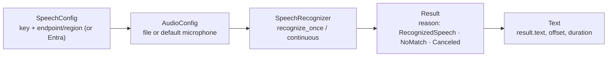
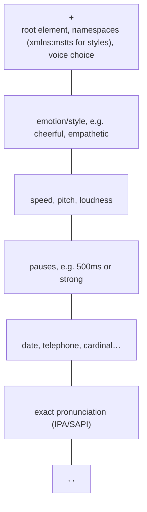

# Speech to text and text to speech

> AI-103 · D4 Implement text analysis solutions · about 75 min · Study Hub module `t03` ([open the hub](https://claude.ai/artifact/TdpMZLFYA9knTdjNyCms9F))

## Why it matters
"Convert speech to text and text to speech for agentic interactions" and "custom speech models". You'll see Speech SDK classes, result reasons, SSML elements and the newer OpenAI-family audio models.

## Pre-question (answer before reading)
**Q:** `recognize_once_async().get()` returns a result with reason `NoMatch`. What happened?

<details><summary>Answer</summary>

Audio was received, but **no speech could be recognised** (silence, noise, or the wrong language). `Canceled` would indicate an error such as bad credentials or a network problem.

</details>

## Mental model & story
Speech has two directions. **Speech to text (STT)** is a court stenographer; **text to speech (TTS)** is a narrator. Azure gives you two families of each.

The **Azure Speech** service (Speech SDK) is the mature stenographer: real-time recognition from a microphone or file, **continuous** recognition with events for long audio, **fast transcription** for files, and **batch transcription** for many stored recordings. When your callers use domain words (drug names, part numbers) or have noisy lines, train a **custom speech** model with sample audio plus human transcripts, or related text, and point the SDK at its endpoint.

Its narrator speaks with **neural voices** (including HD and custom neural voices). **SSML**, an XML markup, is the director's script: choose the voice, add a speaking **style** (`mstts:express-as`, e.g. cheerful), change **prosody** (rate, pitch, volume), insert **breaks**, control how numbers and dates are read (`say-as`), and fix pronunciations (`phoneme`).

The newer generative family works through the OpenAI SDK: **gpt-transcribe** for offline STT (it replaces gpt-4o-transcribe 2025-03-20, which retires on 15 Oct 2026; files up to 25 MB), **gpt-4o-transcribe-diarize** to label speakers, and **gpt-4o-mini-tts** for TTS that accepts plain-English **instructions** like "speak calmly, like a nurse". There's also an **Azure Speech MCP server** so agents can transcribe and synthesise, storing audio in a Blob container via a SAS URL.

**Where the analogy breaks:** A stenographer asks you to repeat yourself. Recognition just returns its best guess, so check `reason`, consider confidence, and design the conversation to confirm critical values such as amounts and dates.

## Diagrams
**Speech SDK recognition**



**SSML building blocks**



## Key points
- `SpeechConfig(subscription=key, endpoint=...)` (or region); `AudioConfig(filename=...)` or default mic; `SpeechRecognizer(speech_config, audio_config)`; `recognize_once_async().get()` for one utterance.
- Result reasons: **RecognizedSpeech** (`result.text`), **NoMatch** (speech not recognised), **Canceled** (error; read `CancellationDetails` for reason and error details).
- Long audio: **continuous recognition** (`start_continuous_recognition_async` + `recognized`, `canceled`, `session_stopped` events). Many stored files: **batch transcription** (async REST, files in storage via SAS). Single files quickly: **fast transcription**.
- TTS: `SpeechSynthesizer(speech_config, audio_config)` with `AudioOutputConfig(use_default_speaker=True)` or a filename; `speak_text_async(text).get()`; reasons **SynthesizingAudioCompleted** or **Canceled**; `audio_config=None` keeps audio in `result.audio_data`.
- Voice: `speech_config.speech_synthesis_voice_name = "en-US-AvaMultilingualNeural"` (locale-name-variant pattern; HD and custom neural voices exist). Output format: `set_speech_synthesis_output_format(SpeechSynthesisOutputFormat.Riff24Khz16BitMonoPcm)`.
- SSML via `speak_ssml_async(ssml)`: `voice`, `mstts:express-as` (needs the `mstts` namespace), `prosody`, `break`, `say-as`, `phoneme`, `emphasis`, `lexicon`, `audio`.
- **Custom speech**: improve accuracy for vocabulary, accents and noise; train with audio + human-labelled transcripts (or plain related text), evaluate, deploy a custom endpoint, and use its endpoint ID in `SpeechConfig`.
- Generative audio (OpenAI SDK): `client.audio.transcriptions.create(model="gpt-transcribe", file=...)` → `.text` (prompt and language hints where the model supports them); diarisation with `gpt-4o-transcribe-diarize`; TTS `client.audio.speech.with_streaming_response.create(model="gpt-4o-mini-tts", voice=..., input=..., instructions="Speak calmly")`.
- **Azure Speech MCP server**: tools to recognise (WAV, MP3, OGG, FLAC, MP4, M4A, AAC) and synthesise (to Blob); needs a Storage container **SAS URL** with read/write/add/create/list: treat it as a secret with a short expiry.

## Comparisons
**Speech SDK vs generative audio models**

|  | Azure Speech (SDK) | gpt-transcribe / mini-tts |
|---|---|---|
| Strengths | Real-time streaming, custom speech, SSML control, many voices | High accuracy on messy audio, natural TTS steered by instructions |
| Customisation | Custom speech models, custom neural voice | Prompt hints; instructions for tone |
| Speaker labels | Diarisation features | gpt-4o-transcribe-diarize |
| Fine control of pronunciation | SSML phoneme/lexicon | Limited |

## Code to recognise
**Recognise speech, handle every outcome**

```python
import azure.cognitiveservices.speech as speechsdk

speech_config = speechsdk.SpeechConfig(subscription=key, endpoint=endpoint)
audio = speechsdk.audio.AudioConfig(filename="call.wav")
recognizer = speechsdk.SpeechRecognizer(speech_config=speech_config, audio_config=audio)

result = recognizer.recognize_once_async().get()
if result.reason == speechsdk.ResultReason.RecognizedSpeech:
    print(result.text)
elif result.reason == speechsdk.ResultReason.NoMatch:
    print("No speech could be recognised")
elif result.reason == speechsdk.ResultReason.Canceled:
    details = result.cancellation_details
    print(details.reason, details.error_details)
```

- Line 3: Key + endpoint (or region); Entra auth is also possible.
- Line 4: File input; `use_default_microphone=True` for live audio.
- Line 7: `.get()` waits for the async operation to finish.
- Line 10: NoMatch: audio, but nothing recognisable.
- Line 12: Canceled: errors such as bad keys or network failures.

**SSML with a style and a pause**

```xml
<speak version="1.0" xmlns="http://www.w3.org/2001/10/synthesis"
       xmlns:mstts="https://www.w3.org/2001/mstts" xml:lang="en-US">
  <voice name="en-US-AvaMultilingualNeural">
    <mstts:express-as style="cheerful">
      Your order has shipped!
    </mstts:express-as>
    <break time="500ms"/>
    It arrives on <say-as interpret-as="date" format="mdy">10/12/2026</say-as>.
    <prosody rate="-10%">Track it any time in the app.</prosody>
  </voice>
</speak>
```

- Line 2: The mstts namespace is required for express-as styles.
- Line 4: Speaking style (voice-dependent).
- Line 7: Pause between sentences.
- Line 8: Read the value as a date.
- Line 9: Slow down slightly.

## Portal steps
**Try speech in Foundry** (Foundry portal > Build > Tools / Speech playground)

1. Try real-time transcription and TTS voices.
2. Build a custom speech model: upload audio + transcripts, train, test word error rate, deploy an endpoint.
3. Copy the endpoint ID into your `SpeechConfig`.

## Worked example
**Scenario:** A pharmacy hotline's transcripts misrecognise drug names, and callers have strong regional accents.

- Domain vocabulary + accents → recognition accuracy issue.
- Custom speech adapts acoustic and language models with your audio and transcripts or related text.
- Deploy a custom endpoint and point the SDK to it; measure word error rate before and after.

**Answer:** Train a **custom speech** model with representative call audio + human transcripts (plus drug-name text), deploy its endpoint, and use it in `SpeechConfig`.

## Your turn (faded example)
**Scenario:** An app must say "Your code is 4 7 1 9" digit by digit and pause before it.

- You'll use SSML.
- **Which element adds the pause?** <details><summary>answer</summary>`<break time="500ms"/>` (or a strength).</details>
- **Which element reads digits individually?** <details><summary>answer</summary>`<say-as interpret-as="digits">4719</say-as>` (or telephone/characters forms).</details>

## Exam traps & misconceptions
- ✗ Treating NoMatch as an error. → ✓ Canceled indicates errors; NoMatch means nothing recognisable was heard.
- ✗ Forgetting the mstts namespace when using express-as. → ✓ Styles need `xmlns:mstts`.
- ✗ Using real-time recognition for 10,000 archived recordings. → ✓ Batch transcription handles many stored files asynchronously.
- ✗ Using fine-tuning to fix drug-name recognition. → ✓ Custom speech is the speech-specific adaptation.
- ✗ Sharing a long-lived SAS URL with the Speech MCP server. → ✓ Treat SAS as a secret with short expiry and minimal permissions.

## Discussion prompts
- **When would you choose gpt-4o-mini-tts over a neural voice with SSML?** When natural, expressive speech steered by plain instructions matters more than exact control. SSML neural voices give precise pronunciation, timing and style controls, plus custom voices.
- **How do you make voice interactions in an agent safer?** Confirm critical values back to the user, handle NoMatch/low confidence by asking again, avoid reading out sensitive data, and log transcripts with privacy controls.

## Interview angle / teach-back
**Prompt:** Explain how to transcribe a call and read a reply aloud with the Speech SDK, including error handling and SSML.

**Rubric:** SpeechConfig + AudioConfig + SpeechRecognizer · Check result.reason: RecognizedSpeech / NoMatch / Canceled · SpeechSynthesizer + voice name; speak_text_async / speak_ssml_async · SSML elements: express-as (mstts namespace), prosody, break, say-as · Custom speech for domain vocabulary

**Model answer:** Create a SpeechConfig with the key and endpoint, an AudioConfig for the file or mic, and a SpeechRecognizer. Call recognize_once_async().get() and check the reason: RecognizedSpeech gives text, NoMatch means nothing recognisable, Canceled means an error. To reply, set a voice name and use a SpeechSynthesizer with speak_text_async, or speak_ssml_async to control style (express-as with the mstts namespace), prosody, pauses and how numbers are read. For domain vocabulary, train a custom speech model and use its endpoint.

## Quick Q&A
- **Result reason for errors?** Canceled (read CancellationDetails).
- **Long audio in real time?** Continuous recognition with events.
- **Thousands of stored files?** Batch transcription.
- **SSML style element?** `mstts:express-as` (needs mstts namespace).
- **SSML pause?** `<break>`.
- **Read as date/digits?** `<say-as interpret-as=...>`.
- **Fix domain vocabulary?** Custom speech model.
- **Speaker labels with generative STT?** gpt-4o-transcribe-diarize.

## Sources (accessed 2026-10-02)
- [Lab: Recognize and synthesize speech](https://microsoftlearning.github.io/mslearn-ai-language/Instructions/Exercises/04-azure-speech.html)
- [Lab: Use speech-capable generative AI models](https://microsoftlearning.github.io/mslearn-ai-language/Instructions/Exercises/03-gen-ai-speech.html)
- [Lab: Use Azure Speech in an agent](https://microsoftlearning.github.io/mslearn-ai-language/Instructions/Exercises/05-azure-speech-mcp.html)

## SRS cards created
- ai-103-t03-01, ai-103-t03-02, ai-103-t03-03, ai-103-t03-04
