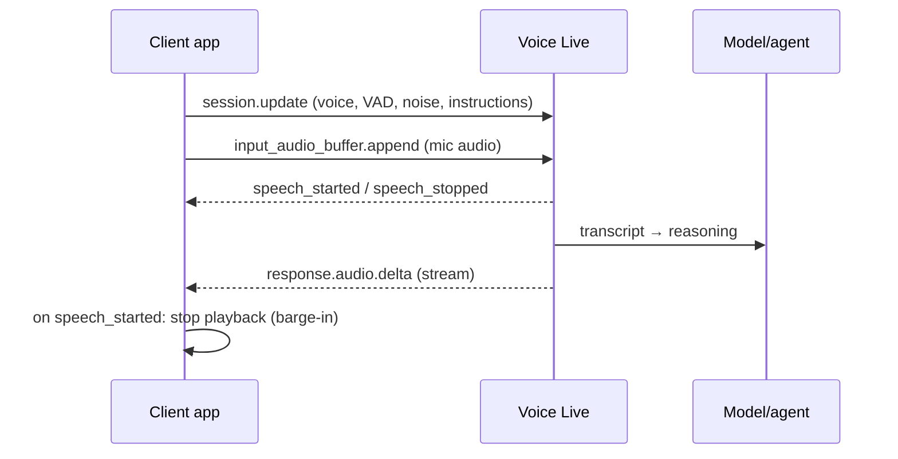

# Voice agents and reasoning over audio

> AI-103 · D4 Implement text analysis solutions · about 60 min · Study Hub module `t04` ([open the hub](https://claude.ai/artifact/TdpMZLFYA9knTdjNyCms9F))

## Why it matters
"Integrate speech as an agent modality" and "enable multimodal reasoning from audio inputs". The star is **Voice Live**: real-time speech-to-speech for agents, with turn detection, noise suppression and barge-in.

## Pre-question (answer before reading)
**Q:** In a voice assistant, the user starts talking while the agent is still speaking. What should the app do, and which event tells it?

<details><summary>Answer</summary>

Stop playback immediately (**barge-in**). The server event `input_audio_buffer.speech_started` signals that the user started speaking.

</details>

## Mental model & story
A text chatbot is a pen pal; a voice agent is a **phone call**. Phone calls need things text never did: knowing when someone has finished speaking (**turn detection**), ignoring the dog barking (**noise suppression**), not hearing your own voice back (**echo cancellation**), and stopping when the caller interrupts (**barge-in**).

**Voice Live** is a managed real-time speech-to-speech service in Foundry. Your app opens a WebSocket session, sends a `session.update` describing modalities, voice, instructions, audio format and turn detection, then streams microphone audio (`input_audio_buffer.append`). The service transcribes, reasons with a generative model (or with an existing **Foundry agent**), and streams audio back (`response.audio.delta`).

The recommended turn detection is **Azure semantic VAD**, which listens for meaning as well as silence, so "umm… let me think" doesn't end the turn. Contoso's travel agent added Voice Live in the agent playground's **voice mode**; the voice configuration is stored in the agent's metadata so any client can connect just by naming the agent.

Audio can also be an *input to reasoning*: an audio-capable model receives a recording (base64 plus format) as part of the prompt and answers questions about it, such as "What did the customer ask for, and did they sound satisfied?"

**Where the analogy breaks:** A phone line carries only sound. Voice Live sessions also carry text (transcripts, instructions) and events, and you pay per audio token and session time, so cap session length and handle idle timeouts.

## Diagrams
**Voice Live session (simplified)**



## Key points
- **Voice Live**: WebSocket real-time speech-to-speech (`wss://<resource>.services.ai.azure.com/voice-live/realtime?api-version=...`); connect with a model or a **Foundry agent**; auth with Entra ID (role such as Cognitive Services User) or key.
- `session.update` settings: `modalities` (text, audio), `voice` (OpenAI, Azure standard or custom voice), `instructions`, input/output audio format (**pcm16** or g711), 24 kHz sampling, `turn_detection`, noise reduction (`azure_deep_noise_suppression`), echo cancellation (`server_echo_cancellation`), input transcription, optional **avatar**.
- Turn detection: **`azure_semantic_vad`** (recommended; semantic end-of-utterance) or `server_vad` with threshold (e.g. 0.5), prefix padding (e.g. 300 ms) and silence duration (e.g. 500 ms).
- Client events: `session.update`, `input_audio_buffer.append` / `commit` / `clear`, `response.create`. Server events: `session.updated`, `input_audio_buffer.speech_started` / `speech_stopped`, `conversation.item.input_audio_transcription.completed`, `response.audio.delta` / `done`, `response.audio_transcript.done`, `response.done`, `error`.
- **Barge-in**: on `speech_started`, stop playing the agent's audio, otherwise the agent talks over the user.
- Python SDK `azure-ai-voicelive` (async): `async with connect(endpoint=..., credential=..., model=... or agent_config={...}) as conn:`; `await conn.session.update(session=RequestSession(...))`; send audio chunks (e.g. 50 ms, 24 kHz, 16-bit mono PCM) as base64.
- Voice Live with an agent: the agent playground's **voice mode** sets language, VAD, audio enhancement, voice and avatar; configuration is stored in the agent's metadata so clients only reference the agent.
- Reasoning over audio: audio-capable models accept audio parts (`input_audio`: base64 data + format) alongside text; realtime models (e.g. gpt-realtime) handle low-latency voice over WebSocket/WebRTC.
- Custom speech models and phrase hints improve recognition of domain terms in voice agents.

## Comparisons
**Voice options for agents**

| Need | Option |
|---|---|
| Natural real-time voice conversation with an agent | Voice Live (agent mode) |
| Transcribe a recording, then reason in text | STT (gpt-transcribe / Speech SDK) → LLM |
| Ask questions about a recording directly | Audio-capable model with input_audio |
| Precise prompts and pronunciation in replies | Speech SDK TTS with SSML |
| Talking face for a kiosk | Voice Live with avatar |

## Code to recognise
**Configure a Voice Live session (Python SDK)**

```python
from azure.ai.voicelive.aio import connect
from azure.ai.voicelive.models import (RequestSession, Modality, InputAudioFormat,
    OutputAudioFormat, AzureSemanticVad, AudioNoiseReduction, AudioEchoCancellation)

async with connect(endpoint=endpoint, credential=credential, model="gpt-realtime") as conn:
    await conn.session.update(session=RequestSession(
        modalities=[Modality.TEXT, Modality.AUDIO],
        instructions="You are a friendly airline assistant. Keep answers short.",
        input_audio_format=InputAudioFormat.PCM16,
        output_audio_format=OutputAudioFormat.PCM16,
        turn_detection=AzureSemanticVad(),
        input_audio_noise_reduction=AudioNoiseReduction(type="azure_deep_noise_suppression"),
        input_audio_echo_cancellation=AudioEchoCancellation()))
    async for event in conn:
        if event.type == "input_audio_buffer.speech_started":
            stop_playback()                      # barge-in
        elif event.type == "response.audio.delta":
            play(event.delta)
```

- Line 5: Async-only SDK; connect to a model (or pass an agent configuration).
- Line 6: session.update sets the whole conversation behaviour.
- Line 11: Semantic VAD: end of turn by meaning, not just silence.
- Line 12: Noise suppression for real-world microphones.
- Line 16: Interrupt the agent's audio when the user speaks.

**Ask a question about a recording (audio input)**

```python
import base64
audio_b64 = base64.b64encode(open("call.wav", "rb").read()).decode()

r = client.chat.completions.create(
    model="audio-model",
    messages=[{"role": "user", "content": [
        {"type": "text", "text": "Summarise the caller's request and their mood."},
        {"type": "input_audio", "input_audio": {"data": audio_b64, "format": "wav"}}]}])
print(r.choices[0].message.content)
```

- Line 2: Audio is sent inline as base64.
- Line 8: An `input_audio` content part sits next to the text instruction.

## Portal steps
**Turn an agent into a voice agent** (Foundry portal > Build > Agents > (agent) > Playground > Voice mode)

1. Enable voice; choose language, turn detection, noise suppression and echo cancellation.
2. Pick a voice (and optionally an avatar).
3. Talk to it; the configuration is saved with the agent for client apps.

## Worked example
**Scenario:** A hotel kiosk voice agent keeps cutting guests off when they pause to think, and talks over them when they interrupt.

- Cut-offs during pauses → silence-only VAD is too eager.
- Switch to semantic VAD (or increase silence duration).
- Talking over → implement barge-in on speech_started.

**Answer:** Use **`azure_semantic_vad`** for turn detection and stop playback on **`input_audio_buffer.speech_started`** (barge-in); add noise suppression and echo cancellation for the lobby.

## Your turn (faded example)
**Scenario:** A support team wants to search 5,000 recorded calls for refund requests and judge customer satisfaction.

- This is offline analysis of recordings, not a live conversation.
- **Voice Live or something else?** <details><summary>answer</summary>Not Voice Live: transcribe (batch or gpt-transcribe), then analyse text with an LLM (or ask an audio-capable model directly for samples).</details>
- **Which extraction service could also process audio into fields?** <details><summary>answer</summary>Content Understanding (e.g. call-centre analyzers) for structured output from audio.</details>

## Exam traps & misconceptions
- ✗ Ignoring barge-in. → ✓ Without stopping playback on speech_started, the agent talks over users.
- ✗ Using silence-based VAD with long thinking pauses. → ✓ Semantic VAD handles pauses and fillers better.
- ✗ Using Voice Live for batch analysis of recordings. → ✓ Voice Live is real-time; use transcription or Content Understanding for archives.
- ✗ Thinking browser clients can send Entra tokens in WebSocket headers. → ✓ Browsers can't set custom WebSocket headers, so keys or tokens go in the query string (prefer a server-side relay).

## Discussion prompts
- **What makes a voice agent feel natural?** Fast first audio, semantic turn detection, barge-in, short spoken answers, confirmation of critical details, and good noise and echo handling.
- **Why store the voice configuration with the agent?** Every client gets the same behaviour by referencing the agent name; changes are made once and versioned with the agent.

## Interview angle / teach-back
**Prompt:** Explain how Voice Live turns a Foundry agent into a real-time voice agent.

**Rubric:** WebSocket session; session.update config · Audio streaming in (append) and out (audio.delta) · Turn detection: azure_semantic_vad recommended · Noise suppression + echo cancellation · Barge-in on speech_started; agent mode/voice config in agent metadata

**Model answer:** Voice Live is a real-time speech-to-speech service. The client opens a WebSocket session and sends session.update with the voice, instructions, audio formats, turn detection (azure_semantic_vad is recommended), noise suppression and echo cancellation. It streams microphone audio with input_audio_buffer.append and plays response.audio.delta chunks back. When speech_started arrives while audio is playing, the client stops playback (barge-in). With agent mode, the voice settings live in the agent's metadata, so clients just reference the agent.

## Quick Q&A
- **Recommended turn detection?** `azure_semantic_vad`.
- **Barge-in signal?** `input_audio_buffer.speech_started`.
- **Stream mic audio event?** `input_audio_buffer.append`.
- **Audio out event?** `response.audio.delta`.
- **Noise reduction type?** `azure_deep_noise_suppression`.
- **Audio input content part?** `input_audio` (base64 data + format).

## Sources (accessed 2026-10-02)
- [Lab: Develop a Voice Live agent](https://microsoftlearning.github.io/mslearn-ai-language/Instructions/Exercises/06-voice-live-agent.html)
- [Audio input quickstart](https://learn.microsoft.com/en-us/azure/foundry/openai/audio-completions-quickstart)

## SRS cards created
- ai-103-t04-01, ai-103-t04-02, ai-103-t04-03, ai-103-t04-04
