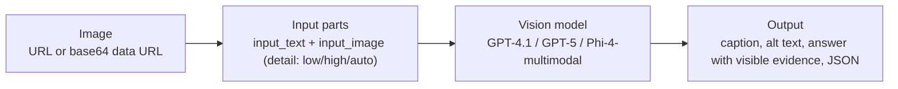
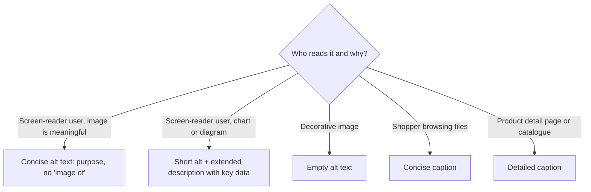

# Multimodal understanding: captions, alt text and visual Q&A

> AI-103 · D3 Implement computer vision solutions · about 65 min · Study Hub module `v01` ([open the hub](https://claude.ai/artifact/TdpMZLFYA9knTdjNyCms9F))

## Why it matters
Half of D3's bullets are about *understanding* images: analysing visual context, concise vs detailed captions for one or many images, Q&A grounded in visual evidence, accessible alt text, and identifying objects or regions.

## Pre-question (answer before reading)
**Q:** What's wrong with the alt text "Image of a graph"?

<details><summary>Answer</summary>

It says what the element is, not what it **means**. Good alt text conveys the purpose, e.g. "Sales rose 40% from Q1 to Q4, peaking in November." Screen readers already announce it's an image, and complex charts deserve an extended description.

</details>

## 🍎 Story time (kid version)
**Robo at Foundry Town Hall: Robo describes the photo**

Children show Robo photos. For the tiny picture tiles on the school website, he says one short line: "Red bicycle by the gate." For the lost-property page he says more: the colour, the bell, the scratched left handle. When a child asks, "Is my bike broken?", Robo only says what he can actually see, and if the photo is blurry he says, "I can't tell." For children who can't see the picture, he says what it's for, never "a picture of".

| In the story | In Foundry |
|---|---|
| One short line vs a fuller description | Concise vs detailed captions |
| Only what he can see, or "I can't tell" | Visual Q&A grounded in visible evidence |
| Saying what the picture is for | Alt text that states the purpose, without "image of" |

**Where the story breaks:** Robo sees a shrunken copy of each photo, so tiny writing can be lost unless you send a high-detail or cropped image.

## Mental model & story (grown-up version)
A multimodal model is a **colleague who can see**: you hand over one or more pictures with a question and get a written answer. In Foundry you use vision-capable models (GPT-4.1, GPT-4.1-mini, the GPT-5 family, Phi-4-multimodal) through the same Responses or Chat Completions APIs. The image travels as a URL or a base64 **data URL**, as an `input_image` part next to your `input_text`.

Northwind's online shop uses one model for four jobs. **Concise captions** for product tiles (one line). **Detailed captions** for the product page. **Comparisons** across several images ("Which of these three sofas is the darkest?"). **Visual Q&A** for support: a customer uploads a photo of a damaged parcel and asks whether it's covered.

For visual Q&A, Northwind tells the model to **ground every answer in what is visible** ("describe the evidence you see; if it isn't visible, say you can't tell"). That reduces confident guesses, just as grounding instructions do for text.

For accessibility, alt text follows simple rules: describe the **purpose**, keep it short, don't start with "image of", and leave decorative images with empty alt. Complex images such as charts get an **extended description** with the key data. When precise object locations are needed at scale (counting items on shelves, marking defect regions), Northwind uses Content Understanding or a dedicated detection model rather than free-text descriptions.

**Where the analogy breaks:** A colleague can lean closer to read small print. A model sees a resized version; small text and fine details may be lost. Use high detail settings or crop the region of interest when detail matters.

## Diagrams
**Image → answer**



**Which description?**



## Key points
- Vision-capable models in Foundry include GPT-4.1, GPT-4.1-mini, the GPT-5 family and Phi-4-multimodal-instruct; test images in the chat playground.
- Responses API: `input=[{"role": "user", "content": [{"type": "input_text", "text": q}, {"type": "input_image", "image_url": url_or_data_url}]}]` → `output_text`.
- Chat Completions: content parts `{"type": "text", ...}` and `{"type": "image_url", "image_url": {"url": ...}}`.
- Local files: base64-encode and pass a **data URL** (`data:image/jpeg;base64,...`). A `detail` setting (low/high/auto) trades token cost for fidelity.
- Several images can go in one request for comparison or multi-image captions; refer to them by order in the prompt.
- Caption control comes from instructions: length (one line vs paragraph), focus (product features, safety issues), audience and format (plain text or JSON schema).
- Visual Q&A grounded in evidence: ask the model to cite what it sees, admit when something isn't visible, and return structured fields (e.g. `damage_visible`, `evidence`).
- Alt text guidance: purpose-focused, concise (often under ~125 characters), no "image of/picture of", don't repeat nearby text; decorative images get empty alt; complex images get an extended description.
- Identifying objects, components or regions: models can describe and roughly locate items; for exact counts, boxes or regions at scale use Content Understanding (image/video analyzers) or specialised detection models.

## Comparisons
**Concise vs detailed**

|  | Concise caption / alt text | Detailed caption / extended description |
|---|---|---|
| Length | One line | Paragraph(s) |
| Use | Tiles, alt attributes, notifications | Product pages, catalogues, charts for accessibility |
| Prompt cue | "in under 15 words" | "describe materials, colours, condition and context" |

## Code to recognise
**Ask about a local image (Responses API)**

```python
import base64
with open("parcel.jpg", "rb") as f:
    data_url = "data:image/jpeg;base64," + base64.b64encode(f.read()).decode()

r = client.responses.create(
    model="gpt-4.1",
    input=[{"role": "developer",
            "content": "Answer only from what is visible. If you can't tell, say so."},
           {"role": "user", "content": [
               {"type": "input_text", "text": "Is the parcel damaged? Describe the evidence."},
               {"type": "input_image", "image_url": data_url}]}])
print(r.output_text)
```

- Line 3: Data URLs carry local images inline.
- Line 7: Grounding rule for visual evidence.
- Line 10: Text and image parts travel together in one user message.

**Generate alt text and an extended description as JSON**

```python
class Access(BaseModel):
    alt_text: str              # <= 125 chars, purpose-focused
    extended_description: str  # key data for complex images; "" if not needed
    decorative: bool

r = client.responses.parse(model="gpt-4.1-mini", text_format=Access,
    instructions=("Write alt text that conveys purpose, without 'image of'. "
                  "If the image is a chart, add an extended description with the key numbers."),
    input=[{"role": "user", "content": [{"type": "input_image", "image_url": chart_url}]}])
```

- Line 2: Constraints live in the instructions; the schema enforces the shape.
- Line 4: Decorative images should get empty alt in the page.

## Portal steps
**Test vision in the playground** (Foundry portal > Build > Models > (vision model) > Playground)

1. Attach one or more images to the chat.
2. Ask for a concise caption, then a detailed one; compare.
3. Ask a question that needs visual evidence; then View code.

## Worked example
**Scenario:** An insurer wants an app where customers photograph car damage; the app must say which panels look damaged and must not invent damage it can't see.

- Image input + question → vision model.
- Grounding: describe visible evidence, say "can't tell" otherwise.
- Structured output: panels[], evidence per panel, confidence; route unclear cases to a human.

**Answer:** A **vision model with evidence-grounded instructions and a JSON schema** (panels, evidence, confidence), plus human review for low confidence. Use Content Understanding if you need consistent fields, confidence and grounding at scale.

## Your turn (faded example)
**Scenario:** A news site needs alt text for 5,000 archive photos.

- Batch over images with a vision model.
- **Name two alt-text rules to put in the instructions.** <details><summary>answer</summary>Describe purpose/content concisely; don't start with "image of"; (also) don't repeat the caption; flag decorative images.</details>
- **How would you treat infographics?** <details><summary>answer</summary>Short alt text plus an extended description containing the key data.</details>

## Exam traps & misconceptions
- ✗ Starting alt text with "Image of…". → ✓ Screen readers already announce images; describe purpose.
- ✗ Giving decorative images descriptive alt text. → ✓ Decorative images should have empty alt so screen readers skip them.
- ✗ Expecting reliable pixel-accurate boxes from free-text answers. → ✓ Use Content Understanding or detection models for precise regions.
- ✗ Sending a local file path as `image_url`. → ✓ Send a public/SAS URL or a base64 data URL.

## Discussion prompts
- **How do you reduce hallucination in visual Q&A?** Ground instructions (only visible evidence), ask for the evidence, allow "can't tell", use higher detail or crops for small items, structured outputs with confidence, and human review for high-stakes cases.
- **When would you use a small multimodal model?** High-volume, simple tasks such as short captions or tagging, on cost-sensitive or edge workloads, after checking quality on a sample.

## Interview angle / teach-back
**Prompt:** Explain how to build accessible image descriptions and grounded visual Q&A with a multimodal model.

**Rubric:** input_text + input_image parts (URL or data URL) · Concise vs detailed captions via instructions · Alt text rules: purpose, no 'image of', decorative empty, extended for charts · Ground answers in visible evidence; allow 'can't tell' · Use CU/detection for precise regions

**Model answer:** Send the image as an `input_image` part (URL or base64 data URL) with a text instruction. Control caption length and focus in the instructions. For accessibility, alt text should state the purpose briefly without "image of"; decorative images get empty alt and charts get an extended description with key data. For visual Q&A, tell the model to answer only from visible evidence and to say when it can't tell. For exact object regions at scale, use Content Understanding or a detection model.

## Quick Q&A
- **Image part type (Responses API)?** `input_image`.
- **Local image format?** Base64 data URL.
- **Alt text for decorative images?** Empty.
- **Charts need…** Short alt + extended description.
- **Setting trading cost vs fidelity?** `detail` (low/high/auto).
- **Precise object regions at scale?** Content Understanding or detection models.

## Sources (accessed 2026-10-02)
- [Lab: Develop a vision-enabled chat app](https://microsoftlearning.github.io/mslearn-ai-vision/Instructions/Exercises/01-gen-ai-vision.html)
- [Learning path: Extract insights from visual data](https://learn.microsoft.com/en-us/training/paths/insight-visual-data/)

## SRS cards created
- ai-103-v01-01, ai-103-v01-02, ai-103-v01-03, ai-103-v01-04
