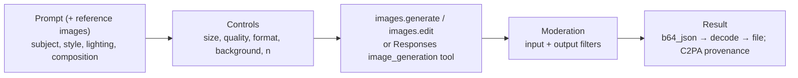
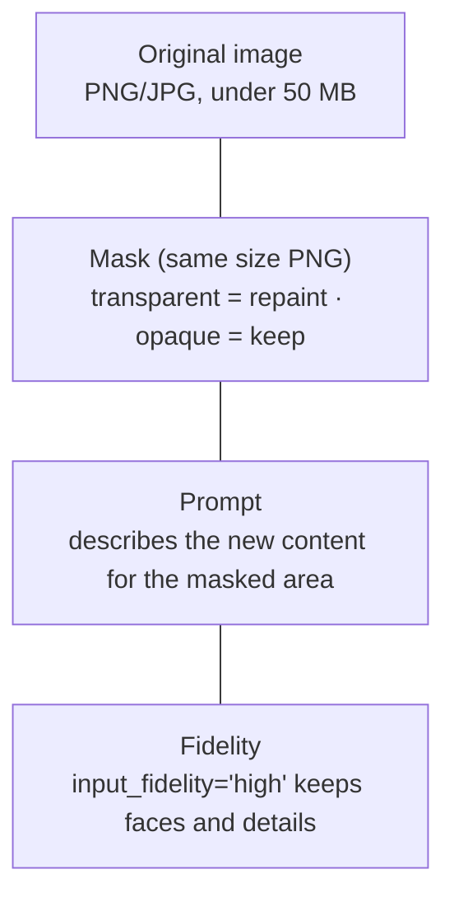

# Image generation and editing

> AI-103 · D3 Implement computer vision solutions · about 65 min · Study Hub module `v02` ([open the hub](https://claude.ai/artifact/TdpMZLFYA9knTdjNyCms9F))

## Why it matters
D3 asks you to generate images from prompts **and reference media**, edit them with **inpainting and masks**, and pick the right **controls** (size, quality, format, background, fidelity). Know the gpt-image family's parameters and the Responses API image tool.

## Pre-question (answer before reading)
**Q:** In a mask image for inpainting, which pixels get regenerated: the opaque ones or the transparent ones?

<details><summary>Answer</summary>

The **transparent** (alpha = 0) areas are edited; opaque areas are preserved. The mask must have the same dimensions as the image.

</details>

## 🍎 Story time (kid version)
**Robo at Foundry Town Hall: The stencil**

Robo paints pictures from a description: "a teal mug on a wooden desk in morning light". When Maya wants only the mug's logo changed, Robo lays a stencil over the painting. The cut-out hole is the only spot he repaints; everything under the solid part stays exactly as it was. The stencil must be the same size as the painting. Every finished painting gets a hidden sticker that says "made by a robot".

| In the story | In Foundry |
|---|---|
| Painting from a description | `images.generate` with a prompt |
| The cut-out hole | The transparent area of the mask (gets edited) |
| The solid part of the stencil | The opaque area of the mask (kept) |
| The hidden "made by a robot" sticker | C2PA content credentials |

**Where the story breaks:** Some children expect the coloured part of a stencil to be repainted. In a real mask it's the opposite: transparent means "change this".

## Mental model & story (grown-up version)
An image model is a **studio illustrator** who works from a brief. The brief (prompt) should cover subject, setting, style, lighting, composition and any text to include. You can also hand over **reference images** (a product photo, a brand mood board) to anchor subject or style.

Foundry's catalogue has the **gpt-image** family and partner models such as **FLUX** from Black Forest Labs. As of October 2026 the GA models are **gpt-image-2** and **gpt-image-2.5** (Flare, Sunburst); **gpt-image-1**, **gpt-image-1-mini** and **gpt-image-1.5** are limited-access previews, and gpt-image-1 retires on 23 Oct 2026. DALL-E 3 was retired in March 2026.

The controls are the illustrator's paper and finish: **size** (gpt-image-1 family: square 1024×1024, portrait 1024×1536, landscape 1536×1024; gpt-image-2 and later: custom sizes in multiples of 16 px up to a 3840 px edge), **quality** (low, medium, high: cost and speed), **output format** (PNG or JPEG, with **compression** for JPEG), **background** (`transparent` for PNG cut-outs, documented for gpt-image-1 only), **n** (1–10 variations) and **streaming** with partial previews.

Editing is touching up an existing picture. **Inpainting** uses a **mask**: transparent areas are repainted, everything else is kept. **Prompt-driven edits** change the whole image ("make it winter"). **input_fidelity="high"** preserves faces and fine details from the input image (documented for the gpt-image-1 series, not the mini). For iterative, conversational editing, the **image_generation tool** in the Responses API lets users refine an image over several turns. Every generated image carries **C2PA content credentials** marking it as AI-generated.

**Where the analogy breaks:** An illustrator can refuse a bad brief politely. The service blocks unsafe prompts and outputs with content-policy errors, and some subjects (such as photorealistic minors) are blocked by default, so your app must handle refusals.

## Diagrams
**Generate or edit**



**Inpainting with a mask**



## Key points
- Models (checked 2 Oct 2026): GA **gpt-image-2** and **gpt-image-2.5**; limited-access **gpt-image-1** (retires 23 Oct 2026), **gpt-image-1-mini**, **gpt-image-1.5**; plus **FLUX** models. DALL-E 3 retired (March 2026). Filter the catalogue by *text to image*.
- `client.images.generate(model=deployment, prompt=..., n=1..10, size="1024x1024"|"1024x1536"|"1536x1024" (gpt-image-1 family; gpt-image-2+: multiples of 16 px), quality="low"|"medium"|"high", output_format="png"|"jpeg", output_compression=0-100 (JPEG), background="transparent"|"auto" (transparent: gpt-image-1, PNG), stream=True, partial_images=1..3)`.
- Result: `result.data[0].b64_json` → `base64.b64decode(...)` → write bytes to a file.
- **Edit / inpaint**: `client.images.edit(model=..., image=open(...), mask=open(...), prompt=...)`; one or more input images; **mask** = PNG of the same dimensions, **transparent (alpha 0) areas are edited**.
- `input_fidelity="high"` preserves faces, logos and fine details from inputs (not supported on gpt-image-1-mini).
- Reference images guide subject or style; prompt-driven edits without a mask can change the whole image.
- Responses API: `tools=[{"type": "image_generation"}]` → output item `image_generation_call` with base64 `result`; supports multi-turn iterative editing.
- Safety: prompts and outputs are moderated (errors such as `content_policy_violation`); some content is blocked by default; generated images include **C2PA** provenance.
- Quotas are per deployment (images per minute); quality and size drive cost and latency.

## Comparisons
**Choose the control**

| Need | Setting |
|---|---|
| Sticker or logo cut-out | background="transparent" with PNG |
| Fast draft thumbnails | quality="low", smaller size, n > 1 |
| Final print-ready hero image | quality="high", landscape size |
| Smaller files for the web | JPEG with output_compression |
| Keep a person's face when editing | input_fidelity="high" |
| Change only the sky | Mask with the sky transparent + prompt |

## Code to recognise
**Generate, then inpaint**

```python
import base64

img = client.images.generate(model="gpt-image-2",
    prompt="Studio photo of a teal ceramic mug on a walnut desk, soft morning light",
    size="1536x1024", quality="medium", output_format="png", n=1)
open("mug.png", "wb").write(base64.b64decode(img.data[0].b64_json))

edit = client.images.edit(model="gpt-image-1.5",
    image=open("mug.png", "rb"),
    mask=open("mug_mask.png", "rb"),          # transparent where the logo should go
    prompt="Add the Contoso logo, small and centred on the mug",
    input_fidelity="high")
open("mug_logo.png", "wb").write(base64.b64decode(edit.data[0].b64_json))
```

- Line 4: Prompt covers subject, material, setting and lighting.
- Line 5: Landscape size; medium quality balances cost and detail.
- Line 6: Images come back as base64.
- Line 10: Mask: same dimensions; transparent region is repainted.
- Line 12: High fidelity keeps the original mug details (gpt-image-1 series; not the mini).

## Portal steps
**Image playground** (Foundry portal > Build > Models > (gpt-image deployment) > Playground)

1. Write a prompt; set size, quality and number of images.
2. Try an edit: upload an image and draw/upload a mask.
3. View code to copy the parameters.

## Worked example
**Scenario:** A marketing team needs product cut-outs with no background for slides, plus a version of an existing photo where only the sky is changed to sunset.

- Cut-outs → PNG with transparent background.
- Change only the sky → inpainting: mask with the sky area transparent.
- Prompt the new sky; keep fidelity high for the product.

**Answer:** Generate with **`background="transparent"` and PNG**; edit the photo with a **mask** (sky transparent) and a sunset prompt via `images.edit`.

## Your turn (faded example)
**Scenario:** Your edit replaced the whole image instead of just the logo area.

- You passed a prompt and an image.
- **What was probably missing or wrong?** <details><summary>answer</summary>The **mask** (or the mask had the wrong transparency/dimensions).</details>
- **Which areas should be transparent?** <details><summary>answer</summary>Only the region to repaint (the logo area); keep everything else opaque.</details>

## Exam traps & misconceptions
- ✗ Making the area to keep transparent. → ✓ Transparent = edited; opaque = kept.
- ✗ Using a mask of a different size. → ✓ The mask must match the image dimensions.
- ✗ Expecting `background="transparent"` with JPEG. → ✓ Transparency needs PNG.
- ✗ Expecting transparent backgrounds from every gpt-image model. → ✓ Microsoft documents `background="transparent"` for gpt-image-1 only (limited access; retires 23 Oct 2026).
- ✗ Using input_fidelity on gpt-image-1-mini. → ✓ The mini model doesn't support it.
- ✗ Planning new work on DALL-E 3. → ✓ It's retired; use the gpt-image family or FLUX.

## Discussion prompts
- **How would you keep generated product images on-brand?** Reference images for style, a reusable prompt template (palette, lighting, composition), brand-safety checks (logo correctness, prohibited content) and human approval before publishing.
- **Why does provenance matter for generated images?** C2PA credentials let viewers and platforms verify AI generation, supporting transparency, misinformation controls and compliance.

## Interview angle / teach-back
**Prompt:** Explain how to generate an image and then change only one part of it.

**Rubric:** images.generate with prompt + size/quality/format · Decode b64_json · images.edit with image + mask + prompt · Mask: same size; transparent area edited · input_fidelity high to preserve details; C2PA provenance

**Model answer:** Call `images.generate` with a descriptive prompt and controls such as size, quality and format; decode the base64 result to a file. To change one part, call `images.edit` with the image, a mask of the same size where only the area to repaint is transparent, and a prompt describing the new content. Setting `input_fidelity` to high keeps faces and details. Outputs are moderated and carry C2PA provenance.

## Quick Q&A
- **Mask: which area is edited?** Transparent (alpha 0).
- **Transparent background needs?** PNG output.
- **Keep faces when editing?** `input_fidelity="high"`.
- **Image tool in Responses API?** `image_generation`.
- **Retired image model?** DALL-E 3.
- **Where's the image data?** `data[0].b64_json`.

## Sources (accessed 2026-10-02)
- [Lab: Generate images with AI](https://microsoftlearning.github.io/mslearn-ai-vision/Instructions/Exercises/02-generate-image.html)
- [Learning path: Extract insights from visual data](https://learn.microsoft.com/en-us/training/paths/insight-visual-data/)

## SRS cards created
- ai-103-v02-01, ai-103-v02-02, ai-103-v02-03, ai-103-v02-04
