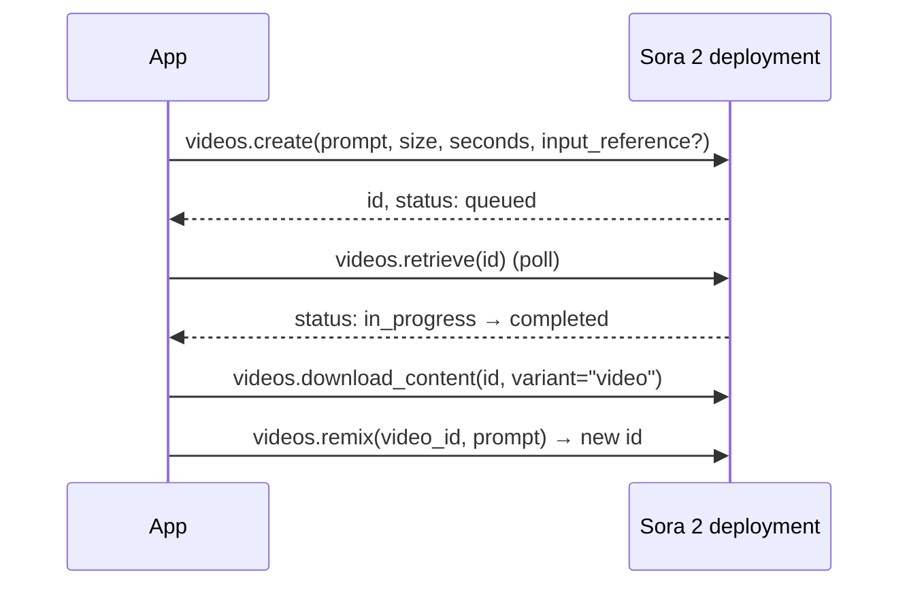

# Video generation and editing with Sora 2

> AI-103 · D3 Implement computer vision solutions · about 55 min · Study Hub module `v03` ([open the hub](https://claude.ai/artifact/TdpMZLFYA9knTdjNyCms9F))

## Why it matters
AI-103 added video: generate from text and reference images, edit generated videos with **remix**, and choose the controls (size, duration). Video jobs are **asynchronous**, so know the create → poll → download pattern.

## Pre-question (answer before reading)
**Q:** `videos.create(...)` returns immediately. Why doesn't it return the video file?

<details><summary>Answer</summary>

Video generation takes minutes, so it's an **asynchronous job**. You get a video id with status `queued`/`in_progress`, poll `videos.retrieve(id)` until `completed`, then download the content.

</details>

## 🍎 Story time (kid version)
**Robo at Foundry Town Hall: Ordering a short film**

Robo orders a short film from the film crew: "a slow zoom on a cat drinking milk, 8 seconds". The crew doesn't hand it over straight away. They give him a ticket that says "filming...", and he checks back every few minutes. When the ticket says "done", he collects the film. If he wants the same shot at night, he asks for a remake with just that one change and gets a new film with a new ticket.

| In the story | In Foundry |
|---|---|
| The "filming..." ticket | An async job (`queued` or `in_progress`) |
| Checking back every few minutes | Polling `videos.retrieve` |
| Collecting the film | `download_content(variant="video")` |
| A remake with one change | `videos.remix`, which returns a new video id |

**Where the story breaks:** The crew has strict rules the story skips: no real people, famous characters or copyrighted music, and clips last only 4, 8 or 12 seconds.

## Mental model & story (grown-up version)
Making a Sora 2 video is like commissioning a **short film crew**. You hand over a shot description, and they go away to film it. You check back (poll) until they say it's done, then collect the footage.

The brief works best like a director's note: **one camera move and one action per shot** ("slow dolly-in on a barista pouring latte art, morning light"). Clips are short (**4, 8 or 12 seconds**, default 4) in **1280×720 or 720×1280**, and Sora 2 generates **audio** too. Longer stories are stitched from several clips.

You can anchor the first frame with an **input reference image** (JPEG, PNG or WebP) matching the output size, which suits a product shot. And you can edit a generated video with **remix**: give the original video id and a focused change ("same shot, switch to an 85 mm lens"). Remix returns a new video id; make one change per remix for predictable results.

The crew has rules: no real people or public figures, no copyrighted characters or music, and nothing unsuitable for under-18s. Requests that break them are refused.

**Where the analogy breaks:** A film crew can reshoot just the last second. Remix changes the whole generated clip according to your instruction; small, specific changes work best, and you can't edit uploaded real-world footage this way.

## Diagrams
**Async video job**



## Key points
- Models: **sora-2** and **sora-2-pro**. Sizes **1280x720** or **720x1280**; durations **4, 8 or 12 seconds** (default 4); audio is generated.
- Inputs: text prompt; optional **input_reference** image (JPEG/PNG/WebP, matching the output size) to anchor the first frame; **remix** of an existing generated video.
- SDK: `video = client.videos.create(model=..., prompt=..., size="1280x720", seconds="8", input_reference=open(img, "rb"))`.
- Poll `client.videos.retrieve(video.id)` while status is `queued` or `in_progress`; stop on `completed`, `failed` or `cancelled`. Jobs take minutes.
- Download: `client.videos.download_content(video.id, variant="video").write_to_file("out.mp4")`; a `thumbnail` variant also exists.
- Edit: `client.videos.remix(video_id=..., prompt="same shot, …")` returns a **new** video id; one focused change per remix.
- Prompt tips: one camera move + one action per shot; describe subject, setting, lighting, lens; plan beats; stitch two 4 s clips rather than forcing one long clip.
- Blocked: real people/public figures, copyrighted characters or music, content unsuitable for under-18s. Handle refusals in the app.
- Playground: Build > Models > (Sora 2 deployment) > Playground; *View code* shows the REST calls. (The earlier Sora v1 preview used a jobs API; you may meet it in older material.)

## Comparisons
**Pick the technique**

| Need | Technique |
|---|---|
| Short ad from a description | Text-to-video (prompt only) |
| Video must start from our product photo | input_reference image (same size as output) |
| Same clip, different lens or colour grade | Remix with one focused change |
| 30-second story | Several 4–12 s clips, stitched |
| Vertical for mobile stories | 720x1280 |

## Code to recognise
**Create, poll, download and remix**

```python
import time

video = client.videos.create(model="sora-2",
    prompt="Slow dolly-in on a barista pouring latte art, warm morning light",
    size="1280x720", seconds="8",
    input_reference=open("cafe_first_frame.png", "rb"))

while video.status in ("queued", "in_progress"):
    time.sleep(15)
    video = client.videos.retrieve(video.id)

if video.status == "completed":
    client.videos.download_content(video.id, variant="video").write_to_file("latte.mp4")
    remix = client.videos.remix(video_id=video.id,
                                prompt="Same shot, but switch to an 85mm lens")
else:
    print("Generation failed:", video.status)
```

- Line 4: One camera move + one action: a strong single-shot prompt.
- Line 5: Supported size and duration values.
- Line 6: The reference image must match the output size.
- Line 8: Poll; jobs take minutes.
- Line 13: Download the finished MP4 (variant `thumbnail` also exists).
- Line 14: Remix creates a new video from the original with one change.

## Portal steps
**Sora 2 playground** (Foundry portal > Build > Models > (sora-2 deployment) > Playground)

1. Enter a prompt; choose size and duration.
2. Optionally upload a reference image.
3. Generate, review, then try a remix prompt.
4. View code for the REST/SDK pattern.

## Worked example
**Scenario:** A retailer wants 12-second vertical clips for social stories, starting from their product photo, and then a version with a night-time look.

- Vertical → 720x1280; duration 12.
- Start from the product photo → input_reference (resized to 720x1280).
- Night-time version → remix the generated video with "same shot, night-time, neon reflections".

**Answer:** `videos.create(size="720x1280", seconds="12", input_reference=photo)` → poll → download; then **`videos.remix`** with the night-time change.

## Your turn (faded example)
**Scenario:** Your code calls `videos.download_content` right after `videos.create` and fails.

- The job was still queued.
- **What's missing?** <details><summary>answer</summary>Polling `videos.retrieve(id)` until the status is `completed`.</details>
- **Which statuses end the loop?** <details><summary>answer</summary>`completed`, `failed` or `cancelled`.</details>

## Exam traps & misconceptions
- ✗ Expecting synchronous video results. → ✓ It's an async job: create → poll → download.
- ✗ Using 1920x1080 or 30-second durations. → ✓ Sora 2 sizes are 1280x720/720x1280 with 4, 8 or 12 seconds.
- ✗ Reference image of a different size than the output. → ✓ It must match the output size.
- ✗ Asking a remix for five changes at once. → ✓ One focused change per remix gives predictable results.
- ✗ Generating a public figure for an ad. → ✓ Real people and public figures are blocked.

## Discussion prompts
- **How would you build a 45-second product video?** Storyboard 4–12 s shots with one move/action each, generate them (anchoring key shots with reference images), remix for consistency, then stitch and add titles in an editor.
- **What governance would you add before publishing generated video?** Human review, provenance/watermark disclosure, brand and legal checks (no real people or copyrighted material), and a record of prompts and video ids.

## Interview angle / teach-back
**Prompt:** Explain how to generate a Sora 2 clip from a prompt and an image, then edit it.

**Rubric:** videos.create with prompt, size, seconds, input_reference · Async: poll videos.retrieve until completed/failed · download_content(variant='video') · Remix with video_id + one focused change → new id · Valid sizes/durations and content restrictions

**Model answer:** Call `videos.create` with the prompt, a supported size (1280x720 or 720x1280), a duration of 4, 8 or 12 seconds, and optionally an input reference image of the same size for the first frame. The job is asynchronous, so poll `videos.retrieve` until it completes, then `download_content` with variant video. To edit, call `videos.remix` with the video id and one focused change; it returns a new video. Real people, public figures and copyrighted material are blocked.

## Quick Q&A
- **Sora 2 durations?** 4, 8 or 12 seconds (default 4).
- **Sora 2 sizes?** 1280x720 or 720x1280.
- **Anchor the first frame?** `input_reference` image (same size).
- **Edit a generated video?** `videos.remix(video_id, prompt)`.
- **Poll method?** `videos.retrieve(id)`.
- **Download?** `videos.download_content(id, variant="video")`.

## Sources (accessed 2026-10-02)
- [Lab: Generate video with Sora in Microsoft Foundry](https://microsoftlearning.github.io/mslearn-ai-vision/Instructions/Exercises/03-generate-video.html)
- [Learning path: Extract insights from visual data](https://learn.microsoft.com/en-us/training/paths/insight-visual-data/)

## SRS cards created
- ai-103-v03-01, ai-103-v03-02, ai-103-v03-03, ai-103-v03-04
