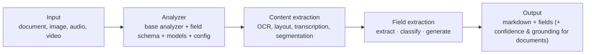

# Content Understanding for images and video

> AI-103 · D3 Implement computer vision solutions · about 65 min · Study Hub module `v05` ([open the hub](https://claude.ai/artifact/TdpMZLFYA9knTdjNyCms9F))

## Why it matters
Content Understanding (CU) appears in D3 and D5. In D3 it's about **visual characteristics**, **video segment analysis**, **objects and regions**, and **single-task vs pro-mode** pipelines.

## Pre-question (answer before reading)
**Q:** You need the same fields (damage type, severity, part) from 10,000 inspection photos. Free-form vision prompts or a CU analyzer?

<details><summary>Answer</summary>

A **Content Understanding analyzer** based on the image analyzer with a field schema (classify/generate fields): consistent fields every time. Note: only **document** analyzers return per-field **confidence** and **grounding**, so for photos you validate allowed values and sample-review critical results.

</details>

## Mental model & story
Content Understanding is a **customs inspection desk** for media. You design the inspection form once (the **analyzer**): which base analyzer to start from (document, image, audio, video), which **fields** to fill, and how each field is filled: **extract** (copy a value that's visibly there), **classify** (pick from a fixed list) or **generate** (write a summary or inference). Every item that passes the desk gets the same form. **Document** analyzers can also return **confidence scores** and **grounding** (where the evidence was found) for each field when `estimateFieldSourceAndConfidence` is on; image, audio and video analyzers return the fields without them.

For **images**, Litware's quality team built an analyzer from `prebuilt-image` with fields like `Defect` (classify: scratch, dent, crack, none), `Component` (classify: door, hinge, panel), `Severity` (classify: low, medium, high) and `Description` (generate). Image analyzers don't return confidence, so every *crack* or *high* result goes to an inspector and a weekly sample is spot-checked.

For **video**, CU splits footage into **segments** (shots and scenes), picks **keyframes**, transcribes speech and can produce per-segment summaries and fields: chapters for training videos, or flagged moments in safety footage. The `prebuilt-videoSearch` analyzer returns retrieval-ready output for RAG. Face-related description features require additional approval and consent.

The exam outline names two pipeline styles. **Single-task** (standard) analyzers handle one file with one analyzer, for any modality, with extract/classify/generate fields (confidence and grounding on documents only). **Pro mode** was **documents only**: it reasoned across **multiple documents** and **reference data** you supply (e.g. check an invoice against the contract), using classify/generate fields, without confidence or grounding. Reality check (Oct 2026): pro mode existed only in the 2025-05-01-preview API, which is retired; the GA API (2025-11-01) has no mode setting, and the successor is **agentic mode** (2026-06-01-preview), which reasons over evidence in a document but at first accepts one input file per request and doesn't support extract fields. Learn both: the exam may still ask about pro mode.

**Where the analogy breaks:** Customs forms are filled by trained officers. CU uses generative models underneath, so add validation (allowed values, ranges) and human review for low confidence, especially for safety decisions.

## Diagrams
**How Content Understanding processes media**



**Standard vs pro mode**

| | single file | multiple files + reference data |
|---|---|---|
| **all modalities** | **Standard mode**: images, audio, video, documents · confidence + grounding on documents only | **(not applicable)**: pro mode doesn't cover non-document media |
| **documents only** | **Standard on documents**: fields from one document | **Pro mode (retired preview; now agentic mode)**: cross-document reasoning and validation · classify/generate only · no confidence/grounding |

## Key points
- CU is a Foundry Tool that turns documents, images, audio and video into **markdown** (for RAG) and **structured fields** (for automation).
- Analyzer = **base analyzer** (e.g. `prebuilt-image`, `prebuilt-video`, `prebuilt-document`) + **field schema** + model configuration + settings. Prebuilt analyzers include read, layout, document, image, invoice, receipt, ID document, audio search, video search, call centre and document search.
- Field methods: **extract** (verbatim value; standard mode only), **classify** (enum), **generate** (summaries, inferences). Up to about 100 fields per analyzer.
- **Single-task (standard) pipelines**: one file, one analyzer, any modality, cost/latency-optimised. **Confidence (0–1) and grounding** come only from **document** analyzers with `estimateFieldSourceAndConfidence` enabled; image, audio and video analyzers return no confidence.
- **Pro mode** (exam-outline term): documents only; multi-document reasoning with reference data supplied when the analyzer is created; cross-document validation; classify/generate fields only; **no confidence or grounding**. It lived only in the retired 2025-05-01-preview API; the successor is **agentic mode** (2026-06-01-preview: one input file per request at first, no extract fields).
- Video analysis: segmentation (shots, scenes), keyframes, transcript, chapters, per-segment summaries and fields; `prebuilt-videoSearch` produces retrieval-ready output. Face description features need approval and consent.
- Identifying objects, components or regions: define classify/generate fields per component. Image analyzers return no confidence or grounding, so validate values against allowed lists and route critical results to review.
- Prerequisites: a Foundry resource in a supported region with default model deployments configured (e.g. GPT-4.1, GPT-4.1-mini, text-embedding-3-large).
- Confidence routing (document analyzers): ≥ 0.9 auto-accept, 0.7–0.9 review if the field is critical, < 0.7 manual.

## Comparisons
**Pick the mode**

| Scenario | Mode |
|---|---|
| Classify defects in each photo (no confidence for images) | Standard (image) |
| Chapters and summaries for training videos | Standard (video) |
| Check invoices against contract terms across files | Pro mode (exam answer; today agentic mode or retrieval + reasoning) |
| Mortgage packet: validate figures across 6 documents | Pro mode (exam answer) |
| Extract exact serial numbers from labels | Standard (extract fields) |

## Code to recognise
**An image analyzer for defect inspection (definition)**

```json
{
  "description": "Hinge and panel defect inspection",
  "baseAnalyzerId": "prebuilt-image",
  "config": { "returnDetails": false },
  "fieldSchema": {
    "fields": {
      "Component": { "type": "string", "method": "classify", "enum": ["door", "hinge", "panel"] },
      "Defect":    { "type": "string", "method": "classify", "enum": ["none", "scratch", "dent", "crack"] },
      "Severity":  { "type": "string", "method": "classify", "enum": ["low", "medium", "high"] },
      "Notes":     { "type": "string", "method": "generate", "description": "One-sentence description of the visible issue" }
    }
  }
}
```

- Line 3: Start from the prebuilt image analyzer.
- Line 4: Image analyzers don't return confidence or grounding (that's document analyzers with estimateFieldSourceAndConfidence).
- Line 7: classify fields constrain output to allowed values.
- Line 10: generate fields produce free text.

**Create the analyzer and analyse an image (Python SDK)**

```python
from azure.ai.contentunderstanding import ContentUnderstandingClient
from azure.core.credentials import AzureKeyCredential

cu = ContentUnderstandingClient(endpoint=endpoint, credential=AzureKeyCredential(key))
cu.begin_create_analyzer(analyzer_id="defect-inspector", resource=definition,
                         allow_replace=True).result()

with open("hinge_017.jpg", "rb") as f:
    result = cu.begin_analyze_binary(analyzer_id="defect-inspector", binary_input=f.read()).result()
fields = result.contents[0].fields
print(fields["Defect"].value, fields["Severity"].value)
```

- Line 5: Long-running operation: `.result()` waits for creation.
- Line 9: Analyse local bytes (or pass URL inputs with begin_analyze).
- Line 10: Field values; image analyzers don't add confidence scores.

## Portal steps
**Build an image analyzer** (Content Understanding studio (Foundry) > New project > Upload sample)

1. Choose a template or start from the image analyzer.
2. Define fields: name, type, method (classify/generate/extract), descriptions.
3. Test on samples; check the field values (document analyzers also show confidence and grounding).
4. Build the analyzer (versioned) and call it from code.

## Worked example
**Scenario:** A media company wants each archived training video split into chapters with a title and summary, and searchable by topic in a RAG app.

- Video input → CU standard mode (video).
- Chapters → segmentation + generate fields per segment (title, summary).
- Searchable → use video search output (markdown) and index it in Azure AI Search.

**Answer:** A **CU video analyzer** (segments with generated title/summary fields) or **prebuilt-videoSearch** output, indexed in Azure AI Search for RAG.

## Your turn (faded example)
**Scenario:** Auditors need to validate that each supplier invoice matches the signed contract's rates, across separate PDF files.

- Multiple related documents must be compared.
- **Standard or pro mode?** <details><summary>answer</summary>**Pro mode** (multi-document reasoning with reference data) is the exam-outline answer. Today its preview API is retired: use agentic mode (preview) or retrieval + model reasoning.</details>
- **What won't pro mode return?** <details><summary>answer</summary>Confidence scores and grounding (and it doesn't support extract fields).</details>

## Exam traps & misconceptions
- ✗ Using pro mode for images or video. → ✓ Pro mode is documents only.
- ✗ Expecting confidence scores from pro mode. → ✓ Pro mode returns no confidence or grounding.
- ✗ Expecting confidence scores from an image or video analyzer. → ✓ Only document analyzers return confidence and grounding (estimateFieldSourceAndConfidence).
- ✗ Planning new production work on pro mode. → ✓ Its preview API is retired; use agentic mode (preview) or retrieval + reasoning.
- ✗ Using extract fields for inferred values. → ✓ Extract is verbatim; use generate or classify for inferences.
- ✗ Calling CU before default model deployments are configured. → ✓ CU needs its default deployments set up.

## Discussion prompts
- **When would you use a vision model prompt instead of a CU analyzer?** For ad-hoc, conversational or one-off questions. For repeatable fields at scale, use an analyzer (document analyzers add confidence and grounding).
- **How does grounding help audits?** It records where each value came from (page/region/time), so reviewers can verify quickly and auditors can trace decisions.

## Interview angle / teach-back
**Prompt:** Explain how Content Understanding analyses images and video, and when to use standard vs pro mode.

**Rubric:** Analyzer = base analyzer + field schema + config · extract/classify/generate fields · Outputs markdown + fields (+ confidence/grounding for documents) · Video: segments, keyframes, transcript, per-segment fields · Single-task: any modality; Pro (outline): documents, multi-doc + reference data, no confidence; today agentic mode

**Model answer:** In Content Understanding you design an analyzer: a base such as prebuilt-image or prebuilt-video plus a schema of fields that are extracted verbatim, classified into allowed values, or generated. It returns markdown and fields; document analyzers can add confidence and grounding. For video it segments the footage, picks keyframes, transcribes and fills fields per segment. Single-task analyzers cover every modality; pro mode, as the exam outline describes it, is for documents only, reasoning across several files and reference data without confidence or grounding. Its preview API has been retired, and agentic mode (preview) is the successor.

## Quick Q&A
- **Field methods?** Extract, classify, generate.
- **Pro mode supports which modality?** Documents only.
- **Pro mode lacks…** Confidence and grounding (and extract fields).
- **Which analyzers return confidence?** Document analyzers only.
- **Pro mode's successor?** Agentic mode (preview).
- **Base for photos?** `prebuilt-image`.
- **RAG-ready video output?** `prebuilt-videoSearch`.
- **Grounding means…** Source location of each value.

## Sources (accessed 2026-10-02)
- [Lab: Analyze images with Content Understanding](https://microsoftlearning.github.io/mslearn-ai-vision/Instructions/Exercises/04-content-understanding.html)
- [Content Understanding prebuilt analyzers](https://learn.microsoft.com/en-us/azure/ai-services/content-understanding/concepts/prebuilt-analyzers)

## SRS cards created
- ai-103-v05-01, ai-103-v05-02, ai-103-v05-03, ai-103-v05-04
