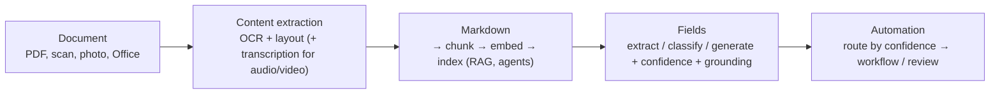
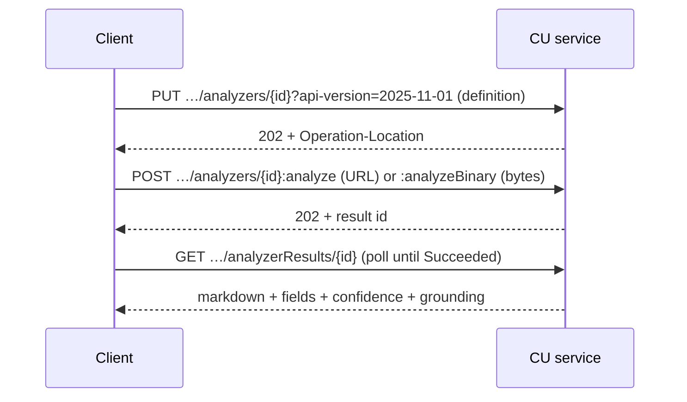

# Content Understanding for documents and RAG

> AI-103 · D5 Implement information extraction solutions · about 70 min · Study Hub module `x01` ([open the hub](https://claude.ai/artifact/TdpMZLFYA9knTdjNyCms9F))

## Why it matters
D5's document skills point at Content Understanding: multimodal extraction pipelines, **clean grounded markdown for agents and RAG**, and **analyzers that output structured fields or markdown** for downstream reasoning.

## Pre-question (answer before reading)
**Q:** Why convert a scanned PDF to markdown before indexing it for RAG, instead of indexing raw OCR text?

<details><summary>Answer</summary>

Markdown keeps **structure** (headings, tables, lists, reading order), so chunks follow sections and tables stay intact. Retrieval and the model's answers improve, and citations can point to the right section.

</details>

## Mental model & story
Contoso Insurance receives claims as PDFs, scans, photos and the occasional voicemail. Two downstream consumers need very different things. Their **RAG assistant** needs clean, well-structured text to chunk and search. Their **claims workflow** needs exact fields such as policy number, claim date, amount and incident type, with confidence scores to decide what needs review.

Content Understanding (CU) serves both from one pipeline. The analyzer first does **content extraction**: OCR, layout analysis (paragraphs, headings, tables, selection marks) and, for audio and video, transcription and segmentation. It then emits **markdown**, a faithful, structured representation ideal for RAG, plus **fields** defined in the schema (extract, classify, generate) with **confidence** and **grounding** (page and coordinates, like `D(1,0.5,1.2,...)`, or text spans).

For common documents there are **prebuilt analyzers** (invoice, receipt, ID document, layout, read, document search). For Contoso's own claim form, they built a **custom analyzer** in the Content Understanding studio: upload samples, pick a template, define fields, test, and build a versioned analyzer that code calls via the SDK or REST.

Their routing rule uses confidence: **≥ 0.9** goes straight through, **0.7–0.9** is reviewed if the field is critical, **< 0.7** is always reviewed. Cross-document checks (does the claim match the policy schedule?) were the job of **pro mode** with the policy as reference data: the exam-outline answer. Its preview API is now retired, so today they'd use agentic mode (preview) or retrieve the policy sections and let a model compare.

**Where the analogy breaks:** A human clerk asks when a field is ambiguous. CU fills fields regardless, so the confidence scores and grounding must actually drive review, not just sit in the JSON.

## Diagrams
**One analyzer, two consumers**



**REST pattern (long-running operations)**



## Key points
- CU converts documents (and images, audio, video) into **markdown** for RAG/search and **structured fields** for automation. **Document** analyzers add **confidence (0–1)** and **grounding** (source location or spans) per field when `estimateFieldSourceAndConfidence` is enabled.
- Prebuilt document analyzers: `prebuilt-read`, `prebuilt-layout`, `prebuilt-document`, `prebuilt-invoice`, `prebuilt-receipt`, `prebuilt-idDocument`, `prebuilt-documentSearch` (RAG-ready).
- Custom analyzer JSON: `description`, `baseAnalyzerId`, `config` (e.g. `returnDetails`, `estimateFieldSourceAndConfidence`), `fieldSchema.fields` (name → type, method, description, enum), optional `models` (completion and embedding deployments).
- Methods: **extract** (verbatim; standard mode only), **classify** (enum), **generate** (inferred). Write clear field descriptions: they guide extraction.
- SDK (`azure-ai-contentunderstanding`): `ContentUnderstandingClient(endpoint, credential)`; `begin_create_analyzer(analyzer_id, resource=definition, allow_replace=True).result()`; `begin_analyze(analyzer_id, inputs=[...])` or `begin_analyze_binary(analyzer_id, binary_input=bytes)`; read `result.contents[0].markdown` and `.fields[name].value` / `.confidence`.
- REST: PUT analyzer (poll Operation-Location) → POST `:analyze` (URL inputs) or `:analyzeBinary` (bytes) → GET `analyzerResults/{id}` while status is `Running`, until `Succeeded`.
- Auth: `Ocp-Apim-Subscription-Key` header or Microsoft Entra ID. Prerequisite: default model deployments configured for the resource (e.g. GPT-4.1, GPT-4.1-mini, text-embedding-3-large).
- **Pro mode** (exam-outline term; documents only): multi-document reasoning with reference data, classify/generate fields, no confidence/grounding; it lived only in the retired 2025-05-01-preview API, and **agentic mode** (preview) is the successor. **Standard / single-task**: single-document analysis with confidence and grounding (document analyzers).
- Use markdown output for RAG ingestion (chunk by headings/paragraphs, keep tables together) and fields for workflows; route by confidence thresholds.

## Comparisons
**Markdown vs fields**

|  | Markdown output | Structured fields |
|---|---|---|
| Consumer | RAG indexes, agents, LLM prompts | Workflows, databases, rules |
| Shape | Full content with structure | Named values with types |
| Quality signals | Structure fidelity | Confidence + grounding per field |
| Typical analyzer | prebuilt-documentSearch / layout | Custom schema or prebuilt-invoice |

## Code to recognise
**Analyse a claim and route by confidence**

```python
cu = ContentUnderstandingClient(endpoint=endpoint, credential=DefaultAzureCredential())

with open("claim_4471.pdf", "rb") as f:
    result = cu.begin_analyze_binary(analyzer_id="claim-form-v2",
                                     binary_input=f.read()).result()

content = result.contents[0]
index_for_rag(content.markdown)                  # structured text for chunking

amount = content.fields["ClaimAmount"]
if amount.confidence >= 0.9:
    auto_process(amount.value)
elif amount.confidence >= 0.7:
    queue_review("ClaimAmount", amount.value, priority="normal")
else:
    queue_review("ClaimAmount", amount.value, priority="high")
```

- Line 1: Keyless auth works too.
- Line 4: Custom analyzer built in the studio.
- Line 5: Long-running operation: `.result()` waits.
- Line 8: Markdown feeds the RAG pipeline.
- Line 11: Confidence-based routing makes the scores useful.

## Portal steps
**Build a custom document analyzer** (Content Understanding studio (ai.azure.com/contentunderstanding) > Create project)

1. Upload sample documents and pick a template (or start blank).
2. Define fields with clear descriptions and methods (extract/classify/generate).
3. Test: inspect values, confidence and grounding highlights.
4. Build the analyzer (creates a version); call it by id from code.

## Worked example
**Scenario:** A bank wants (a) a chatbot that answers from 20,000 policy PDFs with tables, and (b) automatic extraction of account number, branch and amount from deposit slips with review of uncertain values.

- (a) RAG needs structure-preserving text → CU markdown (`prebuilt-documentSearch` or layout) → chunk → index.
- (b) Fixed fields with confidence → custom (or prebuilt) analyzer with extract fields in standard mode.
- Route low-confidence fields to staff.

**Answer:** **CU markdown output for the RAG index** plus a **standard-mode field analyzer with confidence routing** for deposit slips.

## Your turn (faded example)
**Scenario:** You call `:analyzeBinary` and get a result id back immediately.

- CU analysis is a long-running operation.
- **What do you do next with REST?** <details><summary>answer</summary>Poll `GET …/analyzerResults/{id}` until the status is `Succeeded` (not `Running`).</details>
- **And with the SDK?** <details><summary>answer</summary>Call `.result()` on the poller returned by `begin_analyze_binary`.</details>

## Exam traps & misconceptions
- ✗ Indexing raw OCR text when tables matter. → ✓ Markdown from layout analysis keeps tables and headings intact.
- ✗ Using extract for a value that must be inferred. → ✓ Use generate (or classify for enums).
- ✗ Ignoring confidence scores. → ✓ They exist to drive routing and review.
- ✗ Calling the URL operation with local bytes. → ✓ Use `:analyzeBinary` (or `begin_analyze_binary`) for bytes.

## Discussion prompts
- **Why might you keep both markdown and fields from the same analysis?** Markdown serves search and conversational answers with context; fields drive automation and analytics. One analysis feeds both without re-processing.
- **How would you choose confidence thresholds?** Measure accuracy at each confidence band on a labelled sample, weigh the cost of errors per field, and set thresholds so critical fields have near-zero error after review.

## Interview angle / teach-back
**Prompt:** Explain how Content Understanding prepares documents for both RAG and automation.

**Rubric:** Content extraction: OCR + layout · Markdown output preserves structure for chunking/RAG · Field schema with extract/classify/generate · Confidence + grounding → routing/review · SDK/REST long-running pattern

**Model answer:** Content Understanding first extracts content with OCR and layout analysis, then produces markdown that keeps headings, tables and reading order, which is ideal for chunking and indexing in RAG. The same analyzer can fill a schema of fields (extracted, classified or generated) with confidence scores and grounding, so automation can accept high-confidence values and send the rest to review. Calls are long-running operations: begin_analyze or begin_analyze_binary and wait for the result.

## Quick Q&A
- **RAG-friendly CU output?** Markdown.
- **Field quality signals?** Confidence (0–1) and grounding.
- **Analyse local bytes?** `begin_analyze_binary` / `:analyzeBinary`.
- **Poll REST results?** GET analyzerResults/{id} until Succeeded.
- **Prebuilt for RAG documents?** `prebuilt-documentSearch`.
- **CU auth header?** `Ocp-Apim-Subscription-Key` (or Entra ID).

## Sources (accessed 2026-10-02)
- [Lab: Extract information from multimodal content](https://microsoftlearning.github.io/mslearn-ai-information-extraction/Instructions/Exercises/01-content-understanding.html)
- [Lab: Develop a Content Understanding client app](https://microsoftlearning.github.io/mslearn-ai-information-extraction/Instructions/Exercises/02-content-understanding-api.html)
- [Prebuilt analyzers](https://learn.microsoft.com/en-us/azure/ai-services/content-understanding/concepts/prebuilt-analyzers)

## SRS cards created
- ai-103-x01-01, ai-103-x01-02, ai-103-x01-03, ai-103-x01-04
