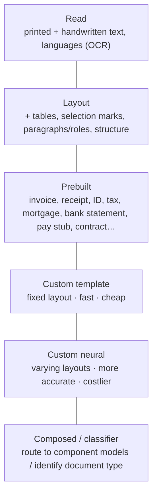
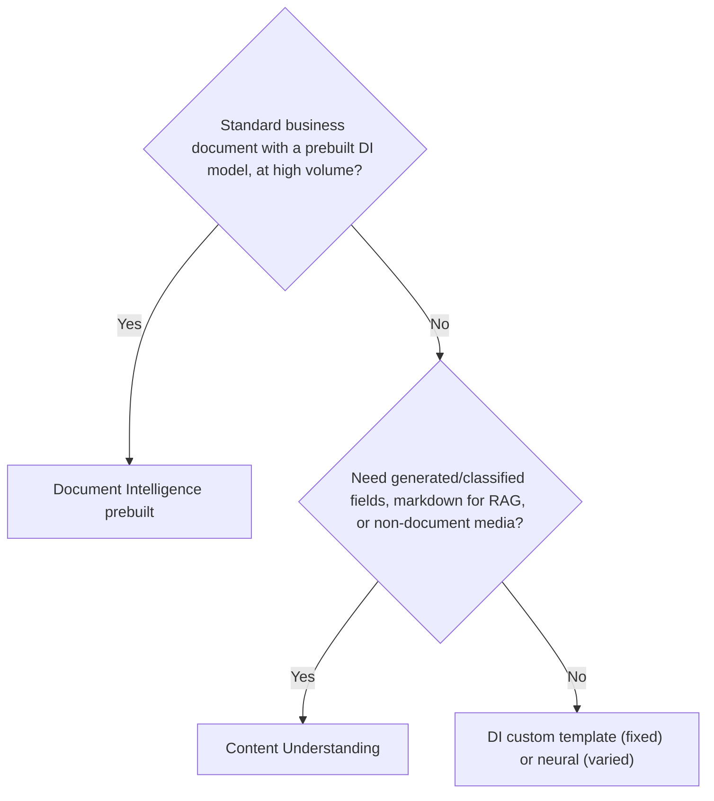

# OCR, layout and Document Intelligence

> AI-103 · D5 Implement information extraction solutions · about 60 min · Study Hub module `x02` ([open the hub](https://claude.ai/artifact/TdpMZLFYA9knTdjNyCms9F))

## Why it matters
"Extract information by using multimodal pipelines that combine OCR, layout analysis, and field extraction". Document Intelligence is the deterministic, form-focused engine; know its models, custom options and limits, and when CU is the better fit.

## Pre-question (answer before reading)
**Q:** Your forms always have the same fixed layout, you need a model trained in minutes, and cost matters. Custom template or custom neural model?

<details><summary>Answer</summary>

**Custom template**: fixed layouts, fast to train, cheaper. Custom **neural** handles varying layouts and is generally more accurate, but costs more to train and run.

</details>

## 🍎 Story time (kid version)
**Robo at Foundry Town Hall: Robo's reading glasses**

Robo owns several pairs of reading glasses. The plain pair reads every word, even messy handwriting. The table pair also sees boxes, rows and tick boxes. Special pairs know famous forms such as receipts, and find "Total" and "Shop name" at once. For Town Hall's own form, which always looks the same, Robo makes stencil glasses from 5 examples. For forms that keep changing shape, he trains smarter, flexible glasses.

| In the story | In Foundry |
|---|---|
| The plain pair | The Read model (OCR) |
| The table pair | The Layout model (tables, selection marks, structure) |
| Special pairs for famous forms | Prebuilt models (invoice, receipt, ID...) |
| Stencil glasses vs flexible glasses | Custom template vs custom neural models |

**Where the story breaks:** Stencil glasses fail as soon as a form's layout changes. That's when you need neural models or Content Understanding.

## Mental model & story (grown-up version)
Document Intelligence (DI) is a **precision scanner with specialist reading glasses**. The **Read** model sees printed and handwritten text and its language, line by line. The **Layout** model adds structure: paragraphs and their roles (title, section heading), tables, selection marks (checkboxes) and optional key-value pairs.

Then come specialist glasses: **prebuilt models** for invoices, receipts, IDs, health insurance cards, US tax forms, mortgage documents, bank statements, cheques, pay stubs, credit cards, contracts and more. Each returns typed fields (e.g. `VendorName`, `InvoiceTotal` as a currency) with confidence.

For your own forms you train **custom models**: **template** models for fixed layouts (quick, cheap, many languages) or **neural** models for varied layouts. A **composed model** routes each document to the right component model, and a **custom classifier** first identifies the document type. Training needs only a handful of labelled samples in a Blob container (the studio creates the label files for you).

Wide World Importers used DI for high-volume invoices and receipts (predictable, cheap, well-understood fields) and Content Understanding for messy multimodal intake (emails with photos, audio notes) where generative fields and markdown helped.

**Where the analogy breaks:** Specialist glasses only see what they were made for. A prebuilt invoice model won't understand your custom delivery note, and template models fail when layouts change, so choose neural or CU for variety.

## Diagrams
**Document Intelligence model families**



**DI or Content Understanding?**



## Key points
- Read = OCR (printed + handwritten, language per line, handwriting flag). Layout = Read + tables, selection marks, paragraphs with roles (title, sectionHeading), structure; key-value pairs as an option. (The old general document model is deprecated.)
- Prebuilt models include invoice, receipt, ID, health insurance card, US tax forms (W-2, 1098, 1099, 1040 and unified), mortgage forms, bank statement, cheque, pay stub, credit card, contract and marriage certificate.
- Custom **template** (fixed layout, trains in minutes, low cost, many languages) vs custom **neural** (varying layouts, higher accuracy, more cost). **Composed** models route to component models; a **custom classifier** identifies document types.
- Training: minimum about 5 labelled samples in a Blob container (with SAS); label files per sample (`ocr.json`, `labels.json`) plus `fields.json`, generated by the studio. Enable CORS on the storage account for the studio.
- Add-on capabilities: high-resolution OCR, formulas, font styles, barcodes, **query fields** (ask for extra fields without training), key-value pairs, searchable PDF output.
- Input limits (S0): JPEG, PNG, BMP, TIFF, PDF (and Office formats for Read); up to 500 MB (4 MB on the free tier); 50 × 50 to 10,000 × 10,000 pixels; no password-protected PDFs.
- SDK `azure-ai-documentintelligence`: `DocumentIntelligenceClient(endpoint, credential).begin_analyze_document("prebuilt-invoice", AnalyzeDocumentRequest(url_source=url), locale="en-US").result()` → `result.documents[0].fields["VendorName"]` (value + confidence); `result.pages[...].lines`, `result.tables`.
- DI = deterministic, form-focused, mature prebuilt models. CU = generative, schema-first (extract/classify/generate), any modality, markdown for RAG. AI-103 emphasises CU but expects you to pick DI where it fits.
- Both feed RAG: layout output (or CU markdown) preserves tables and headings for chunking.

## Comparisons
**Pick the model**

| Scenario | Choice |
|---|---|
| Digitise handwritten notes | Read |
| Extract tables from annual reports | Layout |
| 50,000 vendor invoices a month | Prebuilt invoice |
| Your fixed-layout warranty card | Custom template |
| Supplier forms in dozens of layouts | Custom neural (or CU) |
| Mixed bundle: route each form | Custom classifier + composed model |

## Code to recognise
**Prebuilt invoice extraction**

```python
from azure.ai.documentintelligence import DocumentIntelligenceClient
from azure.ai.documentintelligence.models import AnalyzeDocumentRequest
from azure.core.credentials import AzureKeyCredential

di = DocumentIntelligenceClient(endpoint=endpoint, credential=AzureKeyCredential(key))
poller = di.begin_analyze_document("prebuilt-invoice",
                                   AnalyzeDocumentRequest(url_source=invoice_url),
                                   locale="en-US")
result = poller.result()

inv = result.documents[0]
vendor = inv.fields.get("VendorName")
total = inv.fields.get("InvoiceTotal")
print(vendor.value_string, vendor.confidence)
print(total.value_currency.amount, total.value_currency.currency_symbol)
```

- Line 6: Model id as the first argument.
- Line 7: URL source here; bytes are also supported.
- Line 9: Long-running operation.
- Line 13: String fields expose `value_string` and `confidence`.
- Line 15: Currency fields expose amount and symbol.

## Portal steps
**Train a custom model** (Document Intelligence Studio > Custom extraction model > Create project)

1. Connect a Blob container (SAS) with at least ~5 sample forms; enable CORS for the studio.
2. Label fields on each sample (studio writes the label files).
3. Train: choose **template** (fixed) or **neural** (varied) build mode.
4. Test, then call the model id from code; compose models if you have several form types.

## Worked example
**Scenario:** An HR team receives 12 kinds of onboarding forms in one mixed PDF stream and needs fields from each kind.

- First identify each document's type → custom classifier.
- Then extract with the right model per type → composed model of custom (and prebuilt) models.
- Use template for fixed forms, neural for variable ones.

**Answer:** A **custom classifier** to split and identify document types, then a **composed model** routing each type to its component extraction model.

## Your turn (faded example)
**Scenario:** Upload of a 30 MB scanned PDF fails on your development resource.

- You created the resource on the free tier.
- **What's the likely limit?** <details><summary>answer</summary>The free (F0) tier accepts files up to 4 MB.</details>
- **Fix?** <details><summary>answer</summary>Use the S0 tier (up to 500 MB) or split/compress the file; also check it isn't password-protected.</details>

## Exam traps & misconceptions
- ✗ Choosing a template model for varied layouts. → ✓ Template needs fixed layouts; use neural (or CU).
- ✗ Using Read when you need tables. → ✓ Read is text only; Layout adds tables and structure.
- ✗ Expecting password-protected PDFs to work. → ✓ They're not supported.
- ✗ Training with a single sample. → ✓ You need several labelled samples (about 5 minimum).

## Discussion prompts
- **When would you migrate a DI workload to Content Understanding?** When you need generated or classified fields, markdown for RAG, multimodal inputs, or faster schema changes without retraining; keep DI where prebuilt models already perform well at low cost.
- **Why use query fields?** To pull a few extra fields from prebuilt or layout analysis without training a custom model.

## Interview angle / teach-back
**Prompt:** Explain the Document Intelligence model families and how to choose one.

**Rubric:** Read (OCR) vs Layout (structure/tables) · Prebuilt models for common documents · Custom template (fixed) vs neural (varied) · Composed models + classifier for mixed streams · When CU is better

**Model answer:** Read does OCR for printed and handwritten text; Layout adds tables, selection marks and paragraph structure. Prebuilt models extract typed fields from common documents such as invoices and receipts. For your own forms, train a custom template model for fixed layouts or a neural model for varied ones, compose them, and use a classifier to route mixed streams. Choose Content Understanding when you need generated fields, RAG-ready markdown or other media.

## Quick Q&A
- **OCR-only model?** Read.
- **Tables + structure?** Layout.
- **Fixed-layout custom model?** Custom template.
- **Varied layouts?** Custom neural.
- **Route to several models?** Composed model.
- **Free-tier file size limit?** 4 MB (S0: 500 MB).
- **Extra fields without training?** Query fields add-on.

## Sources (accessed 2026-10-02)
- [Lab: Extract data with Document Intelligence](https://microsoftlearning.github.io/mslearn-ai-information-extraction/Instructions/Exercises/03-document-intelligence.html)
- [Learning path: Extract insights from visual data](https://learn.microsoft.com/en-us/training/paths/insight-visual-data/)

## SRS cards created
- ai-103-x02-01, ai-103-x02-02, ai-103-x02-03, ai-103-x02-04
