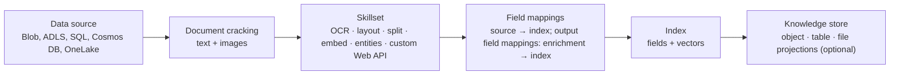
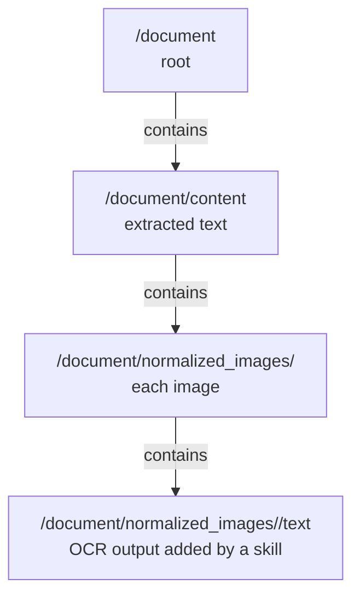

# Azure AI Search: ingest, enrich and index

> AI-103 · D5 Implement information extraction solutions · about 75 min · Study Hub module `x03` ([open the hub](https://claude.ai/artifact/TdpMZLFYA9knTdjNyCms9F))

## Why it matters
"Ingest and index content", "implement enrichment by using custom or built-in skills", and "monitor data ingestion quality and search index health". Azure AI Search's indexer pipeline is the backbone of enterprise RAG.

## Pre-question (answer before reading)
**Q:** A Blob container holds scanned PDFs. After indexing, searches can't find words that only appear in the scans. What's missing from the indexer pipeline?

<details><summary>Answer</summary>

An **OCR skill** in a skillset (with image extraction enabled) to read text from images, typically merged back into the content with a **merge skill**, and an attached Foundry resource for billing.

</details>

## Mental model & story
Azure AI Search is a **library with an automated cataloguing team**. A **data source** says where the books are (Blob Storage, ADLS Gen2, Azure SQL, Cosmos DB, OneLake…). An **indexer** is the cataloguer: it **cracks** each document open (extracts text and images), runs an optional **skillset** of AI skills to enrich it, maps the results into fields, and writes them to the **index**, the catalogue that queries search. It runs on a schedule and picks up changes.

Each skill reads from and writes to an **enrichment tree**, a growing JSON-like structure per document: `/document/content` is the extracted text, `/document/normalized_images/*` are images, and skills add nodes such as `/document/normalized_images/*/text` (OCR output) or `/document/merged_content`. Built-in skills cover OCR, image analysis, language detection, entity recognition, PII, translation, **text split** (chunking), **text merge**, the **shaper**, **Azure OpenAI embedding** (vectors), **document layout**, and GenAI prompt skills. When nothing fits, a **custom Web API skill** (usually an Azure Function) plugs in your own code using a simple `values` / `recordId` / `data` contract.

Enrichments can also be saved to a **knowledge store**: object projections (JSON in Blob), table projections (Table storage) and file projections (images), handy for analytics or Power BI.

Litware's index broke quietly one week: a new batch of PDFs was password-protected, so the indexer logged failures and the document count stopped growing. They now watch **indexer execution history** (success, failed and warning items), document counts, storage and query latency, and alert on failures.

**Where the analogy breaks:** A library cataloguer stops for help when a book is damaged. Indexers record errors and warnings and carry on (within your failure limits), so you must actively monitor them.

## Diagrams
**Indexer pipeline**



**Enrichment tree (per document)**



## Key points
- Components: **data source → indexer → (skillset) → index**, plus an optional **knowledge store**. Indexers run on schedules with change detection.
- **Field mappings** map source fields into index fields; **output field mappings** map enrichment nodes (e.g. `/document/merged_content`) into index fields.
- Built-in skills include OCR, image analysis, language detection, entity recognition, PII detection, translation, **text split** (chunking), **text merge**, **shaper**, **Azure OpenAI embedding**, **document layout**, and GenAI prompt skills. Billable AI skills need an **attached Foundry (AI services) resource** in the same region; a small free allowance (about 20 documents per indexer per day) exists for testing.
- **Custom Web API skill**: an HTTPS endpoint (often an Azure Function) receiving `{"values": [{"recordId", "data"}]}` and returning `{"values": [{"recordId", "data", "errors", "warnings"}]}`.
- Each skill has a `context` (where it runs in the tree, e.g. `/document/normalized_images/*`) and inputs/outputs; outputs of one skill can feed the next.
- Index field attributes: **key**, **searchable**, **filterable**, **sortable**, **facetable**, **retrievable**. Vector fields are `Collection(Edm.Single)` with **dimensions** and a **vector profile** (HNSW or exhaustive KNN).
- **Integrated vectorization**: text split + embedding skills at indexing time, and a **vectorizer** on the index so queries can be vectorised automatically.
- Knowledge store projections: **object** (JSON → Blob), **table** (Table storage, relational analysis), **file** (images → Blob); a shaper skill builds the projection shape.
- Index health: indexer execution history (succeeded, failed, warnings), document count and storage size, skill errors (e.g. OCR on unreadable scans), query latency/throttling; set alerts.

## Comparisons
**Index field attributes**

| Attribute | Lets you… |
|---|---|
| searchable | full-text search the field |
| filterable | use it in $filter (exact match, ranges) |
| sortable | $orderby on it |
| facetable | build facet counts (category refiners) |
| retrievable | return it in results |
| key | uniquely identify each document (string) |

## Code to recognise
**A skill pair: OCR on images, then merge into content**

```json
{
  "skills": [
    { "@odata.type": "#Microsoft.Skills.Vision.OcrSkill",
      "context": "/document/normalized_images/*",
      "inputs":  [{ "name": "image", "source": "/document/normalized_images/*" }],
      "outputs": [{ "name": "text", "targetName": "text" }] },
    { "@odata.type": "#Microsoft.Skills.Text.MergeSkill",
      "context": "/document",
      "inputs": [{ "name": "text", "source": "/document/content" },
                 { "name": "itemsToInsert", "source": "/document/normalized_images/*/text" },
                 { "name": "offsets", "source": "/document/normalized_images/*/contentOffset" }],
      "outputs": [{ "name": "mergedText", "targetName": "merged_content" }] }
  ]
}
```

- Line 4: Runs once per extracted image.
- Line 6: Adds `/document/normalized_images/*/text`.
- Line 8: Merge inserts OCR text back at the image positions.
- Line 13: Map `/document/merged_content` to an index field with an output field mapping.

**A custom Web API skill response (Azure Function)**

```json
{
  "values": [
    { "recordId": "r1",
      "data": { "riskLevel": "high" },
      "errors": [], "warnings": [] }
  ]
}
```

- Line 3: Echo each input recordId so results line up.
- Line 4: Outputs go under `data`.

## Portal steps
**Import and vectorize data** (Azure portal > AI Search service > Import data (new))

1. Pick the data source (e.g. Blob container) and authentication.
2. Choose enrichment: OCR, layout, chunking; attach a Foundry resource.
3. Choose an embedding model for vectorization (integrated vectorization).
4. Review the generated index, indexer and skillset; run; check indexer status and document count.

## Worked example
**Scenario:** A legal archive mixes born-digital PDFs and scanned images. Searches must find text in both, and lawyers want results filtered by case number and sorted by date.

- Scanned text → enable image extraction + OCR skill + merge skill.
- Case number → a **filterable** field; date → **sortable** (and filterable) field.
- Map merged content to a searchable field via output field mappings.

**Answer:** Indexer with **image extraction + OCR + merge** skills, `merged_content` mapped to a **searchable** field, `caseNumber` **filterable**, `filedDate` **sortable/filterable**.

## Your turn (faded example)
**Scenario:** Your Azure Function skill returns results, but the indexer reports that outputs are missing for each document.

- The indexer matches outputs to inputs by an identifier.
- **Which field must be echoed back?** <details><summary>answer</summary>`recordId` for each value.</details>
- **Where must the output values live?** <details><summary>answer</summary>Under `data` in each value.</details>

## Exam traps & misconceptions
- ✗ Forgetting to attach a Foundry resource for billable skills. → ✓ Beyond the small free allowance, AI skills need an attached resource.
- ✗ Mapping enrichment outputs with field mappings. → ✓ Enrichment nodes use **output** field mappings.
- ✗ Making a field facetable when you only need to filter. → ✓ Each attribute adds index size; enable only what you use.
- ✗ Assuming indexer failures stop the run and alert you. → ✓ Failed items are logged; you must monitor execution history.

## Discussion prompts
- **Why chunk with the text split skill before embedding?** Embedding models have input limits and long documents dilute meaning; chunks give precise retrieval and fit the context window. Overlap preserves context across boundaries.
- **When would you write a custom Web API skill?** When enrichment needs logic no built-in skill provides: calling a proprietary classifier, looking up master data, or calling Content Understanding with a custom analyzer.

## Interview angle / teach-back
**Prompt:** Explain how an Azure AI Search indexer turns files in Blob Storage into a searchable, enriched index.

**Rubric:** Data source + indexer + index (+ schedule/change detection) · Document cracking and enrichment tree · Skillset: built-in (OCR, split, embed…) + custom Web API · Field mappings vs output field mappings · Monitor indexer execution history and index health

**Model answer:** The indexer reads from a data source, cracks each file into text and images, and runs a skillset whose skills read and write nodes in an enrichment tree (OCR for images, text split for chunks, embeddings for vectors, or custom Web API skills). Field mappings move source fields, and output field mappings move enrichment results, into index fields with attributes such as searchable or filterable. It runs on a schedule with change detection, and you monitor execution history, failed items and document counts.

## Quick Q&A
- **Pipeline order?** Data source → indexer → skillset → index.
- **Extracted text node?** `/document/content`.
- **OCR output node?** `/document/normalized_images/*/text`.
- **Map enrichments to fields?** Output field mappings.
- **Custom skill contract key?** `values` with `recordId` + `data`.
- **Knowledge store projections?** Object, table, file.
- **Vector field type?** `Collection(Edm.Single)` + dimensions + profile.

## Sources (accessed 2026-10-02)
- [Lab: Create a knowledge mining solution](https://microsoftlearning.github.io/mslearn-ai-information-extraction/Instructions/Exercises/04-knowledge-mining.html)
- [Azure AI Search overview](https://learn.microsoft.com/en-us/azure/search/search-what-is-azure-search)

## SRS cards created
- ai-103-x03-01, ai-103-x03-02, ai-103-x03-03, ai-103-x03-04
