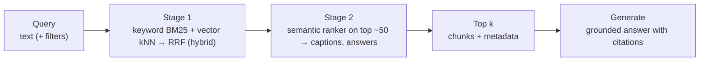
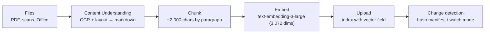

# Search for grounding: vector, hybrid, semantic and RAG pipelines

> AI-103 · D5 Implement information extraction solutions · about 80 min · Study Hub module `x04` ([open the hub](https://claude.ai/artifact/TdpMZLFYA9knTdjNyCms9F))

## Why it matters
"Configure semantic search, hybrid search, and vector search for grounding", "configure RAG ingestion flow, including OCR", and "connect retrieval pipelines directly to workflows and agent tools". This module completes the RAG story end to end.

## Pre-question (answer before reading)
**Q:** What does the semantic ranker change: which documents are retrieved, or their order?

<details><summary>Answer</summary>

Their **order** (and it adds captions and answers). It re-ranks the top results from a keyword or hybrid query using a language model; it doesn't find documents the first stage missed.

</details>

## Mental model & story
A search query is a **two-stage talent show**. Stage one finds candidates. **Keyword search** (BM25) uses the **simple** or **full Lucene** syntax (fuzzy `~`, proximity, boosting `^`, wildcards, regex) with **filters** (`$filter`), **facets** and **sorting**. **Vector search** finds nearest neighbours by meaning, with a `VectorizedQuery` (you pass the vector) or a `VectorizableTextQuery` (the index's vectorizer embeds the text). **Hybrid search** runs both and fuses the rankings with **Reciprocal Rank Fusion (RRF)**.

Stage two is the judges: the **semantic ranker** re-scores the top results (about 50) with a language model and can return **captions** (key sentences) and **answers** (extracted spans). It needs a **semantic configuration** naming the title, content and keyword fields.

Adventure Works built their **RAG ingestion pipeline** like the official lab: Content Understanding turns each document (including scans, via OCR and layout) into markdown; a script chunks by paragraph (about 2,000 characters), embeds each chunk with text-embedding-3-large (3,072 dimensions) and uploads to an index with a vector field; a manifest of file hashes means only changed files are reprocessed. A watch mode picks up new files automatically.

Finally the pipeline connects to consumers: an **agent** gets the Azure AI Search tool (or a **Foundry IQ** knowledge base via MCP), a **workflow** has a retrieval step, and a plain app runs hybrid queries then prompts the model to answer only from the retrieved chunks with citations.

**Where the analogy breaks:** Talent-show judges only see who made the shortlist. If stage one misses the right document (bad chunking, wrong embedding model, vector-only search for codes), no re-ranker can bring it back.

## Diagrams
**Query time: two stages**



**RAG ingestion (lab pattern)**



## Key points
- Query parameters: `search` (text), `searchFields`, `select`, `$filter` (OData; string values are case-sensitive), `$orderby` (sortable fields), `facet`, `top`/`skip`, `searchMode` (any/all), `count`. `queryType=full` enables Lucene syntax: fuzzy `~`, proximity, boosting `^`, wildcards, regex.
- Scoring: BM25 relevance; **scoring profiles** boost fields or freshness.
- **Vector search**: `VectorizedQuery(vector=..., k_nearest_neighbors=..., fields="content_vector")`, or `VectorizableTextQuery(text=...)` when the index has a **vectorizer**. Algorithms: HNSW (approximate, fast) or exhaustive KNN (exact, slower).
- **Hybrid**: pass `search_text` **and** `vector_queries` in the same request; results are fused with **RRF**. Usually the best default for grounding.
- **Semantic ranker**: `query_type="semantic"` + `semantic_configuration_name`; re-ranks top results, adds captions and answers. It improves order, not recall.
- Embedding consistency: same model and dimensions for documents and queries (e.g. text-embedding-3-large = 3,072 dimensions).
- RAG ingestion with OCR: extract (CU or DI layout) → markdown → chunk (with sensible boundaries/overlap) → embed → index; track changes (hashes) so you only reprocess what changed.
- Connect retrieval to consumers: Azure AI Search tool on an agent, Foundry IQ knowledge bases (MCP), workflows with a retrieval step, or your own code; always pass citations back to users.
- Measure relevance with labelled queries (precision@k, recall, nDCG) and retrieval/groundedness evaluators; tune chunking, fields, weights and the semantic configuration.

## Comparisons
**Search modes for grounding**

| Mode | Strength | Weakness |
|---|---|---|
| Keyword (BM25) | Exact terms, codes, names, filters | Misses synonyms and paraphrases |
| Vector | Meaning, paraphrases, multilingual | Weak on rare exact tokens (IDs) |
| Hybrid (RRF) | Best of both; robust default | Slightly more cost/latency |
| + Semantic ranker | Better top results, captions, answers | Can't recover missed documents |

## Code to recognise
**Hybrid + semantic query in Python**

```python
from azure.search.documents import SearchClient
from azure.search.documents.models import VectorizableTextQuery

results = search_client.search(
    search_text="refund policy for damaged goods",
    vector_queries=[VectorizableTextQuery(text="refund policy for damaged goods",
                                          k_nearest_neighbors=50, fields="content_vector")],
    query_type="semantic", semantic_configuration_name="default",
    filter="region eq 'EU'",
    select=["title", "content", "url"], top=5)

for r in results:
    print(r["title"], r["@search.reranker_score"])
```

- Line 5: Keyword half of the hybrid query.
- Line 6: The index's vectorizer embeds this text: no client-side embedding call.
- Line 7: k sets how many vector neighbours enter fusion.
- Line 8: Semantic ranker re-orders the fused results.
- Line 9: OData filter narrows candidates (filterable field).
- Line 13: Semantic results carry a reranker score.

**Ingestion step: chunk, embed, upload**

```python
chunks = [p for p in markdown.split("\n\n") if p.strip()]       # paragraph chunks
batch = []
for i, chunk in enumerate(chunks):
    vec = client.embeddings.create(model="embed-3-large", input=chunk).data[0].embedding
    batch.append({"id": f"{doc_id}-{i}", "title": title, "content": chunk,
                  "content_vector": vec, "url": source_url})
search_client.upload_documents(documents=batch)
```

- Line 1: Split CU markdown on paragraph boundaries (the lab caps chunk size).
- Line 4: Same embedding model as queries; 3,072 dims for text-embedding-3-large.
- Line 5: Deterministic ids let you replace a document's chunks when it changes.
- Line 7: Upload (or merge) documents into the index.

## Portal steps
**Add semantic ranking** (Azure portal > AI Search > Indexes > (index) > Semantic configurations)

1. Create a semantic configuration: title field, content fields, keyword fields.
2. Enable the semantic ranker plan on the service if needed.
3. Test in Search explorer with query type semantic; compare with plain hybrid.

## Worked example
**Scenario:** A support RAG app answers well for descriptive questions but poorly when users paste error codes like `0x80070005`, and the best document is often ranked 4th or 5th.

- Error codes → keyword matching needed → hybrid search.
- Right document present but low → semantic ranker to re-order.
- Keep k high enough (e.g. 50) so the right chunk enters fusion.

**Answer:** Switch to **hybrid search** (keyword + vector, RRF) and add the **semantic ranker** with a semantic configuration; return top 3–5 chunks with citations.

## Your turn (faded example)
**Scenario:** After switching embedding models, vector search returns nonsense.

- Documents were embedded with the old model.
- **What's wrong?** <details><summary>answer</summary>Queries and documents now use different embedding models (and maybe dimensions).</details>
- **Fix?** <details><summary>answer</summary>Re-embed all documents with the new model (rebuild or create a new index, then switch), keeping one model for both sides.</details>

## Exam traps & misconceptions
- ✗ Expecting the semantic ranker to find documents keyword/vector search missed. → ✓ It only re-orders the top results.
- ✗ Filtering on a field that isn't filterable. → ✓ Mark it filterable in the schema.
- ✗ Using `VectorizableTextQuery` without a vectorizer on the index. → ✓ Then pass your own vector with `VectorizedQuery`.
- ✗ Changing the embedding model without re-indexing. → ✓ Vectors must come from the same model.
- ✗ Lowercase/uppercase mismatch in `$filter` values. → ✓ Filter string comparisons are case-sensitive.

## Discussion prompts
- **How would you tune retrieval for a RAG app?** Build 50–100 labelled queries, measure precision@k and nDCG, compare keyword, vector, hybrid and hybrid+semantic, adjust chunk size/overlap and fields, then re-check groundedness of answers.
- **Agent tool, Foundry IQ or custom code to connect retrieval?** Azure AI Search tool for one agent and an existing index; Foundry IQ for shared, multi-source knowledge across agents; custom code when you need full control over query construction and prompt assembly.

## Interview angle / teach-back
**Prompt:** Explain end to end how documents become grounded answers: ingestion, search modes and connection to an agent.

**Rubric:** Ingestion: OCR/layout → markdown → chunk → embed → index; change detection · Keyword vs vector vs hybrid (RRF) · Semantic ranker re-orders top results; captions/answers · Same embedding model both sides · Connect via AI Search tool / Foundry IQ / workflow; cite sources

**Model answer:** Ingestion turns each file into structured markdown (OCR and layout via Content Understanding), splits it into chunks, embeds each chunk with one embedding model and uploads it to an index, reprocessing only changed files. At query time, hybrid search combines keyword and vector results with RRF, and the semantic ranker re-orders the top results and adds captions. The agent reaches the index through the Azure AI Search tool or a Foundry IQ knowledge base and answers only from retrieved chunks, citing them.

## Quick Q&A
- **Fusion method for hybrid?** Reciprocal Rank Fusion (RRF).
- **Semantic ranker changes…** Order of top results (+ captions/answers), not recall.
- **Let the index embed query text?** `VectorizableTextQuery` + vectorizer.
- **Lucene syntax for fuzzy?** `~` with queryType=full.
- **text-embedding-3-large dimensions?** 3,072.
- **Is $filter case-sensitive for strings?** Yes.

## Sources (accessed 2026-10-02)
- [Lab: Build an automated RAG ingestion pipeline](https://microsoftlearning.github.io/mslearn-ai-information-extraction/Instructions/Exercises/05-rag-pipeline.html)
- [Hybrid search](https://learn.microsoft.com/en-us/azure/search/hybrid-search-overview)
- [Semantic ranking](https://learn.microsoft.com/en-us/azure/search/semantic-search-overview)

## SRS cards created
- ai-103-x04-01, ai-103-x04-02, ai-103-x04-03, ai-103-x04-04
