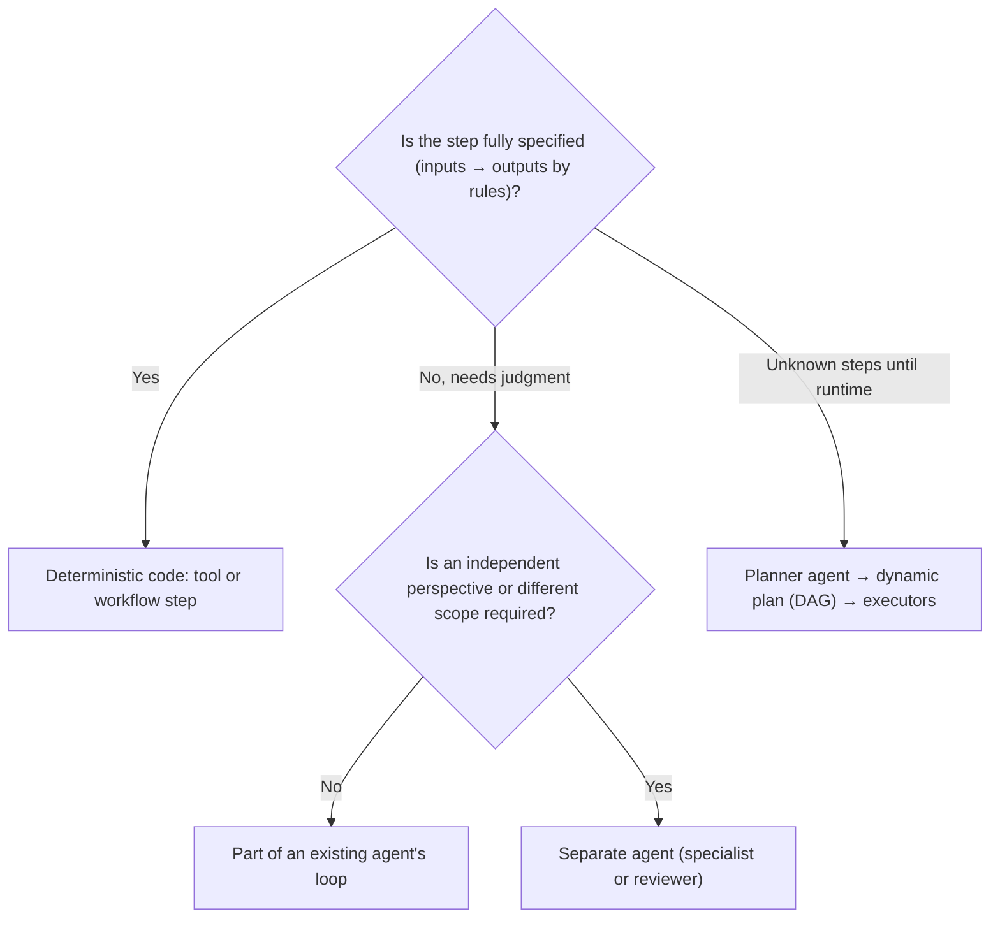
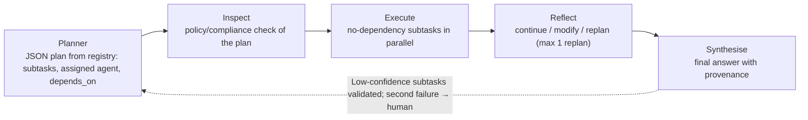

# Decompose goals into workflows, agents and tools

> AI-500 · D1 Architect multi-agent solutions · about 80 min · Study Hub module `a01` ([open the hub](https://claude.ai/artifact/WBg4UvZLizXnza8mbGvMze))

## Why it matters
The first skill in the outline, and the one every case study leans on: given a business goal, what becomes a **deterministic workflow step**, what becomes an **agent**, and what becomes a **tool**? Wrong cuts create nano-agents, lost context and runaway cost.

## Pre-question (answer before reading)
**Q:** A mortgage pre-approval process has 9 steps. Seven are fixed rules (fetch credit score, compute ratios, check thresholds). Two need judgment (explain unusual income, draft a decision letter). How many agents do you need?

<details><summary>Answer</summary>

Probably **one or two**. The seven fixed steps are **tools or workflow steps** (deterministic code is cheaper, testable and auditable). Judgment steps go to an agent; a separate agent is justified only if, e.g., the letter must be checked independently.

</details>

## Mental model & story
Woodgrove Bank wants an assistant that prepares mortgage pre-approvals. The first design from an enthusiastic team had **nine agents**, one per step. It cost 11 model calls per application, took 40 seconds, and the *ratio calculator agent* occasionally did arithmetic wrong.

The architect, **Tom**, redrew it with three questions per step. *Is the step fully specified?* Then it's **code** — a tool or a workflow step (credit score lookup, debt-to-income ratio). *Does it need judgment over unstructured input?* Then it's an **agent** task (interpret irregular income documents). *Does it need an independent opinion?* Then it's a **second agent** (a reviewer for decline letters).

For the agent parts he chose **prompt chaining** with JSON contracts: step 1 extracts income facts in a strict schema, a validation gate checks the schema and the numbers, step 2 interprets them. Only the specific fields pass forward, never the whole previous output. Failed steps retry alone from a checkpoint.

For unusual cases — self-employed applicants with foreign income — a **planner** produces a JSON plan of subtasks from an **agent registry** (capabilities, latency, cost), with dependencies forming a DAG. Independent subtasks run in parallel; a reviewer can inspect the plan before execution (plan-and-execute). One replan is allowed; after that, a human takes over.

The final system: one orchestrated workflow, two agents (analyst and reviewer), eight tools. Three model calls per application, 9 seconds, and arithmetic that's always right because a tool does it.

**Where the analogy breaks:** Decomposition is not free modularity. Every boundary is a place where context can be lost (summary-of-summary collapse), latency is added and contracts must be versioned. Integrative reasoning (e.g., an economist weighing many interacting factors) often degrades when split across agents.

## Diagrams
**Workflow step, tool or agent?**



**Plan-and-execute with a dependency DAG**



## Key points
- Three cuts: **deterministic step** (code/tool/workflow node), **agent** (judgment over unstructured input), **separate agent** (different context, identity, model, owner, or an independent check).
- **Prompt chaining**: linear steps with strict **JSON contracts**, schema + semantic **validation gates** between steps; pass specific fields, not whole outputs; checkpoint step outputs and retry only the failed step (transient → exponential backoff 2/4/8 s; persistent → fail fast).
- **Branching chains**: classify first, then route to the chain for that class.
- **Dynamic decomposition**: a planner (meta-agent) emits a JSON plan — `task_id`, description, `assigned_agent`, `depends_on`, `expected_output_format`, reasoning — using an **agent registry** (capabilities, latency, cost). Resolve dependencies as a DAG; run independent subtasks in parallel.
- **Plan-and-execute** gives an inspection/compliance point before anything runs; reflection decides continue / modify / replan (limit replans, e.g., 1).
- **Handoff contracts**: task description, context summary, source agent, confidence, reason for handoff, expected output format, timeout. Pass full relevant history to avoid summary-of-summary collapse; separate completed work from remaining work.
- **Granularity**: coarse (1–2 agents), **medium (3–5) usually best quality-to-cost**, fine (6+) diminishing returns. Quality-to-cost ratio = quality % gain ÷ cost % increase.
- Put boundaries at **capability interfaces**: each agent produces a complete artifact and the next needs only that output.
- Anti-patterns: **nano-tasking** (agent for what a tool does), **redundant coordination** (splitting shared context), **decomposition for its own sake**; integrative reasoning → keep in one agent.
- Adaptive granularity: simple queries take a short path; complex ones get the planner.

## Comparisons
**Decomposition strategies**

| Strategy | Best for | Risks |
|---|---|---|
| Prompt chaining (fixed) | Known steps with clear contracts | Rigid; one bad step blocks the chain (use gates + retries) |
| Branching chains | A few known request types | Misclassification; needs a fallback branch |
| Dynamic plan (planner + DAG) | Varied, multi-part requests | Plan errors; cost; needs inspection and replan limits |
| Handoff between specialists | Conversation moves between domains | Ping-pong loops; context loss; depth limits needed |
| Single agent with tools | Integrative reasoning, small scope | Prompt/tool sprawl as scope grows |

**Granularity trade-off (illustrative)**

| Granularity | Agents | Typical outcome |
|---|---|---|
| Coarse | 1–2 | Cheapest; may miss specialist quality |
| Medium | 3–5 | Usually best quality-to-cost |
| Fine | 6+ | More cost and latency; diminishing returns |

## Code to recognise
**A planner's JSON plan (validated before execution)**

```json
{
  "complexity_assessment": "high: self-employed applicant with foreign income",
  "subtasks": [
    { "task_id": "t1", "description": "Extract income facts from tax returns",
      "assigned_agent": "income-extractor", "depends_on": [],
      "expected_output_format": "IncomeFacts v2 (JSON schema)" },
    { "task_id": "t2", "description": "Convert foreign income using official rates",
      "assigned_agent": "tool:fx_rates", "depends_on": ["t1"],
      "expected_output_format": "number (GBP)" },
    { "task_id": "t3", "description": "Check credit file",
      "assigned_agent": "tool:credit_bureau", "depends_on": [],
      "expected_output_format": "CreditSummary v1" },
    { "task_id": "t4", "description": "Assess affordability and draft rationale",
      "assigned_agent": "underwriting-analyst", "depends_on": ["t2", "t3"],
      "expected_output_format": "Decision v3 with citations" }
  ]
}
```

- Line 2: The planner states why the case is complex: useful for routing and audit.
- Line 5: Each subtask names an agent or a tool from the registry.
- Line 8: Deterministic work is assigned to tools, not agents.
- Line 11: `depends_on` builds the DAG: t1 and t3 can run in parallel.
- Line 15: Contracts are versioned schemas, so a gate can validate each output.

## Portal steps
**Prototype a decomposition quickly** (Foundry > Build > Workflows (or Agent Framework in VS Code))

1. Model the fixed steps as workflow actions or tools first.
2. Add one agent node for the judgment step; give it a strict output schema.
3. Add a validation step (schema + business rules) after each agent node.
4. Trace a few runs and count model calls, latency and failures per step before adding more agents.

## Worked example
**Scenario:** An insurer's FNOL (first notice of loss) intake: capture claim details, verify policy coverage (rules), estimate damage from photos, detect fraud signals, and write a summary for an adjuster. Decompose it.

- Coverage check is rules → tool.
- Damage estimate from photos needs vision judgment → agent (or a vision tool/model call inside the intake agent).
- Fraud signals are owned by the fraud team → their agent via A2A or a scoring tool.
- Summary can be produced by the intake agent at the end; no separate writer agent unless an independent check is required.

**Answer:** **Intake agent** (conversation + vision analysis) with **tools**: policy coverage rules, photo storage, fraud score (fraud team's service/agent via A2A). A **workflow** sequences: capture → coverage tool → fraud check (parallel with damage estimate) → summary. Two agents at most; everything rule-based stays in code.

## Your turn (faded example)
**Scenario:** A planner sometimes assigns the same subtask twice and the system loops on replanning.

- Plans need validation and replan limits.
- **What do you validate before execution?** <details><summary>answer</summary>Schema, unique task IDs, acyclic dependencies, agents/tools exist in the registry, and policy constraints.</details>
- **What stops the replan loop?** <details><summary>answer</summary>A replan limit (e.g., 1), then escalate to a human or return a partial result.</details>

## Exam traps & misconceptions
- ✗ Creating an agent for arithmetic or lookups. → ✓ Deterministic steps belong in tools/code: cheaper, testable, always right.
- ✗ Passing each agent the previous agent's summary of a summary. → ✓ Pass the relevant original facts/fields; avoid context collapse.
- ✗ Unlimited replanning. → ✓ Cap replans; escalate after the limit.
- ✗ Splitting tightly coupled reasoning across agents. → ✓ Integrative reasoning works better in one agent with the full picture.
- ✗ Choosing fine granularity "for flexibility". → ✓ Medium granularity usually wins on quality-to-cost; measure before splitting further.

## Discussion prompts
- **How would you measure whether a decomposition is better?** Run the same evaluation set through both designs: task success, quality scores, model calls, tokens, latency and failure rate per step. Compute a quality-to-cost ratio and inspect traces for context loss at boundaries.
- **When is a planner worth its cost?** When request shapes vary widely and fixed chains would need many branches. For a handful of known request types, branching chains are cheaper and more predictable.

## Interview angle / teach-back
**Prompt:** Explain how you decide what becomes a workflow step, a tool, an agent or a separate agent, and how you pass work between them.

**Rubric:** Deterministic → code/tool/workflow · Judgment → agent; independent check/scope → separate agent · JSON contracts + validation gates; pass specific fields · Planner with registry and DAG; plan inspection; replan limit · Granularity: medium usually best; avoid anti-patterns

**Model answer:** If a step is fully specified I make it code — a tool or a workflow step. Judgment over unstructured input goes to an agent, and I add a separate agent only for a different scope, owner, model or an independent check. Between steps I use strict JSON contracts with validation gates and pass only the fields needed. For varied requests a planner builds a DAG of subtasks from an agent registry, which I inspect before execution, with one replan at most. Medium granularity, three to five agents, is usually the best quality-to-cost; I avoid nano-agents and splitting integrative reasoning.

## Quick Q&A
- **Deterministic step belongs in?** Code: a tool or workflow step.
- **What sits between chained prompts?** JSON contracts + validation gates.
- **Planner output?** JSON plan: subtasks, assigned agent, depends_on, output format.
- **Usual best granularity?** Medium: 3–5 agents.
- **Nano-tasking?** An agent doing what a tool should do.
- **Replan policy?** Limit (e.g., 1), then escalate.
- **Avoid in handoffs?** Summary-of-summary context collapse.

## Sources (accessed 2026-10-02)
- [Course AI-500T00-A (official learning paths)](https://learn.microsoft.com/en-us/training/courses/ai-500t00)
- [AI agent orchestration patterns](https://learn.microsoft.com/en-us/azure/architecture/ai-ml/guide/ai-agent-design-patterns)
- [Agent Framework workflows](https://learn.microsoft.com/en-us/agent-framework/workflows/overview)

## SRS cards created
- ai-500-a01-01, ai-500-a01-02, ai-500-a01-03, ai-500-a01-04
