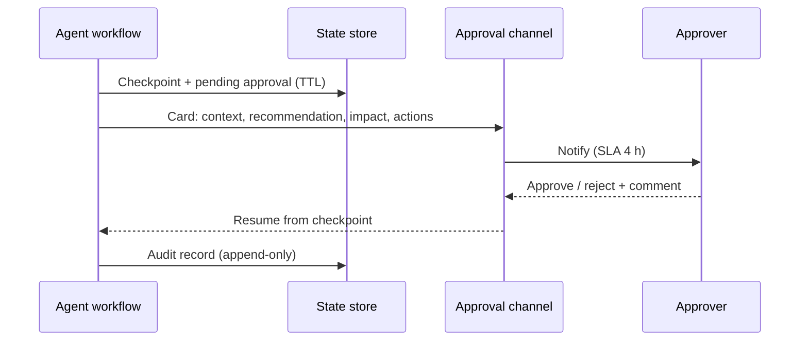

# Workflows, control loops and human-in-the-loop design

> AI-500 · D1 Architect multi-agent solutions · about 80 min · Study Hub module `a02` ([open the hub](https://claude.ai/artifact/WBg4UvZLizXnza8mbGvMze))

## Why it matters
*Design workflows, including agents, subagents, control loops, and human-in-the-loop* is where architecture meets risk. The exam wants loops that terminate, subagents with clear contracts, autonomy levels matched to impact, and human checkpoints that are durable, timed and audited.

## Pre-question (answer before reading)
**Q:** An agent proposes refunds. 99% are under $20. Should every refund wait for a human?

<details><summary>Answer</summary>

No. Match **autonomy to impact and calibrated confidence**: auto-execute low-risk, high-confidence actions; require approval for high-impact or low-confidence ones; always escalate policy exceptions. Blanket approval creates queues and rubber-stamping.

</details>

## Mental model & story
Contoso Telecom's retention agent can offer credits, plan changes and cancellations. In the pilot every action waited for a human, the queue hit 3,000 items, and supervisors approved 99.7% without reading — *rubber-stamping*.

The redesign set **autonomy levels** per action. Credits under $10 with high confidence: **full-auto**, logged. Plan changes: **supervised** (executed, then sampled for review). Credits over $200, more than ten customers affected, or anything irreversible: **approval-required** — the workflow pauses, posts an adaptive card in Teams, and waits.

The wait is **durable**: state is written to Cosmos DB, the workflow checkpoint is saved, and no compute runs while a human thinks. If the approver doesn't answer within the SLA (4 hours standard, 1 hour urgent), it escalates to a senior reviewer; if that also times out, the default is **reject** with a notification.

The control loop around the agent got limits too: a maximum number of iterations, a token budget and a completion signal; a **reflection** step only on high-stakes outputs; and subagents with **narrow contracts** (inputs, outputs, timeout) so the orchestrator can retry or reroute them.

Three months later: 85% of actions run automatically, approvals take a median of 11 minutes, and the rejection rate on approvals is 13% — proof that humans are actually reviewing.

**Where the analogy breaks:** Confidence scores from models are not probabilities out of the box. A model saying 0.90 may be right only 65% of the time. Thresholds only work after **calibration** on labelled outcomes, per model and task.

## Diagrams
**Autonomy by impact and confidence**

| | Low impact | High impact / irreversible |
|---|---|---|
| **High calibrated confidence** | **Full-auto**: execute + log; sample for QA | **Approval-required**: pause for a human; audit |
| **Low calibrated confidence** | **Supervised / clarify**: ask the user or a reviewer; cheap to fix | **Escalate**: human decides; agent provides analysis |

**Durable approval step**



## Key points
- Workflow structures: sequential steps, branches, **bounded loops** (exit criteria + caps), **subagents** with narrow contracts (inputs, outputs, timeout), parallel fan-out/fan-in, checkpoints for resume.
- Control loop guards: iteration cap, token budget, wall-clock timeout, semantic completion signal, and an escalation/partial-result path.
- Reflection patterns: plan-then-act, act-then-reflect (critique), iterative refinement with thresholds or an external validator; cap at 3 cycles (1 for latency-sensitive).
- **Autonomy levels**: full-auto → supervised (act, then review samples) → approval-required (block until authorised) → human-only.
- Escalation triggers in priority order: **policy exception** (always) → business impact × calibrated confidence → ambiguity (multiple valid interpretations).
- Example thresholds: low-risk > 0.60, moderate > 0.75, high-risk > 0.88, policy exceptions 1.0 (= always escalate) — only after **calibration** (≈2,000 labelled decisions, recalibrate quarterly).
- Durable HITL: externalise state, pause with zero compute, survive restarts, resume at the pause point; never block a thread waiting synchronously.
- Approval SLAs and timeouts: e.g., standard 4 h, urgent 1 h, escalated 24 h; on timeout escalate, then default **reject** (or auto-approve only for trivial, reversible cases).
- Approval requests must carry context: customer/context summary, agent recommendation and why, impact, exact actions on approval, approve/reject + comment.
- Health signals: escalation rate > 35% (too conservative or capability gap), ~100% approvals (rubber-stamping), 12–15% rejection (meaningful oversight).

## Comparisons
**Where to put the human**

| Point | Use when | Example |
|---|---|---|
| Before execution (approval gate) | High impact or irreversible actions | Payout > $200, account closure |
| After execution (review/sampling) | Low impact, reversible, high volume | Plan change, sampled 5% weekly |
| Clarification with the user | Ambiguous intent | "Which of your two accounts?" |
| Override / takeover | Agent stuck or user unhappy | Live agent takes the conversation |
| Plan inspection | Dynamic plans in regulated flows | Compliance checks the plan before it runs |

## Code to recognise
**LangGraph: a supervised workflow that pauses before a payout**

```python
from typing import TypedDict
from langgraph.graph import StateGraph, START, END
from langgraph.types import interrupt, Command
from langgraph.checkpoint.postgres import PostgresSaver   # durable: survives restarts

class Claim(TypedDict):
    claim_id: str
    proposal: dict
    confidence: float
    approved: bool

def assess(state: Claim) -> dict: ...           # agent proposes payout + calibrated confidence

def approval_gate(state: Claim) -> dict:
    high_impact = state["proposal"]["amount"] > 200
    if high_impact or state["confidence"] < 0.88:
        decision = interrupt({"claim": state["claim_id"], "proposal": state["proposal"]})
        return {"approved": decision["approved"]}
    return {"approved": True}

def execute_payout(state: Claim) -> dict: ...   # tool call; runs only when approved

g = StateGraph(Claim)
g.add_node("assess", assess)
g.add_node("approval_gate", approval_gate)
g.add_node("execute_payout", execute_payout)
g.add_edge(START, "assess")
g.add_edge("assess", "approval_gate")
g.add_conditional_edges("approval_gate", lambda s: "pay" if s["approved"] else "stop",
                        {"pay": "execute_payout", "stop": END})
g.add_edge("execute_payout", END)

with PostgresSaver.from_conn_string(DB_URI) as saver:
    saver.setup()
    app = g.compile(checkpointer=saver)
    cfg = {"configurable": {"thread_id": "claim-8841"}}
    app.invoke({"claim_id": "claim-8841"}, cfg)          # runs until interrupt() pauses it
    app.invoke(Command(resume={"approved": True}), cfg)  # the approver's decision resumes it
```

- Line 4: A durable checkpointer (Postgres) saves the thread so a paused run survives restarts; MemorySaver is for tests only.
- Line 16: Routing combines impact and calibrated confidence.
- Line 17: `interrupt()` pauses inside the node and hands the payload to your approval UI. Nothing blocks a thread while it waits.
- Line 29: Rejected claims end without paying.
- Line 37: The first call stops at the interrupt.
- Line 38: `Command(resume=...)` passes the decision back as the return value of `interrupt()`. (LangGraph's static `interrupt_before` is meant for debugging, not HITL.)

## Portal steps
**Human-in-the-loop in Foundry workflows** (Foundry > Build > Workflows > (workflow))

1. Add the agent node that proposes the action with a structured output (action, amount, confidence).
2. Add a condition on impact/confidence.
3. On the approval path, add a human-input/question step (or call a Power Automate/Teams approval).
4. Resume the workflow with the decision; log both the recommendation and the decision.

## Worked example
**Scenario:** A procurement agent creates purchase orders. Requirements: POs under $1,000 with an approved vendor execute automatically; new vendors or amounts over $10,000 need finance approval within 8 business hours; nothing may block a server thread.

- Low impact + known vendor → full-auto with logging.
- New vendor or > $10,000 → approval-required.
- Between $1,000 and $10,000 with known vendors → supervised (execute, sample review) or approval depending on risk appetite.
- Durable wait with timeout → checkpoint state, pause, resume; escalate on timeout.

**Answer:** Route by **impact × vendor risk × calibrated confidence**: auto under $1,000 (approved vendors), approval-required for new vendors or > $10,000 using a durable pause (state in Cosmos DB/checkpoint, Teams adaptive card, 8-hour SLA, escalate then default reject), supervised sampling in between; audit every decision.

## Your turn (faded example)
**Scenario:** Approvers approve 99% of requests within 20 seconds.

- That pattern suggests rubber-stamping.
- **What do you change in the requests?** <details><summary>answer</summary>Richer context: recommendation rationale, impact, exact actions, anomalies highlighted; fewer, higher-quality escalations.</details>
- **What do you change in thresholds?** <details><summary>answer</summary>Recalibrate so low-risk items stop escalating; monitor rejection rate (healthy ~12–15%) and time-on-task.</details>

## Exam traps & misconceptions
- ✗ Escalating everything "to be safe". → ✓ Creates queues and rubber-stamping; match autonomy to impact and calibrated confidence.
- ✗ Using raw model confidence as a probability. → ✓ Calibrate on labelled outcomes per model/task; recalibrate quarterly.
- ✗ Waiting synchronously for a human inside a request. → ✓ Use durable pause/resume with externalised state.
- ✗ No timeout policy on approvals. → ✓ Define SLAs, escalation and a safe default (usually reject).
- ✗ Loops without exit criteria. → ✓ Cap iterations, tokens and time; define completion signals.

## Discussion prompts
- **How would you design overrides so humans can correct an agent mid-workflow?** Expose an override action that edits the workflow state (with reason and identity), re-validates downstream steps, and records both the original recommendation and the override in the audit trail; feed overrides into evaluation sets.
- **Supervised vs approval-required for reversible actions?** If the action is cheap to reverse and the volume is high, supervised (execute then sample) keeps throughput; approval-required is for irreversible or high-impact actions where post-hoc correction is costly.

## Interview angle / teach-back
**Prompt:** Explain how you'd design autonomy levels and human-in-the-loop for an agent that takes financial actions.

**Rubric:** Autonomy levels: full-auto, supervised, approval-required · Triggers: policy exception, impact × calibrated confidence, ambiguity · Calibration on labelled outcomes · Durable pause/resume, SLAs, timeouts, safe default · Context-rich requests; monitor approval/rejection rates

**Model answer:** I assign autonomy per action: small, reversible, high-confidence actions run automatically with logging; medium ones run supervised with sampled review; high-impact or irreversible ones need approval. Policy exceptions always escalate, then impact and calibrated confidence decide — calibrated on thousands of labelled outcomes. Approvals are durable: state is persisted, the workflow pauses with no compute, and resumes on the decision, with SLAs, escalation and a reject-by-default timeout. Requests carry full context, and I watch escalation and rejection rates to catch over-escalation or rubber-stamping.

## Quick Q&A
- **Three autonomy levels?** Full-auto, supervised, approval-required.
- **Always escalate?** Policy exceptions.
- **Why calibrate confidence?** Raw scores aren't true probabilities.
- **Durable HITL?** Externalise state, pause with zero compute, resume.
- **Typical safe timeout default?** Reject (with notification).
- **Healthy approval rejection rate?** About 12–15%.
- **LangGraph human approval pause?** `interrupt()` in the node + a durable checkpointer; resume with `Command(resume=...)`.

## Sources (accessed 2026-10-02)
- [Human-in-the-loop in Agent Framework workflows](https://learn.microsoft.com/en-us/agent-framework/workflows/human-in-the-loop)
- [LangGraph human-in-the-loop (interrupts)](https://docs.langchain.com/oss/python/langgraph/interrupts)
- [AI-500 module: human-in-the-loop approval workflows](https://learn.microsoft.com/en-us/training/modules/aaai-design-human-in-loop-approval-workflows/)

## SRS cards created
- ai-500-a02-01, ai-500-a02-02, ai-500-a02-03, ai-500-a02-04
