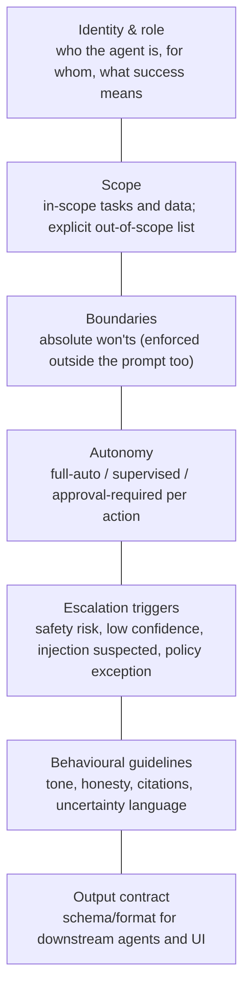
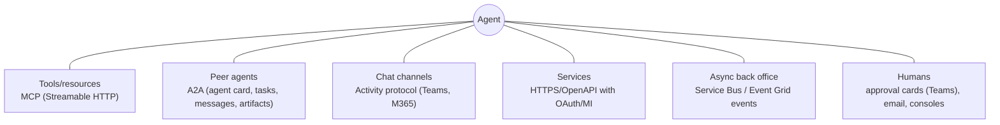

# Personas, scopes, autonomy, tool permissions and protocols

> AI-500 · D1 Architect multi-agent solutions · about 75 min · Study Hub module `a03` ([open the hub](https://claude.ai/artifact/WBg4UvZLizXnza8mbGvMze))

## Why it matters
Three named skills live here: specify **personas, scopes, boundaries and autonomy**; specify **tool scopes, permission boundaries and authentication**; and choose **protocols** between agents and components. The exam rewards specifications that are precise enough to enforce and test.

## Pre-question (answer before reading)
**Q:** A claims agent can read policies and also call `update_policy`. It only ever needs to read. What's wrong, and where should the fix be enforced?

<details><summary>Answer</summary>

The tool scope violates **least privilege**. Remove (or don't grant) the write tool, and enforce it in **identity/RBAC** for the agent and the tool server — not just in the prompt.

</details>

## Mental model & story
Fabrikam's agent platform team wrote a one-page **persona spec** for every agent before any prompt: role, goals, in-scope and out-of-scope topics, absolute *won'ts*, autonomy level, escalation triggers, output contract and tone. Reviews compare behaviour against the spec, not against someone's memory of what the agent should do.

Next came **tool scopes**. Each tool lists read or write, allowed parameters and ranges, rate limits and the data it can touch. The underwriting agent's `get_policy` tool is read-only and scoped to one tenant; the payments tool exists only for the payout agent, which itself is approval-required.

Then **authentication per tool**. Calls to Azure services use the agent's **managed identity**. Calls where the *user's* rights must apply — a broker viewing only their clients — use **on-behalf-of** (OBO) so the downstream API sees the user. Partner APIs use **OAuth client credentials**; one legacy API still needs a key, kept in **Key Vault** and rotated.

Finally, **protocols**. Tools are served over **MCP** so several agents share them. The partner repair network's agent is an opaque peer reached over **A2A**, discovered through its agent card. Teams users reach the front-door agent over the **Activity protocol**. Long-running back-office jobs are kicked off asynchronously through **Service Bus** events so nothing waits on a socket.

**Where the analogy breaks:** A persona spec is a contract with a model that can be manipulated. Every *won't* that matters must also be enforced outside the prompt — by tool absence, identity, guardrails or approval — because prompt-only boundaries fail under injection.

## Diagrams
**A persona specification**



**Protocol per interaction**



## Key points
- Persona spec = identity/role, goals, **scope** (in/out), **boundaries** (won'ts), **autonomy level**, **escalation triggers**, behavioural guidelines, **output contract**. Version it with the agent.
- Scopes should be testable: each in/out-of-scope item becomes evaluation cases (including refusals).
- **Tool scope** per agent: read vs write, allowed operations, parameter constraints (schemas, ranges, enums), data scope (tenant, region), rate limits, approval requirement.
- **Permission boundaries**: per-agent identity, RBAC at the narrowest scope, network reachability, and tool allow-lists on the server side; never share service accounts across agents.
- Auth methods per tool: **managed identity** (agent → Azure), **on-behalf-of** (user's permissions downstream, user in audit logs), **OAuth client credentials** (B2B/service), **OAuth identity passthrough** (per-user tokens stored by the platform), **API key** (Key Vault + rotation) as a fallback.
- **MCP**: client–server protocol for tools/resources/prompts; remote servers over **Streamable HTTP**; discovery of tools at runtime; versioned servers.
- **A2A**: agent card (`/.well-known/agent.json` or agent-card.json), skills, auth schemes; **tasks** with lifecycle, **messages** with parts, **artifacts** as outputs; streaming and push notifications for long tasks; `contextId` for continuity.
- Choose MCP when *your* agent controls the call (tool); A2A when another agent owns the reasoning; events when work is asynchronous and decoupled; direct HTTP for simple services.
- Message contracts between agents: JSON schemas with versions; breaking vs non-breaking changes managed like APIs.
- Behavioural guidelines include **honesty under uncertainty** (say *I don't know*, cite sources) — part of HAX and RAI design.

## Comparisons
**Authentication method per tool call**

| Situation | Method | Why |
|---|---|---|
| Agent reads its own Azure resources | Managed identity | No secrets; per-agent RBAC |
| Downstream must enforce the user's permissions | On-behalf-of (OBO) | User identity flows; user appears in audit |
| Partner service-to-service API | OAuth 2.0 client credentials | Scoped tokens, revocable |
| SaaS acting for the user | OAuth identity passthrough / auth code + PKCE | Per-user consent and tokens |
| Legacy API with keys only | API key in Key Vault, rotated | Fallback; isolate per service/env |

**Protocol choice**

| Interaction | Protocol | Watch out |
|---|---|---|
| Shared tools across agents | MCP | Tool poisoning; allow-lists; versioning |
| Delegate to another team's agent | A2A | What context you send; auth; long tasks |
| Teams/M365 users | Activity protocol | Channel limits; SSO |
| Background processing | Service Bus / Event Grid | Idempotency; dead-letter queues |

## Code to recognise
**Persona and tool-scope spec (reviewed with the agent version)**

```yaml
agent: broker-assistant
role: Help insurance brokers answer client policy questions and prepare quotes.
in_scope: [policy coverage questions, quote preparation, document lookup]
out_of_scope: [legal advice, claims decisions, changes to policies]
wont: [reveal other brokers' clients, bind cover, quote outside underwriting rules]
autonomy:
  answer_questions: full-auto
  prepare_quote: supervised
  send_quote_to_client: approval-required
escalate_when: [confidence < 0.75, legal question, suspected prompt injection]
tools:
  get_policy:   { access: read,  auth: on-behalf-of, scope: "broker's clients only" }
  rate_engine:  { access: read,  auth: managed-identity, rate_limit: 30/min }
  send_quote:   { access: write, auth: on-behalf-of, approval: required }
output_contract: QuoteDraft v2 (JSON schema)
```

- Line 4: Out-of-scope items become refusal test cases.
- Line 5: Won'ts must also be enforced by missing tools, identity and guardrails.
- Line 6: Autonomy is set per action, not per agent.
- Line 12: OBO lets the policy system enforce the broker's own permissions and audit the real user.
- Line 13: Service-level data with no user rights involved uses the agent's managed identity.
- Line 14: The only write tool is approval-gated.

## Portal steps
**Turn a spec into enforcement** (Spec → Foundry agent + identity + tools + guardrails)

1. Instructions: identity, scope, won'ts, escalation, output format (d01).
2. Tools: attach only the tools in the spec; set MCP allowed_tools and approval requirements.
3. Identity: per-agent managed identity with RBAC at the narrowest scope; OBO for user-scoped data.
4. Guardrails: input/tool/output checks for the won'ts (s03).
5. Evaluation: test cases for each scope and boundary item (v01).

## Worked example
**Scenario:** A wealth-management assistant must answer portfolio questions for the signed-in adviser only, fetch market prices, and never place trades. Specify tool auth and scope.

- Portfolio data is user-scoped → OBO so the portfolio API enforces the adviser's entitlements.
- Market prices aren't user-specific → managed identity (or client credentials to the vendor).
- No trading → no trade tool at all; guardrail and evaluation cases for trade requests.

**Answer:** `get_portfolio`: read, **OBO**; `get_prices`: read, **managed identity / client credentials**, rate-limited; **no trade tool**; persona won't + refusal tests; escalate requests to trade to a human adviser workflow.

## Your turn (faded example)
**Scenario:** Two agents share one service principal for all tools. An incident shows one agent accessed data only the other should see.

- Shared identity removes per-agent boundaries.
- **What's the fix?** <details><summary>answer</summary>A distinct (managed) identity per agent with RBAC scoped to exactly its resources.</details>
- **What else limits blast radius?** <details><summary>answer</summary>Server-side tool allow-lists per identity, network segmentation, and per-agent audit logs.</details>

## Exam traps & misconceptions
- ✗ Relying on "never do X" in the prompt as the only control. → ✓ Enforce boundaries with tool absence, identity, guardrails and approvals.
- ✗ Using the agent's identity when downstream must apply the user's permissions. → ✓ Use on-behalf-of (or identity passthrough).
- ✗ Calling another team's agent through MCP as if it were a tool. → ✓ Use A2A for opaque agents with their own reasoning.
- ✗ One service principal for all agents. → ✓ Per-agent identities and least privilege.
- ✗ Unversioned message contracts between agents. → ✓ Version schemas; manage breaking changes like APIs.

## Discussion prompts
- **How do you test that a persona's boundaries hold?** Turn every out-of-scope and won't into evaluation cases (direct, paraphrased, multi-turn, injected via documents), run them in CI with a custom judge and the AI Red Teaming Agent, and require 100% on safety-critical cases.
- **When is an API key acceptable?** When the downstream supports nothing else; store it in Key Vault, isolate per service and environment, rotate on a schedule (and on exposure), and monitor usage.

## Interview angle / teach-back
**Prompt:** Explain how you specify an agent's persona, tool scopes and authentication, and how you pick protocols.

**Rubric:** Persona spec fields incl. autonomy and escalation · Boundaries enforced outside the prompt · Tool scope: read/write, params, data scope, rate, approval · Auth: MI, OBO, client credentials, passthrough, key fallback · MCP vs A2A vs Activity vs events

**Model answer:** Each agent gets a versioned persona spec: role, scope in and out, won'ts, autonomy per action, escalation triggers, guidelines and an output contract — and every won't is enforced by missing tools, identity, guardrails or approvals, not just the prompt. Tools are scoped by access, parameters, data and rate, with approvals for writes. Authentication follows the data: managed identity for the agent's own Azure resources, on-behalf-of when the user's permissions matter, client credentials for partners, keys only as a Key Vault-managed fallback. I use MCP for shared tools, A2A for other teams' agents, the Activity protocol for Teams, and events for asynchronous work.

## Quick Q&A
- **Persona spec must include?** Role, scope, won'ts, autonomy, escalation, guidelines, output contract.
- **User's permissions downstream?** **On-behalf-of** (OBO).
- **Agent's own Azure access?** **Managed identity**.
- **B2B service API?** OAuth client credentials.
- **Opaque peer agent?** **A2A**.
- **Shared tool server?** **MCP**.
- **Where are won'ts enforced?** Outside the prompt too: tools, identity, guardrails, approvals.

## Sources (accessed 2026-10-02)
- [On-behalf-of flow (Microsoft identity platform)](https://learn.microsoft.com/en-us/entra/identity-platform/v2-oauth2-on-behalf-of-flow)
- [Model Context Protocol specification](https://modelcontextprotocol.io/specification)
- [Agent2Agent (A2A) protocol](https://a2a-protocol.org/)
- [Agent identity in Foundry](https://learn.microsoft.com/en-us/azure/foundry/agents/concepts/agent-identity)

## SRS cards created
- ai-500-a03-01, ai-500-a03-02, ai-500-a03-03, ai-500-a03-04
