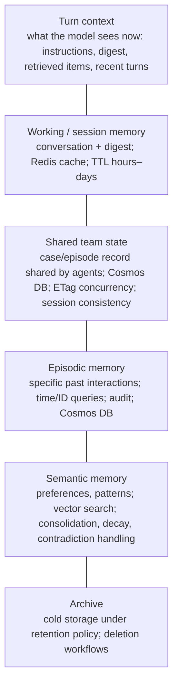
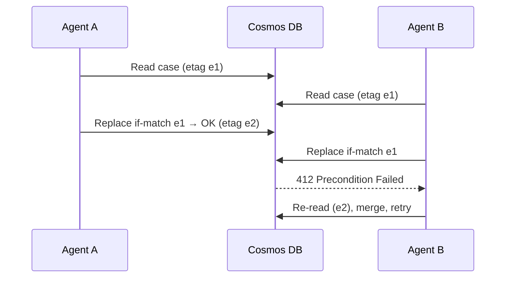

# Memory architecture and multi-tier state persistence

> AI-500 · D1 Architect multi-agent solutions · about 85 min · Study Hub module `a04` ([open the hub](https://claude.ai/artifact/WBg4UvZLizXnza8mbGvMze))

## Why it matters
Two blueprint skills meet here: *design short-term and long-term memory, including context sharing* and *specify multi-tier state persistence with lifecycle and tenant isolation*. Memory designs fail quietly — wrong facts recalled, other tenants' data leaking, costs growing forever — so the exam probes the details.

## Pre-question (answer before reading)
**Q:** Three agents update the same case record. Occasionally one agent's write silently overwrites another's. Which concurrency control prevents lost updates in Cosmos DB without global locks?

<details><summary>Answer</summary>

**Optimistic concurrency with ETags**: read the item with its `_etag`, write with an *if-match* condition; on HTTP 412, re-read, merge and retry (bounded). Use short Redis locks only for critical exclusive decisions.

</details>

## Mental model & story
Lamna Healthcare's care-coordination system has an intake agent, a scheduling agent and a medication-review agent working on the same patient episode. The first version kept everything in the prompt. By day three of an episode the context was 80% irrelevant and the agents disagreed about the patient's allergies.

The architect, **Dev**, split memory into tiers. **Working memory** is the current turn and session — the conversation plus a compact **digest** of key facts, cached in **Redis** for sub-millisecond reads. **Shared team state** — the episode record all three agents read and write — lives in **Cosmos DB** with **session consistency** and **ETag**-based optimistic concurrency. **Long-term memory** holds **episodic** records (what happened in past interactions, queryable by time) and **semantic** memories (preferences and patterns), embedded and searched with Cosmos DB vector search.

Isolation was non-negotiable. Every container is partitioned by `patientId` (with the tenant in the key for the multi-clinic version), cross-partition queries are disabled, and every retrieved memory is checked against the session's patient before injection. The audit middleware logs every read and write.

Lifecycle rules keep memory useful and lawful. Only *memorable* observations are stored, each with an importance score. Importance decays monthly unless the memory is accessed; contradictions mark old memories as superseded; episodic memories older than 90 days are consolidated into semantic ones; TTLs and retention policies remove what's no longer allowed — except safety-critical facts like allergies, which are pinned.

Now each agent receives a small, labelled *context from previous interactions* section: the top five relevant memories, critical items first.

**Where the analogy breaks:** "Long-term memory" sounds like the model learning. It isn't: memory is data you store, retrieve and inject. That means it inherits every data-governance duty — consent, retention, deletion rights, residency and access control.

## Diagrams
**Memory and state tiers**



**Optimistic concurrency on shared state**



## Key points
- **Short-term**: context window + session state (conversation, digest). **Long-term**: episodic (events), semantic (patterns/preferences), plus shared team state for collaboration.
- Context sharing between agents: shared state record (blackboard), structured handoff payloads, or a digest — not whole transcripts.
- Session state options: server-managed conversations, client-managed history, Redis (hot, sub-ms) + Cosmos DB (durable); partition by session/thread ID; persist per turn or at checkpoints.
- Shared state consistency in Cosmos DB: **session** (read-your-writes; usual choice), **strong** (critical atomic decisions; cost/latency), **eventual** (throughput).
- Concurrency: **optimistic (ETag, if-match; 412 → re-read/merge/retry ≤ 3)** by default; **pessimistic** Redis lock (SET NX with expiry, compare-and-delete release) only for critical exclusive decisions.
- Cosmos DB vector search: enable the capability, define the **vector embedding policy** and **vector index** (flat, quantizedFlat, diskANN) at **container creation** (immutable); query with `VectorDistance`; combine with full-text for hybrid recall.
- Store only memorable observations (importance 1–10, type); retrieve by blended score (e.g., 0.5 similarity + 0.3 importance + 0.2 recency); top ~5 memories; critical first.
- Lifecycle: decay unaccessed memories, boost on access (capped), contradiction detection (newer supersedes), consolidation episodic → semantic, TTL and archival, pinned critical facts.
- **Tenant isolation**: tenant/subject ID in partition keys, document IDs and cache keys; disable cross-partition queries; validate retrieved items belong to the session's tenant; per-tenant CMK where required; dedicated instances for regulated tenants.
- Privacy: right to deletion (purge memories and embeddings, keep an audit record), audit middleware on every read/write/delete, retention by jurisdiction.

## Comparisons
**Which store for which state?**

| State | Store | Notes |
|---|---|---|
| Hot session cache, locks, rate counters | Azure Managed Redis | TTL; sub-ms; not the system of record |
| Durable sessions, shared case state | Cosmos DB (NoSQL) | Partition by tenant/session; ETags; change feed |
| Long-term semantic memory | Cosmos DB vector search (or AI Search) | Policies immutable after creation |
| Enterprise knowledge (documents) | Azure AI Search / Foundry IQ | Knowledge ≠ memory: shared, curated |
| Archives, replay snapshots | Blob Storage (WORM if required) | Lifecycle management |

**Isolation models**

| Model | Use | Trade-off |
|---|---|---|
| Dedicated instance per tenant | Regulated or very large tenants | Strongest isolation; highest cost |
| Shared with logical isolation | Most SaaS tenants | Partition keys + validation; noisy neighbours |
| Hybrid | Tiered offerings | Operational complexity |

## Code to recognise
**Tenant-scoped vector recall in Cosmos DB, then guarded write-back**

```python
query = """
SELECT TOP @k c.id, c.content, c.importance, VectorDistance(c.embedding, @q) AS score
FROM c
WHERE c.tenantId = @tenant AND c.patientId = @patient AND c.status = 'active'
ORDER BY VectorDistance(c.embedding, @q)"""
items = memories.query_items(query, parameters=[
    {"name": "@k", "value": 5}, {"name": "@q", "value": embed(question)},
    {"name": "@tenant", "value": ctx.tenant_id}, {"name": "@patient", "value": ctx.patient_id}],
    partition_key=[ctx.tenant_id, ctx.patient_id])          # no cross-partition fan-out

safe = [m for m in items if m["score"] >= MIN_SIMILARITY]   # drop weak matches

case = cases.read_item(item=case_id, partition_key=[ctx.tenant_id, ctx.patient_id])
case["allergies"] = merge(case["allergies"], new_allergies)
cases.replace_item(item=case, body=case,
                   etag=case["_etag"], match_condition=MatchConditions.IfNotModified)
```

- Line 2: `VectorDistance` ranks by similarity; pair it with filters.
- Line 4: Tenant and subject filters on every query, plus the partition key below.
- Line 9: Querying within the hierarchical partition key avoids cross-tenant scans.
- Line 11: Drop low-similarity results instead of injecting noise.
- Line 14: Merge, don't overwrite, shared facts.
- Line 16: Optimistic concurrency: a 412 means someone else wrote first — re-read and retry.

## Portal steps
**Prepare Cosmos DB for agent memory** (Azure portal > Cosmos DB account > Features / Data Explorer)

1. Enable vector search for NoSQL on the account (before creating the container).
2. Create the container with a (hierarchical) partition key such as /tenantId, /patientId.
3. Define the vector embedding policy (path, dimensions, distance) and vector index type at creation.
4. Set default TTL and per-item TTL rules; enable the change feed for audit/SIEM.
5. Assign data-plane RBAC to each agent's managed identity (least privilege).

## Worked example
**Scenario:** A multi-tenant HR assistant serves 400 companies. Requirements: no cross-company leakage, delete an employee's memories on request within 30 days, keep audit evidence of deletions, and recall preferences across sessions.

- Isolation → tenant in partition key, IDs and cache keys; validation before injection.
- Recall → semantic memory with vector search per employee.
- Deletion → purge memories and embeddings, keep an audit record of the deletion.
- Audit → middleware logging every access to a separate, longer-retention store.

**Answer:** Cosmos DB with **hierarchical partition key (tenantId, employeeId)**, vector index for semantic memory, Redis keys prefixed by tenant, retrieval filters + post-retrieval tenant validation, a **deletion workflow** that purges items and embeddings (and caches) and writes an audit entry, plus audit middleware logging to a separate container with long retention.

## Your turn (faded example)
**Scenario:** Agents keep recalling an outdated delivery address after the customer changed it.

- Old and new memories coexist.
- **Which lifecycle mechanism is missing?** <details><summary>answer</summary>**Contradiction detection**: when a new memory is very similar but conflicting, mark the old one superseded (lower importance, contradicted_by).</details>
- **How do you protect critical facts from decay?** <details><summary>answer</summary>Pin them (critical flag) so pruning and decay never remove them.</details>

## Exam traps & misconceptions
- ✗ Storing whole transcripts as "memory". → ✓ Store memorable observations with importance; retrieve the top few.
- ✗ Changing the vector index policy on an existing container. → ✓ Vector embedding and index policies are set at creation and immutable.
- ✗ Using last-writer-wins for shared case state. → ✓ Use ETag optimistic concurrency (or locks for critical decisions).
- ✗ Relying on filters alone for tenant isolation. → ✓ Partition keys + filters + post-retrieval validation + tenant-scoped caches.
- ✗ Forgetting embeddings when deleting a user's data. → ✓ Purge memories, embeddings and caches; keep an audit record.

## Discussion prompts
- **Session consistency or strong consistency for shared agent state?** Session gives read-your-writes for each agent's session at low latency and is the usual choice; strong is for critical atomic decisions where every reader must see the latest write, at higher latency and cost (and with multi-region constraints).
- **When would you use AI Search instead of Cosmos DB for memory?** When memory is really shared knowledge needing rich retrieval (hybrid, semantic ranker, skillsets) across many agents; Cosmos DB fits per-user/per-tenant transactional memory close to session state.

## Interview angle / teach-back
**Prompt:** Describe a memory and state architecture for a multi-agent system, including concurrency, lifecycle and tenant isolation.

**Rubric:** Tiers: working/session, shared team state, episodic, semantic · Stores: Redis, Cosmos DB, vector search · Consistency + ETag concurrency · Lifecycle: importance, decay, contradiction, consolidation, TTL, pinned facts · Isolation: partition keys, validation, tenant cache keys, deletion + audit

**Model answer:** I separate working memory (the session and a digest, cached in Redis) from shared team state (a Cosmos DB record agents update with session consistency and ETag optimistic concurrency) and long-term memory (episodic records and semantic memories with vector search). Only memorable observations are stored with importance; retrieval blends similarity, importance and recency and injects the top few, critical first. Lifecycle rules decay, supersede, consolidate and expire memories, with critical facts pinned. Tenants are isolated by partition keys, filters, post-retrieval validation and tenant-scoped caches, and deletion requests purge memories and embeddings while leaving an audit record.

## Quick Q&A
- **Default concurrency control in Cosmos DB?** Optimistic with **ETags** (412 → retry).
- **Usual consistency level for agent state?** **Session**.
- **Vector index policy changeable later?** **No**: set at container creation.
- **Episodic vs semantic memory?** Specific events vs generalised patterns/preferences.
- **How many memories to inject?** About the top 5; critical first.
- **Isolation basics?** Tenant in partition keys/IDs/cache keys + validation.
- **Deletion must cover?** Memories, embeddings, caches; keep audit record.

## Sources (accessed 2026-10-02)
- [Vector search in Azure Cosmos DB for NoSQL](https://learn.microsoft.com/en-us/azure/cosmos-db/nosql/vector-search)
- [Optimistic concurrency control in Cosmos DB](https://learn.microsoft.com/en-us/azure/cosmos-db/nosql/database-transactions-optimistic-concurrency)
- [Consistency levels in Cosmos DB](https://learn.microsoft.com/en-us/azure/cosmos-db/consistency-levels)
- [Course AI-500T00-A (memory and context modules)](https://learn.microsoft.com/en-us/training/courses/ai-500t00)

## SRS cards created
- ai-500-a04-01, ai-500-a04-02, ai-500-a04-03, ai-500-a04-04
