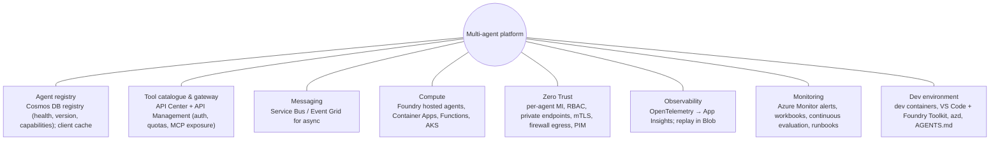
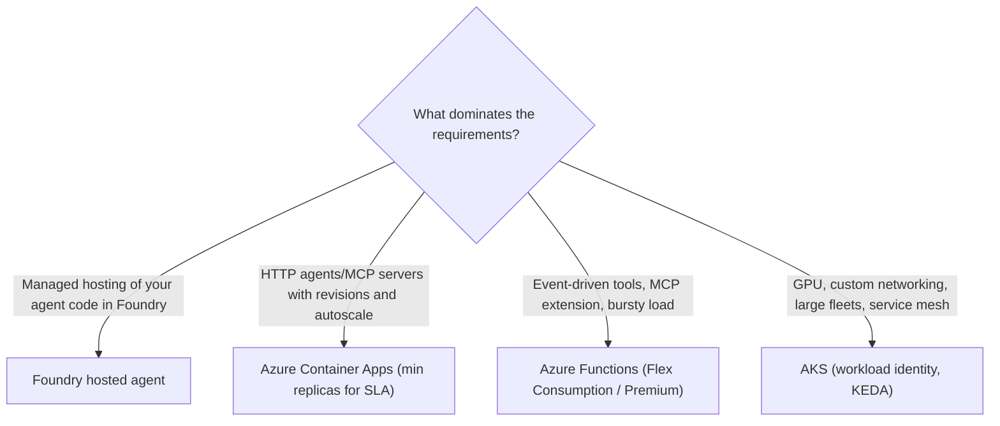

# Technology components: integration, Zero Trust, compute, observability, dev tools

> AI-500 · D1 Architect multi-agent solutions · about 90 min · Study Hub module `a05` ([open the hub](https://claude.ai/artifact/WBg4UvZLizXnza8mbGvMze))

## Why it matters
Seven blueprint skills ask you to *specify components*. The exam gives requirements (scale, SLA, isolation, cost, debugging needs) and asks which Azure building block delivers them. This module is the component catalogue with the trade-offs that decide each choice.

## Pre-question (answer before reading)
**Q:** An MCP server must answer within 2 seconds at all times, including the first request after a quiet night. It runs on Azure Container Apps with scale-to-zero. What's the problem?

<details><summary>Answer</summary>

**Cold starts.** Scale-to-zero breaks the latency SLA; set **min replicas ≥ 1** (or use a hosting plan without cold starts, e.g., Functions Flex Consumption with always-ready instances or Premium).

</details>

## Mental model & story
Contoso's platform team publishes a **component catalogue** for agent teams. Each requirement maps to a default and an alternative, so teams stop reinventing infrastructure.

**Integration.** Agents find each other through an **agent registry** (a Cosmos DB container with capabilities, versions, health and heartbeats, cached by clients). Tools are catalogued in **Azure API Center** and fronted by **API Management**, which can also expose existing REST APIs as MCP servers and applies auth, rate limits and token quotas. Knowledge routing uses a lightweight classifier that picks AI Search indexes per query. Asynchronous work flows over **Service Bus**.

**Zero Trust.** Every agent runs with its **own managed identity** and least-privilege RBAC. Services are reachable only through **private endpoints**; containers sit in a VNet with deny-by-default network policies, mutual TLS between services, and an **Azure Firewall** egress allow-list. Admin rights are **just-in-time** through PIM. Controls are mapped to regulations (GDPR, HIPAA, SOC 2, EU AI Act) with Azure Policy and Defender for Cloud.

**Compute.** Foundry **hosted agents** for teams that want managed hosting of their own code; **Container Apps** for most agents and MCP servers (revisions, traffic splitting, KEDA scaling, min replicas for SLAs); **Functions** (Flex Consumption or Premium) for event-driven tools and the MCP extension; **AKS** for GPU, custom networking or very large fleets.

**Observability and monitoring.** OpenTelemetry everywhere, exported to Application Insights; structured JSON logs of decisions (not raw conversations); replay snapshots in Blob Storage; dashboards, dynamic-threshold alerts, continuous evaluation and automated runbooks for known failure modes.

**Developer environment.** A **dev container** pins Python, Azure CLI/azd and tools; VS Code with the **Foundry Toolkit**; dependencies locked and updated by Dependabot; and an **AGENTS.md** / `copilot-instructions.md` file that tells AI coding assistants the repo's conventions.

**Where the analogy breaks:** A catalogue picks defaults, not designs. Combining components multiplies failure modes: a registry outage stops routing, a gateway misconfiguration throttles everyone, private networking breaks a forgotten dependency. Each critical component needs its own redundancy and fallback.

## Diagrams
**Component catalogue (defaults)**



**Which compute for an agent or MCP server?**



## Key points
- **Agent registry**: agentId, endpoint, capabilities, version, health (healthy/degraded/draining/offline), heartbeat (e.g., 60 s; exclude > 2 min stale), TTL; capability-based routing; canary routing by version; client cache with refresh and stale tolerance; circuit breaker; multi-region writes — the registry is a critical dependency.
- **API Management** as AI/MCP gateway: expose REST APIs as MCP servers, validate tokens at the edge, rate-limit, token quotas (`llm-token-limit`), semantic caching, token metrics, load balancing across model deployments. **API Center**: catalogue/registry of APIs and MCP servers.
- Logic Apps: low-code tool wrappers over enterprise connectors (SharePoint, ServiceNow, SAP).
- **Zero Trust components**: per-agent managed identity (no shared service accounts), RBAC at narrow scope, PIM just-in-time elevation, private endpoints + public network access disabled, deny-all network policies with explicit allows (remember DNS), mTLS (service mesh), Azure Firewall egress allow-lists, Sentinel anomaly detection.
- Compliance mapping: Azure Policy (allowed regions, tags), Defender for Cloud regulatory compliance, Purview, Data Zone deployments for residency, long-retention logs.
- **Compute trade-offs**: Container Apps (revisions, traffic weights, KEDA, `--min-replicas 1` to avoid cold starts, internal ingress); Functions (Flex Consumption/Premium for MCP, avoid cold-start-prone plans for SLAs; Durable Functions for long workflows); AKS (GPU, custom CNI, workload identity, mesh); App Service (simple web hosting with Entra auth).
- **Observability components**: OpenTelemetry SDK + Azure Monitor exporter, W3C trace context across services, structured decision logs, replay snapshot store, Foundry tracing view.
- **Monitoring components**: workbooks (operational vs analytical), dynamic-threshold alerts, continuous evaluation, drift/regression detection, action groups → runbooks (Automation/Functions) for known failure patterns.
- **Developer tools**: dev containers (`devcontainer.json`), VS Code + Foundry Toolkit/Python extensions, Azure CLI/azd, pinned tool versions, lock files, Dependabot/Renovate, pre-commit hooks, and **AI instructions** (`AGENTS.md`, `.github/copilot-instructions.md`).

## Comparisons
**Compute options for agents and tools**

| Option | Strengths | Watch out |
|---|---|---|
| Foundry hosted agent | Managed hosting for your framework code; Foundry integration | Platform constraints; region availability |
| Container Apps | Revisions, traffic splitting, KEDA, internal ingress, scale rules | Scale-to-zero cold starts; set min replicas for SLAs |
| Azure Functions | Event triggers, MCP extension, pay per use | Cold starts on some plans; execution limits; use Flex/Premium |
| AKS | GPUs, custom networking, mesh, large fleets | Operational overhead; you run the platform |
| App Service | Simple web apps/APIs with built-in auth | Less control over scaling patterns |

## Code to recognise
**A dev container that pins the agent toolchain**

```json
{
  "name": "agents-dev",
  "image": "mcr.microsoft.com/devcontainers/python:3.12",
  "features": {
    "ghcr.io/devcontainers/features/azure-cli:1": {},
    "ghcr.io/azure/azure-dev/azd:0": {},
    "ghcr.io/devcontainers/features/docker-in-docker:2": {}
  },
  "postCreateCommand": "pip install -r requirements.lock && pre-commit install",
  "customizations": {
    "vscode": { "extensions": ["ms-python.python", "TeamsDevApp.vscode-ai-foundry"] }
  },
  "remoteEnv": { "AZURE_CLI_DISABLE_CONNECTION_VERIFICATION": "0" }
}
```

- Line 3: Pinned base image = same Python everywhere (laptops, Codespaces, CI).
- Line 5: Dev container features add pinned CLIs: Azure CLI and azd.
- Line 9: Install from a lock file for reproducible dependencies; hooks run checks before commits.
- Line 11: Extensions (Python, Foundry Toolkit) are installed for everyone automatically.
- Line 13: Keep TLS verification on; never disable it to work around proxies.

## Portal steps
**Container Apps settings for an agent or MCP server** (Azure portal > Container App > Scale / Ingress / Revisions / Identity)

1. Scale: min replicas ≥ 1 for latency SLAs; KEDA rules (HTTP concurrency, queue length).
2. Ingress: internal only for back-end agents and tools; private endpoints for dependencies.
3. Revisions: multiple revision mode for canary traffic splits.
4. Identity: system- or user-assigned managed identity; grant least-privilege roles.
5. Monitoring: Application Insights connection string via secret/Key Vault reference; OpenTelemetry in code.

## Worked example
**Scenario:** A bank needs: 30 agents built by 6 teams, agents discoverable at runtime, no public endpoints, per-agent audit, and debugging that can reproduce any failed request. Specify components.

- Discovery → agent registry (+ API Center for tools/MCP).
- No public endpoints → private endpoints, internal ingress, firewall egress.
- Per-agent audit → per-agent managed identities + structured logs with agent IDs.
- Reproducible debugging → OpenTelemetry tracing with replay snapshots.

**Answer:** Cosmos DB **agent registry** with health and versions (cached by clients), **API Center + APIM** for tools/MCP, Container Apps with **internal ingress** in a VNet, **private endpoints** for Foundry/Cosmos/Search/Key Vault, **Azure Firewall** egress allow-list, **per-agent managed identities**, OpenTelemetry → App Insights, **replay snapshots** in Blob, and runbooks for known failures.

## Your turn (faded example)
**Scenario:** The registry becomes unavailable for 5 minutes and every orchestrator fails to route.

- The registry is a critical dependency.
- **What client-side protection helps immediately?** <details><summary>answer</summary>A local cache of registry entries with stale tolerance (minutes) and periodic refresh.</details>
- **What server-side design helps?** <details><summary>answer</summary>Multi-region writes/replicas, health monitoring, and a circuit breaker so clients fall back to cached routes.</details>

## Exam traps & misconceptions
- ✗ Scale-to-zero for latency-SLA services. → ✓ Cold starts break SLAs; keep min replicas or always-ready instances.
- ✗ Using APIM as the MCP server host. → ✓ APIM is a gateway (it can expose APIs as MCP); host tools on Functions/Container Apps.
- ✗ One identity for all agents "to simplify". → ✓ Per-agent identities are a Zero Trust requirement.
- ✗ Logging full conversations for observability. → ✓ Log decisions and metadata; hash/redact PII.
- ✗ "Works on my machine" dev setups. → ✓ Dev containers, lock files and pinned CLIs.

## Discussion prompts
- **Foundry hosted agents or Container Apps for your Agent Framework code?** Hosted agents give managed hosting and native Foundry integration with less ops; Container Apps give full control of networking, scaling, revisions and sidecars. Regulated networking or custom scaling needs often push to Container Apps or AKS.
- **What should AGENTS.md contain for an agent repo?** Build/test commands, coding conventions, folder layout, how to run evaluations locally, security rules (no secrets, use managed identity), and what not to change (generated code, prompts without review).

## Interview angle / teach-back
**Prompt:** Walk through the components you'd specify for a production multi-agent platform on Azure and why.

**Rubric:** Integration: registry, API Center/APIM, messaging, knowledge routing · Zero Trust: per-agent MI, RBAC, PIM, private endpoints, network policies, firewall · Compute choice with SLA/cold-start reasoning · Observability + monitoring components · Dev environment: dev containers, lock files, AI instructions

**Model answer:** For integration I use an agent registry with health and versions, API Center and API Management for tools and MCP, and Service Bus for async work. Zero Trust means per-agent managed identities with least-privilege RBAC, just-in-time admin, private endpoints, deny-by-default networking and controlled egress, mapped to compliance controls. Compute is Container Apps by default with min replicas for SLAs, Functions for event-driven tools, AKS for GPU or custom networking, or Foundry hosted agents for managed hosting. OpenTelemetry tracing, decision logs and replay snapshots support debugging; alerts, continuous evaluation and runbooks support operations; and dev containers, lock files and AGENTS.md keep development consistent.

## Quick Q&A
- **Avoid cold starts on Container Apps?** Min replicas ≥ 1.
- **Catalogue of APIs and MCP servers?** **Azure API Center**.
- **Gateway with token quotas and semantic cache?** **API Management**.
- **Low-code enterprise tool wrappers?** **Logic Apps**.
- **JIT admin access?** **PIM**.
- **Where are replay snapshots stored?** Blob Storage.
- **File with AI coding-assistant instructions?** `AGENTS.md` / `.github/copilot-instructions.md`.

## Sources (accessed 2026-10-02)
- [Azure Container Apps scaling](https://learn.microsoft.com/en-us/azure/container-apps/scale-app)
- [Azure Functions MCP extension](https://learn.microsoft.com/en-us/azure/azure-functions/functions-bindings-mcp)
- [API Management AI gateway capabilities](https://learn.microsoft.com/en-us/azure/api-management/genai-gateway-capabilities)
- [Azure API Center for MCP servers](https://learn.microsoft.com/en-us/azure/api-center/register-discover-mcp-server)
- [Dev containers](https://containers.dev/)

## SRS cards created
- ai-500-a05-01, ai-500-a05-02, ai-500-a05-03, ai-500-a05-04
