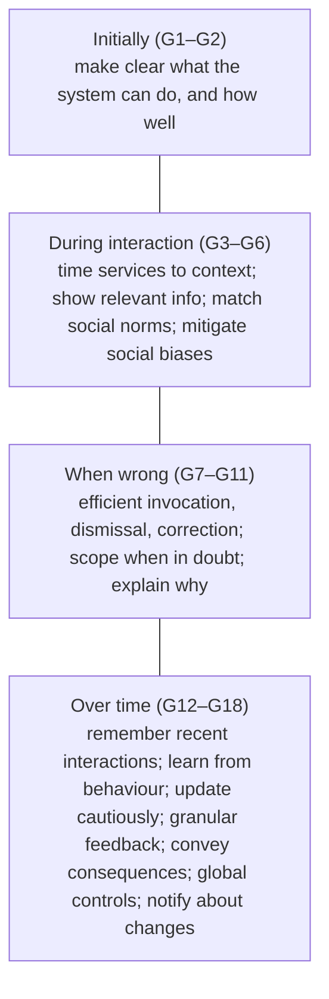
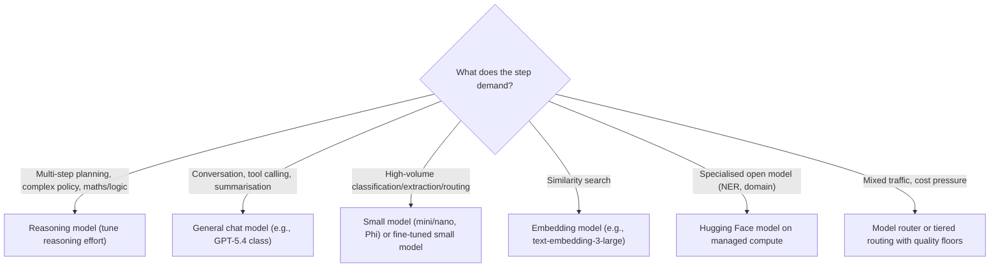

# Human-AI experience (HAX), responsible AI and model matching

> AI-500 · D1 Architect multi-agent solutions · about 75 min · Study Hub module `a06` ([open the hub](https://claude.ai/artifact/WBg4UvZLizXnza8mbGvMze))

## Why it matters
Two D1 skills complete the architecture: design controls for the **human-AI experience** and responsible AI, and **match tasks to model families**. Both are about fit — what users need to trust and correct the system, and which model gives the right quality at the right cost.

## Pre-question (answer before reading)
**Q:** Users keep accepting an agent's recommendations even when they're wrong. Which HAX guideline areas would you strengthen?

<details><summary>Answer</summary>

Make clear **how well** the system can do what it does (G2) and **why** it did something (G11), support efficient **correction** (G9) and **granular feedback** (G15), and scope services when in doubt (G10) — e.g., show confidence, evidence and an easy way to edit or reject.

</details>

## Mental model & story
Wingtip Health's discharge-planning assistant was accurate in tests but caused two near-misses: nurses accepted suggested medication schedules without noticing they were low-confidence. The design team pulled out Microsoft's **Guidelines for Human-AI Interaction** (HAX).

**Initially**, the assistant now says what it can and can't do and how reliable it is for each task (G1, G2). **During interaction**, it shows information when it's relevant to the current step, in clinical language, and avoids biased assumptions (G3–G6). **When wrong**, nurses can invoke, dismiss and correct suggestions in one click; when unsure, the assistant narrows to what it's confident about and explains *why* it recommended something with the evidence (G7–G11). **Over time**, it remembers recent context, learns cautiously, asks for granular feedback, explains the consequences of actions and notifies users when its behaviour changes (G12–G18).

Responsible AI principles map onto the same design: fairness tests across patient groups, reliability via evaluation and fallbacks, privacy via minimisation, inclusiveness via accessible UI, transparency via citations and disclosure, accountability via named owners and audit trails.

Then the model mix. The planner that reasons over multi-condition care plans uses a **reasoning model**. The conversational front end uses a **general chat model** with reliable tool calling. Classification and extraction steps (route a request, pull vitals from notes) use a **small model**. Embeddings come from a dedicated embedding model. A clinical NER model from **Hugging Face** runs on managed compute for entity extraction. Each choice was validated on Wingtip's own evaluation set, not on leaderboards alone.

**Where the analogy breaks:** HAX guidelines don't tell you *how much* friction to add. Too many confirmations train users to click through (automation bias returns); too few hide uncertainty. Calibrate friction to risk, and measure behaviour (override rates, correction rates), not just satisfaction.

## Diagrams
**HAX guidelines by phase (18)**



**Matching task demands to model families**



## Key points
- HAX (Amershi et al.): **18 guidelines** in four phases — initially, during interaction, when wrong, over time. Use them as design and review checklists.
- Controls that support HAX: capability and limitation statements, confidence/uncertainty display, explanations with evidence and citations, easy dismiss/edit/undo, global settings, granular feedback, change notifications, consequence previews before actions.
- Calibrate friction to risk: confirmations and approvals for high-impact actions; lightweight correction for low-impact ones. Monitor override and correction rates for automation bias.
- Responsible AI principles: fairness, reliability & safety, privacy & security, inclusiveness, transparency, accountability — each mapped to concrete controls and tests.
- Disclosure: users know they're interacting with AI; AI-generated content labelled where required (e.g., EU AI Act transparency duties).
- Model matching dimensions: task complexity, tool-calling reliability, structured-output support, context length, latency, cost, throughput/quota, region/residency, safety behaviour, licensing (open models).
- **Reasoning models** for planning and complex analysis (control reasoning effort; reasoning tokens cost); **general chat** for conversation and tool use; **small models** for routing, classification, extraction; **fine-tuned** models for format/style/vocabulary at scale; **embeddings** for retrieval.
- **Hugging Face** models in Foundry deploy to **managed compute** (dedicated GPU endpoints; Safetensors weights; models needing `trust_remote_code` are blocked unless Hugging Face verifies them or they come from trusted organisations); local `transformers` pipelines suit cheap subtasks (zero-shot routing, NER, rerankers).
- Validate model choices on **your** evaluation set (quality, latency, cost per task); leaderboards only shortlist.
- Use routing (model router or tiered heuristics with quality floors) when traffic mixes simple and complex requests (v02).
- **Model lifecycle** (checked 2 Oct 2026): gpt-4.1-nano retires 14 Oct 2026; o3, o4-mini and o3-mini retire 19 Nov 2026; gpt-4.1 and gpt-4.1-mini are deprecated (new subscriptions can't deploy them) and retire April 2027. Check the retirement schedule before pinning a model, and keep a tested fallback.

## Comparisons
**Model families at a glance**

| Family | Strengths | Costs / risks |
|---|---|---|
| Reasoning | Planning, multi-step logic, complex policy | Higher latency and tokens; overkill for simple steps |
| General chat | Conversation, tool calling, summarisation | Mid cost; may miss deep reasoning |
| Small (mini/nano/Phi) | Fast, cheap classification/extraction/routing | Weaker on nuance; validate quality floors |
| Fine-tuned | Consistent format/vocabulary; shorter prompts | Training data, retraining cadence, hosting |
| Open (Hugging Face) | Specialised tasks, control, on managed compute | You manage serving, scaling, versions |

## Code to recognise
**A model-assignment policy per agent step (reviewed with evaluations)**

```yaml
steps:
  route_request:      { model: gpt-5.4-nano, reasoning_effort: low, max_output_tokens: 200, why: "classification, 40k/day" }
  extract_vitals:     { model: hf-clinical-ner,  host: managed-compute, why: "domain NER, no LLM needed" }
  converse_with_nurse:{ model: gpt-5.4, tools: true, why: "reliable tool calling, tone" }
  plan_discharge:     { model: gpt-5.5, reasoning_effort: medium, why: "multi-condition planning" }
  embed_documents:    { model: text-embedding-3-large, dimensions: 1024, why: "retrieval quality vs storage" }
fallbacks:
  plan_discharge: gpt-5.4          # if the primary deployment is throttled
quality_floors:
  route_request: 0.95              # macro-F1 on the routing eval set
  plan_discharge: 4.5              # task adherence (1-5)
```

- Line 2: Cheap, fast small model for high-volume routing; low reasoning effort keeps reasoning tokens inside the output budget.
- Line 3: Not every step needs an LLM: a domain NER model can be cheaper and better.
- Line 5: A stronger reasoning model for genuinely multi-step planning; tune effort to control cost and latency.
- Line 6: Embedding dimensions can be reduced to save storage, validated on recall.
- Line 8: Fallbacks keep the system up when a deployment is throttled.
- Line 10: Every assignment has a measured quality floor on your own data.

## Portal steps
**Compare models for a step** (Foundry > Discover > Models (leaderboards) → Build > Evaluations)

1. Shortlist candidates with the leaderboard (quality, safety, cost, latency).
2. Deploy candidates (or use serverless/managed compute for open models).
3. Run the same evaluation set for the step; compare quality, latency and cost per task.
4. Record the choice, quality floor and fallback in the agent manifest.

## Worked example
**Scenario:** A loan assistant's planner (complex policy reasoning, 2k requests/day) and its intent router (90k requests/day) both use the same large reasoning model. Costs are high and routing is slow. Redesign the model mix.

- Routing is high-volume classification → small model with a quality floor.
- Planning needs reasoning but not maximal effort for every case → reasoning model with tuned effort, maybe tiered.
- Validate both on evaluation sets.

**Answer:** Move the **router** to a small model (or fine-tuned small model) with a measured macro-F1 floor; keep a **reasoning model** for the planner at **medium effort**, escalating effort only for flagged complex cases; add a fallback; re-run evaluations and compare cost per task.

## Your turn (faded example)
**Scenario:** Users dismiss an agent's suggestions 70% of the time but never say why.

- Dismissals without reasons give little signal.
- **Which HAX guideline helps?** <details><summary>answer</summary>G15: encourage granular feedback (quick reason chips on dismiss).</details>
- **What else would you check?** <details><summary>answer</summary>Timing and relevance (G3, G4): suggestions may appear at the wrong moment or lack context; and whether the system conveys how well it can do the task (G2).</details>

## Exam traps & misconceptions
- ✗ Adding confirmations everywhere. → ✓ Excess friction causes click-through; match friction to risk.
- ✗ Choosing models from leaderboards only. → ✓ Validate on your own evaluation set and costs.
- ✗ Using a reasoning model for classification. → ✓ Small models are faster and cheaper for routing/extraction.
- ✗ Deploying Hugging Face models to serverless endpoints in Foundry. → ✓ HF models in Foundry deploy to managed compute (GPU).
- ✗ Treating explanations as optional for high-stakes decisions. → ✓ Explain why (G11) with evidence; support correction and review.

## Discussion prompts
- **How would you measure whether HAX controls work?** Track override/correction rates against error rates (are users catching mistakes?), time-to-correct, feedback completion, dismissal reasons, and outcomes for decisions with low vs high displayed confidence.
- **When is fine-tuning a small model better than prompting a large one?** High volume, stable task, ≥ hundreds of quality examples, strict latency/cost targets, specialised vocabulary — when evaluation shows the small fine-tuned model meets the quality floor.

## Interview angle / teach-back
**Prompt:** Explain how you'd design the human-AI experience for an agent that makes clinical suggestions, and how you'd choose its models.

**Rubric:** HAX phases and key guidelines (G1–G2, G9–G11, G15, G18) · Friction matched to risk; monitor automation bias · RAI principles mapped to controls · Model families matched to steps; validated on own data · Fallbacks/routing

**Model answer:** I use the HAX guidelines as a checklist: be clear about what the assistant can do and how reliably, show relevant information at the right time, make it easy to dismiss, correct and undo, explain why with evidence, scope down when unsure, and over time collect granular feedback and notify users about changes. Friction scales with risk, and I watch override and correction rates for automation bias. For models, each step gets the smallest model that meets a measured quality floor: small models for routing and extraction, a general chat model for conversation and tools, a reasoning model for complex planning, embeddings for retrieval, and specialised open models where they fit — all validated on our own evaluation set with fallbacks.

## Quick Q&A
- **How many HAX guidelines?** **18**, in four phases.
- **G11?** Make clear why the system did what it did.
- **G2?** Make clear how well the system can do what it can do.
- **Model for high-volume routing?** A small model (mini/nano, Phi) with a quality floor.
- **Model for complex planning?** A reasoning model (tune effort).
- **HF models deploy to?** Managed compute (GPU endpoints).
- **How to choose models finally?** Your own evaluation set: quality, latency, cost per task.

## Sources (accessed 2026-10-02)
- [Guidelines for Human-AI Interaction (HAX Toolkit)](https://www.microsoft.com/en-us/haxtoolkit/ai-guidelines/)
- [Responsible AI principles at Microsoft](https://www.microsoft.com/en-us/ai/principles-and-approach)
- [Hugging Face models in Foundry](https://learn.microsoft.com/en-us/azure/foundry/foundry-models/how-to/hugging-face-models)
- [Model leaderboards in Foundry](https://learn.microsoft.com/en-us/azure/foundry/how-to/benchmark-model-in-catalog)

## SRS cards created
- ai-500-a06-01, ai-500-a06-02, ai-500-a06-03, ai-500-a06-04
