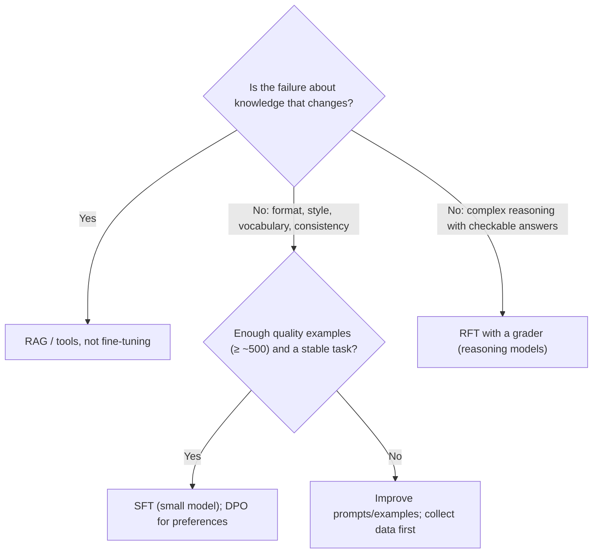
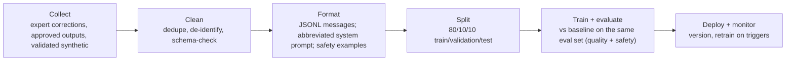

# Fine-tuning strategy for agents and models

> AI-500 · D2 Develop multi-agent solutions in Azure · about 60 min · Study Hub module `d02` ([open the hub](https://claude.ai/artifact/WBg4UvZLizXnza8mbGvMze))

## Why it matters
*Design and implement a strategy for fine-tuning agents and models, including data and frequency.* The exam wants you to know **when** fine-tuning beats prompting, **which method** (SFT, DPO, RFT), **how much and what data**, and **when to retrain** — without regressing safety.

## Pre-question (answer before reading)
**Q:** A triage agent's 2,800-token prompt makes P95 latency miss its 1.5-second target. You have 3,000 expert-labelled examples and the task is stable. Prompt more or fine-tune?

<details><summary>Answer</summary>

Strong case for **fine-tuning a smaller model** (SFT): long prompt, strict latency, enough quality examples, high volume and a stable task. Validate it beats the baseline on your evaluation set, including safety.

</details>

## Mental model & story
Lamna Healthcare's discharge-summary agent used a large model with a long prompt full of formatting rules and clinical abbreviations. It was accurate but slow and expensive at 60,000 summaries a month.

The ML lead, **Priya**, checked the fine-tuning criteria: prompt over 2,000 tokens, strict latency, thousands of clinician-approved summaries, high volume, specialised vocabulary and a stable format. All yes. Reasoning depth wasn't the problem — format and vocabulary were — so **supervised fine-tuning (SFT)** of a small model was the right tool.

Data came from three sources: clinicians' corrections, approved outputs, and **synthetic** examples generated by a teacher model and validated by clinicians. The pipeline deduplicated, **de-identified**, schema-checked and split 80/10/10. Each example used an **abbreviated system prompt** — the long rules were what the model should learn. Safety examples (refusals, escalation cases) were included so fine-tuning didn't erode safety behaviour.

Later, a style issue remained: summaries were correct but too verbose for nurses. Priya added **DPO** with pairs of preferred (concise) and non-preferred (verbose) outputs. For a separate coding-reasoning task, the team considered **RFT** with a grader that rewards correct ICD codes.

Retraining runs **quarterly** or on triggers: data drift (new procedures), quality degradation in monitoring, or domain expansion. Every new model version goes through the same evaluation gates as prompt changes.

**Where the analogy breaks:** Fine-tuning teaches behaviour, not facts that change. New policies or prices still belong in retrieval. And a fine-tuned model is a new artefact to version, evaluate, host and retire — the operational cost doesn't disappear.

## Diagrams
**Should you fine-tune?**



**Fine-tuning data pipeline**



## Key points
- Fine-tune when: prompt > ~2,000 tokens, strict P95 latency/cost targets, **≥ 500 quality examples**, high volume, specialised vocabulary/format, stable task.
- Don't fine-tune when: < 500 examples, the task changes often, failures are about missing/changing knowledge (use RAG), or failures are reasoning depth (try reasoning models/RFT).
- **SFT**: input → ideal output pairs; teaches format, style, vocabulary, tool-call patterns.
- **DPO**: preferred vs non-preferred outputs for the same input; teaches preferences (concision, tone) without a reward model.
- **RFT**: reinforcement fine-tuning with a grader that scores outputs; for complex reasoning with verifiable answers (reasoning models).
- **Distillation**: a large teacher model's high-quality outputs train a smaller student (cheaper, faster); validate the student on held-out data. Heads-up (checked 2 Oct 2026): Foundry's *stored completions* distillation feature retires on **15 Oct 2026**, so capture teacher outputs through the Responses API or agent traces and run SFT on the student yourself.
- Data volume guide: format 500–5k, vocabulary 1k–10k+, reasoning 5k+; quality beats quantity.
- Data hygiene: deduplicate, de-identify (PII/PHI), schema-validate, balance classes, include safety examples, track lineage (e.g., Azure ML data assets).
- Training format: JSONL chat messages with an **abbreviated** system prompt (core identity and constraints: AI-500 course guidance; the production system prompt stays in the inference deployment); 80/10/10 split; watch training vs validation loss for overfitting.
- Retrain triggers: data drift, quality degradation, domain expansion, scheduled (e.g., quarterly); every new version passes the same evaluation and safety gates; deploy for evaluation at low cost (e.g., developer deployment tiers where available) before production.

## Comparisons
**SFT vs DPO vs RFT**

|  | SFT | DPO | RFT |
|---|---|---|---|
| Data | Input + ideal output | Input + preferred + non-preferred outputs | Inputs + a grader (reward) |
| Teaches | Format, style, vocabulary, patterns | Preferences between acceptable outputs | Better reasoning toward verifiable goals |
| Typical use | Consistent summaries, tool-call formats | Concise vs verbose, tone | Code/maths/coding-system reasoning |
| Watch out | Overfitting; safety erosion | Pair quality | Grader hacking; cost |

## Code to recognise
**Training data lines (JSONL): SFT and DPO**

```json
{"messages": [
  {"role": "system", "content": "Discharge summary writer v3."},
  {"role": "user", "content": "Patient 58F, CAP, 5 days IV ceftriaxone, now PO..."},
  {"role": "assistant", "content": "DISCHARGE SUMMARY\nDx: community-acquired pneumonia..."}]}

{"input": {"messages": [{"role": "user", "content": "Summarise for the ward nurse: ..."}]},
 "preferred_output": [{"role": "assistant", "content": "Stable. Switch to oral amoxicillin..."}],
 "non_preferred_output": [{"role": "assistant", "content": "The patient, who was admitted..."}]}
```

- Line 2: An abbreviated system prompt: the long formatting rules are what the model should learn.
- Line 4: The ideal output written or approved by experts (SFT).
- Line 6: DPO line: one input...
- Line 7: ...a preferred answer (concise, nurse-ready)...
- Line 8: ...and a non-preferred one for the same input.

## Portal steps
**Run and compare a fine-tuning job** (Foundry > Build > Fine-tuning)

1. Choose a base model that supports the method (SFT/DPO/RFT).
2. Upload training and validation JSONL; set epochs/hyperparameters or defaults.
3. Watch training/validation loss; stop if validation loss rises (overfitting).
4. Deploy the fine-tuned model for evaluation (low-cost tier if available).
5. Evaluate against the baseline on the same dataset, including safety; record lineage and version.

## Worked example
**Scenario:** An insurer wants its claims-extraction agent to produce a strict 40-field JSON from adjuster notes with insurer-specific abbreviations. It has 1,200 validated examples; the schema changes twice a year. Prompting gets 91% field accuracy; the target is 97% at half the latency.

- Format + vocabulary + latency + enough data → SFT on a smaller model.
- Schema changes twice a year → plan retraining on schema change triggers.
- Validate on held-out data and keep structured-output enforcement.

**Answer:** **SFT a small model** on the 1,200 examples (80/10/10 split) with an abbreviated system prompt, keep structured outputs/JSON schema validation, compare against the prompted baseline on accuracy, latency and cost, and schedule **retraining when the schema changes** (plus drift triggers).

## Your turn (faded example)
**Scenario:** After fine-tuning, the model follows the format perfectly but now answers questions it used to refuse.

- Safety behaviour eroded.
- **What was missing from the training data?** <details><summary>answer</summary>Safety examples: refusals and escalations for out-of-scope or harmful requests.</details>
- **What process gate would have caught it?** <details><summary>answer</summary>Safety evaluation (and red-teaming) as a mandatory gate for every fine-tuned version.</details>

## Exam traps & misconceptions
- ✗ Fine-tuning to teach facts that change monthly. → ✓ Use RAG/tools for changing knowledge.
- ✗ Using the full production system prompt in every training example. → ✓ Use an abbreviated system prompt; the behaviour is what's learned.
- ✗ Training on raw production logs with PII. → ✓ De-identify, deduplicate and validate first.
- ✗ Skipping safety examples. → ✓ Fine-tuning can erode refusals; include safety data and gate on safety evals.
- ✗ Choosing RFT for formatting problems. → ✓ SFT handles format/style; RFT targets verifiable reasoning.

## Discussion prompts
- **How often should a fine-tuned agent model be retrained?** On triggers — data drift, measured degradation, domain/schema changes — and on a schedule (e.g., quarterly) as a backstop; each retrain is a release with full evaluation gates.
- **Fine-tuning vs a bigger model with better prompts?** Compare cost per task, latency and quality on the same evaluation set. Fine-tuning wins at high volume with stable tasks; bigger models win when tasks vary or data is scarce.

## Interview angle / teach-back
**Prompt:** Explain how you'd decide whether to fine-tune, which method to use, and how you'd manage the data and retraining.

**Rubric:** Criteria for and against · SFT vs DPO vs RFT vs distillation · Data sources, hygiene, abbreviated prompt, split, safety examples · Evaluate vs baseline incl. safety · Retraining triggers and versioning

**Model answer:** I fine-tune when prompts are long, latency or cost targets are strict, the task is stable and I have at least several hundred high-quality examples; changing knowledge stays in RAG. SFT teaches format, style and vocabulary; DPO teaches preferences between good answers; RFT improves verifiable reasoning with a grader; distillation moves a big model's behaviour into a small one. Data comes from expert corrections, approved outputs and validated synthetic examples, deduplicated, de-identified and schema-checked, with abbreviated system prompts, safety examples and an 80/10/10 split. Each version is evaluated against the baseline, including safety, and retrained on drift, degradation, domain change or a quarterly schedule.

## Quick Q&A
- **Minimum example count rule of thumb?** About **500** quality examples.
- **Preferences between two acceptable outputs?** **DPO**.
- **Verifiable reasoning with a grader?** **RFT**.
- **Format/style/vocabulary?** **SFT**.
- **System prompt in training data?** Abbreviated.
- **Typical split?** 80/10/10.
- **Retrain triggers?** Drift, degradation, domain expansion, schedule.

## Sources (accessed 2026-10-02)
- [Fine-tuning in Foundry (SFT, DPO, RFT)](https://learn.microsoft.com/en-us/azure/foundry/openai/how-to/fine-tuning)
- [Direct preference optimization](https://learn.microsoft.com/en-us/azure/foundry/openai/how-to/fine-tuning-direct-preference-optimization)
- [Reinforcement fine-tuning](https://learn.microsoft.com/en-us/azure/foundry/openai/how-to/reinforcement-fine-tuning)
- [Stored completions retirement: move to the Responses API and agent traces](https://learn.microsoft.com/en-us/azure/foundry-classic/openai/how-to/stored-completions-retirement)

## SRS cards created
- ai-500-d02-01, ai-500-d02-02, ai-500-d02-03, ai-500-d02-04
