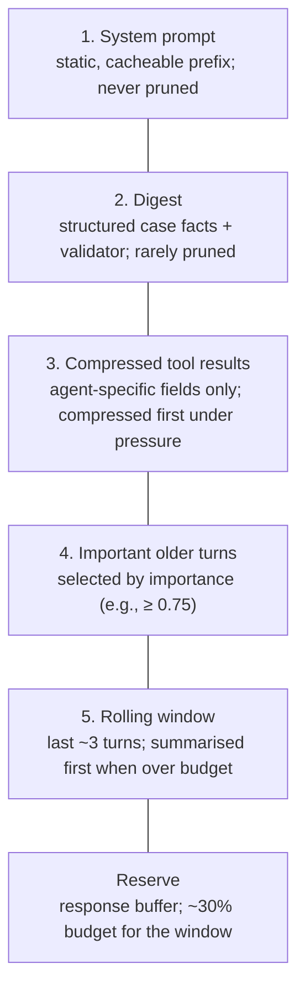
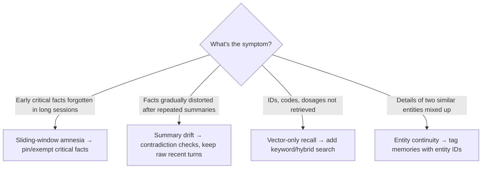

# Context management and memory implementation

> AI-500 · D2 Develop multi-agent solutions in Azure · about 90 min · Study Hub module `d03` ([open the hub](https://claude.ai/artifact/WBg4UvZLizXnza8mbGvMze))

## Why it matters
Context is the scarcest resource in a multi-agent system: every agent, turn and tool result competes for it. The exam asks how you **accumulate, retrieve, inject and compact** context in and between agents, how you implement memory safely, and how to diagnose the four classic context failures.

## Pre-question (answer before reading)
**Q:** By the fifth agent in a pipeline, the prompt holds 2,150 tokens of earlier conversation, but the approval agent needs about 200 tokens of facts. What would you pass instead?

<details><summary>Answer</summary>

A **structured digest**: key-value facts (customer identified, tier, order, status, eligibility, exception required, approval status) with a validator, plus only the tool results that agent needs — compressed to the fields it uses.

</details>

## Mental model & story
Adventure Works' returns pipeline had five agents. Each passed its full context to the next, so by agent five 80% of the prompt was irrelevant, costs had tripled and the approval agent sometimes missed the one fact that mattered.

The engineer, **Kai**, built a **context assembler**. Every agent gets a priority-ordered budget: the **system prompt** first (static, cacheable), then a **digest** of the case (structured key-value facts, validated against the source), then **compressed tool results** (agent-specific schemas — 3 fields, not a 50-field record), then **important older turns** (selected by an importance score), then a **rolling window** of the last three turns. If the budget overflows, the window is summarised first; the system prompt and digest are never cut.

Per-agent budgets reflect jobs: lookups 2,000 tokens, reasoning 4,000, complex policy 8,000. A static 800-token policy document moved out of system prompts into a retrieval tool that agents call only when needed.

Long-term **memory** got the same discipline. An extractor stores only memorable observations with an importance score; retrieval blends similarity, importance and recency; the top five go into a labelled *context from previous interactions* section after the role definition. Writes go through middleware that checks tenant, consent and retention rules and logs every access.

Then the failure hunt. A customer's allergy dropped out of a long conversation (**sliding-window amnesia**) — fixed by exempting critical facts. Summaries drifted from the truth after several compactions (**summary drift**) — fixed with contradiction checks and preferring raw recent turns. Order numbers weren't found by vector search (**vector-only recall**) — fixed with hybrid keyword search. Two customers named Sam got mixed up (**entity continuity**) — fixed by tagging memories with entity IDs.

**Where the analogy breaks:** Compaction is lossy by definition. Every summary is a model's judgment of what matters, and errors compound across agents. Keep sources of truth (records, IDs, documents) outside the context and re-derive facts from them rather than trusting a chain of summaries.

## Diagrams
**Context assembly priority (highest first)**



**Diagnosing context-window failures**



## Key points
- Budget creep sources: **context accumulation** across agents, **history bloat** (full history ≈ 3× tokens vs pruning), **tool-result over-injection** (whole records instead of needed fields).
- **Digest**: structured key-value summary of the case validated against sources; fall back to fuller context if loss is detected.
- **Rolling window + importance**: keep ~3 recent turns plus older turns above an importance threshold (e.g., 0.75 — preferences 0.8, commitments 0.85, account declarations 0.9).
- Assembly order: system prompt (cacheable) > digest > compressed tool results > important turns > rolling window; reserve budget for the window and response; emergency truncation as last resort.
- **Per-agent budgets** (example): lookup 2,000, reasoning 4,000, complex policy 8,000 tokens; log violations; move static reference text into retrieval tools.
- Count tokens before calling (e.g., `tiktoken`); act early (e.g., at ~40% of the window) rather than at overflow.
- Between agents: pass structured handoff payloads and the digest, not transcripts; give each agent only its slice.
- Memory implementation: extract memorable observations with importance/type; retrieval score blends similarity, importance and recency; inject top ~5 in a labelled section; dedupe and handle contradictions.
- Memory governance in code: tenant/subject validation on every read and write, consent and retention checks, deletion workflows (memories + embeddings + caches), audit middleware.
- Failure modes: **sliding-window amnesia**, **summary drift**, **vector-only recall**, **entity continuity** — each with a specific fix.

## Comparisons
**Context budget allocation (illustrative, 32K effective budget)**

| Section | Typical tokens | Pruning rule |
|---|---|---|
| System prompt | 500–1,500 | Never |
| Memories | 2,000–6,000 | Top-k by blended score |
| Retrieved documents | 10,000–30,000 (large windows) | Rerank; keep top chunks |
| Conversation history | 5,000–20,000 | Rolling window + important turns; summarise |
| Tool results | 1,000–5,000 | Agent-specific schemas; compress first |
| Response buffer | 4,000–16,000 | Reserve up front |

## Code to recognise
**A budgeted context assembler (simplified)**

```python
import tiktoken
enc = tiktoken.get_encoding("o200k_base")
tokens = lambda text: len(enc.encode(text))

def assemble(agent, case, turns, tool_results, budget):
    parts = [agent.system_prompt, render_digest(case.digest)]          # never pruned
    used = sum(tokens(p) for p in parts)
    window_reserve = int(0.3 * budget)

    for r in tool_results:                                           # compressed first
        slim = {k: r[k] for k in agent.tool_fields[r["tool"]]}
        if used + tokens(str(slim)) > budget - window_reserve: break
        parts.append(f"<tool name={r['tool']}>{slim}</tool>"); used += tokens(str(slim))

    for t in sorted(turns[:-3], key=lambda t: t.importance, reverse=True):
        if t.importance < 0.75 or used + tokens(t.text) > budget - window_reserve: break
        parts.append(t.text); used += tokens(t.text)

    window = "\n".join(t.text for t in turns[-3:])
    if used + tokens(window) > budget:
        window = summarise(window, keep=case.critical_facts)            # never drop pinned facts
    return "\n\n".join(parts + [window])
```

- Line 2: Count tokens with the model's tokenizer before calling.
- Line 6: System prompt and digest come first and are never pruned.
- Line 8: Reserve part of the budget for the most recent turns.
- Line 11: Inject only the fields this agent needs from each tool result.
- Line 15: Older turns survive only if important enough and within budget.
- Line 21: Summarise the window last, protecting critical facts (prevents amnesia).

## Portal steps
**Find context problems in traces** (Foundry tracing / Application Insights)

1. Plot input tokens per agent and turn; look for growth across a session.
2. Open traces where answers missed known facts; check whether the fact was in the prompt.
3. Compare successful vs failed traces for truncation, summarisation or retrieval misses.
4. Add regression cases for each failure mode found.

## Worked example
**Scenario:** A support agent handles 40-turn conversations. Customers complain that it forgets the refund amount agreed at turn 6, and sometimes invents order numbers.

- Forgetting an early agreed fact → sliding-window amnesia.
- Inventing order numbers → missing exact-ID recall; summaries may have distorted numbers.
- Fix both in the context design.

**Answer:** Pin **commitments** (agreed refund) in the **digest** as critical facts that are never pruned; store order IDs in structured state and retrieve them with **keyword/hybrid** search or a lookup tool; prefer raw recent turns over summaries; add contradiction checks to compaction and regression tests for both failures.

## Your turn (faded example)
**Scenario:** Agent 4 in a pipeline receives a 50-field customer record from a CRM tool but only uses tier and status.

- This is tool-result over-injection.
- **What do you change?** <details><summary>answer</summary>An agent-specific tool result schema: inject only tier and status (and an ID for traceability).</details>
- **What's the benefit beyond cost?** <details><summary>answer</summary>Less distraction and lower risk of leaking unnecessary personal data between agents (data minimisation).</details>

## Exam traps & misconceptions
- ✗ Passing full transcripts between agents. → ✓ Pass digests and structured payloads; give each agent its slice.
- ✗ Summarising repeatedly without checks. → ✓ Summary drift: validate summaries against sources; keep raw recent turns.
- ✗ Pure vector search for IDs and codes. → ✓ Add keyword/hybrid retrieval for exact identifiers.
- ✗ Pruning critical facts with everything else. → ✓ Pin critical facts (allergies, commitments).
- ✗ Waiting for overflow before managing context. → ✓ Budget proactively per agent; v2 truncates silently.

## Discussion prompts
- **How would you prove a digest doesn't lose important information?** Validate digest fields against sources, run evaluations comparing answers with digest vs full context on a sample, and monitor contradictions; fall back to fuller context when validation fails.
- **Shared memory vs per-agent memory?** Shared team memory for case facts all agents need (with concurrency control); per-agent memory for role-specific learnings. Keep access least-privilege: an agent shouldn't read memories it doesn't need.

## Interview angle / teach-back
**Prompt:** Explain how you manage context across a five-agent pipeline and how you diagnose context failures.

**Rubric:** Budget creep sources · Assembly priority and per-agent budgets · Digest, compressed tool results, rolling window + importance · Memory retrieval/injection with governance · Four failure modes and fixes

**Model answer:** I give every agent a token budget and assemble context in priority order: system prompt, a validated digest of the case, tool results compressed to the fields that agent needs, important older turns, and a rolling window of recent turns, summarising the window last and never dropping pinned facts. Between agents I pass digests and structured payloads, not transcripts. Long-term memories are retrieved by similarity, importance and recency, injected as a labelled top-five section, and governed for tenant, consent and retention. For failures I look for sliding-window amnesia, summary drift, vector-only recall and entity mix-ups, each with a specific fix and regression tests.

## Quick Q&A
- **Three sources of budget creep?** Context accumulation, history bloat, tool-result over-injection.
- **Never pruned?** System prompt (and usually the digest).
- **Compressed first?** Tool results.
- **Fix for vector-only recall?** Add keyword/hybrid search for IDs.
- **Fix for entity mix-ups?** Tag memories with entity IDs.
- **Fix for summary drift?** Contradiction checks; prefer raw recent turns.
- **Typical rolling window?** About the last 3 turns.

## Sources (accessed 2026-10-02)
- [Context management in Agent Framework (context providers, chat history)](https://learn.microsoft.com/en-us/agent-framework/agents/conversations/context-providers)
- [Manage conversation state (Responses API)](https://learn.microsoft.com/en-us/azure/foundry/openai/how-to/responses)
- [Course AI-500T00-A (memory and context modules)](https://learn.microsoft.com/en-us/training/courses/ai-500t00)

## SRS cards created
- ai-500-d03-01, ai-500-d03-02, ai-500-d03-03, ai-500-d03-04
