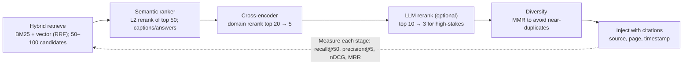
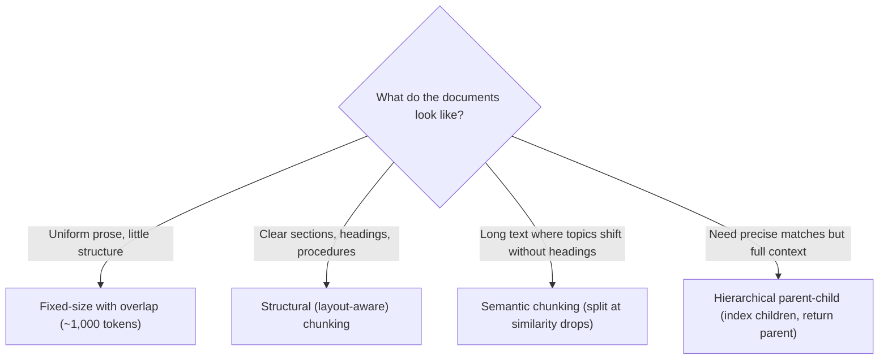

# Multi-agent RAG and knowledge integration

> AI-500 · D2 Develop multi-agent solutions in Azure · about 95 min · Study Hub module `d04` ([open the hub](https://claude.ai/artifact/WBg4UvZLizXnza8mbGvMze))

## Why it matters
Retrieval quality caps answer quality, and in multi-agent systems one bad retrieval propagates through every downstream agent. The exam tests hybrid search tuning, reranking, chunking, embedding choices, routing across many sources and how to share knowledge safely between agents.

## Pre-question (answer before reading)
**Q:** Users search for exact product codes like `KX-2210B` and get semantically similar but wrong products. Pure vector search is used. What's the fix?

<details><summary>Answer</summary>

Use **hybrid search** (BM25 keyword + vector, fused with RRF), possibly with a lower vector weight for code-heavy queries, and avoid generative query rewriting for exact codes.

</details>

## Mental model & story
Tailwind Traders' field-service platform has three agents that all need knowledge: a diagnosis agent (repair manuals), a parts agent (catalogue) and a warranty agent (policy documents). The first version gave each agent a vector index and top-5 results. Answers cited the wrong manual pages a third of the time.

The search engineer, **Lin**, started with **hybrid retrieval** in Azure AI Search: BM25 for exact codes and names, vectors for synonyms, fused with **Reciprocal Rank Fusion**. She tuned the vector weight per query type, retrieved 50 candidates, and turned on the **semantic ranker** to rerank the top 50 with captions. For the diagnosis agent, a cross-encoder reranked the top 20 down to 5.

Chunking mattered more than she expected. Fixed 1,000-token chunks split procedures mid-step. **Structural chunking** using document layout (section headings from Document Intelligence) kept procedures whole; **parent-child** chunking indexed small chunks for precision but returned their parent section for context.

Then routing. Queries now go through a lightweight classifier that picks sources (manuals, catalogue, policies) with confidence scores: above 0.7, search that source; between 0.4 and 0.7, include it if nothing better; below 0.4 everywhere, search all. Results from different indexes are **score-normalised** and reranked together. The query is embedded once and reused.

Finally, knowledge became a **shared layer**: Foundry IQ knowledge bases (on Azure AI Search, with agentic retrieval and citations) exposed to all three agents over MCP, with security trimming so technicians only see documents they're entitled to. Retrieval precision@5 went from 0.61 to 0.86, measured on 100 labelled queries.

**Where the analogy breaks:** Better retrieval can't fix missing or outdated documents, and reranking can't rescue what retrieval never returned. Measure recall at the candidate stage before tuning rerankers, and treat document freshness as part of the RAG design.

## Diagrams
**Retrieval cascade**



**Chunking strategy**



## Key points
- **Hybrid search**: BM25 (exact terms, codes, names) + vector (meaning) fused with **RRF**; vector query **weight** (default 1.0; lower for keyword-heavy, higher for semantic-heavy) shifts influence; `k_nearest_neighbors` sets candidate breadth (e.g., 50), not weight.
- **Semantic ranker**: reranks the top 50 with a cross-encoder-style model, adds captions/answers; optional generative query rewrite (avoid for exact codes).
- Vector index tuning: HNSW `m`, `efConstruction`, `efSearch` (recall vs latency); exhaustive KNN for small or accuracy-critical sets. Tune with 50–100 labelled queries.
- Reranking cascade: hybrid → semantic ranker → domain cross-encoder → optional LLM reranker; **MMR** for diversity. Reranking can't recover documents retrieval missed.
- Metrics: recall@k (candidate stage), precision@k, **nDCG**, **MRR**; measure per query type.
- **Chunking**: fixed + overlap, **structural** (layout via Document Intelligence/Content Understanding), **semantic**, **hierarchical parent-child** (≈2× index size).
- **Embeddings**: general-purpose (e.g., text-embedding-3-large) unless a domain model gains ≥ ~10 points on your eval; changing models means re-embedding everything → **blue-green index**; store the embedding model version per document; use dimension reduction/quantisation to cut storage (validate recall).
- **Dynamic source routing**: classify the query (supervised model or LLM at temperature 0, per-source confidence), search selected sources in parallel (embed once), normalise scores across indexes (min-max/z-score), rerank across sources, skip unhealthy sources; measure routing precision/recall and savings.
- **Knowledge for multi-agent consumption**: a shared knowledge layer (e.g., Foundry IQ knowledge bases with agentic retrieval, exposed via MCP), per-agent scoping and **security trimming**, consistent citations/provenance across agents, and per-request retrieval caching to avoid duplicate searches.
- Freshness: incremental indexing, change tracking, and timestamps in injected context.

## Comparisons
**Retrieval levers and what they fix**

| Lever | Fixes | Cost |
|---|---|---|
| Hybrid (BM25 + vector, RRF) | Exact IDs + synonyms in one query | Small |
| Vector weight / k tuning | Balance keyword vs semantic per query type | Needs labelled queries |
| Semantic ranker | Ordering of top candidates; captions | Extra latency/cost per query |
| Cross-encoder / LLM rerank | Domain-specific relevance | More latency; GPU or tokens |
| Better chunking | Split procedures, lost context | Re-index |
| Domain embeddings | Specialised vocabulary | Re-embed all; blue-green index |
| Source routing | Noise from irrelevant indexes; cost | Classifier maintenance |

## Code to recognise
**Hybrid + semantic query with Azure AI Search (Python)**

```python
from azure.search.documents import SearchClient
from azure.search.documents.models import VectorizableTextQuery

client = SearchClient(endpoint=SEARCH_ENDPOINT, index_name="manuals-v3", credential=DefaultAzureCredential())

results = client.search(
    search_text=query,                                   # BM25 side (exact codes, names)
    vector_queries=[VectorizableTextQuery(
        text=query, k_nearest_neighbors=50, fields="contentVector", weight=0.6)],
    query_type="semantic", semantic_configuration_name="manuals-semantic",
    filter=f"allowedGroups/any(g: search.in(g, '{user_groups}'))",   # security trimming
    select=["id", "title", "content", "page", "sourceUrl"], top=10)

chunks = [r for r in results if r["@search.reranker_score"] >= 2.0]
```

- Line 4: Keyless auth with Entra ID; the index name carries a version (blue-green re-indexing).
- Line 7: Keyword side of hybrid search: catches exact identifiers.
- Line 9: Integrated vectorization embeds the query; 50 candidates for recall; weight < 1 favours keywords for code-heavy queries.
- Line 10: Semantic ranker reranks the top candidates.
- Line 11: Security trimming: only documents the user's groups may see.
- Line 14: Drop weakly relevant results rather than injecting noise (threshold tuned on labelled queries).

## Portal steps
**Tune retrieval with labelled queries** (Azure AI Search > Search explorer / your evaluation notebook)

1. Collect 50–100 real queries with the documents that should be returned.
2. Measure recall@50 for keyword, vector and hybrid; then precision@5/nDCG with the semantic ranker.
3. Adjust vector weight, k, chunking and semantic configuration; re-measure.
4. Version the index (blue-green) when chunking or embeddings change; switch aliases after validation.

## Worked example
**Scenario:** A legal research multi-agent system searches statutes (exact citations like `§ 1983`), case law (long opinions) and internal memos (short, informal). Lawyers complain about irrelevant memos in answers about statutes.

- Exact citations → hybrid with keyword strength; no generative rewrite for citations.
- Long opinions → structural/parent-child chunking.
- Irrelevant memos → source routing with confidence thresholds and cross-source normalisation.

**Answer:** Per-source indexes with suitable chunking (structural/parent-child for opinions), **hybrid search** with tuned vector weights (keyword-heavy for statute queries), **semantic ranker** + domain reranker, and a **routing classifier** that searches memos only when confidence warrants; normalise and rerank across sources, measured with nDCG on labelled queries.

## Your turn (faded example)
**Scenario:** The team switches to a new embedding model and recall drops for two days during re-indexing.

- Mixed embeddings in one index break similarity.
- **What deployment pattern avoids this?** <details><summary>answer</summary>**Blue-green indexing**: build a new index with the new embeddings, validate, then switch the alias/endpoint.</details>
- **What metadata helps future migrations?** <details><summary>answer</summary>Store the embedding model and version per document/index.</details>

## Exam traps & misconceptions
- ✗ Pure vector search for code-heavy queries. → ✓ Use hybrid search; tune weights.
- ✗ Treating `k_nearest_neighbors` as a weight. → ✓ It controls candidate breadth; `weight` controls influence in RRF.
- ✗ Tuning rerankers before measuring candidate recall. → ✓ Reranking can't recover missed documents.
- ✗ Mixing old and new embeddings in one index. → ✓ Re-embed everything into a new index (blue-green).
- ✗ Letting every agent search every index for every query. → ✓ Route by query type; cache per request; scope per agent.

## Discussion prompts
- **How do you share knowledge across agents without leaking data?** A shared knowledge layer with security trimming by user/group, per-agent scopes on which knowledge bases they can call, provenance on every chunk, and audits of retrieval calls; never let an agent's broader identity bypass the user's permissions (use OBO or trimming).
- **When is agentic retrieval (query planning) worth it?** For complex, multi-part questions spanning several sources, where decomposing the query improves recall; for simple lookups, a single hybrid query is faster and cheaper.

## Interview angle / teach-back
**Prompt:** Explain how you'd design and tune retrieval for several agents that share knowledge.

**Rubric:** Hybrid + RRF; weight vs k · Semantic ranker and rerank cascade; MMR · Chunking strategies · Embedding choice, blue-green re-indexing · Source routing, normalisation, shared layer with security trimming · Metrics on labelled queries

**Model answer:** I start with hybrid search — BM25 plus vectors fused with RRF — tuning vector weight and candidate breadth per query type, then rerank with the semantic ranker and, where needed, a domain cross-encoder, with MMR for diversity. Chunking follows document structure: layout-aware or parent-child for procedures and long documents. Embeddings change only via blue-green indexes. A lightweight classifier routes queries to the right sources with confidence thresholds, and I normalise and rerank across sources. Agents share a knowledge layer such as Foundry IQ over MCP with security trimming and consistent citations, and I measure recall, precision@k, nDCG and MRR on 50–100 labelled queries.

## Quick Q&A
- **Fusion method for hybrid search?** **Reciprocal Rank Fusion (RRF)**.
- **What does vector weight change?** The vector query's influence in RRF.
- **Semantic ranker reranks how many?** The top 50.
- **Changing embedding models?** Re-embed all; blue-green index.
- **Parent-child chunking?** Index small children, return parent for context.
- **Ranking metrics?** nDCG, MRR, precision@k (recall@k for candidates).
- **Avoid generative query rewrite when?** Exact codes/identifiers.

## Sources (accessed 2026-10-02)
- [Hybrid search in Azure AI Search](https://learn.microsoft.com/en-us/azure/search/hybrid-search-overview)
- [Semantic ranking](https://learn.microsoft.com/en-us/azure/search/semantic-search-overview)
- [Vector query weighting](https://learn.microsoft.com/en-us/azure/search/vector-search-how-to-query)
- [Chunking documents for vector search](https://learn.microsoft.com/en-us/azure/search/vector-search-how-to-chunk-documents)
- [Foundry IQ knowledge bases](https://learn.microsoft.com/en-us/azure/foundry/agents/concepts/what-is-foundry-iq)

## SRS cards created
- ai-500-d04-01, ai-500-d04-02, ai-500-d04-03, ai-500-d04-04
