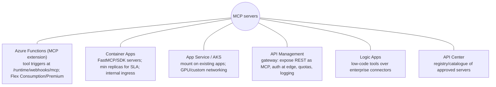
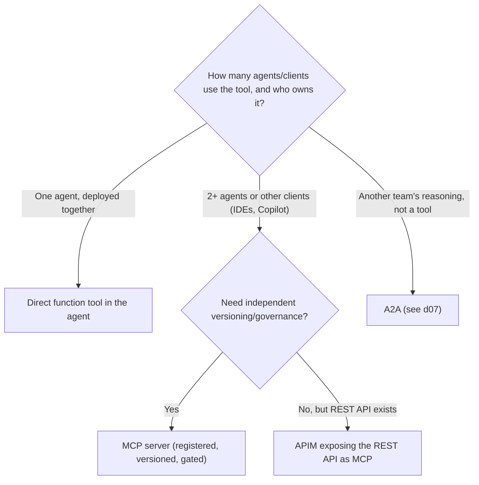

# Tool ecosystems: function calling, MCP servers and clients

> AI-500 · D2 Develop multi-agent solutions in Azure · about 90 min · Study Hub module `d05` ([open the hub](https://claude.ai/artifact/WBg4UvZLizXnza8mbGvMze))

## Why it matters
Tools are where agents touch the real world. AI-500 asks you to integrate tools with **function calling, specified and dynamic tool use**, and to **design and build MCP servers and clients on Azure Functions, Logic Apps and API Management** — including auth, hosting, versioning and when *not* to use MCP.

## Pre-question (answer before reading)
**Q:** Five agents across three teams need the same `get_policy` and `get_claim` tools, and the tools change on their own release cycle. Direct function tools in each agent, or an MCP server?

<details><summary>Answer</summary>

An **MCP server**: 2+ agents share the tools, they version independently, and you want central governance (auth, rate limits, audit). Direct function tools fit a single agent deployed together with its tools.

</details>

## Mental model & story
Fabrikam's claims platform had 14 agents, each with its own copy of the policy and claims functions. A schema change in the policy API broke eleven of them in one afternoon.

The platform team built **MCP servers** instead. The policy server runs on **Azure Functions** with the MCP extension (Flex Consumption with always-ready instances, so no cold starts); the claims server is a Python **FastMCP** app on **Container Apps** with a minimum replica. Legacy REST APIs that already had OpenAPI definitions were exposed as MCP tools through **API Management**, which also validates tokens at the edge and applies rate limits. Back-office connectors (ServiceNow, SAP) are wrapped as low-code tools with **Logic Apps**.

Authentication followed the data: servers accept Entra ID bearer tokens from each agent's **managed identity**; tools that must respect the user's rights use **identity passthrough** so downstream systems authorise and audit the actual user; one partner API uses OAuth client credentials. Every server is registered in **API Center**, so teams discover approved servers instead of copying code.

Versioning became explicit. Servers live at `/v1`, `/v2`; adding an optional parameter is a **minor** change, removing a required one is **major** and gets a new path, with the old version kept and warning callers for 90 days.

On the client side, agents attach servers with **allowed tools** lists and approval settings. For high-impact tools the orchestrator uses **specified tool use** (forcing a particular tool at a step); elsewhere the model chooses (**dynamic tool use**). One agent with 120 tools now retrieves the 10 most relevant tool descriptions per request instead of sending all 120.

**Where the analogy breaks:** MCP standardises the plumbing, not the trust. A server can expose dangerous tools or poisoned descriptions, and a shared server is a shared blast radius. Treat each server like an API product: owners, reviews, auth, quotas, monitoring and deprecation policy.

## Diagrams
**MCP on Azure: hosting and gateway options**



**Direct tool or MCP server?**



## Key points
- **Function calling**: the model emits structured calls; your code validates, authorises and executes; strict JSON schemas reduce argument errors.
- **Specified tool use**: force or constrain tools (`tool_choice` required/specific, allowed-tool lists) at steps where the right tool is known. **Dynamic tool use**: the model chooses; for large catalogues use **semantic tool retrieval** (embed tool descriptions, send the top-k per request).
- Use MCP when **2+ agents share** tools, tools **version independently**, you need **central governance**, or there are many (e.g., 5+) integrations; use direct tools for a single agent deployed with its tools.
- Hosting: **Azure Functions MCP extension** (triggers become tools; avoid cold-start-prone plans — use Flex Consumption with always-ready or Premium), **Container Apps** (`--min-replicas 1` for SLAs), **App Service** (mount into an existing FastAPI app with built-in auth), **AKS** (GPU, custom networking, KEDA).
- **API Management** is a **gateway**, not a host: expose existing REST APIs as MCP servers, pass through remote MCP servers, validate tokens, rate-limit, IP filter and log at the edge.
- **Logic Apps**: low-code tool wrappers over 1,400+ connectors (SharePoint, ServiceNow, SAP). **API Center**: private catalogue/registry of MCP servers.
- Server auth options: **managed identity / Entra tokens** validated by the platform (recommended), **OAuth identity passthrough** (per-user tokens; downstream authorises the user), **OAuth client credentials** (B2B), **API keys** in Key Vault with rotation (fallback).
- Python servers: `FastMCP(name, stateless_http=True)`, `@mcp.tool()` with docstrings and type hints, `streamable_http_app()` served by uvicorn; stateless HTTP scales horizontally.
- Clients: Foundry `MCPTool(server_label, server_url, allowed_tools, require_approval)` (default approval **always**), Agent Framework MCP tools, or the MCP SDK `ClientSession` in custom code.
- Versioning: URL prefix per version; semver of tool schemas (remove required param or change response shape = **major**; add optional param/field = **minor**; fix = patch); deprecation window (e.g., 90 days: announce → warn → report → enforce with migration guidance).

## Comparisons
**Where to host an MCP server**

| Option | Best when | Watch out |
|---|---|---|
| Functions + MCP extension | Event-style tools, small teams, pay-per-use | Cold starts on some plans; execution limits |
| Container Apps | Python/Node servers, autoscale, revisions | Scale-to-zero breaks SLAs; set min replicas |
| App Service | Add MCP to an existing web app | Less granular scaling |
| AKS | GPU tools, mesh, large fleets | Operational overhead |
| APIM (gateway) | Expose existing REST APIs; edge policy | Not a compute host for custom logic |

## Code to recognise
**A FastMCP server and a Foundry agent that uses it**

```python
# server.py  (hosted on Container Apps, internal ingress, Entra auth in front)
from mcp.server.fastmcp import FastMCP

mcp = FastMCP("claims-tools", stateless_http=True)

@mcp.tool()
def get_claim(claim_id: str) -> dict:
    """Return status, amount and adjuster for a claim. Read-only. claim_id like CLM-12345."""
    return claims_repo.get(claim_id)

app = mcp.streamable_http_app()          # uvicorn server:app

# agent.py
from azure.ai.projects.models import MCPTool, PromptAgentDefinition
tool = MCPTool(server_label="claims", server_url="https://claims-mcp.internal.contoso.com/v1/mcp",
               allowed_tools=["get_claim"], require_approval="never")
agent = project.agents.create_version(agent_name="claims-helper",
    definition=PromptAgentDefinition(model="gpt-5.4", instructions=INSTRUCTIONS, tools=[tool]))
```

- Line 4: Stateless HTTP mode scales horizontally behind a load balancer.
- Line 6: Each decorated function becomes an MCP tool; the docstring is its description (write it for a model).
- Line 11: Streamable HTTP endpoint for remote clients.
- Line 15: The version is in the URL path: breaking changes get a new path.
- Line 16: Allow-list only the tools this agent needs; read-only tools may skip approval, write tools shouldn't.

## Portal steps
**Expose an existing REST API as an MCP server in API Management** (Azure portal > API Management > MCP servers (or APIs) > Create MCP server)

1. Choose the API (with an OpenAPI definition) and select the operations to expose as tools.
2. Apply inbound policies: validate the Entra token, rate limits, IP filters.
3. Register the server in API Center so teams can discover it.
4. Connect agents with an allow-list of tools; monitor usage and errors at the gateway.

## Worked example
**Scenario:** A retail platform has 30 internal REST APIs with OpenAPI specs. Eight agents need subsets of them. Security wants token validation and rate limits at a single edge, and teams need a catalogue.

- Existing REST + OpenAPI → no need to rewrite as custom servers.
- Edge policy + many consumers → gateway.
- Discovery → catalogue.

**Answer:** Expose the APIs as **MCP servers through API Management** (token validation, rate limits, logging at the edge), register them in **API Center**, and connect each agent with **allowed_tools** for just its subset; write custom MCP servers (Functions/Container Apps) only for tools that need new logic.

## Your turn (faded example)
**Scenario:** An agent has 140 tools and frequently picks the wrong one, with large prompts.

- Sending every tool description bloats the prompt and confuses selection.
- **What technique helps?** <details><summary>answer</summary>**Semantic tool retrieval**: embed tool descriptions and send only the top-k relevant tools per request (dynamic tool use with a shortlist).</details>
- **And for critical steps?** <details><summary>answer</summary>**Specified tool use**: force the required tool where the step is known.</details>

## Exam traps & misconceptions
- ✗ Hosting MCP servers on a cold-start-prone plan for latency-critical tools. → ✓ Use Flex Consumption with always-ready, Premium, or Container Apps with min replicas.
- ✗ Treating APIM as the place to write tool logic. → ✓ APIM is a gateway; host logic on Functions/Container Apps.
- ✗ Breaking a tool's schema in place. → ✓ Version it: new path for major changes, deprecation window for the old one.
- ✗ Giving an agent every tool on a server. → ✓ Use allowed_tools and approval settings.
- ✗ Using MCP for a tool only one agent uses and deploys with. → ✓ A direct function tool is simpler.

## Discussion prompts
- **How do you stop tool poisoning on shared MCP servers?** Own and review tool descriptions like code, sign/pin server versions, restrict who can publish, scan descriptions for instructions aimed at models, allow-list tools per agent, and monitor for unexpected tool use.
- **Identity passthrough or managed identity for a CRM tool?** If the CRM must enforce each user's record-level access and audit the user, passthrough/OBO; if the data is service-level and the agent's access is appropriate for all users, managed identity with tight RBAC.

## Interview angle / teach-back
**Prompt:** Explain how you'd build and integrate a tool ecosystem for many agents on Azure.

**Rubric:** Function calling vs specified vs dynamic tool use; semantic tool retrieval · When MCP vs direct tools · Hosting: Functions, Container Apps, App Service, AKS; APIM as gateway; Logic Apps; API Center · Auth: MI, passthrough, client credentials, keys · Versioning and deprecation

**Model answer:** Agents call tools through function calling, with specified tool use where the step is known and dynamic tool use elsewhere — with semantic retrieval of tool descriptions when the catalogue is large. Shared tools become MCP servers when several agents use them or they version independently; single-agent tools stay as direct functions. I host servers on Functions with the MCP extension or on Container Apps with minimum replicas, expose existing REST APIs through API Management as MCP with edge auth and quotas, wrap enterprise connectors with Logic Apps, and catalogue everything in API Center. Servers authenticate with Entra tokens, use passthrough when user permissions matter, and are versioned with deprecation windows.

## Quick Q&A
- **MCP vs direct tool rule?** MCP when 2+ agents share or tools version independently.
- **APIM's role for MCP?** Gateway: expose REST as MCP, edge auth, quotas.
- **Registry for MCP servers?** Azure API Center.
- **Default Foundry MCP approval?** **always**.
- **Many tools, poor selection?** Semantic tool retrieval (top-k).
- **Forcing a specific tool?** Specified tool use (`tool_choice`).
- **Major tool-schema change?** Remove required param or change response shape.

## Sources (accessed 2026-10-02)
- [MCP extension for Azure Functions](https://learn.microsoft.com/en-us/azure/azure-functions/functions-bindings-mcp)
- [Expose REST APIs as MCP servers in API Management](https://learn.microsoft.com/en-us/azure/api-management/export-rest-mcp-server)
- [Connect agents to MCP servers (Foundry)](https://learn.microsoft.com/en-us/azure/foundry/agents/how-to/tools/model-context-protocol)
- [MCP Python SDK](https://github.com/modelcontextprotocol/python-sdk)

## SRS cards created
- ai-500-d05-01, ai-500-d05-02, ai-500-d05-03, ai-500-d05-04
