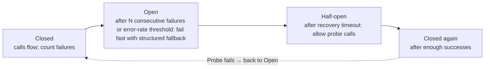
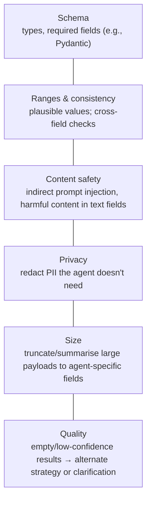

# Tool errors, fallbacks and result validation

> AI-500 · D2 Develop multi-agent solutions in Azure · about 75 min · Study Hub module `d06` ([open the hub](https://claude.ai/artifact/WBg4UvZLizXnza8mbGvMze))

## Why it matters
Tools fail: throttling, timeouts, bad data, outages, and responses carrying injected instructions. *Design tool error-handling and fallback mechanisms* and *implement tool result validation and quality checks* are separate skills; together they decide whether one flaky API takes down the whole agent system.

## Pre-question (answer before reading)
**Q:** A pharmacy tool returns HTTP 400 "invalid dosage format" and the agent's retry logic retries it five times with backoff. What's wrong?

<details><summary>Answer</summary>

400 is a **permanent** error: retrying won't help. Return a **structured error** immediately (so the agent can fix the input or ask the user). Retry only **transient** errors (429, 5xx, timeouts) with exponential backoff + jitter.

</details>

## Mental model & story
During a regional outage, Contoso Pharmacy's dosage-check tool started timing out. The agents retried aggressively, tripled traffic to the struggling service, and users waited 90 seconds for an error.

The fix had layers. **Classify errors**: transient (429, 5xx, timeouts) get exponential backoff with jitter, honouring `Retry-After`; permanent ones (400, validation) return immediately as structured errors; degraded responses (partial data) pass through with a warning. Retry budgets differ: critical tools up to 5 attempts (~31 s total), standard ones 3 (~7 s) — and the agent's own timeout is longer than the maximum retry duration so retries aren't cut off mid-way.

A **circuit breaker** wraps each tool: after a run of consecutive failures (or an error rate such as 30% in 60 s) it **opens**, failing fast with a **structured fallback** — `{status: unavailable, fallback: consult_pharmacist, retry_after_seconds: 120}` — instead of hammering the service. After a recovery timeout it goes **half-open** and lets a probe through; successes close it again. A `/health` endpoint reports dependencies and breaker state.

Writes became **idempotent**: each call carries an idempotency key so a retried "create prescription refill" never creates two.

Then **validation** of what comes back. Results are checked against a schema, values against ranges (a dosage of 5,000 mg is flagged), and text fields are scanned for **indirect prompt injection** and harmful content before entering the agent's context. Personal data the agent doesn't need is redacted. Empty or low-confidence results trigger a different strategy (rephrase, alternate source) rather than a confident wrong answer.

**Where the analogy breaks:** Retries and fallbacks change semantics. A cached fallback may be stale, an alternate provider may disagree, and a degraded answer must say it's degraded. Every fallback needs a visible marker for the agent and the user, and an alert for operators.

## Diagrams
**Circuit breaker states**



**Tool result validation pipeline**



## Key points
- Error classes: **transient** (429, 5xx, timeouts → retry with exponential backoff + jitter, honour `Retry-After`), **permanent** (400/validation/authorisation → structured error, no retry), **degraded** (partial results → pass with warning).
- Retry budgets per criticality (e.g., critical 5 attempts ≈ 31 s, standard 3 ≈ 7 s); agent/tool timeout must exceed the maximum retry duration.
- Retries require **idempotency** for writes (idempotency keys, dedupe).
- **Circuit breaker**: CLOSED → OPEN (N consecutive failures or error rate in a window) → HALF_OPEN after recovery timeout → CLOSED after successes; fail fast while open.
- **Structured fallbacks**: `{status, fallback action, retry_after_seconds}` so the model can respond sensibly (e.g., suggest a human, use cached data with a staleness note).
- Fallback options: alternate tool/provider, cached result with timestamp, degraded answer with completeness indicator, human escalation; never silently fabricate.
- **Health endpoints** report dependency and breaker state; registries/routers use them to skip unhealthy tools.
- **Result validation**: schema, ranges, cross-field consistency, content scanning for injection and harm (Content Safety/Prompt Shields on tool outputs), PII redaction, size limits.
- Quality checks: empty or low-confidence results → retry with different parameters, alternate source, or ask the user; record why.
- Handle failures in the **orchestrator**, not by every spoke independently; trace every retry and fallback.

## Comparisons
**Error handling by class**

| Class | Examples | Action |
|---|---|---|
| Transient | 429, 503, timeouts | Backoff + jitter, Retry-After, bounded retries |
| Permanent | 400 bad input, 401/403 | No retry; structured error; fix input or escalate |
| Degraded | Partial results, stale data | Return with warning/completeness indicator |
| Systemic outage | Repeated failures | Circuit opens; fallback; alert |

## Code to recognise
**Retry, circuit breaker and validation around a tool (simplified)**

```python
from tenacity import retry, stop_after_attempt, wait_exponential_jitter, retry_if_exception_type
from pydantic import BaseModel, Field

class DoseCheck(BaseModel):
    drug_code: str
    max_daily_mg: float = Field(gt=0, lt=4000)       # plausible range
    interactions: list[str]

class Transient(Exception): ...

@retry(retry=retry_if_exception_type(Transient), stop=stop_after_attempt(3),
       wait=wait_exponential_jitter(initial=1, max=8))
def call_dose_api(payload, idem_key):
    r = http.post(DOSE_URL, json=payload, headers={"Idempotency-Key": idem_key}, timeout=10)
    if r.status_code in (429, 500, 502, 503, 504): raise Transient(r.status_code)
    r.raise_for_status()                              # 4xx → permanent, no retry
    return r.json()

def dose_tool(payload, idem_key):
    if breaker.is_open():
        return {"status": "unavailable", "fallback": "consult_pharmacist", "retry_after_seconds": 120}
    try:
        data = DoseCheck.model_validate(call_dose_api(payload, idem_key))
        breaker.record_success()
        return scan_and_redact(data.model_dump())     # injection scan + PII redaction
    except Exception as e:
        breaker.record_failure()
        return {"status": "error", "kind": type(e).__name__, "retryable": False}
```

- Line 6: Range checks catch implausible values before the agent trusts them.
- Line 11: Retry only transient errors, with bounded attempts and jittered exponential backoff.
- Line 14: An idempotency key makes retried writes safe.
- Line 15: Map transient status codes explicitly; everything else is permanent.
- Line 20: While the breaker is open, fail fast with a structured fallback the model can use.
- Line 23: Validate the shape before using the result.
- Line 25: Scan text fields for injected instructions and redact unneeded PII.
- Line 28: Return a structured error rather than raising into the model loop.

## Portal steps
**Observe tool reliability** (Application Insights > Dependencies / custom metrics)

1. Chart failure rate and latency per tool (dependency name).
2. Track retries, breaker state changes and fallback counts as custom metrics.
3. Alert on breaker opens and rising fallback rates.
4. Link alerts to runbooks for known failure modes (v05).

## Worked example
**Scenario:** A shipping-quote tool from a partner fails 20% of calls during peak with 503s and sometimes returns quotes of $0.00. Agents present those quotes to customers.

- 503s are transient → bounded retries with backoff; breaker for sustained failure.
- $0.00 is a validation failure → range check.
- Customer-facing fallback must be honest.

**Answer:** Retry 503s with jittered backoff (bounded), honour Retry-After, add a **circuit breaker** with a structured fallback ("quote unavailable, try again in 2 minutes" or a cached quote marked with its timestamp), and **validate results** (quote > 0 and within expected ranges) so invalid quotes never reach customers; alert on fallback rates.

## Your turn (faded example)
**Scenario:** A retried `create_refund` call created two refunds.

- Retries aren't safe for non-idempotent writes.
- **What do you add?** <details><summary>answer</summary>An **idempotency key** per logical operation, checked by the service (or a dedupe table).</details>
- **And in the agent loop?** <details><summary>answer</summary>Track tool call IDs and never re-issue a completed write; prefer read-after-write verification.</details>

## Exam traps & misconceptions
- ✗ Retrying 400 errors. → ✓ Permanent errors need a structured response, not retries.
- ✗ Agent timeout shorter than the retry budget. → ✓ Set timeouts longer than the maximum retry duration.
- ✗ Retrying writes without idempotency. → ✓ Use idempotency keys.
- ✗ Injecting raw tool output into context. → ✓ Validate schema/ranges, scan for injection and redact PII first.
- ✗ Silent fallbacks. → ✓ Mark degraded or cached results and alert operators.

## Discussion prompts
- **Where should retries live: tool server, client or orchestrator?** Prefer one layer per call path to avoid retry storms (multiplicative retries). Typically the client wrapper retries transient errors with a budget, the orchestrator handles fallbacks and escalation, and servers stay idempotent.
- **How do you test fallbacks?** Chaos testing: inject 429/503/timeouts and malformed responses in staging, verify breaker transitions, fallback messages, alerts and that no invalid data reaches users.

## Interview angle / teach-back
**Prompt:** Explain how you make agent tool calls resilient and safe to trust.

**Rubric:** Transient vs permanent vs degraded handling · Backoff + jitter, Retry-After, budgets, timeouts · Idempotency · Circuit breaker states + structured fallback · Result validation: schema, ranges, injection scan, PII, quality

**Model answer:** I classify errors: transient ones get bounded retries with jittered exponential backoff and Retry-After, permanent ones return structured errors immediately, and degraded results pass with a warning. Writes carry idempotency keys so retries are safe, and timeouts exceed the retry budget. A circuit breaker per tool opens after repeated failures, fails fast with a structured fallback the model can use, probes when half-open and closes on success. Every result is validated — schema, ranges, consistency — scanned for injected instructions and harmful content, stripped of unneeded personal data, and low-quality results trigger an alternate strategy instead of a confident wrong answer.

## Quick Q&A
- **Retry which errors?** Transient: 429, 5xx, timeouts.
- **Permanent error handling?** Structured error, no retry.
- **Make retried writes safe?** Idempotency keys.
- **Breaker states?** Closed → Open → Half-open → Closed.
- **Structured fallback fields?** Status, fallback action, retry_after_seconds.
- **Before injecting tool output?** Validate, scan for injection, redact PII.
- **Timeout vs retry budget?** Timeout must exceed max retry duration.

## Sources (accessed 2026-10-02)
- [Retry pattern (Azure Architecture Center)](https://learn.microsoft.com/en-us/azure/architecture/patterns/retry)
- [Circuit Breaker pattern](https://learn.microsoft.com/en-us/azure/architecture/patterns/circuit-breaker)
- [Prompt Shields for documents (indirect attacks)](https://learn.microsoft.com/en-us/azure/ai-services/content-safety/concepts/jailbreak-detection)

## SRS cards created
- ai-500-d06-01, ai-500-d06-02, ai-500-d06-03, ai-500-d06-04
