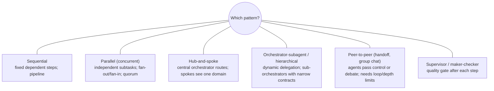
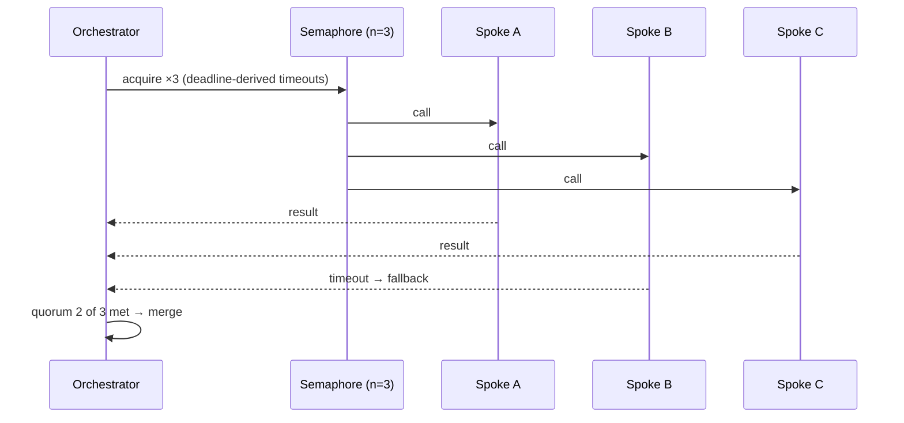

# Orchestration patterns, scaling and A2A integration

> AI-500 · D2 Develop multi-agent solutions in Azure · about 95 min · Study Hub module `d07` ([open the hub](https://claude.ai/artifact/WBg4UvZLizXnza8mbGvMze))

## Why it matters
*Implement multi-agent orchestration patterns* (hub-and-spoke, sequential, parallel, peer-to-peer, orchestrator-subagent), *scale and control spawning, batching and concurrency*, and *integrate existing agents securely with A2A and/or MCP*. This is the heart of D2 — and of most case studies.

## Pre-question (answer before reading)
**Q:** Four specialist agents each take 15 s. Run in sequence they take 60 s. Run in parallel they'd take 15 s — but the deployment allows 1,000 tokens per minute (TPM) and each agent call uses about 300 tokens. What limits parallelism?

<details><summary>Answer</summary>

**Quota.** Parallel calls consume TPM at the same moment; with ~300 tokens per call and 1,000 TPM, only about **3** can run concurrently without throttling. Use a semaphore sized to quota, or raise quota/spread deployments.

</details>

## Mental model & story
Adventure Works' trip-planning service started as a mesh: every agent could message every other. It worked with three agents and collapsed at seven — loops, duplicated work, nobody in charge.

The rebuild used **hub-and-spoke**: an orchestrator owns routing and ordering; specialist spokes (flights, hotels, visas, budget) are registered as tools and see only their domain. The hub handles failures centrally: each spoke call has a **timeout** (30 s), a **circuit breaker** (open after 3 consecutive failures), and a **structured fallback**, so a broken visa service yields a partial plan with a completeness note instead of a crash.

Independent spokes run **in parallel** with `asyncio.gather(..., return_exceptions=True)`, bounded by a **semaphore** sized to the model quota. A **quorum policy** fits the step: for hotel options, *best-effort* (use whatever returns in time); for a fraud check, *fail-fast*; for three price estimates, *minimum quorum* (2 of 3). Dependent steps (budget after flights and hotels) stay **sequential**.

For open-ended requests, an **orchestrator-subagent** design lets the hub spawn subagents dynamically — but with limits: maximum depth, maximum subagents per request, and a token budget. Peer-to-peer **handoff** is used only in the customer-service front end, with a chain-depth limit and an escalation back to the hub.

The visa specialist is owned by a partner and runs on another cloud. It joins through **A2A**: discovered in the registry via its agent card, called with OAuth tokens, given only the context it needs, with every JWT validated (signature, issuer, audience, expiry, caller allow-list). An internal pricing agent is exposed to other teams as an **MCP tool** because callers want a deterministic function, not a conversation.

**Where the analogy breaks:** Patterns compose, and their failure modes compose too: a parallel step inside a handoff inside a hierarchy can multiply retries, costs and confusion. Keep the topology shallow, make each pattern's termination and failure behaviour explicit, and trace the whole call tree.

## Diagrams
**Orchestration patterns**



**Fan-out with quota-aware concurrency and quorum**



## Key points
- **Sequential**: dependent steps; simplest; no backtracking. **Parallel**: independent subtasks, fan-out/fan-in, aggregation (vote, merge, best). **Hub-and-spoke**: orchestrator routes, spokes domain-only; single point of failure → harden the hub.
- **Orchestrator-subagent / hierarchical**: dynamic delegation; sub-orchestrators with narrow contracts; watch latency and versioning across levels. **Peer-to-peer**: handoff (one active agent) or group chat (manager picks speaker); needs loop guards and depth limits.
- **Supervisor** pattern: quality gates after each agent (maker-checker, critic loops) — cap retries.
- Hub failure handling: per-spoke timeouts with structured fallback, circuit breakers, graceful degradation (partial result + completeness indicator); handle failures in the orchestrator, not each spoke.
- **Concurrency in Python**: `asyncio.create_task`, `asyncio.gather(..., return_exceptions=True)`, `asyncio.wait(return_when=FIRST_COMPLETED | FIRST_EXCEPTION)`, per-call timeouts derived from the total deadline.
- **Quorum policies**: fail-fast (any failure aborts), best-effort (use what returns), minimum-quorum (e.g., 2 of 3).
- **Spawning control**: semaphores sized to TPM/RPM quota, maximum depth and subagents per request, token budgets, queue-based backpressure (Service Bus) and autoscaling (KEDA); prefer queue-based merges over locks.
- **Batching**: Batch deployments/APIs for offline, non-urgent work (lower cost, ~24 h window); micro-batching for embeddings; don't batch latency-sensitive paths.
- **A2A integration**: discovery via registry/agent card, auth (OAuth 2.0/managed identity), JWT validation (signature via JWKS, issuer, audience, expiry, caller allow-list), minimal shared context, task lifecycle with streaming/push for long tasks, health and versioning.
- Use **A2A** for opaque peers with their own reasoning; expose an agent through **MCP** when callers want it as a deterministic tool; conflicts between agents resolved by authority/priority, voting, a synthesis agent or human escalation — with an audit trail.

## Comparisons
**Pattern selection**

| Scenario | Pattern | Key control |
|---|---|---|
| Draft → compliance review → publish | Sequential (+ supervisor gate) | Validation gates; retry cap |
| Three independent risk assessments | Parallel with quorum | Semaphore; deadline timeouts |
| Front door routing to domain specialists | Hub-and-spoke | Hub timeouts, breakers, fallback |
| Open-ended research with unknown subtasks | Orchestrator-subagent | Depth/spawn limits; token budget |
| Customer moves across departments | Handoff (peer-to-peer) | Chain depth limit; escalate to hub |
| Writer and critic iterate | Group chat / maker-checker | Max rounds; termination condition |

**Parallel vs sequential**

|  | Sequential | Parallel |
|---|---|---|
| Latency | Sum of steps | Slowest branch |
| Quota use | Spread over time | Spikes: N calls at once |
| Use when | Dependencies, cost-bound | Independent steps, latency-bound, quota headroom |

## Code to recognise
**Quota-aware fan-out with deadlines and a minimum quorum**

```python
import asyncio

SEM = asyncio.Semaphore(3)                      # sized to TPM/RPM quota

async def call_spoke(spoke, task, timeout):
    async with SEM:
        return await asyncio.wait_for(spoke.run(task), timeout=timeout)

async def fan_out(spokes, task, deadline_s=20, quorum=2):
    per_call = deadline_s * 0.8                 # leave time to merge
    results = await asyncio.gather(*(call_spoke(s, task, per_call) for s in spokes),
                                   return_exceptions=True)
    ok = [r for r in results if not isinstance(r, Exception)]
    if len(ok) < quorum:
        return {"status": "insufficient", "completeness": f"{len(ok)}/{len(spokes)}"}
    return {"status": "ok", "merged": merge(ok), "completeness": f"{len(ok)}/{len(spokes)}"}
```

- Line 3: Concurrency is capped by quota, not by how many spokes exist.
- Line 7: Every call has a timeout derived from the overall deadline.
- Line 10: Reserve part of the deadline for merging and the final answer.
- Line 12: `return_exceptions=True` lets one failure not cancel the others.
- Line 14: Minimum-quorum policy: proceed with 2 of 3, otherwise degrade explicitly.
- Line 16: Always report completeness so downstream agents and users know what's missing.

## Portal steps
**Implement patterns with Agent Framework** (VS Code > Agent Framework project)

1. Sequential/concurrent/handoff/group chat/magentic builders in `agent_framework.orchestrations` for standard patterns.
2. Custom graphs with `WorkflowBuilder`: executors and edges (conditional, switch-case, fan-out, fan-in).
3. Add checkpointing for long runs; emit events for tracing.
4. Wrap spokes with timeouts/breakers in middleware or executors; test failure paths.

## Worked example
**Scenario:** An insurance quote must combine a credit check (must succeed), three reinsurer price quotes (any two suffice), and a sanctions screening by a partner's agent (another cloud). Total SLA 25 s.

- Credit check: required → fail-fast.
- Reinsurer quotes: independent → parallel with minimum quorum 2 of 3.
- Sanctions: partner agent → A2A with validated tokens and minimal context.
- Deadline-derived timeouts and a semaphore for quota.

**Answer:** Hub orchestrator: run credit check (fail-fast) and sanctions screening via **A2A** in parallel with the reinsurer fan-out (**quorum 2 of 3**), all under deadline-derived timeouts and a quota-sized semaphore; circuit breakers per dependency; return a quote only if credit and sanctions pass and quorum is met, otherwise a clear partial/decline with completeness info; trace the whole tree.

## Your turn (faded example)
**Scenario:** A handoff design occasionally passes a customer back and forth between billing and tech agents 9 times.

- Peer-to-peer handoff without limits can loop.
- **What control stops it?** <details><summary>answer</summary>A chain-depth limit (e.g., 3–4 handoffs) and loop detection (same pair repeating).</details>
- **What happens at the limit?** <details><summary>answer</summary>Escalate to the hub orchestrator (or a human) with the full handoff history.</details>

## Exam traps & misconceptions
- ✗ Parallelising dependent steps. → ✓ Dependencies require sequential order (or DAG scheduling).
- ✗ Unbounded `gather` over many agents. → ✓ Bound with a semaphore sized to quota; add deadlines.
- ✗ Letting each spoke implement its own failure policy. → ✓ Centralise failure handling in the orchestrator.
- ✗ Trusting any token presented by a calling agent. → ✓ Validate JWT signature, issuer, audience, expiry and caller allow-list.
- ✗ Sharing the full conversation with partner agents by default. → ✓ Share the minimum context the task needs.

## Discussion prompts
- **Hub-and-spoke has a single point of failure. How do you mitigate it?** Run the hub stateless with multiple replicas behind a load balancer, externalise state (Cosmos DB/Redis), checkpoint long workflows, apply breakers per spoke, and keep the hub's logic simple (routing, ordering, failure handling).
- **Peer-to-peer or hub for 12 agents?** A hub (possibly hierarchical) — peer-to-peer relationships grow as N(N−1)/2 and lack an arbiter; keep peer handoffs local to small groups with depth limits.

## Interview angle / teach-back
**Prompt:** Explain how you'd pick and implement an orchestration pattern, control concurrency, and integrate an external agent.

**Rubric:** Pattern choice by dependencies/ownership · Hub failure handling: timeouts, breakers, fallback, completeness · Parallelism: gather, deadlines, quorum, semaphore for quota · Spawn limits, backpressure, batching · A2A integration with token validation and minimal context; MCP when tool-like

**Model answer:** I pick the pattern from the work's shape: sequential for dependent steps, parallel for independent ones, hub-and-spoke for routing to specialists, orchestrator-subagent for open-ended decomposition, and peer handoffs only in small groups with depth limits. The hub owns failure handling — per-spoke timeouts, circuit breakers, structured fallbacks and completeness indicators. Parallel branches use asyncio with deadline-derived timeouts, quorum policies and a semaphore sized to quota; spawning is bounded by depth, count and token budgets, with queues for backpressure and batch APIs for offline work. External agents join through A2A with validated tokens and minimal context; agents that callers want as functions are exposed through MCP.

## Quick Q&A
- **Parallel latency equals?** The slowest branch.
- **Limit concurrency by?** Quota (TPM/RPM) via a semaphore.
- **Three quorum policies?** Fail-fast, best-effort, minimum-quorum.
- **Hub failure tools?** Timeouts, circuit breakers, structured fallback, partial results.
- **Handoff loop guard?** Chain-depth limit; escalate to hub.
- **Validate agent-to-agent JWTs for?** Signature, issuer, audience, expiry, caller allow-list.
- **Offline bulk work?** Batch deployments/APIs.

## Sources (accessed 2026-10-02)
- [AI agent orchestration patterns](https://learn.microsoft.com/en-us/azure/architecture/ai-ml/guide/ai-agent-design-patterns)
- [Agent Framework orchestrations](https://learn.microsoft.com/en-us/agent-framework/workflows/orchestrations/)
- [A2A protocol](https://a2a-protocol.org/)
- [mslearn-ai-agents: connect to remote agents with A2A](https://microsoftlearning.github.io/mslearn-ai-agents/Instructions/Exercises/09-multi-remote-agents-with-a2a.html)

## SRS cards created
- ai-500-d07-01, ai-500-d07-02, ai-500-d07-03, ai-500-d07-04
