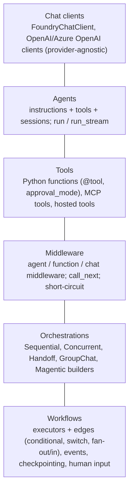
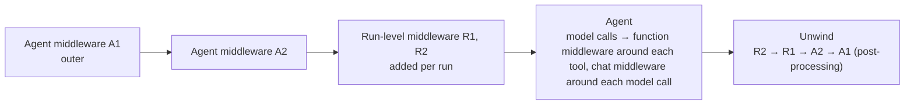

# Frameworks: Agent Framework, LangGraph, LangChain, Hugging Face and middleware

> AI-500 · D2 Develop multi-agent solutions in Azure · about 90 min · Study Hub module `d08` ([open the hub](https://claude.ai/artifact/WBg4UvZLizXnza8mbGvMze))

## Why it matters
Three named skills: *implement orchestration frameworks (Agent Framework, LangChain, LangGraph)*, *implement advanced capabilities with Hugging Face Transformers*, and *design middleware for reusable capabilities (logging, authorisation, exception handling)*. Expect code-reading questions.

## Pre-question (answer before reading)
**Q:** You need the same PII redaction and authorisation check on every tool call across 15 Agent Framework agents. Where do you put it?

<details><summary>Answer</summary>

In **function middleware** registered on the agents (or shared via a factory): it wraps every tool invocation, can inspect/modify arguments and results, and can short-circuit unauthorised calls — written once, reused everywhere.

</details>

## Mental model & story
Contoso's agent teams used four frameworks. The platform group standardised: **Microsoft Agent Framework** for new Foundry-centric agents, **LangGraph** for flows that auditors need to inspect as explicit state machines, and **Hugging Face Transformers** for cheap specialised subtasks. Semantic Kernel and AutoGen code was migrated over time; CrewAI stayed in prototypes.

In Agent Framework, an `Agent` wraps a chat client (`FoundryChatClient` for Foundry), instructions and tools. Standard patterns come from builders — sequential, concurrent, **handoff**, group chat, magentic — and custom flows use **workflows**: executors joined by edges (direct, conditional, switch-case, fan-out, fan-in), with events and **checkpointing** so long runs resume after failures.

Cross-cutting concerns moved into **middleware**. *Agent middleware* wraps whole runs (logging, timing, tenant checks). *Function middleware* wraps tool calls (authorisation, argument validation, PII redaction, rate limiting). *Chat middleware* wraps model requests (prompt logging, token accounting). Middleware calls `call_next()` to continue, edits results after it returns, or short-circuits by setting a result instead.

The audit-heavy dispute workflow is a **LangGraph** `StateGraph`: typed state, nodes, conditional edges, a checkpointer and interrupts for human review. Every transition is explicit and replayable; tracing goes to Azure via OpenTelemetry.

Finally, **Hugging Face**: a zero-shot classifier routes requests without an LLM call, a cross-encoder reranks retrieval results, and a clinical NER model extracts entities. Large open models are deployed to **Foundry managed compute** and called through the OpenAI-compatible endpoint.

**Where the analogy breaks:** Frameworks change fast — APIs are renamed between versions, and exam snippets reflect a point in time. Learn the concepts (agents, tools, middleware, executors/edges, state graphs, checkpointing, interrupts) and read code for intent, not exact signatures.

## Diagrams
**Agent Framework building blocks**



**Middleware execution order**



## Key points
- **Agent Framework** (Python/.NET): `Agent` + chat client (`FoundryChatClient`), tools (`@tool`, `approval_mode`), sessions, streaming; recommended with Foundry; successor to Semantic Kernel + AutoGen.
- Orchestration builders: **Sequential**, **Concurrent**, **Handoff** (`HandoffBuilder(...).with_start_agent(...).add_handoff(...)`), **GroupChat**, **Magentic**; custom **workflows** with `WorkflowBuilder`, executors, edges, events and **checkpointing**; human input requests inside workflows.
- **Middleware** types: **agent** (wraps a run), **function** (wraps tool calls), **chat** (wraps model requests). Signature `async def mw(context, call_next)`; continue with `await call_next()`; modify results after; short-circuit by setting a result (agent level can raise `MiddlewareTermination`).
- Register middleware on the agent (all runs) or per run; agent-level middleware wraps run-level middleware (A1 → A2 → R1 → R2 → agent → back out).
- Middleware uses: logging/telemetry, authorisation checks, PII redaction, exception handling, rate limiting, caching — reusable across agents.
- **LangGraph**: `StateGraph` with typed state, `add_node`, `add_edge`, `add_conditional_edges`, `compile(checkpointer=...)`, `interrupt()` + `Command(resume=...)` for human-in-the-loop (static `interrupt_before` is for debugging), subgraphs, supervisor patterns; explicit, auditable state transitions; OpenTelemetry tracing to Azure (e.g., `langchain-azure-ai` tracer).
- **LangChain**: components (models, tools, retrievers, output parsers) composed into chains; use with Azure via the Azure integrations; LangGraph for stateful agents.
- Hosting framework code: Foundry **hosted agents** or Container Apps; same observability and identity rules apply.
- **Hugging Face Transformers** for advanced capabilities: `pipeline("zero-shot-classification")` routing, NER/PII extraction, summarisation, **sentence-transformers** embeddings, **cross-encoder rerankers**, small local models for cheap subtasks.
- HF models in Foundry: deploy to **managed compute** (GPU; Safetensors; permissive licences; `trust_remote_code` models blocked unless verified or from trusted organisations; separate quota); call via the OpenAI-compatible `/openai/v1` endpoint with the deployment name.

## Comparisons
**Framework choice**

| Framework | Strengths | Use when |
|---|---|---|
| Microsoft Agent Framework | Native Foundry/identity, middleware, workflows, checkpointing, orchestration builders | Default for new Foundry-centric agents |
| LangGraph | Explicit state graphs, interrupts, replayable transitions | Auditable, regulated subflows; complex state machines |
| LangChain | Large ecosystem of components | Retrieval/tool composition; existing LangChain code |
| Semantic Kernel / AutoGen | Existing investments | Migrate to Agent Framework over time |
| Hugging Face Transformers | Specialised open models, local pipelines | Routing, NER, reranking, cheap subtasks |

## Code to recognise
**Agent Framework: function middleware + handoff orchestration**

```python
from agent_framework import Agent, function_middleware, FunctionInvocationContext
from agent_framework.foundry import FoundryChatClient
from agent_framework.orchestrations import HandoffBuilder

@function_middleware
async def authorize_and_redact(context: FunctionInvocationContext, call_next):
    if context.function.name in WRITE_TOOLS and not caller_may_write(context):
        context.result = {"status": "denied", "reason": "write not permitted"}
        return                                            # short-circuit: tool never runs
    await call_next()                                     # run the tool
    context.result = redact_pii(context.result)           # post-process the result

client = FoundryChatClient(project_endpoint=ENDPOINT, model="gpt-5.4", credential=credential)
triage  = client.as_agent(name="triage", instructions=TRIAGE, middleware=[authorize_and_redact])
billing = client.as_agent(name="billing", instructions=BILLING, tools=[refund], middleware=[authorize_and_redact])
tech    = client.as_agent(name="tech", instructions=TECH, tools=[diagnose], middleware=[authorize_and_redact])

workflow = (HandoffBuilder(name="support", participants=[triage, billing, tech])
            .with_start_agent(triage)
            .add_handoff(triage, [billing, tech])
            .build())
```

- Line 5: Function middleware wraps every tool invocation of the agents it's registered on.
- Line 9: Not calling `call_next()` and setting a result short-circuits the call.
- Line 10: `call_next()` runs the tool (and any inner middleware).
- Line 11: After the tool returns, middleware can transform its result.
- Line 14: The same middleware is reused across agents: one implementation, consistent policy.
- Line 20: Handoff orchestration: triage can transfer control to billing or tech.

**Hugging Face: cheap routing and reranking without an LLM call**

```python
from transformers import pipeline
from sentence_transformers import CrossEncoder

router = pipeline("zero-shot-classification", model="facebook/bart-large-mnli")
route = router(user_msg, candidate_labels=["billing", "technical", "account", "other"])
target = route["labels"][0] if route["scores"][0] >= 0.6 else "llm_router"

reranker = CrossEncoder("cross-encoder/ms-marco-MiniLM-L-6-v2")
scores = reranker.predict([(query, c["content"]) for c in candidates])
top5 = [c for _, c in sorted(zip(scores, candidates), key=lambda x: x[0], reverse=True)[:5]]
```

- Line 4: Zero-shot classification routes without training data or an LLM call.
- Line 6: Low-confidence routes fall back to a smarter (LLM) router.
- Line 8: A cross-encoder scores query–passage pairs for precise reranking.
- Line 10: Keep only the best passages for the agent's context.

## Portal steps
**Deploy a Hugging Face model to Foundry managed compute** (Foundry > Discover > Models (Hugging Face) > Deploy)

1. Pick a model that meets criteria (Safetensors, permissive licence, no remote code).
2. Choose a GPU SKU and instance count (1 for test, 2+ for production) within managed compute quota.
3. Grant Foundry User to callers; deploying needs a contributor-level role.
4. Call it via the OpenAI-compatible endpoint with the deployment name as `model`.

## Worked example
**Scenario:** Every agent in a 15-agent system must (1) log each tool call with tenant and duration, (2) block write tools for read-only users, (3) convert unhandled tool exceptions into structured errors. Implement it once.

- All three wrap tool calls → function middleware.
- Logging needs timing around call_next; authorisation short-circuits before; exception handling wraps call_next in try/except.
- Register on all agents (e.g., via a factory).

**Answer:** One **function middleware** (or three composable ones): check authorisation before `call_next()` (short-circuit with a denial result), time and log with tenant ID around it, and catch exceptions after it to set a structured error result; register it on every agent through a shared factory so policy stays consistent.

## Your turn (faded example)
**Scenario:** Auditors require a dispute-resolution flow where every state transition is explicit, replayable and pausable for human review.

- Explicit state transitions and interrupts are LangGraph's strengths.
- **Which constructs do you use?** <details><summary>answer</summary>`StateGraph` with typed state, nodes and conditional edges, a durable checkpointer and `interrupt()` in review nodes, resumed with `Command(resume=...)`.</details>
- **How do you keep observability consistent with the rest of the platform?** <details><summary>answer</summary>OpenTelemetry tracing exported to Application Insights (e.g., the Azure LangChain tracer), same correlation IDs.</details>

## Exam traps & misconceptions
- ✗ Copy-pasting logging and auth checks into every tool. → ✓ Use middleware for cross-cutting concerns.
- ✗ Calling an LLM to route when a cheap classifier suffices. → ✓ Zero-shot/small models for routing; LLM fallback for low confidence.
- ✗ Deploying HF models that require `trust_remote_code`. → ✓ Foundry blocks them unless Hugging Face verifies them or they come from trusted organisations; prefer compliant Safetensors models.
- ✗ Forgetting checkpointing in long workflows. → ✓ Checkpoint to resume after failures or human pauses.
- ✗ Memorising exact signatures over concepts. → ✓ APIs evolve; read code for intent.

## Discussion prompts
- **Agent Framework or LangGraph for a new regulated workflow?** Agent Framework workflows also give typed graphs and checkpointing with native Foundry integration; LangGraph is attractive when the team already uses it or auditors want its explicit state-machine model. Either way: explicit state, interrupts for review, and full tracing.
- **What belongs in middleware vs in the tool?** Cross-cutting policy (auth, logging, redaction, rate limits, error shaping) in middleware; business logic and input validation specific to the tool in the tool itself.

## Interview angle / teach-back
**Prompt:** Explain how you'd use Agent Framework, LangGraph and Hugging Face in one platform, and what middleware is for.

**Rubric:** MAF: agents, clients, tools, builders, workflows, checkpointing · Middleware types and call_next / short-circuit / ordering · LangGraph StateGraph, conditional edges, checkpointer, interrupts · HF pipelines (routing, NER, rerankers) and managed compute deployment · Choose by need; migrate SK/AutoGen

**Model answer:** Agent Framework is the default: agents wrap a chat client such as FoundryChatClient with instructions and tools, standard patterns come from builders like Handoff or Concurrent, and custom flows are workflows of executors and edges with checkpointing. Cross-cutting policy lives in middleware — agent, function or chat middleware that calls call_next, post-processes results or short-circuits — registered once and reused. LangGraph handles flows that need explicit, auditable state machines with checkpointers and interrupts. Hugging Face Transformers handle cheap specialised tasks like zero-shot routing, NER and cross-encoder reranking, and larger open models run on Foundry managed compute.

## Quick Q&A
- **Three MAF middleware types?** Agent, function, chat.
- **Continue in middleware?** `await call_next()`.
- **Short-circuit a tool call?** Set a result without calling `call_next()` (agent level: `MiddlewareTermination`).
- **MAF handoff builder?** `HandoffBuilder(...).with_start_agent(...).add_handoff(...)`.
- **LangGraph pause for review?** `interrupt()` + durable checkpointer; resume with `Command`.
- **Cheap routing without an LLM?** Zero-shot classification pipeline.
- **HF models in Foundry deploy to?** Managed compute (GPU).

## Sources (accessed 2026-10-02)
- [Agent Framework middleware](https://learn.microsoft.com/en-us/agent-framework/agents/middleware)
- [Agent Framework workflows](https://learn.microsoft.com/en-us/agent-framework/workflows/overview)
- [LangGraph overview](https://docs.langchain.com/oss/python/langgraph/overview)
- [Hugging Face Transformers pipelines](https://huggingface.co/docs/transformers/main_classes/pipelines)
- [mslearn-ai-agents: multi-agent solution with Agent Framework](https://microsoftlearning.github.io/mslearn-ai-agents/Instructions/Exercises/08-agent-framework-multi-agents.html)

## SRS cards created
- ai-500-d08-01, ai-500-d08-02, ai-500-d08-03, ai-500-d08-04
