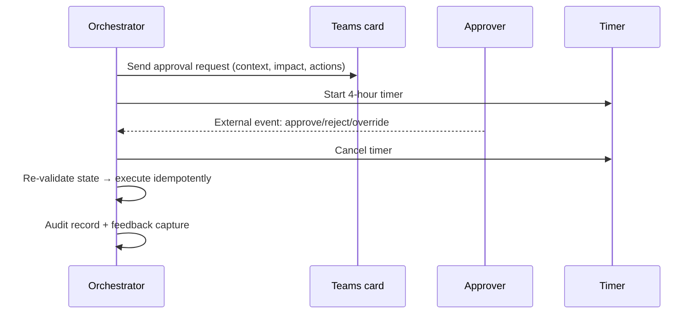
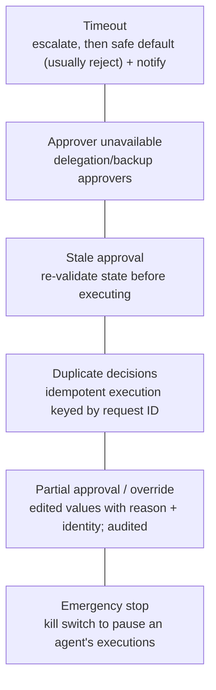

# Implementing human-in-the-loop: approvals, overrides and edge cases

> AI-500 · D2 Develop multi-agent solutions in Azure · about 80 min · Study Hub module `d09` ([open the hub](https://claude.ai/artifact/WBg4UvZLizXnza8mbGvMze))

## Why it matters
a02 designed *where* humans fit. This module *implements* it: durable approval workflows, overrides, timeouts, stale approvals and the feedback loop that turns human decisions into better agents. The exam likes edge cases — the approver who never answers, the approval that's out of date.

## Pre-question (answer before reading)
**Q:** A manager approves a refund 6 hours after the request, but in the meantime the customer already received a partial refund. What should the workflow do on approval?

<details><summary>Answer</summary>

**Re-validate before executing**: check that the state the approval was based on still holds (amount, status, policy). If it changed, don't execute; route back for a fresh decision. Approvals are for a specific state, not a blank cheque.

</details>

## Mental model & story
Adventure Works' refund agent now escalates about 9% of cases. The first implementation held an HTTP request open while waiting for Teams approvals; deployments and timeouts lost dozens of pending decisions.

The rebuild used a **durable orchestration**: the agent proposes a refund, a Durable Functions orchestrator sends an adaptive card to Teams, then waits for an **external event** or a **timer**, whichever comes first. While it waits, nothing runs and nothing is lost on restart. Pending approvals are also visible in a dashboard (Redis with a 24-hour TTL for quick lookups; Cosmos DB as the system of record).

Edge cases were written down and coded. **Timeout**: after 4 hours escalate to a senior reviewer, after 24 hours reject by default and notify. **Approver unavailable**: delegation rules. **Stale approval**: re-validate state before executing. **Duplicate clicks**: idempotent execution keyed by request ID. **Partial approval**: the approver can edit the amount — an **override** recorded with reason and identity. **Emergency stop**: a kill switch pauses all executions for an agent.

Overrides and rejections are gold. Approvers pick a rejection reason from a short list (wrong policy interpretation, outside authority, insufficient context, tier mismatch, other) — three seconds of effort. Monthly, a feedback collector samples high-quality rejections, turns them into regression test cases with the expected correct action and trace links, and ranks them by `0.4 × confidence-outcome mismatch + 0.3 × novelty + 0.3 × frequency`. Rejections fell from 28% to 12% in six months.

Every decision is audited according to its tier — routine, notable, auditable or regulated — with retention from 30 days to 7+ years.

**Where the analogy breaks:** Human review isn't automatically meaningful. If reviewers lack context, time or authority, approvals become rubber stamps that add delay without safety. Measure the review itself: time on task, rejection rates, overrides, and outcomes of approved actions.

## Diagrams
**Durable human interaction pattern**



**Edge cases to implement**



## Key points
- Implementation options: **Foundry workflows** (human input/approval steps), **Agent Framework** tool approvals (`approval_mode="always_require"`) and workflow human-input requests, **MCP approvals** in Foundry (`mcp_approval_request` → `mcp_approval_response`), **Power Automate + Teams** adaptive cards, **Durable Functions** human-interaction pattern.
- Durable pattern: externalise state, wait for an **external event** or **timer** (`task_any`), pause with zero compute, resume after restarts.
- Polling alternative (simpler apps): submit via webhook, store pending approval (e.g., Redis TTL 24 h), poll status with a timeout; prefer callbacks/events at scale.
- **Re-validate** before executing an approved action: the approval refers to a state snapshot.
- **Idempotent execution** keyed by request ID; ignore duplicate or late decisions.
- **Overrides**: humans can edit or replace the agent's decision; record original recommendation, override, reason and identity; overrides feed evaluation sets.
- SLAs and timeouts (example): standard 4 h, urgent 1 h, escalated 24 h; then escalate → default reject + SLA notification; trivial reversible items may auto-approve after timeout.
- Feedback loop: rejection categories, high-quality sampling, conversion to regression tests (label, expected action, trace ID), prioritisation (e.g., 0.4 mismatch + 0.3 novelty + 0.3 frequency), deployment gate requiring feedback cases to pass.
- Audit tiers (example): **routine** (logs, 30 days), **notable** (audit DB, 1 year), **auditable** (human review, full trail, 3 years), **regulated** (human + legal review, immutable record, 7+ years).
- Measure oversight quality: rejection rate (healthy ~12–15%), approval time, overrides, reversals (> 2% → root-cause analysis).

## Comparisons
**HITL implementation options**

| Option | Best for | Notes |
|---|---|---|
| Foundry workflow human step | Low-code agent workflows | Built into Foundry workflows |
| Agent Framework approvals / human input | Code-first agents and workflows | Tool approval_mode; workflow requests; checkpointing |
| Durable Functions | Long waits, timers, escalations | External events + timers; zero compute while waiting |
| Power Automate + Teams cards | Business approvers in Teams | Approval connector; adaptive cards |
| MCP approval requests | Approving MCP tool calls | mcp_approval_request / mcp_approval_response |

## Code to recognise
**Durable Functions: approval with timeout, re-validation and safe default**

```python
import azure.durable_functions as df
from datetime import timedelta

def orchestrator(context: df.DurableOrchestrationContext):
    proposal = yield context.call_activity("propose_refund", context.get_input())
    if proposal["amount"] <= 50 and proposal["confidence"] >= 0.75:
        return (yield context.call_activity("execute_refund", proposal))   # full-auto

    yield context.call_activity("send_teams_card", proposal)
    timer = context.create_timer(context.current_utc_datetime + timedelta(hours=4))
    decision = context.wait_for_external_event("ApprovalDecision")
    winner = yield context.task_any([decision, timer])

    if winner == decision:
        timer.cancel()
        d = decision.result
        if d["approved"] and (yield context.call_activity("revalidate", proposal)):
            final = {**proposal, **d.get("override", {})}
            return (yield context.call_activity("execute_refund", final))
    return (yield context.call_activity("reject_and_notify", proposal))

main = df.Orchestrator.create(orchestrator)
```

- Line 6: Low-impact, confident proposals skip the human.
- Line 10: A durable timer: nothing runs while waiting, and it survives restarts.
- Line 11: The approval arrives as an external event raised by the Teams card handler.
- Line 12: Whichever completes first wins: decision or timeout.
- Line 17: Re-validate state before executing an approved action.
- Line 18: Overrides (edited amounts) are applied — and audited in the activity.
- Line 20: Timeout or rejection: safe default with notification (escalation can be added before this).

## Portal steps
**Approvals in Teams with Power Automate** (Power Automate > cloud flow triggered by HTTP/webhook)

1. Receive the approval payload (context, recommendation, impact, actions).
2. Post an adaptive card or use the Approvals connector to the approver/channel.
3. Return the decision to the agent's orchestrator (raise the external event / call back).
4. Log the decision and comment to the audit store; handle timeouts and delegation.

## Worked example
**Scenario:** A healthcare scheduling agent can cancel appointments. Requirements: cancellations of surgeries need a nurse manager's approval within 2 hours; if no answer, page the on-call manager; never cancel if the patient already rescheduled; all decisions kept 7 years.

- Durable wait with timer and escalation.
- Stale state → re-validate before executing.
- Retention → regulated audit tier.

**Answer:** Durable orchestration: propose → Teams approval card → `task_any` (decision vs 2-hour timer) → on timeout **escalate** (page on-call) with a second timer → default **reject** if still unanswered; on approval **re-validate** (appointment still scheduled, not rescheduled) and execute **idempotently**; write an immutable audit record with 7-year retention (regulated tier).

## Your turn (faded example)
**Scenario:** Approvers sometimes click Approve twice and two cancellations are attempted.

- Duplicate decisions must not cause duplicate effects.
- **What implementation detail prevents it?** <details><summary>answer</summary>Idempotent execution keyed by the request ID; ignore events for completed requests.</details>
- **Where should this be enforced?** <details><summary>answer</summary>In the execution activity/service (and the orchestrator state), not only in the UI.</details>

## Exam traps & misconceptions
- ✗ Holding an HTTP request open while waiting for a human. → ✓ Use durable waits with external events and timers.
- ✗ Executing an approval without checking state. → ✓ Re-validate; approvals refer to a snapshot.
- ✗ No default on timeout. → ✓ Escalate, then a safe default (usually reject) with notification.
- ✗ Overrides without reasons. → ✓ Record reason and identity; feed into evaluation.
- ✗ Free-text-only rejection feedback. → ✓ Short category lists get high completion; free text is optional.

## Discussion prompts
- **How do you prevent approval queues from becoming bottlenecks?** Tune thresholds with calibrated confidence so only valuable escalations reach humans, batch similar low-risk items for bulk review, route by expertise, track SLA compliance, and auto-approve trivial reversible items after timeout where policy allows.
- **How do human decisions improve the agent?** Categorised rejections and overrides become regression test cases and prompt/tool fixes, prioritised by impact; deployment gates require those cases to pass, and monitoring checks that rejection rates fall over time.

## Interview angle / teach-back
**Prompt:** Explain how you'd implement a robust approval step for an agent action, including edge cases and learning from decisions.

**Rubric:** Durable wait: external event + timer, zero compute · Timeouts, escalation, safe default, delegation · Re-validation, idempotency, overrides with reason · Audit tiers and retention · Feedback loop into regression tests

**Model answer:** I implement approvals as a durable orchestration: send a context-rich card, then wait for either the approver's external event or a timer, with no compute running in between. Timeouts escalate to a backup and then default to reject with a notification. On approval I re-validate the state the request was based on and execute idempotently, applying any override the approver made with its reason recorded. Every decision is audited by tier with appropriate retention. Rejections are categorised, sampled monthly into regression tests with trace links, prioritised by impact, and required to pass before the next deployment.

## Quick Q&A
- **Wait for a human durably?** External event + timer (e.g., Durable Functions `task_any`).
- **Before executing an approval?** Re-validate state.
- **Duplicate approvals?** Idempotent execution by request ID.
- **Timeout default?** Escalate, then reject + notify.
- **Override must record?** Original, new value, reason, identity.
- **Audit tiers?** Routine, notable, auditable, regulated.
- **Feedback → ?** Regression test cases + prompt/tool fixes.

## Sources (accessed 2026-10-02)
- [Durable Task: human interaction pattern](https://learn.microsoft.com/en-us/azure/durable-task/common/durable-task-human-interaction)
- [Agent Framework human-in-the-loop](https://learn.microsoft.com/en-us/agent-framework/workflows/human-in-the-loop)
- [mslearn-ai-agents: build a workflow in Foundry](https://microsoftlearning.github.io/mslearn-ai-agents/Instructions/Exercises/06-build-workflow-ms-foundry.html)
- [AI-500 module: human-in-the-loop approval workflows](https://learn.microsoft.com/en-us/training/modules/aaai-design-human-in-loop-approval-workflows/)

## SRS cards created
- ai-500-d09-01, ai-500-d09-02, ai-500-d09-03, ai-500-d09-04
