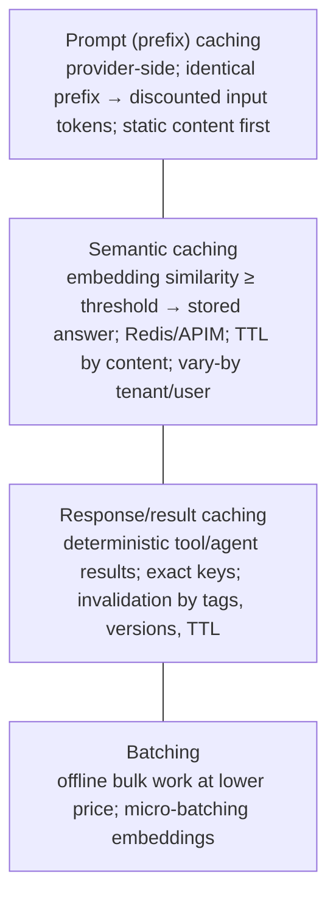
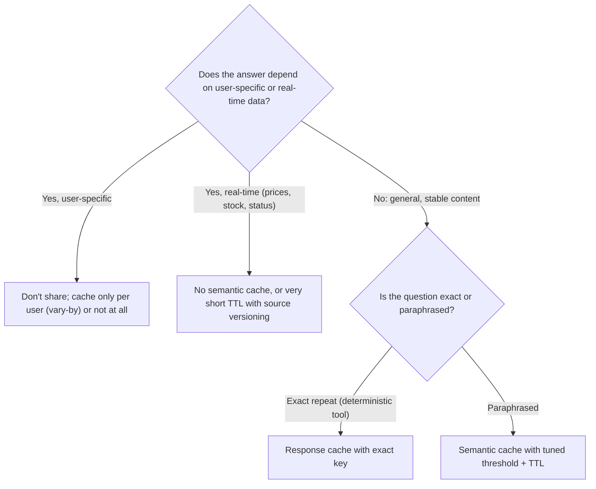

# Caching strategy, batching and cost-aware execution

> AI-500 · D2 Develop multi-agent solutions in Azure · about 75 min · Study Hub module `d10` ([open the hub](https://claude.ai/artifact/WBg4UvZLizXnza8mbGvMze))

## Why it matters
*Design and implement a caching strategy, including prompt caching, semantic caching, and response caching.* Done well, caching cuts inference cost 60–70% at scale; done badly, it serves stale or another user's answers. The exam tests mechanics (prefixes, thresholds, TTLs, vary-by) and judgment (what's safe to cache).

## Pre-question (answer before reading)
**Q:** To maximise prompt-cache hits, where should the customer's name and the retrieved documents go in the prompt — before or after the 2,000-token system prompt?

<details><summary>Answer</summary>

**After.** Prompt caching works on an identical **prefix**: put static content (system prompt, tool definitions, examples) first and variable content (customer context, retrieved docs, the question) after it.

</details>

## Mental model & story
Adventure Works served 10 million agent requests a month. A cost review found three wastes: the same 2,000-token system prompt paid in full on every call, thousands of near-identical questions ("what's your return window?") answered from scratch, and catalogue lookups recomputed for every user.

First, **prompt caching**: prompts were reordered so the static system prompt and tool definitions form an identical prefix, with variable content after it. Cached input tokens are billed at a steep discount (around half price), automatically, with no code change beyond the ordering.

Second, **semantic caching**: questions are embedded and compared with recent questions in Redis; above a similarity threshold (0.92 after tuning — 0.80 produced wrong hits, 0.98 almost no hits) the stored answer is returned without calling the model. TTLs depend on the content: 7 days for general answers, 24 hours for anything time-sensitive, 30 days for stable policy text. Keys include the agent and tenant, so one tenant never sees another's answers. At the API Management layer, the `llm-semantic-cache-lookup` and `llm-semantic-cache-store` policies do the same for every app behind the gateway, partitioned with **vary-by**.

Third, **response caching** for deterministic tools — catalogue, store locations, policy lookups — with invalidation by dependency tags (entity IDs), data-source versions and TTLs.

Together they cut inference cost by about two-thirds. Batch work (nightly re-summarisation of 2 million reviews) moved to **Batch** deployments at a lower price with a 24-hour window, and request bursts were smoothed with queues and quota-sized concurrency.

**Where the analogy breaks:** A cache hit is a confident answer from the past. If data changed, the hit is wrong; if the key ignored a user or tenant, it's a leak; if the threshold is loose, it's an answer to a different question. Caching is a correctness feature as much as a cost feature.

## Diagrams
**Three caching layers**



**Is this response safe to cache?**



## Key points
- **Prompt caching**: automatic for long prompts (Azure OpenAI applies it to prompts of roughly 1,024+ tokens with an identical prefix); cached input tokens are discounted; design: static first (system prompt, tools, examples), variable after.
- **Semantic caching**: embed the query, find a stored answer above a similarity threshold, return it; typical hit rates 20–40%; tune the threshold on labelled pairs (e.g., 0.92); too low → wrong answers, too high → few hits.
- TTL by content: general ~7 days, time-sensitive ~24 h (or none), stable policy ~30 days; never cache volatile data (stock, prices, status) for long.
- Partition caches: keys include agent and tenant (and user for personalised answers); in APIM use **vary-by** (e.g., subscription, user or tenant).
- **APIM policies**: `llm-semantic-cache-lookup` (inbound; `score-threshold` where **lower = stricter** similarity requirement, e.g., start ~0.05; embeddings backend; `vary-by`) and `llm-semantic-cache-store` (outbound; `duration` in seconds); requires Azure Managed Redis/Azure Cache for Redis with RediSearch.
- **Response caching** for deterministic workloads (catalogue, policies, locations): exact keys, invalidation by dependency tags (entity IDs), data-source versions, cascading invalidation through agent dependencies, TTL.
- Combined layers can reduce inference costs ~60–70% at scale; ROI depends on volume (infra + engineering vs savings per hit).
- Pitfalls: thresholds too loose/strict, poor invalidation, unbounded key scans (use native vector search or bounded scans), caching time-sensitive data, cross-user leakage.
- **Batching**: Batch deployments/APIs for non-urgent bulk jobs (lower cost, ~24 h turnaround); micro-batch embeddings; keep interactive paths on standard deployments.
- Cost-aware execution: quota-sized concurrency, queues for bursts, smaller models for simple steps (v02), and per-agent cost attribution (v05).

## Comparisons
**Caching layers compared**

| Layer | Saves | Hit condition | Main risk |
|---|---|---|---|
| Prompt caching | Discount on cached input tokens | Identical prefix (long prompts) | Low hits if variable content comes first |
| Semantic caching | Whole model call | Similarity ≥ threshold | Wrong or stale answers; leakage |
| Response caching | Tool/agent computation | Exact key match | Stale data without invalidation |
| Batch processing | Lower per-token price | Offline workloads | Latency (hours) |

## Code to recognise
**API Management: per-subscription token limit + semantic cache**

```xml
<policies>
  <inbound>
    <base />
    <llm-token-limit counter-key="@(context.Subscription.Id)"
                     tokens-per-minute="20000" estimate-prompt-tokens="true" />
    <llm-semantic-cache-lookup score-threshold="0.05"
                               embeddings-backend-id="embeddings-backend"
                               embeddings-backend-auth="system-assigned"
                               ignore-system-messages="true" max-message-count="10">
      <vary-by>@(context.Subscription.Id)</vary-by>
    </llm-semantic-cache-lookup>
  </inbound>
  <outbound>
    <llm-semantic-cache-store duration="3600" />
    <base />
  </outbound>
</policies>
```

- Line 4: Token quota per subscription (tenant/app); excess requests get 429.
- Line 6: `score-threshold`: lower means a closer match is required (stricter).
- Line 7: An embeddings deployment computes vectors for lookup.
- Line 9: Ignore the system message so prompt wording changes don't fragment the cache.
- Line 10: `vary-by` partitions the cache so one subscription never gets another's answers.
- Line 14: Store responses for an hour (seconds).

## Portal steps
**Tune a semantic cache threshold** (Evaluation notebook + Redis / APIM)

1. Collect pairs of questions labelled same-intent / different-intent.
2. Compute similarity distributions; pick the threshold that keeps false hits near zero at acceptable hit rate.
3. Set TTLs per content type and partition keys (tenant/user).
4. Monitor hit rate, false-hit reports and staleness incidents; re-tune quarterly.

## Worked example
**Scenario:** A bank's assistant answers general product questions (stable for weeks), current interest rates (change daily) and personal balance questions. Design caching.

- General product Q&A → semantic cache, long TTL.
- Interest rates → time-sensitive: short TTL tied to rate-table version, or no semantic cache.
- Personal balances → never in a shared cache.
- Prompt caching applies to all (static prefix first).

**Answer:** **Prompt caching** everywhere (static prefix first); **semantic cache** for general product questions (tuned threshold, ~7–30-day TTL, tenant-partitioned); rates served from a **response cache** keyed by rate-table version (invalidated on publish) or not cached; **no caching** of personal balances (or per-user only with very short TTL), and vary-by user/tenant in APIM.

## Your turn (faded example)
**Scenario:** Users in tenant A occasionally receive answers mentioning tenant B's products from the APIM semantic cache.

- Cache entries are shared across tenants.
- **What's missing in the lookup policy?** <details><summary>answer</summary>A `vary-by` element keyed on the tenant (e.g., subscription or a tenant header/claim).</details>
- **What else would you check?** <details><summary>answer</summary>That stored entries for personalised answers are partitioned per user, and purge the contaminated cache.</details>

## Exam traps & misconceptions
- ✗ Putting user context before the static system prompt. → ✓ Static prefix first, variable content after.
- ✗ Lowering a semantic similarity requirement to boost hit rate. → ✓ Wrong answers cost more than model calls; tune on labelled pairs.
- ✗ Misreading APIM `score-threshold`. → ✓ Lower value = stricter match.
- ✗ Caching prices or stock for days. → ✓ Short TTL tied to data versions, or don't cache.
- ✗ A shared cache without tenant/user partitioning. → ✓ Use vary-by and partitioned keys.

## Discussion prompts
- **How do you prove a semantic cache is safe?** Measure false-hit rate on labelled pairs, sample cached responses in production for review, track user corrections/thumbs-down on cached answers, and alert on staleness incidents; keep a kill switch to bypass the cache.
- **When isn't caching worth it?** Low volume (infrastructure and engineering exceed savings), highly personalised or real-time answers, or strict audit needs where every answer must come from a fresh, traced reasoning path.

## Interview angle / teach-back
**Prompt:** Explain your caching strategy for a high-volume multi-agent service and how you keep it correct.

**Rubric:** Prompt caching mechanics and ordering · Semantic cache: threshold tuning, TTLs, partitioning · APIM semantic cache policies (score-threshold, vary-by, duration) · Response caching with invalidation · What not to cache; batching for offline

**Model answer:** Prompts are ordered with static content first so prompt caching discounts the shared prefix. A semantic cache in Redis or at API Management returns stored answers for paraphrased questions above a tuned similarity threshold — in APIM a lower score-threshold is stricter — with TTLs by content type and keys partitioned by agent, tenant and, where needed, user via vary-by. Deterministic tool results use exact-key response caching with invalidation by entity tags, data versions and TTL. I never cache volatile or personal answers in shared caches, and I move offline bulk work to batch deployments. Hit rates, false hits and staleness are monitored, with a bypass switch.

## Quick Q&A
- **Prompt caching needs?** Identical prefix on long prompts; static content first.
- **Typical semantic cache hit rate?** About 20–40%.
- **APIM score-threshold: lower means?** Stricter (closer match required).
- **Partition APIM cache by tenant?** `vary-by`.
- **TTL for time-sensitive answers?** Short (e.g., 24 h) or none.
- **Offline bulk jobs?** Batch deployments (~24 h, cheaper).
- **Never cache in shared caches?** Personal or real-time data.

## Sources (accessed 2026-10-02)
- [Prompt caching (Azure OpenAI)](https://learn.microsoft.com/en-us/azure/foundry/openai/how-to/prompt-caching)
- [APIM semantic cache lookup policy](https://learn.microsoft.com/en-us/azure/api-management/llm-semantic-cache-lookup-policy)
- [APIM LLM token limit policy](https://learn.microsoft.com/en-us/azure/api-management/llm-token-limit-policy)
- [Batch deployments](https://learn.microsoft.com/en-us/azure/foundry/openai/how-to/batch)
- [AI Gateway labs (Azure Samples)](https://github.com/Azure-Samples/AI-Gateway)

## SRS cards created
- ai-500-d10-01, ai-500-d10-02, ai-500-d10-03, ai-500-d10-04
