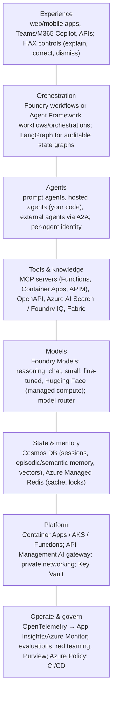
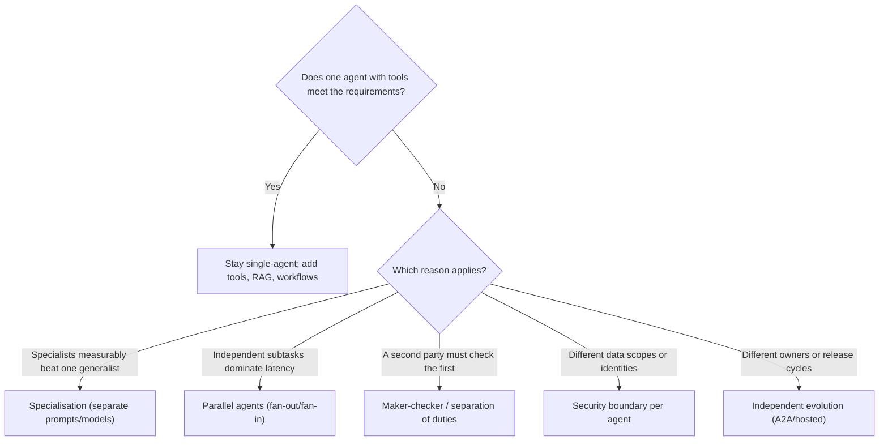

# The expert's map: when (and how) to go multi-agent on Azure

> AI-500 · D1 Architect multi-agent solutions · about 75 min · Study Hub module `f01` ([open the hub](https://claude.ai/artifact/WBg4UvZLizXnza8mbGvMze))

## Why it matters
AI-500 assumes you can already build an agent (AI-103). What it tests is judgment: when a second agent pays for itself, which Azure component carries each concern, and how the pieces fail. This module is the map you'll hang every later topic on.

## Pre-question (answer before reading)
**Q:** A claims assistant has one agent with 6 tools and a good prompt. A teammate proposes splitting it into a router plus five specialist agents "for modularity". What single test would you apply first?

<details><summary>Answer</summary>

The **litmus test**: remove the extra agents — does the solution still meet its requirements? If one agent with tools works, the split only adds latency, cost, failure points and governance work. Multi-agent is justified by **specialisation quality, parallel latency, separation of duties, security boundaries or independent evolution** — not by modularity alone.

</details>

## Mental model & story
Northwind Insurance's first assistant was a single agent: instructions, six tools and a knowledge base. It handled 80% of claims questions. Then the business asked for three things at once: fraud checks by a model the data-science team owns, payouts that a second, independent agent must verify, and German-language customers whose data must stay in the EU.

The lead architect, **Rania**, didn't start by drawing agents. She listed **why** a second agent might be needed. Fraud scoring: a different team, model and release cadence (*independent evolution*). Payout verification: a maker-checker control auditors demand (*separation of duties*). EU data: a different identity and data scope (*security boundary*). Each reason passes the litmus test; "it looks cleaner" doesn't.

Then she mapped concerns to Azure. Agents and workflows run in **Microsoft Foundry Agent Service** (prompt agents, workflows, hosted agents) or as **Microsoft Agent Framework** code on **Container Apps**. Agents reach tools through **MCP** servers and talk to other teams' agents through **A2A**. State lives in **Cosmos DB** (sessions, memory, vector search) and **Redis** (hot cache, locks). Knowledge comes from **Azure AI Search** / **Foundry IQ**. **API Management** sits in front of models as an AI gateway (token limits, semantic cache, metering). **Entra ID** gives every agent its own identity; **Key Vault** holds secrets; **OpenTelemetry → Application Insights** carries traces across every hop.

Finally she wrote down what multi-agent would cost: more model calls, more latency on the critical path, a distributed call stack to debug, guardrails on every edge, per-agent identities and RBAC, coordinated releases and per-agent cost attribution. The design review approved three agents, not six.

**Where the analogy breaks:** Maps hide motion. Real systems change weekly: models get upgraded, prompts drift, tools change schemas, traffic spikes. That's why AI-500 spends half its weight on evaluation, monitoring, security and deployment — the architecture is only correct if you can keep proving it in production.

## Diagrams
**Reference architecture for a production multi-agent system on Azure**



**Do you need more than one agent?**



## Key points
- **Agentic** = an autonomous loop (plan → act → observe) and can be a single agent. **Multi-agent** = two or more agents with distinct roles, context and identity whose interaction is essential. Multi-*persona* prompting in one model call is not multi-agent.
- Litmus test: remove the second agent. If the solution still meets requirements, don't go multi-agent.
- Legitimate reasons: **specialisation quality**, **parallel latency**, **separation of duties** (maker-checker), **security boundaries** (different data scopes/identities), **independent evolution** (teams, models, release cadence).
- Coordination costs: pattern selection, message contracts, synchronisation, per-agent identity and OBO, distributed tracing, coordinated releases, per-agent cost attribution, guardrails on every edge.
- Flat (everyone-talks-to-everyone) designs fail at scale: N(N−1)/2 relationships, cascading failures and no arbiter. Prefer a hub (orchestrator) or hierarchy.
- Protocols: **MCP** = agent ↔ tools/resources; **A2A** = agent ↔ agent (opaque peer with its own reasoning); **Activity protocol** = channels such as Teams/Microsoft 365; plain HTTPS/OpenAPI for services.
- Foundry Agent Service v2: **prompt agents** (declarative), **workflows** (graph of agents/actions, HITL), **hosted agents** (your container, e.g., Agent Framework or LangGraph code).
- **Microsoft Agent Framework** (Python/.NET) is the recommended framework for Foundry: agents, tools, middleware, workflows with typed executors/edges, checkpointing and orchestration builders; successor to Semantic Kernel + AutoGen. **LangGraph** fits explicit, auditable state graphs.
- State tiers: in-memory (turn) → Redis (hot, sub-ms) → Cosmos DB (durable sessions, memory, vector search) with tenant partitioning.
- Everything observable: OpenTelemetry spans for agent entry, LLM calls, tool calls and agent-to-agent calls, correlated by W3C trace context.

## Comparisons
**Single agent vs multi-agent: what you gain and pay**

|  | Single agent + tools | Multi-agent |
|---|---|---|
| Latency | One loop; fewest hops | Extra hops; parallel branches can cut wall-clock time |
| Quality | Limited by one prompt/context | Specialists with focused context can do better |
| Cost | Lowest | More calls and tokens; optimise with routing and caching |
| Debugging | One trace, one prompt | Distributed call stack; needs trace correlation and replay |
| Security | One identity and scope | Per-agent identity and least privilege; guardrails per edge |
| Change management | One release | Contracts between agents; coordinated or versioned releases |

**Concern → Azure component**

| Concern | Primary component | Alternatives |
|---|---|---|
| Agent runtime | Foundry Agent Service (prompt/workflow/hosted) | Agent Framework on Container Apps/AKS |
| Tool hosting | MCP on Azure Functions or Container Apps | APIM exposing REST as MCP; Logic Apps connectors |
| Agent registry / tool catalogue | Azure API Center, Cosmos DB registry | Foundry Control Plane inventory |
| Session & memory | Cosmos DB (NoSQL + vector) | Redis for hot state; AI Search for knowledge |
| Model access control | API Management AI gateway | Per-deployment quotas |
| Observability | OpenTelemetry → Application Insights | Foundry tracing view, Log Analytics workbooks |

## Code to recognise
**An agent version manifest (kept in source control)**

```yaml
agent_id: claims-payout-verifier
version: 2.3.0
role: checker            # maker-checker: verifies payouts proposed by claims-maker
model:
  deployment: gpt-5.4-verifier
  model_version: "2025-04-14"
system_prompt_sha256: 8f2c...e41
tools:
  - mcp://policy-admin/v2/get_policy        # read-only
  - mcp://payments/v1/get_payout_quote      # read-only; no write tools
identity: mi-claims-verifier                 # its own managed identity
autonomy: approval-required                  # never executes payouts itself
evaluation_baseline:
  task_adherence: 4.6
  tool_call_accuracy: 0.97
  attack_success_rate: 0.00
approvals: [ai-lead, risk-officer]
```

- Line 3: Each agent's role is explicit; this one exists for separation of duties.
- Line 6: Pin the model **version**, not just the deployment name: silent upgrades are a classic incident cause.
- Line 7: Hash the system prompt so replays and audits can prove which prompt ran.
- Line 9: Tool scope is least privilege: a checker gets read-only tools.
- Line 11: Per-agent identity enables per-agent RBAC and audit.
- Line 12: Autonomy level is a design decision, recorded with the version.
- Line 13: The release gate compares new versions against this baseline.

## Portal steps
**Get oriented in Foundry (new portal)** (ai.azure.com > your project > Build / Operate)

1. Build > Agents: prompt agents, workflows and hosted agents with their versions.
2. Build > Tools and Knowledge: MCP/OpenAPI tools, Foundry IQ knowledge bases.
3. Build > Evaluations and Guardrails: evaluators, red teaming, content filters.
4. Operate: tracing (connected Application Insights), quotas, Control Plane inventory and compliance.
5. Note the project endpoint for `AIProjectClient` and the connected Application Insights resource.

## Worked example
**Scenario:** A retailer wants: (1) answer order questions, (2) issue refunds under $50 automatically, (3) refunds above $50 independently verified, (4) a fraud model owned by another team. Which parts justify separate agents?

- (1) and (2) are one capability with tools: a single support agent.
- (3) needs an independent check: separation of duties → a verifier agent with read-only tools and its own identity.
- (4) is owned and released by another team: independent evolution → their agent exposed through A2A (or as a hosted agent behind a contract).

**Answer:** **Three** agents: support agent (tools for orders and small refunds), **verifier** (maker-checker for >$50), and the fraud team's agent via **A2A**. Not a separate agent per tool.

## Your turn (faded example)
**Scenario:** A team runs five agents in a peer-to-peer mesh; an outage in one cascades to all five.

- Mesh = N(N−1)/2 relationships and no arbiter.
- **What topology change do you propose?** <details><summary>answer</summary>A **hub-and-spoke** (orchestrator) or hierarchical design, so failures are contained and handled in one place.</details>
- **What protections go in the orchestrator?** <details><summary>answer</summary>Per-spoke timeouts, circuit breakers, structured fallbacks and partial results with completeness indicators.</details>

## Exam traps & misconceptions
- ✗ Calling a multi-persona prompt "multi-agent". → ✓ Multi-agent means separate agents with their own context, identity and role.
- ✗ Splitting by org chart (one agent per department). → ✓ Split by capability boundaries that need different context, identity, model or release cycle.
- ✗ Using MCP to talk to another team's reasoning agent. → ✓ MCP is for tools/resources; delegate to an opaque agent with A2A.
- ✗ Pinning only the deployment name. → ✓ Pin the model version; deployments can be upgraded underneath you.
- ✗ Treating observability as a later phase. → ✓ Trace context, structured logs and replay capture are architecture decisions.

## Discussion prompts
- **Give an example where multi-agent made a system worse.** A support bot split into intake, classifier and responder agents: each hop summarised the previous output, losing details (summary-of-summary collapse), tripling latency and cost. One agent with a classification tool performed better.
- **How would you explain the cost of a second agent to a CFO?** In unit economics: extra calls and tokens per task, added latency, more evaluation and on-call surface. Show the measurable benefit (quality, risk reduction, audit requirement) per task and compare cost per resolved case.

## Interview angle / teach-back
**Prompt:** Explain to a product manager when a multi-agent design is justified and what it costs.

**Rubric:** Litmus test: remove the second agent · Five justified reasons · Coordination costs: latency, tokens, debugging, identity, guardrails, releases · Hub/hierarchy over mesh · Map concerns to Azure components

**Model answer:** I first check whether one agent with tools meets the need; if it does, I don't split. Extra agents are justified when specialists measurably improve quality, when parallel work cuts latency, when a second party must check the first, when data scopes or identities differ, or when another team owns and releases a capability. Each agent adds calls, latency, a distributed trace to debug, an identity to secure, guardrails on its edges and a contract to version, so I use a hub or hierarchy, not a mesh, and I instrument everything from day one.

## Quick Q&A
- **Multi-agent litmus test?** Remove the second agent — still works? Then don't split.
- **Five reasons to go multi-agent?** Specialisation, parallel latency, separation of duties, security boundaries, independent evolution.
- **MCP vs A2A?** MCP = agent↔tools; A2A = agent↔agent (opaque peer).
- **Recommended framework with Foundry?** Microsoft Agent Framework.
- **Three Foundry agent types?** Prompt, workflow, hosted.
- **Why not a mesh?** N(N−1)/2 links, cascading failures, no arbiter.
- **Durable state + vector memory store?** Cosmos DB (with Redis for hot state).

## Sources (accessed 2026-10-02)
- [Exam AI-500 study guide](https://learn.microsoft.com/en-us/credentials/certifications/resources/study-guides/ai-500)
- [Microsoft Agent Framework overview](https://learn.microsoft.com/en-us/agent-framework/overview/)
- [What is Microsoft Foundry Agent Service?](https://learn.microsoft.com/en-us/azure/foundry/agents/overview)
- [AI agent orchestration patterns (Azure Architecture Center)](https://learn.microsoft.com/en-us/azure/architecture/ai-ml/guide/ai-agent-design-patterns)

## SRS cards created
- ai-500-f01-01, ai-500-f01-02, ai-500-f01-03, ai-500-f01-04
