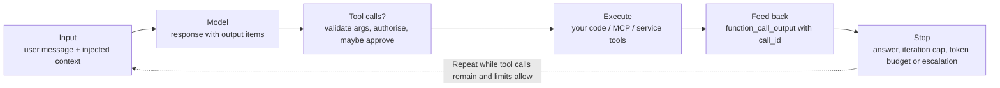
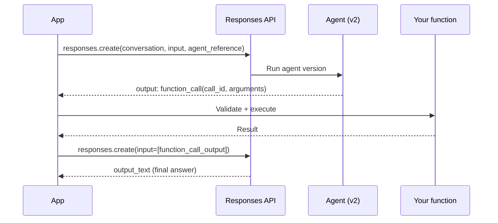

# Foundry Agent Service v2 and the agentic loop in Python

> AI-500 · D2 Develop multi-agent solutions in Azure · about 85 min · Study Hub module `f02` ([open the hub](https://claude.ai/artifact/WBg4UvZLizXnza8mbGvMze))

## Why it matters
Every orchestration pattern in AI-500 is built from one primitive: the agentic loop — call the model, execute tool calls, feed results back, stop safely. Getting its state, termination and failure modes right is what separates a demo from a production agent.

## Pre-question (answer before reading)
**Q:** In Foundry Agent Service v2, a long conversation silently starts forgetting a customer's account number given 40 turns ago, with no error. What's happening, and what's the fix?

<details><summary>Answer</summary>

When context overflows, the service **automatically truncates** older input (the stored conversation is unchanged) — no exception. Persist must-keep facts (e.g., in Cosmos DB) and **re-inject** them each turn, or summarise/compact deliberately.

</details>

## Mental model & story
Northwind's claims agent was first written against the old **v1** API: threads, messages, runs, polling `run.status` until `requires_action`, then `submit_tool_outputs`. When the team moved to **v2**, the shape changed. Agents became **named, versioned definitions** created once per release with `create_version`. Conversations became **conversations** with typed **items**. Runs became **responses**. No more polling: a response comes back with `output` items, and failures raise exceptions.

The loop itself stayed the same idea. Send input. If the output contains `function_call` items, run each function in your code and send back `function_call_output` items with matching `call_id`s. Repeat until the model answers. The difference in production is the guard rails: a **maximum iteration count** (3 for simple tasks, 10–15 for complex ones), a **token budget**, and a **completion signal** so the loop can't spin forever.

State needed decisions too. For long chats, service-managed **conversations** keep history. For quick branching ("what if we approve vs reject?"), `previous_response_id` lets two responses fork from the same point. For a hospital tenant that doesn't want conversation state kept by the service, `store=False` makes each call stateless (no response is stored for later retrieval) and the app carries the items itself. Abuse-monitoring retention is a separate control that needs an approved exemption. A 20-minute report job uses **background mode**: `background=True`, then poll `responses.retrieve` — the job survives a dropped connection.

Then the silent bug: at turn 40 the agent forgot the account number. The service had truncated older items to fit the context window. The fix was architectural: critical facts went into a Cosmos DB record and were re-injected into every turn's instructions.

**Where the analogy breaks:** The loop picture suggests the model 'decides' safely. It doesn't: it proposes tool calls. Your code decides whether to execute them (validation, authorisation, approval). Treat every `function_call` as untrusted input.

## Diagrams
**The guarded agentic loop**



**v2 runtime calls (function tool)**



## Key points
- v1 → v2 mapping: assistant (`asst_` GUID) → **agent** (name + version); thread → **conversation** (`conv_` id, typed items); run → **response**; message → **item**; `requires_action` → iterate **output items**; `last_error` → **exceptions**.
- Two planes: `AIProjectClient` (admin plane: `agents.create_version(agent_name, definition=PromptAgentDefinition(...))`, created at deployment time) and `project.get_openai_client()` (runtime plane: `conversations`, `responses`). Calling responses on the project client is an error.
- Invoke an agent: `responses.create(conversation=conv.id, input=..., extra_body={"agent_reference": {"name": ..., "type": "agent_reference"}})`.
- Function tools: your code executes them; return `function_call_output` with the same `call_id`. Validate arguments against the schema and authorise before executing.
- State options: **conversation** (server-managed history; long sessions), **previous_response_id** chaining (stateless forks/branches), **store=False** (stateless: no server-side response storage; app carries items; abuse-monitoring retention is a separate control).
- **Background mode**: `background=True`, then poll `responses.retrieve(id)` while status is queued/in progress; survives disconnects; good for long tasks.
- Context overflow → **silent truncation** of older input (conversation unchanged). Persist critical facts and re-inject; compact deliberately (d03).
- Loop controls are mandatory: `MAX_ITERATIONS` (≈3 simple, 10–15 complex), token budget (act at ~40% of the window, e.g. ~50K of 128K), semantic completion signals, and an escalation path.
- Reflection loops (plan-then-act, act-then-reflect, iterative refinement) have diminishing returns: ~40–50% of the gain in cycle 1, 15–20% in 2, <10% in 3, at ~3.4× tokens for 3 cycles. Cap at 3; latency-sensitive paths 1; batch none.
- v1 (`azure-ai-agents`) is supported until 31 Mar 2027; *connected agents* were removed in v2 — use workflows and the A2A tool.

## Comparisons
**Agent Service v1 vs v2**

| Concept | v1 (Assistants-style) | v2 (Responses-based) |
|---|---|---|
| Agent identity | assistant asst_... GUID | agent name + version |
| History container | thread | conversation (typed items) |
| Execution | run (poll status) | response (returns output items) |
| Tool round-trip | requires_action → submit_tool_outputs | function_call items → function_call_output |
| Errors | run.last_error | exceptions |
| Multi-agent | connected agents (preview) | workflows + A2A tool |

**Choosing a state strategy**

| Need | Use | Watch out |
|---|---|---|
| Long customer chat | Conversation | Silent truncation; re-inject key facts |
| What-if branches from one point | previous_response_id forks | Branches multiply cost; prune |
| No server-side response state | store=False | App must carry all items (abuse monitoring is separate) |
| 20-minute task | background=True + retrieve | Poll with backoff; set timeouts |

## Code to recognise
**A guarded v2 agentic loop with function calls**

```python
import json, os
from azure.identity import DefaultAzureCredential
from azure.ai.projects import AIProjectClient
from azure.ai.projects.models import PromptAgentDefinition

MAX_ITERATIONS = 6
project = AIProjectClient(endpoint=os.environ["PROJECT_ENDPOINT"], credential=DefaultAzureCredential())
oc = project.get_openai_client()

agent = project.agents.create_version(            # admin plane: once per release
    agent_name="claims-triage",
    definition=PromptAgentDefinition(model="gpt-5.4-mini", instructions=INSTRUCTIONS, tools=TOOLS))
ref = {"agent_reference": {"name": agent.name, "type": "agent_reference"}}

conv = oc.conversations.create()                   # runtime plane: per session
r = oc.responses.create(conversation=conv.id, input=user_msg, extra_body=ref)

for _ in range(MAX_ITERATIONS):
    calls = [i for i in r.output if i.type == "function_call"]
    if not calls:
        break                                      # final answer reached
    outputs = []
    for c in calls:
        args = validate(c.name, json.loads(c.arguments))   # schema + authorisation
        outputs.append({"type": "function_call_output", "call_id": c.call_id,
                        "output": json.dumps(run_tool(c.name, args))})
    r = oc.responses.create(conversation=conv.id, input=outputs, extra_body=ref)
else:
    r = escalate_to_human(conv.id, reason="iteration limit")
print(r.output_text)
```

- Line 6: Never run an unbounded loop: cap iterations (and track tokens).
- Line 10: Agents are versioned definitions created at deployment time, then reused by name.
- Line 13: `agent_reference` tells the Responses API which agent version to run.
- Line 15: Conversations hold server-side history for the session.
- Line 20: No tool calls means the model produced its final answer.
- Line 24: Tool arguments are untrusted: validate against the schema and authorise before executing.
- Line 25: `call_id` must match the request, or the model can't pair results.
- Line 28: The `for ... else` branch runs only if the cap was hit: escalate instead of failing silently.

## Portal steps
**Inspect a run in the portal** (Foundry > Build > Agents > (agent) > Playground / Traces)

1. Run the agent in the playground and open the trace.
2. Check each span: model call, tool calls, tokens, latency.
3. Compare versions: each save of a prompt agent creates a new immutable version.
4. Use the code view to see the SDK calls for the same agent.

## Worked example
**Scenario:** A research agent sometimes loops for 40+ tool calls and costs $3 per request. Users accept up to 2 minutes. Design the controls.

- Loops need hard limits and a graceful exit.
- Long tasks need resilience to disconnects.
- Cost needs a budget, not just an iteration count.

**Answer:** Cap iterations (e.g., 12) **and** a token budget per request; add a completion signal in instructions; when either cap triggers, return partial results with a completeness note or escalate. Run with **background mode** and poll with backoff; trace each iteration to find what drives the loop (often a vague tool result or missing stop criterion).

## Your turn (faded example)
**Scenario:** After migrating to v2, a developer calls `project.responses.create(...)` and gets an error.

- v2 separates admin and runtime planes.
- **Which client should call responses?** <details><summary>answer</summary>The OpenAI-compatible client from `project.get_openai_client()`.</details>
- **Where is the agent chosen?** <details><summary>answer</summary>In `extra_body={"agent_reference": {"name": ..., "type": "agent_reference"}}` on the response call.</details>

## Exam traps & misconceptions
- ✗ Expecting an error when context overflows. → ✓ v2 truncates older input silently; persist and re-inject critical facts.
- ✗ Creating a new agent version on every request. → ✓ Create versions at deployment time; reference them by name at runtime.
- ✗ Polling response status in a loop for normal calls. → ✓ v2 returns output items; use background mode + retrieve only for long jobs.
- ✗ Executing tool calls without validation. → ✓ Arguments are model output: validate, authorise and, for high impact, approve.
- ✗ Unlimited reflection cycles "for quality". → ✓ Gains fall off after cycle 1–2 while tokens multiply; cap at 3 (1 for latency-sensitive).

## Discussion prompts
- **When would you choose `store=False` despite the extra work?** When contracts or policy say conversation state mustn't be kept in the service, or tenants require that all history stays in their own store. The app then carries items and controls retention itself. (Abuse-monitoring storage is separate: it needs an approved modified-abuse-monitoring application.)
- **How do you pick MAX_ITERATIONS?** From traces: look at the distribution of iterations for successful tasks by type, set the cap just above the P95–P99, and treat hitting it as a signal to escalate and investigate.

## Interview angle / teach-back
**Prompt:** Explain the v2 agentic loop with function tools and the controls that make it production-safe.

**Rubric:** create_version at deploy; agent_reference at runtime · function_call → execute → function_call_output with call_id · State options: conversation / previous_response_id / store=False / background · Silent truncation and re-injection · Iteration cap, token budget, completion signal, escalation

**Model answer:** I create the agent version at deployment and reference it by name in responses.create. Each response may contain function_call items: my code validates and authorises the arguments, runs the function and sends back function_call_output with the same call_id, until the model answers. State lives in a conversation, or I chain with previous_response_id, or use store=False to keep no response state in the service; long jobs use background mode. Because overflow truncates silently, I persist key facts and re-inject them. The loop always has an iteration cap, a token budget, a completion signal and an escalation path.

## Quick Q&A
- **v2 equivalent of a thread?** **Conversation**.
- **v2 equivalent of a run?** **Response**.
- **How is a v2 agent referenced at runtime?** `agent_reference` by name (and type).
- **What pairs a tool result with its request?** `call_id`.
- **Keep no response state in the service?** `store=False` (abuse monitoring is a separate control).
- **Long task that survives disconnects?** `background=True` + `responses.retrieve`.
- **What happens on context overflow?** Silent truncation of older input.

## Sources (accessed 2026-10-02)
- [Migrate to Foundry Agent Service v2](https://learn.microsoft.com/en-us/azure/foundry/agents/how-to/migrate)
- [Function calling with agents](https://learn.microsoft.com/en-us/azure/foundry/agents/how-to/tools/function-calling)
- [Responses API background mode](https://learn.microsoft.com/en-us/azure/foundry/openai/how-to/responses)
- [mslearn-ai-agents: use a custom function in an agent](https://microsoftlearning.github.io/mslearn-ai-agents/Instructions/Exercises/02-agent-custom-tools.html)

## SRS cards created
- ai-500-f02-01, ai-500-f02-02, ai-500-f02-03, ai-500-f02-04
