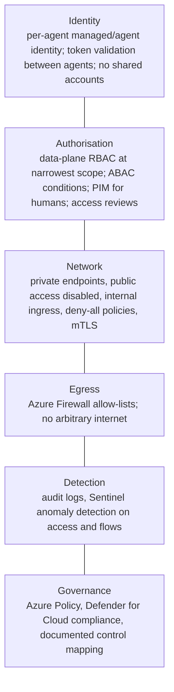
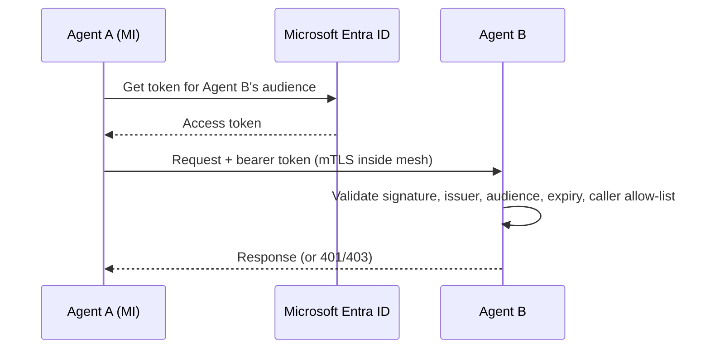

# Resource access: identity, RBAC and network boundaries (Zero Trust)

> AI-500 · D4 Secure, govern, and deploy multi-agent solutions · about 85 min · Study Hub module `s01` ([open the hub](https://claude.ai/artifact/WBg4UvZLizXnza8mbGvMze))

## Why it matters
*Specify and implement resource access, including identity-based access, network boundaries, access control policies, and RBAC* — plus the D1 skill *components for Zero Trust multi-agent solutions*. A compromised agent should be able to reach as little as possible. That's a design you can test.

## Pre-question (answer before reading)
**Q:** An analysis agent only reads documents from one Storage container. Today its identity is Contributor on the subscription. What should it have instead?

<details><summary>Answer</summary>

A **dedicated managed identity** with a **data-plane** role scoped as narrowly as possible — e.g., **Storage Blob Data Reader** on that container (or account) — and no control-plane rights. Contributor is broad control plane and the wrong layer.

</details>

## Mental model & story
Contoso Bank's red team compromised one agent through an indirect prompt injection and then tried to move sideways. In the old design they'd have found a shared service principal with Contributor on the subscription. In the new one they found almost nothing.

**Verify explicitly.** Every agent runs with its **own managed identity** (one per container app or AKS workload via **workload identity federation**). Foundry agents use the project's identity during development and get a **distinct agent identity when published**, so roles are reassigned to that identity. Agent-to-agent calls carry tokens that the receiver validates: signature (JWKS), issuer, audience, expiry and an allow-list of calling identities.

**Least privilege.** Roles are **data-plane** and narrowly scoped: Storage Blob Data Reader on one container, Search Index Data Reader on one index, Key Vault Secrets User on one vault, Cosmos DB data roles on one database. Humans get admin rights **just-in-time** through **PIM** — eligible roles, approval, 1–4 hour activation, full audit — and access reviews run quarterly, with *deny* as the default outcome for unanswered reviews.

**Assume breach.** Network paths are closed by default: **private endpoints** for Foundry, Search, Cosmos DB, Storage and Key Vault with public network access disabled; Container Apps with **internal ingress**; Kubernetes **deny-all network policies** with explicit allows (including DNS); **mutual TLS** between services through the service mesh; **Azure Firewall** egress allow-lists so a compromised agent can't call arbitrary internet hosts. Sentinel compares flow logs with baseline paths to flag lateral movement.

**Policy as code.** Azure Policy denies public network access and non-approved regions; Defender for Cloud tracks regulatory compliance; every control maps to a requirement in the bank's compliance matrix.

**Where the analogy breaks:** Identity and network controls stop movement, not misuse within allowed scope. An agent with legitimate read access can still leak what it reads. Pair access controls with guardrails, data minimisation and monitoring of what agents actually do.

## Diagrams
**Zero Trust layers for agents**



**Agent-to-agent call with token validation**



## Key points
- Zero Trust principles: **verify explicitly**, **least privilege**, **assume breach**.
- **Per-agent identity**: one managed identity per agent workload (system-assigned per container or user-assigned per agent); never share service accounts; Foundry agents get a distinct **agent identity after publishing** — reassign RBAC.
- RBAC: separate **control plane** (Owner/Contributor) from **data plane** (e.g., Storage Blob Data Reader, Search Index Data Reader, Key Vault Secrets User, Cosmos DB data roles, Foundry User); scope to the narrowest resource; consider ABAC conditions where supported.
- Humans: **PIM** just-in-time elevation (eligible, approval, time-bound), quarterly **access reviews** with deny by default, break-glass accounts monitored.
- AKS: **workload identity federation** (OIDC issuer + federated credential for the service account; pod label/annotation) — no secrets in pods.
- Agent-to-agent auth: validate JWT **signature (JWKS), issuer, audience, expiry** and **caller object ID allow-list**.
- Network: **private endpoints** + `publicNetworkAccess: Disabled`, Container Apps **internal ingress**, NSGs, Kubernetes **deny-all NetworkPolicy** with explicit allows (remember DNS/53), **mTLS** (e.g., Istio-based service mesh add-on), **Azure Firewall** egress allow-lists.
- Lateral-movement detection: Sentinel/KQL over flow logs vs baseline paths; alerts on new destinations.
- Policy enforcement: **Azure Policy** (deny public network, allowed regions, required tags/CMK), **Defender for Cloud** regulatory compliance dashboards, Purview for data governance.
- Compliance mapping: GDPR, SOC 2, HIPAA, ISO 27001, EU AI Act requirements mapped to concrete controls and evidence.

## Comparisons
**Common least-privilege roles for agent identities**

| Resource | Agent needs | Role (data plane) |
|---|---|---|
| Blob Storage | Read documents | Storage Blob Data Reader (container scope) |
| Azure AI Search | Query an index | Search Index Data Reader |
| Key Vault | Read secrets | Key Vault Secrets User |
| Foundry project | Call models/agents | Foundry User (project scope) |
| Cosmos DB | Read/write memory | Cosmos DB built-in data contributor (database/container scope) |
| Service Bus | Send messages | Azure Service Bus Data Sender (queue scope) |

## Code to recognise
**AKS workload identity + deny-all network policy**

```bash
# 1) Federate a Kubernetes service account with an agent's managed identity
az aks update -g rg-agents -n aks-agents --enable-oidc-issuer --enable-workload-identity
ISSUER=$(az aks show -g rg-agents -n aks-agents --query oidcIssuerProfile.issuerUrl -o tsv)
az identity federated-credential create --name fc-claims-agent \
  --identity-name mi-claims-agent --resource-group rg-agents \
  --issuer "$ISSUER" --subject system:serviceaccount:agents:claims-agent \
  --audience api://AzureADTokenExchange

# 2) Least privilege: read one container only
az role assignment create --assignee <mi-client-id> --role "Storage Blob Data Reader" \
  --scope /subscriptions/<sub>/resourceGroups/rg-data/providers/Microsoft.Storage/storageAccounts/stclaims/blobServices/default/containers/claims-docs

# 3) Kubernetes: deny all ingress/egress in the namespace (then add explicit allows, incl. DNS)
kubectl apply -n agents -f - <<'EOF'
apiVersion: networking.k8s.io/v1
kind: NetworkPolicy
metadata: { name: default-deny }
spec: { podSelector: {}, policyTypes: [Ingress, Egress] }
EOF
```

- Line 2: Enable the OIDC issuer and workload identity on the cluster.
- Line 4: The federated credential trusts tokens for one service account in one namespace.
- Line 6: The subject pins the exact namespace and service account.
- Line 10: Data-plane role scoped to a single container: least privilege.
- Line 14: Deny-by-default network policy: nothing talks unless explicitly allowed.
- Line 19: Remember explicit allows for DNS and required dependencies after this.

## Portal steps
**Review an agent's access** (Azure portal > (resource) > Access control (IAM) / Networking)

1. Check role assignments: data-plane roles only, narrowest scope, per-agent identity.
2. Remove inherited broad roles (Owner/Contributor) from agent identities.
3. Networking: private endpoint present, public network access disabled.
4. Verify outbound paths go through the firewall with an allow-list.
5. Enable diagnostic logs to Log Analytics for audit and anomaly detection.

## Worked example
**Scenario:** A healthcare platform runs 12 agents on AKS. Requirements: no shared credentials, agents can't reach the internet except two partner APIs, PHI stores reachable only privately, and admin access must be time-bound and audited.

- No shared credentials → per-agent workload identities.
- Egress restriction → firewall allow-list (plus network policies).
- Private PHI stores → private endpoints, public access disabled.
- Time-bound admin → PIM.

**Answer:** **Workload identity federation** with one managed identity per agent and data-plane roles at narrow scope; **deny-all NetworkPolicies** with explicit allows (DNS, internal services); **Azure Firewall** egress allow-listing the two partner FQDNs; **private endpoints** with public access disabled for Cosmos DB/Storage/Search/Key Vault; **mTLS** in the mesh; **PIM** for admins with approval and short activation; logs to Sentinel.

## Your turn (faded example)
**Scenario:** After publishing a Foundry agent, its file search and AI Search tool calls start failing with 403.

- Publishing created a distinct agent identity.
- **What's missing?** <details><summary>answer</summary>RBAC roles for the **new agent identity** on the knowledge resources (e.g., Search Index Data Reader, Storage Blob Data Reader).</details>
- **Why not just re-use the project identity's roles?** <details><summary>answer</summary>Per-agent identity gives least privilege and per-agent audit; grant only what this agent needs.</details>

## Exam traps & misconceptions
- ✗ Granting Contributor so an agent can "read data". → ✓ Contributor is control plane; use scoped data-plane roles.
- ✗ One service principal for all agents. → ✓ Per-agent identities; separate blast radius and audit.
- ✗ Deny-all network policies without a DNS allow. → ✓ Name resolution breaks; add explicit allows.
- ✗ Trusting any valid token from the tenant. → ✓ Validate audience and the caller allow-list too.
- ✗ Standing admin access for engineers. → ✓ PIM just-in-time with approval and expiry.

## Discussion prompts
- **How do you prove least privilege to an auditor?** Export role assignments per agent identity, show they're data-plane and narrowly scoped, show PIM activation logs and access review results, and demonstrate network tests (blocked egress, private-only endpoints).
- **What changes when an agent becomes multi-tenant?** Tenant context in every call, tenant-scoped data access (partition keys, filters, possibly per-tenant resources/CMK), and authorisation checks that the caller's tenant matches the data's tenant.

## Interview angle / teach-back
**Prompt:** Explain how you'd implement Zero Trust access for a fleet of agents on Azure.

**Rubric:** Per-agent identity; Foundry agent identity after publish · Data-plane RBAC at narrowest scope; PIM; access reviews · Agent-to-agent token validation · Private endpoints, internal ingress, deny-all policies, mTLS, egress firewall · Policy enforcement and compliance mapping

**Model answer:** Every agent gets its own identity — a managed identity per workload, workload identity federation on AKS, and the distinct agent identity Foundry creates on publish — with only data-plane roles at the narrowest scope. Humans elevate just-in-time through PIM, and access reviews deny by default. Agents validate each other's tokens: signature, issuer, audience, expiry and an allow-list of callers. The network is closed by default: private endpoints with public access disabled, internal ingress, deny-all network policies with explicit allows including DNS, mutual TLS, and a firewall egress allow-list. Azure Policy and Defender for Cloud enforce and evidence the controls, mapped to the regulations we must meet.

## Quick Q&A
- **Contributor for data access?** No: control plane; use data-plane roles.
- **Foundry agent identity changes when?** On publish (distinct agent identity).
- **AKS secretless identity?** Workload identity federation.
- **JWT checks between agents?** Signature, issuer, audience, expiry, caller allow-list.
- **JIT admin?** PIM.
- **Egress control?** Azure Firewall allow-list.
- **Deny-all gotcha?** Allow DNS explicitly.

## Sources (accessed 2026-10-02)
- [Zero Trust: accelerate and secure AI adoption](https://learn.microsoft.com/en-us/security/zero-trust/security-adoption-scenario-secure-ai)
- [Workload identity on AKS](https://learn.microsoft.com/en-us/azure/aks/workload-identity-overview)
- [Agent identity in Foundry](https://learn.microsoft.com/en-us/azure/foundry/agents/concepts/agent-identity)
- [Privileged Identity Management](https://learn.microsoft.com/en-us/entra/id-governance/privileged-identity-management/pim-configure)

## SRS cards created
- ai-500-s01-01, ai-500-s01-02, ai-500-s01-03, ai-500-s01-04
