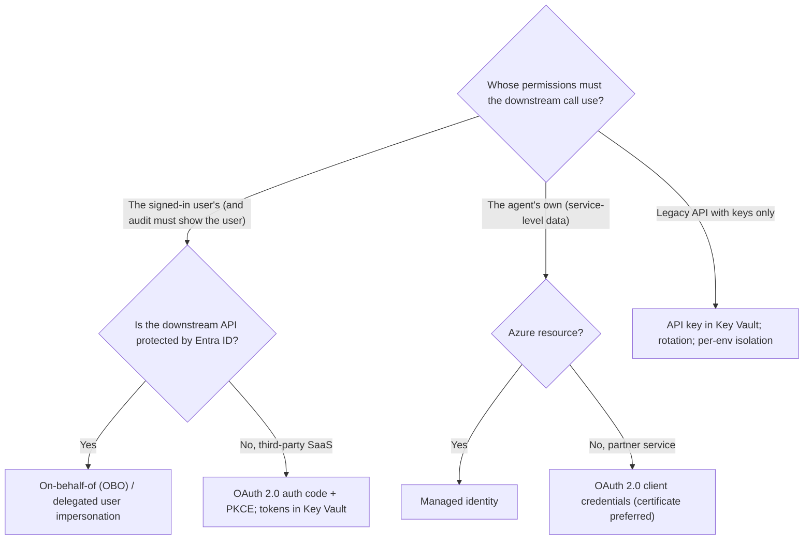
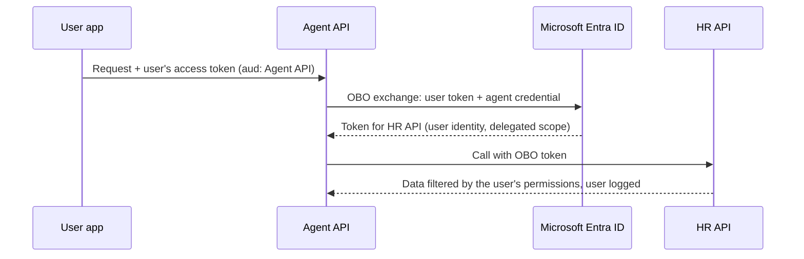

# Authentication flows and secrets management with Key Vault

> AI-500 · D4 Secure, govern, and deploy multi-agent solutions · about 80 min · Study Hub module `s02` ([open the hub](https://claude.ai/artifact/WBg4UvZLizXnza8mbGvMze))

## Why it matters
Two skills: *design and implement authentication flows (user impersonation, on-behalf-of, API keys, OAuth 2.0)* and *design secrets management with Azure Key Vault (secrets, certificates, rotation, RBAC, encryption)*. Getting the flow wrong either leaks power (agent acts with too much) or breaks audit (nobody knows who acted).

## Pre-question (answer before reading)
**Q:** An HR agent calls the HR API on behalf of the signed-in manager, and HR policy says the API must enforce *the manager's* permissions and log the manager as the actor. Which flow?

<details><summary>Answer</summary>

**On-behalf-of (OBO)**: the agent's back end exchanges the user's token for a token to the HR API, so the API sees and enforces the manager's identity and permissions. A managed identity would act as the agent, not the user.

</details>

## Mental model & story
Woodgrove's HR assistant first called every API with its managed identity. It worked — and auditors flagged it: every salary lookup appeared to be done by "hr-agent", and the agent could read every employee's file.

The redesign matched each call to a flow. For the HR and payroll APIs, the agent uses **on-behalf-of**: the front end signs the manager in, the agent's API receives the manager's token and exchanges it for a downstream token, so the HR API enforces the manager's own permissions and logs the manager. For the benefits SaaS that employees connect personally, the platform uses **OAuth authorisation code with PKCE** and stores refresh tokens in **Key Vault**. For a partner background-check service, **OAuth client credentials**. For the agent's own Azure resources, its **managed identity**. One legacy pension API only accepts an **API key**: it lives in Key Vault, isolated per environment, rotated quarterly and on exposure.

Key Vault itself got the same rigour. Access uses **Azure RBAC**, not access policies: agents have **Key Vault Secrets User** on the vault they need; the CI/CD identity has **Secrets Officer**; a monitored break-glass group has **Administrator**; services encrypting data have **Crypto User** on keys. **Soft delete** and **purge protection** are on. Rotation is automated: Event Grid's *SecretNearExpiry* event triggers a function that creates the new secret (keys use a Key Vault rotation policy), with **dual (blue-green) secrets** so clients switch without downtime. Service-to-service mTLS uses **certificates** that renew automatically.

Data at rest uses **customer-managed keys** for the regulated stores, which also lets the bank **crypto-shred** a tenant's data by revoking its key.

**Where the analogy breaks:** OBO isn't a universal fix. It needs a user token at the start (not available for autonomous background agents), token lifetimes constrain long tasks, and consent/permissions must be configured per API. Autonomous agents acting for no particular user need their own identity with tightly scoped rights — and human approval for sensitive actions.

## Diagrams
**Which authentication flow?**



**On-behalf-of flow**



## Key points
- **Managed identity**: agent → Azure resources; no secrets.
- **On-behalf-of (OBO)**: middle-tier exchanges the user's token for a downstream token; downstream enforces and audits the **user**; requires delegated permissions/consent; `OnBehalfOfCredential(..., user_assertion=token)`.
- **User impersonation** (delegated permissions): the app acts as the user within granted scopes; contrast with **app-only** permissions (application acts as itself).
- **OAuth 2.0 client credentials**: service-to-service/B2B; prefer certificates (or federated credentials) over client secrets.
- **OAuth 2.0 auth code + PKCE**: user-delegated access to third-party SaaS; store refresh tokens securely (Key Vault); platform features like Foundry/Copilot Studio **identity passthrough** handle per-user tokens.
- **API keys**: last resort — Key Vault, per-service and per-environment isolation, rotation (scheduled + on exposure), usage monitoring.
- Key Vault object types: **secrets** (passwords, keys for APIs), **keys** (cryptographic operations, CMK), **certificates** (TLS/mTLS with auto-renewal).
- Key Vault access: **Azure RBAC** (recommended over access policies): Secrets User (read), Secrets Officer (manage), Crypto User (use keys), Administrator (break-glass); private endpoint; diagnostic logs.
- Protection & rotation: **soft delete + purge protection**; rotation policies; Event Grid *SecretNearExpiry* → automation; **dual/blue-green secrets** for zero-downtime rotation; cache secrets with short TTLs in apps.
- Encryption: platform-managed keys (default) vs **customer-managed keys** (control, revocation → crypto-shredding for erasure) vs double encryption; **Managed HSM** for FIPS 140-3 Level 3 single-tenant needs.

## Comparisons
**Key Vault RBAC roles**

| Role | Who | Can |
|---|---|---|
| Key Vault Secrets User | Agent identities | Read secret values |
| Key Vault Secrets Officer | CI/CD pipeline identity | Create/update/delete secrets |
| Key Vault Crypto User | Services using CMK/encryption | Use keys for crypto operations |
| Key Vault Administrator | Break-glass group (monitored) | Full data-plane management |
| Key Vault Reader | Auditors | Read metadata, not secret values |

## Code to recognise
**OBO for a user-scoped API, managed identity for Key Vault**

```python
from azure.identity import OnBehalfOfCredential, ManagedIdentityCredential
from azure.keyvault.secrets import SecretClient

# 1) User-scoped call: exchange the incoming user token (OBO)
def get_employee_record(user_token: str, employee_id: str):
    cred = OnBehalfOfCredential(
        tenant_id=TENANT_ID, client_id=AGENT_API_CLIENT_ID,
        client_certificate=load_cert_from_key_vault(),     # prefer certificate over secret
        user_assertion=user_token)
    token = cred.get_token("api://hr-api/.default")
    return http.get(f"{HR_API}/employees/{employee_id}",
                    headers={"Authorization": f"Bearer {token.token}"})

# 2) Agent's own access: legacy API key read from Key Vault with the agent's managed identity
secrets = SecretClient(vault_url=VAULT_URL, credential=ManagedIdentityCredential())
pension_key = secrets.get_secret("pension-api-key-prod").value       # Key Vault Secrets User role
```

- Line 6: OBO exchanges the user's token so the downstream API sees the user.
- Line 8: Authenticate the agent's app with a certificate (or federated credential) rather than a secret.
- Line 9: The incoming user token is the assertion.
- Line 10: Request a token for the downstream API's scope.
- Line 12: The HR API enforces the user's permissions and logs the user.
- Line 15: Service-level secrets: the agent's managed identity reads Key Vault (Secrets User), no secret in code.

## Portal steps
**Harden a Key Vault for agents** (Azure portal > Key Vault > Access configuration / Networking / Properties)

1. Access configuration: Azure RBAC; assign Secrets User to agent identities only.
2. Properties: soft delete and purge protection enabled.
3. Networking: private endpoint; disable public access.
4. Secrets: Event Grid–driven rotation (SecretNearExpiry → function); keys: rotation policy; versioned secrets for blue-green switching.
5. Diagnostics: send audit logs to Log Analytics; alert on unusual access.

## Worked example
**Scenario:** A financial-advice agent must (1) read a client's portfolio with the adviser's permissions, (2) fetch market data from a vendor with a client ID/secret, (3) call an internal pricing function in Azure, (4) sign PDF reports. Assign flows and Key Vault objects.

- (1) user-scoped → OBO.
- (2) service-to-service vendor → client credentials; credential in Key Vault (prefer certificate).
- (3) Azure resource → managed identity.
- (4) signing → a Key Vault key (or certificate) used via Crypto User role.

**Answer:** (1) **OBO** with the adviser's token; (2) **OAuth client credentials**, client certificate/secret stored in **Key Vault** and rotated; (3) **managed identity** with a data-plane role; (4) a **Key Vault key/certificate** for signing, used through the **Crypto User** role — all access via RBAC, vault behind a private endpoint with purge protection.

## Your turn (faded example)
**Scenario:** Rotating an API key causes 10 minutes of failures every quarter.

- Clients still use the old key after rotation.
- **What rotation pattern avoids downtime?** <details><summary>answer</summary>Dual (blue-green) secrets: create and distribute the new key while the old one still works, switch clients, then retire the old key.</details>
- **How do you automate it?** <details><summary>answer</summary>Event Grid SecretNearExpiry → Function (rotation policies are for keys) that generates the new key at the provider, stores a new secret version, and apps reload with short-TTL caching.</details>

## Exam traps & misconceptions
- ✗ Using the agent's identity when the user's permissions must apply. → ✓ Use OBO/delegated flows.
- ✗ Key Vault access policies granting broad rights. → ✓ Use Azure RBAC with specific roles.
- ✗ Client secrets as the default app credential. → ✓ Prefer certificates or federated credentials; rotate.
- ✗ Purge protection off on production vaults. → ✓ Enable soft delete and purge protection.
- ✗ Single-secret rotation with hard cut-over. → ✓ Dual/blue-green secrets for zero-downtime rotation.

## Discussion prompts
- **How does OBO work for long-running agent tasks?** Tokens expire, so long tasks need a strategy: complete user-scoped reads early, use refresh tokens where allowed (stored securely), or re-prompt the user; autonomous continuation should use the agent's own identity with narrowly scoped rights and approvals.
- **When would you use CMK and Managed HSM?** CMK when regulations require customer control of encryption keys or crypto-shredding; Managed HSM for single-tenant, FIPS 140-3 Level 3 key protection requirements.

## Interview angle / teach-back
**Prompt:** Explain how you choose authentication flows for an agent's calls and how you manage its secrets.

**Rubric:** MI for Azure resources · OBO/delegated when user permissions/audit matter · Client credentials (certs) for B2B; auth code + PKCE for user SaaS · API keys as Key Vault-managed fallback · Key Vault RBAC roles, soft delete/purge protection, rotation (dual secrets), certificates, CMK

**Model answer:** I pick the flow by whose permissions should apply. The agent's own Azure resources use its managed identity. When downstream systems must enforce and audit the user, I use on-behalf-of with the user's token, or auth code with PKCE for third-party SaaS. Partner services get OAuth client credentials, ideally with certificates. API keys are a fallback, kept in Key Vault per environment and rotated. Key Vault uses RBAC — Secrets User for agents, Secrets Officer for pipelines, Crypto User for key operations, a monitored admin group — with soft delete, purge protection, private endpoints, automated dual-secret rotation, auto-renewing certificates, and customer-managed keys where regulations need control or crypto-shredding.

## Quick Q&A
- **User's permissions downstream?** **OBO**.
- **Third-party SaaS per user?** Auth code + PKCE.
- **Service-to-service partner API?** Client credentials (certificate).
- **Agent reads secrets role?** Key Vault Secrets User.
- **Pipeline manages secrets role?** Key Vault Secrets Officer.
- **Zero-downtime rotation?** Dual (blue-green) secrets.
- **Crypto-shredding needs?** Customer-managed keys.

## Sources (accessed 2026-10-02)
- [On-behalf-of flow](https://learn.microsoft.com/en-us/entra/identity-platform/v2-oauth2-on-behalf-of-flow)
- [Azure Key Vault RBAC](https://learn.microsoft.com/en-us/azure/key-vault/general/rbac-guide)
- [Key Vault secret rotation](https://learn.microsoft.com/en-us/azure/key-vault/secrets/tutorial-rotation-dual)
- [Customer-managed keys overview](https://learn.microsoft.com/en-us/azure/security/fundamentals/encryption-models)

## SRS cards created
- ai-500-s02-01, ai-500-s02-02, ai-500-s02-03, ai-500-s02-04
