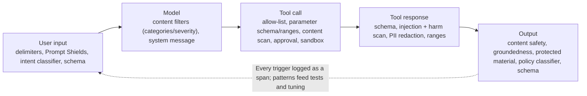
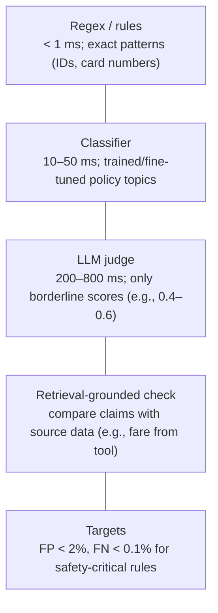

# Guardrails and shift-left security (AI Red Teaming Agent)

> AI-500 · D4 Secure, govern, and deploy multi-agent solutions · about 95 min · Study Hub module `s03` ([open the hub](https://claude.ai/artifact/WBg4UvZLizXnza8mbGvMze))

## Why it matters
Four skills: *multi-intervention guardrails* (user inputs, tool calls, tool responses, outputs), *custom guardrails for domain constraints*, *guardrail testing with synthetic data*, and *shift-left security with the AI Red Teaming Agent*. In multi-agent systems every edge is an attack surface.

## Pre-question (answer before reading)
**Q:** Content filters on the model block harmful outputs. Is that enough for an agent that reads emails and can send payments?

<details><summary>Answer</summary>

No. Output filtering is one point. You also need **input** checks (Prompt Shields for user and document attacks), **tool-call** checks (allow-lists, parameter validation, approvals), and **tool-response** checks (schema, injection scan, PII redaction) — guardrails at every intervention point.

</details>

## Mental model & story
Margie's Travel's booking platform had five agents and a content filter on the model. A red-team exercise still succeeded three ways: a hotel description containing hidden instructions (indirect injection through a tool response), a jailbreak in Base64 (input), and a crafted request that made the payment agent call `refund` with a negative amount (tool call).

The security architect, **Omar**, mapped **guardrails to every intervention point**. *User input*: delimiters, **Prompt Shields** for user and document attacks, an intent classifier, schema checks. *Tool calls*: allow-lists per agent, strict parameter schemas and value ranges, content scans of parameters, sandboxed execution and approvals for money movement. *Tool responses*: schema validation, Content Safety and injection scans, PII redaction, value ranges. *Outputs*: Content Safety categories, **groundedness** checks, protected material detection, policy classifiers and output schemas.

Some rules were domain-specific: never quote a fare not returned by the pricing tool, never book for minors without a guardian, never expose passport numbers. Those became **custom guardrails** in a cascade: regex for passport-number patterns (under a millisecond), a fine-tuned classifier for policy topics (tens of milliseconds), and an LLM judge only for borderline scores (hundreds of milliseconds). Targets: false positives under 2%, false negatives under 0.1% for safety-critical rules.

Guardrails need tests like any code. A **coverage matrix** crossed surfaces (input, tool call, tool response, output) × threats (injection, jailbreak, PII leak, harmful content, policy violation) × variations (paraphrase, multilingual, Base64, multi-turn, leetspeak). Synthetic attacks from simulators fill the matrix; every guardrail trigger emits an OpenTelemetry span.

Finally, **shift-left**: the **AI Red Teaming Agent** runs in CI against each candidate agent version, probing risk categories (violence, hate/unfairness, sexual, self-harm, protected material, code vulnerability, ungrounded attributes) with attack strategies such as Base64, ROT13, character flipping and jailbreak prompts, and reports the **attack success rate (ASR)**. A rise in ASR blocks the release.

**Where the analogy breaks:** Guardrails reduce risk; they can't certify safety. Attackers adapt, classifiers drift and every check adds latency and false positives. Combine guardrails with least privilege (so a bypass can't do much), monitoring of guardrail triggers, and regular red-teaming.

## Diagrams
**Guardrails at every intervention point**



**Custom guardrail cascade**



## Key points
- **Multi-intervention strategy**: guardrails on **user inputs**, **tool calls**, **tool responses** and **outputs** — plus model-level content filters.
- Input: delimiters, **Prompt Shields** (user prompt attacks and document/indirect attacks), intent classification, input schemas.
- Tool calls: per-agent allow-lists, strict parameter schemas and ranges, parameter content scanning, sandboxed execution, **approvals** for high-impact actions.
- Tool responses: schema validation, injection/harm scanning, **PII redaction**, value ranges — before injection into context.
- Outputs: content safety categories (hate, sexual, violence, self-harm) with severity thresholds, **groundedness detection**, **protected material** detection, policy classifiers, output schemas.
- Foundry guardrails/content filters configurable per deployment and per agent (agent-level overrides deployment-level); custom **blocklists**; Content Safety **custom categories** for domain policies.
- **Custom guardrails** cascade: regex → classifier → LLM judge (borderline only) → retrieval-grounded checks; set FP/FN targets per rule criticality.
- **Testing with synthetic data**: coverage matrix (surfaces × threats × variations: paraphrase, multilingual, Base64, multi-turn, leetspeak), adversarial simulators, regression suites in CI, FP/FN measurement; OTel span per trigger for monitoring.
- **AI Red Teaming Agent** (PyRIT-based): risk categories (Violence, HateUnfairness, Sexual, SelfHarm, ProtectedMaterial, CodeVulnerability, UngroundedAttributes), attack strategies and complexity levels, metric **ASR**; run locally or in the cloud; map findings to OWASP LLM Top 10. The local `RedTeam` class isn't compatible with Foundry (new) projects: there, run cloud red teaming through the evals API (`evals.create` with a red-team scenario, then `evals.runs.create` with an `azure_ai_red_team` data source: taxonomy, attack strategies, target).
- **Shift-left** security: threat modelling at design, red teaming and guardrail tests in CI before release, secret/dependency scanning, security review of tool permissions and prompts.

## Comparisons
**Guardrail by intervention point**

| Point | Threats | Controls |
|---|---|---|
| User input | Jailbreaks, direct injection, abusive content | Prompt Shields, intent classifier, delimiters |
| Tool call | Unauthorised or malicious actions, bad parameters | Allow-lists, schemas/ranges, approvals, sandbox |
| Tool response | Indirect injection, PII, corrupt data | Injection/harm scans, redaction, schema/ranges |
| Output | Harmful content, ungrounded claims, IP leakage, policy breaches | Content safety, groundedness, protected material, policy classifiers |

## Code to recognise
**AI Red Teaming Agent local scan in CI (azure-ai-evaluation; Foundry classic projects; simplified)**

```python
import asyncio
from azure.identity import DefaultAzureCredential
from azure.ai.evaluation.red_team import RedTeam, RiskCategory, AttackStrategy

async def target(query: str) -> str:              # wraps the candidate agent version
    return await call_agent(version=CANDIDATE, message=query)

async def main():
    red_team = RedTeam(
        azure_ai_project=PROJECT_ENDPOINT, credential=DefaultAzureCredential(),
        risk_categories=[RiskCategory.Violence, RiskCategory.HateUnfairness,
                         RiskCategory.Sexual, RiskCategory.SelfHarm],
        num_objectives=10)
    result = await red_team.scan(
        target=target, scan_name=f"agent-{CANDIDATE}",
        attack_strategies=[AttackStrategy.EASY, AttackStrategy.MODERATE,
                           AttackStrategy.Base64, AttackStrategy.Flip, AttackStrategy.Jailbreak])
    asr = overall_attack_success_rate(result)
    if asr > BASELINE_ASR:
        raise SystemExit(f"ASR {asr:.1%} above baseline: block release")

asyncio.run(main())
```

- Line 5: The target is a callback wrapping the agent version under test.
- Line 11: Choose risk categories relevant to the agent.
- Line 13: Number of attack objectives per category.
- Line 16: Attack strategies transform prompts (encodings, flips, jailbreak templates) at different complexity levels.
- Line 18: Attack success rate (ASR) is the key metric; compare with the approved baseline.
- Line 20: Fail the pipeline when ASR regresses: shift-left in practice.

## Portal steps
**Configure guardrails for an agent in Foundry** (Foundry > Build > Guardrails (content filters))

1. Create a guardrail policy: harm categories and severity thresholds for inputs and outputs.
2. Enable Prompt Shields (user and document attacks), groundedness and protected material where relevant.
3. Add custom blocklists for domain terms.
4. Assign the guardrail to the agent (agent-level overrides deployment-level).
5. Test with red-team runs and synthetic attacks; monitor trigger rates.

## Worked example
**Scenario:** A procurement agent reads supplier emails and can create purchase orders. Design guardrails across the four intervention points.

- Emails are untrusted → document-attack detection.
- PO creation is high impact → tool-call controls.
- Supplier data returns may carry instructions/PII.
- Outputs to staff must be safe and grounded.

**Answer:** **Input**: Prompt Shields on emails (document attacks), delimiters, intent classifier. **Tool call**: allow-list (`create_po` only for this agent), schema with amount ranges and approved vendor IDs, approval above a threshold. **Tool response**: schema and range checks, injection scan, PII redaction. **Output**: content safety, groundedness against the PO data, policy classifier (no commitments outside contract terms); red-team in CI with ASR gate.

## Your turn (faded example)
**Scenario:** A custom LLM-judge guardrail adds 700 ms to every request and blocks 4% of legitimate requests.

- Latency and false positives are too high.
- **How do you restructure it?** <details><summary>answer</summary>A cascade: cheap regex/classifier first, LLM judge only for borderline scores.</details>
- **How do you set its thresholds?** <details><summary>answer</summary>Measure FP/FN on a labelled synthetic + real dataset; tune to targets (e.g., FP < 2%, FN < 0.1% for critical rules).</details>

## Exam traps & misconceptions
- ✗ Relying on output content filters alone. → ✓ Guard inputs, tool calls, tool responses and outputs.
- ✗ Treating tool responses as trusted. → ✓ Scan for indirect injection and redact PII before injection.
- ✗ Running an LLM judge on every request for every rule. → ✓ Cascade cheap checks first; judge only borderline cases.
- ✗ Testing guardrails with a handful of manual prompts. → ✓ Coverage matrix with variations; regression in CI.
- ✗ Red-teaming once before launch. → ✓ Shift-left: red-team every candidate version in CI and track ASR.

## Discussion prompts
- **How do guardrails and least privilege work together?** Guardrails try to stop bad behaviour; least privilege limits damage when they fail. A payment agent that can only refund up to $100 to the original payment method is safe even if a jailbreak slips through.
- **How would you respond to a rising guardrail trigger rate in production?** Investigate with traces: is it an attack campaign (block, rate-limit, alert security), a product change causing false positives (tune), or drift in user behaviour (update datasets)? Add confirmed attacks to red-team suites.

## Interview angle / teach-back
**Prompt:** Explain a multi-intervention guardrail strategy and how you'd test it and shift security left.

**Rubric:** Four intervention points + model filters · Specific controls at each point · Custom guardrail cascade with FP/FN targets · Synthetic coverage matrix testing; telemetry · AI Red Teaming Agent in CI with ASR gate

**Model answer:** I put guardrails at every intervention point: inputs get Prompt Shields, delimiters and intent checks; tool calls get allow-lists, strict schemas and ranges, content scans, sandboxing and approvals; tool responses get schema checks, injection and harm scans and PII redaction; outputs get content safety, groundedness, protected-material and policy checks — on top of model content filters. Domain rules become a cascade of regex, classifiers and an LLM judge for borderline cases, tuned to false-positive and false-negative targets. Guardrails are tested with a synthetic coverage matrix across surfaces, threats and variations, and every trigger is traced. In CI, the AI Red Teaming Agent attacks each candidate version and blocks the release if the attack success rate rises.

## Quick Q&A
- **Four intervention points?** User input, tool call, tool response, output.
- **Detects indirect attacks in documents?** Prompt Shields (document attacks).
- **Red teaming metric?** Attack success rate (ASR).
- **Cascade order?** Regex → classifier → LLM judge (borderline).
- **Safety-critical targets?** FP < 2%, FN < 0.1%.
- **Agent vs deployment guardrail?** Agent-level overrides deployment-level.
- **Coverage matrix axes?** Surfaces × threats × variations.

## Sources (accessed 2026-10-02)
- [AI Red Teaming Agent](https://learn.microsoft.com/en-us/azure/foundry/concepts/ai-red-teaming-agent)
- [Run the AI Red Teaming Agent locally (classic)](https://learn.microsoft.com/en-us/azure/foundry/how-to/develop/run-scans-ai-red-teaming-agent)
- [Run the AI Red Teaming Agent in the cloud](https://learn.microsoft.com/en-us/azure/foundry/how-to/develop/run-ai-red-teaming-cloud)
- [Guardrails and content filters in Foundry](https://learn.microsoft.com/en-us/azure/foundry/guardrails/guardrails-overview)
- [Groundedness detection](https://learn.microsoft.com/en-us/azure/ai-services/content-safety/concepts/groundedness)
- [OWASP Top 10 for LLM applications](https://owasp.org/www-project-top-10-for-large-language-model-applications/)

## SRS cards created
- ai-500-s03-01, ai-500-s03-02, ai-500-s03-03, ai-500-s03-04
