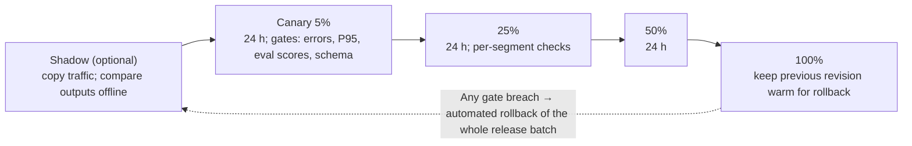
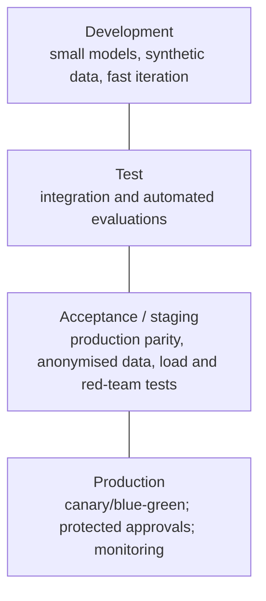

# Release methodology: DTAP, blue/green, canary and rollback

> AI-500 · D4 Secure, govern, and deploy multi-agent solutions · about 80 min · Study Hub module `s04` ([open the hub](https://claude.ai/artifact/WBg4UvZLizXnza8mbGvMze))

## Why it matters
*Choose a release methodology (DTAP, blue/green, canary)* and *design multi-environment release strategies, rollback, release management and rollout.* AI releases change behaviour, not just code — so gates use evaluation metrics, and rollback must restore prompts, models and tools together.

## Pre-question (answer before reading)
**Q:** A new agent version passes CI. You roll it to 5% of traffic; error rate and latency are normal, but task-completion scores from continuous evaluation drop 6%. Proceed?

<details><summary>Answer</summary>

No. Canary gates must include **AI quality metrics**, not only errors and latency. A >5% evaluation drop is a rollback trigger.

</details>

## Mental model & story
Northwind's last big release went straight to 100%: a new model version, a rewritten prompt and two new tools at once. Quality fell, and rolling back the model alone left the new prompt and tools incompatible. It took a day to recover.

The new release process starts with **DTAP** environments: **Development** (small models, synthetic data), **Test**, **Acceptance/staging** (production parity, anonymised data) and **Production**. Each has its own Foundry project, Key Vault and configuration namespace (App Configuration labels), deployed from the same Bicep templates with an environment parameter. The **same artifact** is built once and promoted.

Production rollouts are **canaries**: 5% → 25% → 50% → 100%, about 24 hours per stage, with **quality gates** that include evaluation scores alongside errors and latency. Traffic splitting uses Container Apps **revision weights** (or Front Door/APIM policies). Big infrastructure changes use **blue/green**: a full parallel environment, switched instantly and switched back if needed, at double cost during the transition. **Feature flags** decouple deploying code from releasing behaviour, and enable per-tenant activation. Risky new agents first run in **shadow** mode, receiving copies of traffic without affecting users.

**Rollback** is automated. Triggers: evaluation score drops over 5% (over hours), error rate over 2× baseline (5 minutes), P95 above 150% of the SLO (10 minutes), schema violations over 1% (15 minutes). An Azure Monitor alert calls a webhook, which fires a GitHub `repository_dispatch`, which reactivates the stable revision. The whole **release batch** (model, prompt, tools — tagged together) rolls back as a unit; database changes stay backward compatible.

**Release management** ties it together: a version manifest per agent, tiered approvals (automated for small changes; manual for model upgrades, prompt rewrites over 20% or new tools), tenant rollout tiers (T1 immediately, T2 after 7 days, T3 regulated after 30), version pinning for at most 90 days, and a 90-day retirement notice for old versions.

**Where the analogy breaks:** Canaries assume traffic at 5% is representative. Low-volume segments (a language, a premium tier) may barely appear, so per-segment metrics can stay statistically blind. Combine canaries with targeted evaluation sets, shadow traffic and tenant-tiered rollouts.

## Diagrams
**Progressive delivery with AI quality gates**



**DTAP environments**



## Key points
- **DTAP**: Development → Testing → Acceptance → Production; separate Foundry projects, Key Vaults and configuration per environment; **build once, promote the same artifact**.
- Environment differences via parameters (Bicep `@allowed(['dev','staging','production'])`), App Configuration labels, environment-specific model deployments (smaller in dev).
- **Blue/green**: two full environments; instant switch and instant rollback; ~2× cost during cut-over; needs backward-compatible data.
- **Canary**: gradual traffic (e.g., 5 → 25 → 50 → 100%), ~24 h per stage, gates on **AI evaluation metrics** plus errors/latency; splitting via Container Apps revision weights, Front Door weighted origins, APIM policies or Traffic Manager (DNS).
- **Feature flags** (Azure App Configuration): decouple deploy from release; per-tenant activation; kill switches.
- **Shadow/dark launch**: mirror traffic to the new version without user impact; compare outputs.
- Automated **rollback triggers** (example): eval score −5% (hours), error rate > 2× baseline (5 min), P95 > 150% SLO (10 min), schema violations > 1% (15 min) → alert → webhook → `repository_dispatch` → activate stable revision.
- Roll back the **whole release batch** (model deployment, prompt, tools, config) together; keep DB schema backward compatible; agent versions are immutable, so rollback can re-point to the previous version.
- Release management: version manifests, tiered approval gates (automated vs manual vs customer), tenant rollout tiers, version pinning windows (e.g., ≤ 90 days), deprecation and retirement (90-day notice; HTTP 410 for retired endpoints).
- Model upgrades are releases: pin model versions, test the new version through the same pipeline, canary it.

## Comparisons
**Release methodologies**

| Method | Strength | Cost / risk |
|---|---|---|
| DTAP promotion | Controlled environments, approvals | Slower; parity effort |
| Blue/green | Instant switch and rollback | Double infrastructure during cut-over |
| Canary | Real-traffic validation with small blast radius | Needs good metrics; low-volume segments hard to see |
| Feature flags | Release behaviour independently of deploy; per tenant | Flag debt; testing combinations |
| Shadow | Zero user impact comparison | Extra cost; side-effect-free calls only |

## Code to recognise
**Canary with Container Apps revisions, then automated rollback**

```bash
# Deploy the new revision with no traffic, then shift 5%
az containerapp update -n claims-agent -g rg-prod --image $ACR/claims-agent:3.3.0 \
  --revision-suffix v330
az containerapp ingress traffic set -n claims-agent -g rg-prod \
  --revision-weight claims-agent--v320=95 claims-agent--v330=5

# Promote after gates pass (24 h per stage): 25 -> 50 -> 100
az containerapp ingress traffic set -n claims-agent -g rg-prod \
  --revision-weight claims-agent--v320=75 claims-agent--v330=25

# Rollback (triggered by an alert -> webhook -> repository_dispatch)
az containerapp ingress traffic set -n claims-agent -g rg-prod \
  --revision-weight claims-agent--v320=100 claims-agent--v330=0
```

- Line 2: Multiple-revision mode: the new revision starts with no traffic.
- Line 4: Canary stage 1: 5% of traffic to the new version.
- Line 8: Promote only after quality, error, latency and schema gates pass.
- Line 12: Rollback is a traffic switch back to the stable revision — fast because it's still running.

## Portal steps
**Wire automated rollback** (Azure Monitor alert → action group → webhook → GitHub)

1. Create alerts for rollback triggers (eval score drop, error ratio, P95 vs SLO, schema violations).
2. Action group: webhook to a function that calls GitHub `repository_dispatch`.
3. Rollback workflow: re-point traffic/agent version for the whole release batch (tagged).
4. Notify the team and open an incident; postmortem within 48 hours.

## Worked example
**Scenario:** A bank upgrades its underwriting agent's model and prompt together. Regulated tenants require 30 days' notice; others want improvements quickly. Plan the release.

- Model + prompt + tools must move as one batch.
- Gradual exposure with AI quality gates.
- Tenant tiers for regulated customers.

**Answer:** Tag the **release batch** (model version, prompt v4.0, tool versions), promote through **DTAP** with evaluation and red-team gates, then **canary** 5→25→50→100% with eval/error/latency/schema gates and **automated rollback**; use **feature flags/tenant tiers**: T1 tenants immediately, T2 after 7 days, regulated T3 after 30 days' notice (pinning allowed up to 90 days).

## Your turn (faded example)
**Scenario:** A rollback restored the old model deployment, but errors continued because the new prompt expected the new model's output format.

- Partial rollback created a version mismatch.
- **What should have been rolled back?** <details><summary>answer</summary>The whole release batch: model, prompt, tools and configuration, tagged together.</details>
- **How do you make that easy?** <details><summary>answer</summary>Version manifests and immutable agent versions so rollback re-points to the previous complete version.</details>

## Exam traps & misconceptions
- ✗ Canary gates on errors and latency only. → ✓ Include evaluation quality metrics.
- ✗ Rebuilding artifacts per environment. → ✓ Build once; promote the same artifact.
- ✗ Rolling back one component of a release. → ✓ Roll back the whole batch together.
- ✗ Blue/green without backward-compatible data changes. → ✓ Old and new versions must work with the same data during switch.
- ✗ Releasing to regulated tenants without notice. → ✓ Tenant rollout tiers and pinning windows.

## Discussion prompts
- **When would you choose blue/green over canary?** When changes are infrastructure-wide or hard to split by traffic (e.g., networking, data platform), when instant full rollback matters more than gradual exposure, and when you can afford double capacity briefly.
- **How do feature flags help AI releases?** They let you deploy a new agent behaviour dark, enable it per tenant or segment, compare outcomes, and switch it off instantly without redeploying — while keeping evaluation per flag state.

## Interview angle / teach-back
**Prompt:** Explain how you'd release a new version of a production agent safely.

**Rubric:** DTAP with separate resources; build once, promote · Canary stages with AI quality gates (and/or blue/green) · Feature flags, shadow, tenant tiers · Automated rollback triggers and whole-batch rollback · Release management: manifests, approvals, pinning, retirement

**Model answer:** Changes move through development, test, acceptance and production, each with its own Foundry project, Key Vault and configuration, using one artifact built once. In production I canary — 5, 25, 50, 100 percent over days — with gates on evaluation scores as well as errors, latency and schema validity, or use blue/green for broad infrastructure changes. Feature flags and shadow traffic decouple deployment from release and allow per-tenant rollout, with regulated tenants on longer notice. Alerts on quality drops, error ratios, latency against SLO and schema violations trigger automated rollback of the whole release batch. Version manifests, tiered approvals, pinning windows and retirement notices make it auditable.

## Quick Q&A
- **DTAP?** Development, Testing, Acceptance, Production.
- **Canary stages example?** 5 → 25 → 50 → 100% (~24 h each).
- **Canary gates must include?** AI evaluation metrics too.
- **Blue/green trade-off?** Instant rollback vs double cost.
- **Decouple deploy from release?** Feature flags.
- **Rollback scope?** Whole release batch (model, prompt, tools, config).
- **Retirement notice?** e.g., 90 days; 410 Gone after.

## Sources (accessed 2026-10-02)
- [Blue-green deployment in Container Apps](https://learn.microsoft.com/en-us/azure/container-apps/blue-green-deployment)
- [Traffic splitting in Container Apps](https://learn.microsoft.com/en-us/azure/container-apps/traffic-splitting)
- [Feature management in App Configuration](https://learn.microsoft.com/en-us/azure/azure-app-configuration/concept-feature-management)
- [Learning path: Deploy and govern enterprise agentic AI solutions on Azure](https://learn.microsoft.com/en-us/training/paths/aaai-3-deploy-govern-agentic-ai-solutions-azure/)

## SRS cards created
- ai-500-s04-01, ai-500-s04-02, ai-500-s04-03, ai-500-s04-04
