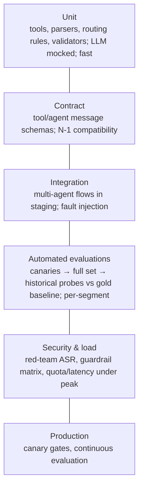
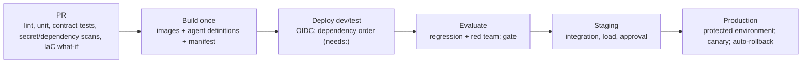

# Testing strategy and CI/CD with IaC for multi-agent systems

> AI-500 · D4 Secure, govern, and deploy multi-agent solutions · about 85 min · Study Hub module `s05` ([open the hub](https://claude.ai/artifact/WBg4UvZLizXnza8mbGvMze))

## Why it matters
*Design a testing strategy (unit, regression, integration, automated evaluations)* and *specify CI/CD requirements for integration and release, including IaC deployments and testing*. Multi-agent systems have dependencies between agents and tools, so the pipeline must deploy in the right order and prove compatibility.

## Pre-question (answer before reading)
**Q:** Agent B depends on Tool T v2's new optional field; Agent A uses T v1 behaviour. In what order should the pipeline deploy, and why?

<details><summary>Answer</summary>

Deploy dependencies first (**reverse topological order**): Tool T v2 (backward compatible: optional field) → then agents that use it. Contract tests verify A still works with T v2 (N-1 compatibility).

</details>

## Mental model & story
Contoso's platform had 18 agents and 9 tool servers in one repository. Releases broke when an agent shipped before the tool version it needed, or when a tool removed a field another agent still used.

The CI/CD redesign started with a **dependency manifest** (`agent-dependencies.yml`) describing which agents depend on which tools and agents. The pipeline deploys in **reverse topological order** — dependencies first — using GitHub Actions `needs:`. A **compatibility matrix** of tool schema versions is checked by **contract tests**: required fields, types, response shapes. Breaking changes (new required parameter, removed field, type change) need a major version; during canaries both N and N−1 must work.

Testing became layered. **Unit tests** cover deterministic code: tools, parsers, routing heuristics, validators — with the LLM mocked. **Contract tests** cover tool and agent message schemas. **Integration tests** run multi-agent flows against staging services with fault injection (timeouts, 429s, malformed responses). **Regression and automated evaluations** run the canary set, the full taxonomy set and historical failure probes against the gold baseline; red-team scans check attack success rate. **Load tests** check quotas and latency under peak.

Infrastructure is **IaC**: Bicep (or Terraform) with **azd** for Foundry resources, projects, model deployments, connections, Container Apps, networking and Key Vault, with *what-if* previews on pull requests. Agent definitions are files in the repo, versioned with prompts.

Pipelines authenticate with **OIDC federated credentials** (no secrets), deploy to protected **GitHub environments** with required reviewers for production, and fail fast on secret scanning, dependency vulnerabilities or evaluation gates. Dev containers, pinned CLI versions, lock files and an `AGENTS.md` keep developers and pipelines consistent.

**Where the analogy breaks:** Tests on LLM behaviour are probabilistic: a flaky evaluation gate erodes trust as fast as no gate. Use enough samples, thresholds derived from historical variance, per-segment checks and re-run policies for borderline results rather than demanding exact outputs.

## Diagrams
**Testing pyramid for multi-agent systems**



**Pipeline**



## Key points
- Test layers: **unit** (deterministic code; mock LLM), **contract** (schemas, N-1 compatibility), **integration** (multi-agent flows, fault injection), **regression/automated evaluations** (quality and safety vs baseline), **security** (red team, guardrail matrix, secret/dependency scans), **load**.
- Contract rules: breaking = new required parameter, removed tool/field, type change; safe = optional parameter/field. Keep N-1 compatibility during rolling and canary releases.
- **Dependency DAG manifest**; deploy dependencies first (reverse topological order); encode with GitHub Actions `needs:` (or Azure DevOps stage dependencies).
- **IaC**: Bicep/Terraform (+ azd) for Foundry resources, projects, deployments, connections, compute, networking, Key Vault, monitoring; *what-if* on PRs; idempotent deployments; environment parameters.
- Agent definitions, prompts, tool schemas and evaluation datasets live in source control and are versioned together.
- Auth: **OIDC federated credentials** (`permissions: id-token: write`, `azure/login`) — no long-lived secrets in CI.
- Gates: evaluation thresholds (from historical variance, per segment), safety 100%/ASR not worse than baseline, schema compliance, scans; production behind **protected environments** with required reviewers.
- Evaluation in CI: `microsoft/ai-agent-evals` GitHub Action (Azure DevOps extension also exists) or the evaluation SDK in a job the deploy job `needs`.
- Reproducibility: dev containers, pinned CLI/tool versions, lock files, Dependabot/Renovate, `AGENTS.md`/`copilot-instructions.md` for AI coding assistants.
- Flakiness control: enough samples, variance-based thresholds, re-run policy for borderline results, quarantined flaky tests tracked to fix.

## Comparisons
**What each test layer catches**

| Layer | Catches | Speed |
|---|---|---|
| Unit | Logic bugs in tools/parsers/routing | Seconds |
| Contract | Schema breaks between agents and tools | Seconds |
| Integration | Flow, handoff and fault-handling bugs | Minutes |
| Automated evaluations | Quality/safety regressions | Minutes–hours (cost) |
| Red team / guardrail matrix | Security regressions (ASR) | Minutes–hours |
| Load | Quota exhaustion, latency under peak | Hours |

## Code to recognise
**GitHub Actions: OIDC, dependency order, evaluation gate, protected production**

```yaml
permissions:
  id-token: write          # OIDC federation, no secrets
  contents: read

jobs:
  deploy-tools:
    runs-on: ubuntu-latest
    steps:
      - uses: azure/login@v3
        with:
          client-id: ${{ vars.AZURE_CLIENT_ID }}
          tenant-id: ${{ vars.AZURE_TENANT_ID }}
          subscription-id: ${{ vars.AZURE_SUBSCRIPTION_ID }}
      - run: azd deploy claims-tools-mcp --environment test

  deploy-agents:
    needs: deploy-tools     # dependencies first
    runs-on: ubuntu-latest
    steps:
      - run: azd deploy claims-agents --environment test

  evaluate:
    needs: deploy-agents
    runs-on: ubuntu-latest
    steps:
      - uses: microsoft/ai-agent-evals@v3-beta
        with:
          data-path: evals/claims_regression_v9.json

  deploy-prod:
    needs: evaluate          # gate: only runs if evaluation passes
    environment: production  # protected: required reviewers
    runs-on: ubuntu-latest
    steps:
      - run: azd deploy --environment prod
```

- Line 2: Required for the job to request an OIDC token.
- Line 9: `azure/login` exchanges the GitHub OIDC token for an Entra token.
- Line 11: IDs are configuration variables, not secrets.
- Line 17: `needs:` encodes the dependency order: tools before agents.
- Line 26: The evaluation action runs Foundry evaluations; failures stop the pipeline.
- Line 31: Production waits for evaluation and for approval in a protected environment.

## Portal steps
**Set up a protected production environment** (GitHub > Settings > Environments > production)

1. Add required reviewers and a wait timer if needed.
2. Restrict deployment branches (e.g., main only).
3. Store non-secret IDs as environment variables; no client secrets (OIDC).
4. Create the federated credential in Entra ID for the repo/environment subject.
5. Grant the pipeline identity least-privilege roles per environment.

## Worked example
**Scenario:** A team's pipeline deploys all 12 agents and 5 tool servers in parallel; occasionally an agent starts before its tool's new version and fails health checks. They also store a client secret in GitHub. Fix the CI/CD design.

- Ordering → dependency DAG and `needs:`.
- Compatibility → contract tests and N-1 support.
- Secrets → OIDC federation.

**Answer:** Introduce a **dependency manifest** and deploy in **reverse topological order** with `needs:` (tools before dependent agents), add **contract tests** and N-1 compatibility checks, gate on **automated evaluations**, and replace the client secret with **OIDC federated credentials** (`id-token: write`, `azure/login`) and protected environments for production.

## Your turn (faded example)
**Scenario:** The evaluation gate fails randomly about 1 run in 6 with no code change.

- Gate is flaky.
- **What do you check first?** <details><summary>answer</summary>Sample size and threshold: are thresholds tighter than the metric's natural run-to-run variance?</details>
- **How do you fix it without weakening safety?** <details><summary>answer</summary>Derive thresholds from historical variance, increase samples for noisy metrics, add a re-run policy for borderline results, keep safety checks strict (100%).</details>

## Exam traps & misconceptions
- ✗ Only end-to-end tests with live LLM calls. → ✓ Unit and contract tests catch most bugs cheaply; mock the LLM.
- ✗ Deploying agents and tools in parallel without ordering. → ✓ Dependencies first via a DAG and `needs:`.
- ✗ Client secrets in CI. → ✓ OIDC federated credentials.
- ✗ Evaluation gates with zero tolerance on noisy metrics. → ✓ Variance-based thresholds; strict only for safety.
- ✗ Infrastructure created by hand in the portal. → ✓ IaC with what-if, versioned and reviewed.

## Discussion prompts
- **How do you test a multi-agent handoff?** Integration tests that drive a conversation across agents with stubbed tools, assert on handoff payload contents (contract), check coherence with a judge, and inject failures (spoke timeout, malformed response) to verify fallbacks.
- **What belongs in IaC vs agent configuration?** IaC: resources, networking, identities, role assignments, model deployments, connections. Agent configuration (prompts, tools, agent definitions) is versioned in the repo and deployed by the pipeline, with evaluation gates — both promoted together.

## Interview angle / teach-back
**Prompt:** Explain your testing strategy and CI/CD requirements for a multi-agent system on Azure.

**Rubric:** Layers: unit, contract, integration, evaluations, security, load · Dependency DAG; reverse topological deploy; N-1 compatibility · IaC (Bicep/Terraform + azd), what-if · OIDC, protected environments, gates incl. evaluations and red team · Reproducible dev env; flakiness control

**Model answer:** I test in layers: unit tests for tools, parsers and routing with the model mocked; contract tests for tool and agent schemas with N-1 compatibility; integration tests for multi-agent flows with fault injection; automated evaluations and red-team scans against a gold baseline; and load tests for quotas. The pipeline builds once, deploys dependencies first using a DAG manifest and needs, provisions everything through Bicep or Terraform with azd and what-if previews, authenticates with OIDC instead of secrets, gates on evaluation, safety and scans, and promotes to a protected production environment with reviewers and a canary. Dev containers, pinned tools and lock files keep it reproducible, and evaluation thresholds come from historical variance to avoid flaky gates.

## Quick Q&A
- **Deploy order?** Dependencies first (reverse topological).
- **Breaking tool change?** New required param, removed field, type change.
- **CI auth without secrets?** OIDC federated credentials (`id-token: write`).
- **Evaluation action?** `microsoft/ai-agent-evals`.
- **IaC preview?** what-if (Bicep) / plan (Terraform).
- **Production protection?** Protected environment with required reviewers.
- **Flaky eval gate fix?** Variance-based thresholds, more samples, re-run policy.

## Sources (accessed 2026-10-02)
- [Use GitHub Actions with OIDC to connect to Azure](https://learn.microsoft.com/en-us/azure/developer/github/connect-from-azure-openid-connect)
- [Azure Developer CLI (azd)](https://learn.microsoft.com/en-us/azure/developer/azure-developer-cli/overview)
- [Bicep what-if](https://learn.microsoft.com/en-us/azure/azure-resource-manager/bicep/deploy-what-if)
- [GitHub Action for agent evaluations](https://github.com/microsoft/ai-agent-evals)

## SRS cards created
- ai-500-s05-01, ai-500-s05-02, ai-500-s05-03, ai-500-s05-04
