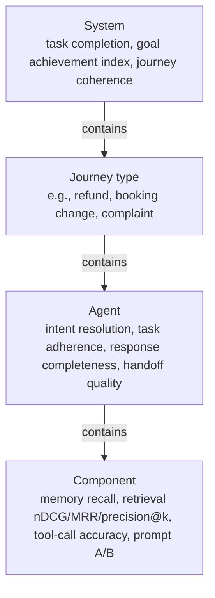
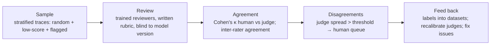

# Evaluation strategy: human review, components and end-to-end

> AI-500 · D3 Evaluate, optimize, and monitor multi-agent solutions · about 90 min · Study Hub module `v01` ([open the hub](https://claude.ai/artifact/WBg4UvZLizXnza8mbGvMze))

## Why it matters
Two blueprint skills: *design a human review process to evaluate solutions in Foundry* and *design evaluations for memory, knowledge, tools and prompts*. The trap the exam sets: every component scores well while the system still fails users. You need both levels — and humans to keep the automated judges honest.

## Pre-question (answer before reading)
**Q:** Retrieval precision is 0.91, tool-call accuracy 0.97 and groundedness 4.6/5, yet only 72% of customer journeys end successfully. How is that possible?

<details><summary>Answer</summary>

Component scores don't capture **handoff losses**, **coherence across agents** (contradictions, repeated questions) or wrong routing between steps. Measure **system-level** outcomes (task completion, goal achievement, journey coherence) and drill down from failing journeys to the agent and component that broke.

</details>

## Mental model & story
Northwind's travel-support system has a triage agent, a booking agent and a refunds agent. Every dashboard was green. Customers were not: a third of refund journeys asked the same question twice, and some promised refunds the refunds agent later denied.

The evaluation lead, **Ama**, rebuilt the strategy top-down. **System level**: task completion rate, a 0–10 **goal achievement index** per journey, and **journey coherence** judged by an LLM (consistent handoffs, no contradictions, no repeats). **Business level**: resolution, reopen and escalation rates, CSAT, cost per resolved task. **Component level**: memory recall accuracy, retrieval nDCG/MRR, tool-call accuracy and argument correctness, and agent behaviour — intent resolution, task adherence, response completeness.

When a metric drops, the team drills down: system → journey type → agent → component. The refund contradictions traced to the triage agent's digest omitting the fare class — a context problem, invisible to component metrics.

Automated judges needed watching too. Ama set up a **human review process**: reviewers with a written rubric score a stratified sample of traces each week; the team computes agreement between humans and each LLM judge (**Cohen's κ**, target above 0.7 before trusting a judge for gating); cases where judges disagree, or score spread exceeds 3 points on a 10-point scale, go to the human queue. Reviewer labels flow back into the evaluation datasets.

Each component also has targeted tests: memory (does the agent recall the right preference and ignore superseded ones?), knowledge (are the right chunks retrieved and cited?), tools (right tool, right arguments, right handling of errors?), prompts (A/B of versions on the same dataset).

**Where the analogy breaks:** Evaluation datasets age. Products change, users phrase things differently, attackers adapt. A strategy without a refresh cadence (and production sampling) measures last year's system against last year's users.

## Diagrams
**Evaluation levels (drill down when something drops)**



**Human review process (weekly)**



## Key points
- Measure **system** (task completion, goal achievement, journey coherence), **business** (resolution, reopen, escalation, CSAT, cost per resolved task) and **component** metrics; high component scores ≠ system success.
- Drill-down path: system → journey type → agent → component.
- **Memory** evaluations: recall accuracy of relevant memories, rejection of superseded/contradicted memories, entity continuity, tenant isolation (no cross-tenant recall).
- **Knowledge** evaluations: retrieval precision@k, recall@k, nDCG, MRR; groundedness and relevance of answers; citation correctness.
- **Tool** evaluations: tool-call accuracy (right tool), argument correctness, success rate, error handling/fallback behaviour.
- **Prompt/agent** evaluations: intent resolution, task adherence, response completeness, instruction adherence; A/B prompt versions on the same dataset.
- Azure AI Evaluation SDK: built-in agent evaluators (`IntentResolutionEvaluator`, `ToolCallAccuracyEvaluator`, `TaskAdherenceEvaluator`, `ResponseCompletenessEvaluator`), quality (groundedness, relevance, coherence, fluency) and safety evaluators; custom evaluators are classes with `__init__` and `__call__` returning a dict; run with `evaluate(data=..., evaluators=..., azure_ai_project=...)` to log results to Foundry. That local path is documented for Foundry **classic** projects; new Foundry projects run evaluations in the cloud with the evals API (`project_client.get_openai_client().evals.create(...)` + `evals.runs.create(...)`, built-in `builtin.*` evaluators).
- **Human review in Foundry**: rubric-based review of sampled traces/evaluation rows, reviewer training, blind review, inter-rater agreement; humans calibrate LLM judges (Cohen's κ > 0.7 before using a judge as a gate).
- Route judge disagreements (or large score spreads) and low-confidence cases to human queues; feed labels back into datasets.
- Evaluate in three places: pre-release (datasets in CI), canary/A-B, and production (continuous evaluation on sampled traffic).

## Comparisons
**What to evaluate, how**

| Target | Metrics | Method |
|---|---|---|
| End-to-end journeys | Task completion, goal index, coherence | Simulated or replayed conversations + LLM judge + human review |
| Memory | Recall accuracy, superseded-fact rejection, isolation | Scripted multi-session scenarios with known facts |
| Knowledge/RAG | precision@k, nDCG, MRR, groundedness, citations | Labelled queries + groundedness evaluator |
| Tools | Tool-call accuracy, argument correctness, error handling | ToolCallAccuracyEvaluator + fault injection |
| Prompts/agents | Intent resolution, task adherence, completeness | Built-in agent evaluators; A/B versions |
| Safety | Defect rate, attack success rate | Safety evaluators + AI Red Teaming Agent (s03) |

## Code to recognise
**Evaluate an agent with built-in and custom evaluators**

```python
from azure.ai.evaluation import (evaluate, IntentResolutionEvaluator, TaskAdherenceEvaluator,
                                 ToolCallAccuracyEvaluator, GroundednessEvaluator)

class HandoffCoherence:
    """Custom evaluator: did a handoff preserve the customer's stated constraints?"""
    def __init__(self, judge):
        self.judge = judge
    def __call__(self, *, query, response, handoff_payload, **kwargs):
        verdict = self.judge.score(query=query, payload=handoff_payload, response=response)
        return {"handoff_coherence": verdict.score, "handoff_coherence_reason": verdict.reason}

result = evaluate(
    data="evals/refund_journeys_v7.jsonl",
    evaluators={
        "intent": IntentResolutionEvaluator(model_config=judge_cfg),
        "adherence": TaskAdherenceEvaluator(model_config=judge_cfg),
        "tools": ToolCallAccuracyEvaluator(model_config=judge_cfg),
        "grounded": GroundednessEvaluator(model_config=judge_cfg),
        "handoff": HandoffCoherence(judge=coherence_judge)},
    azure_ai_project=PROJECT_ENDPOINT,
    output_path="results/refund_v7.json")
```

- Line 1: Built-in agent evaluators cover intent, adherence and tool calls; quality evaluators cover groundedness.
- Line 4: A custom evaluator is any class with `__init__` and `__call__` returning a dict.
- Line 8: It receives columns from the dataset by name (here including the handoff payload).
- Line 13: The dataset is versioned like code (v7).
- Line 20: Logging to the Foundry project makes results visible and comparable in the portal.

## Portal steps
**Set up human review alongside automated evaluation** (Foundry > Evaluations (results) + review workflow)

1. Write a rubric per criterion with anchored examples for each score.
2. Sample traces/evaluation rows weekly: random, low-score and user-flagged.
3. Have two reviewers label a subset to measure inter-rater agreement.
4. Compare human labels to each LLM judge (Cohen's κ); only gate releases on judges above the target.
5. Add reviewed cases to the evaluation dataset; track trends.

## Worked example
**Scenario:** A claims system's components all score well, but adjusters report that the final summaries sometimes contradict earlier answers given to the claimant. Design the evaluation change.

- The problem is cross-agent coherence, invisible to component metrics.
- Add a system-level journey evaluation.
- Make sure the new judge is trustworthy.

**Answer:** Add **journey-level** evaluation: replay or simulate full claim journeys and score **coherence** (no contradictions/repeats) with a specialised LLM judge plus a custom evaluator on handoff payloads; calibrate the judge against **human review** (κ > 0.7); drill down failing journeys to the agent/handoff that dropped information; add the failures to the regression set.

## Your turn (faded example)
**Scenario:** A new LLM judge for 'policy accuracy' agrees with human reviewers only 55% of the time (κ = 0.38).

- The judge isn't reliable enough to gate releases.
- **What do you change about the judge?** <details><summary>answer</summary>Tighten the rubric to one criterion with anchored examples, provide reference policy text, use a different model family from the agent, lower temperature; re-measure κ.</details>
- **Until it's calibrated?** <details><summary>answer</summary>Use it for triage only; gate on human-reviewed samples and other reliable metrics.</details>

## Exam traps & misconceptions
- ✗ Declaring success from component metrics alone. → ✓ Add system/journey metrics and drill down.
- ✗ Gating releases on an uncalibrated LLM judge. → ✓ Measure agreement with humans (κ > 0.7) first.
- ✗ Human review with no rubric or agreement checks. → ✓ Rubrics, training, blind review and inter-rater agreement.
- ✗ Only evaluating before release. → ✓ Also canary/A-B and continuous evaluation in production.
- ✗ Never refreshing datasets. → ✓ Refresh with production failures and new scenarios; version datasets.

## Discussion prompts
- **How big should a human review sample be?** Enough to estimate the metrics you gate on with useful confidence — often 50–100 labelled items per judge for calibration and a weekly stratified sample for monitoring, weighted toward low scores and new features.
- **How do you evaluate memory without leaking real data?** Scripted synthetic multi-session scenarios with known facts, updates and contradictions; tenant-isolation probes with synthetic tenants; check recall, superseded-fact handling and zero cross-tenant retrieval.

## Interview angle / teach-back
**Prompt:** Describe an evaluation strategy for a multi-agent system, including human review and component evaluations.

**Rubric:** System, business and component metrics; drill-down · Memory, knowledge, tools, prompt evaluations · Built-in + custom evaluators via the SDK/Foundry · Human review with rubrics, agreement, judge calibration (κ) · Pre-release, canary and production evaluation

**Model answer:** I measure at three levels: system outcomes like task completion, goal achievement and journey coherence; business outcomes like resolution and cost per resolved task; and components — memory recall, retrieval nDCG and precision, tool-call accuracy and arguments, and agent intent resolution, task adherence and completeness — drilling down from failing journeys to the component that broke. I use built-in and custom evaluators logged to Foundry. Humans review stratified samples with rubrics; I measure agreement and only gate on LLM judges whose agreement with humans is above about 0.7 kappa, routing disagreements to people. Evaluation runs before release, in canaries and continuously on production samples.

## Quick Q&A
- **Why system-level metrics?** Component scores miss handoff loss and incoherence.
- **Journey coherence?** Consistent handoffs; no contradictions or repeats.
- **Trust a judge when?** Agreement with humans κ > ~0.7.
- **Custom evaluator shape?** Class with `__init__` and `__call__` returning a dict.
- **Built-in agent evaluators?** Intent resolution, task adherence, tool call accuracy, response completeness.
- **Retrieval metrics?** precision@k, recall@k, nDCG, MRR.
- **Where to evaluate?** Pre-release, canary, production (continuous).

## Sources (accessed 2026-10-02)
- [Evaluate your AI agents (new Foundry)](https://learn.microsoft.com/en-us/azure/foundry/observability/how-to/evaluate-agent)
- [Agent evaluation with the azure-ai-evaluation SDK (classic docs, matches the code above)](https://learn.microsoft.com/en-us/azure/foundry-classic/how-to/develop/agent-evaluate-sdk)
- [Agent evaluators](https://learn.microsoft.com/en-us/azure/foundry/concepts/evaluation-evaluators/agent-evaluators)
- [Custom evaluators](https://learn.microsoft.com/en-us/azure/foundry/concepts/evaluation-evaluators/custom-evaluators)
- [Course AI-500T00-A (monitor, evaluate and operate path)](https://learn.microsoft.com/en-us/training/courses/ai-500t00)

## SRS cards created
- ai-500-v01-01, ai-500-v01-02, ai-500-v01-03, ai-500-v01-04
