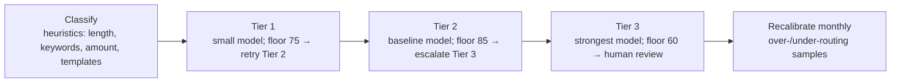

# Optimise performance: latency, rate limits, model routing and tokens

> AI-500 · D3 Evaluate, optimize, and monitor multi-agent solutions · about 85 min · Study Hub module `v02` ([open the hub](https://claude.ai/artifact/WBg4UvZLizXnza8mbGvMze))

## Why it matters
Three skills overlap here: *optimize task duration (parallelism, rate limits)*, *diagnose context window issues*, and *optimize token usage (limits, loop controls, tool calls)*. The exam gives you a slow or expensive system and asks what to change first — and what that change costs in quality.

## Pre-question (answer before reading)
**Q:** A deployment returns 429s although average utilisation is only 40% of its TPM. Requests set `max_output_tokens` to 4,000 but responses average 300 tokens. What's happening?

<details><summary>Answer</summary>

The rate limiter estimates usage from prompt tokens **plus max output tokens** and over short windows, so inflated `max_output_tokens` and bursts trigger throttling. Set realistic output limits, smooth bursts (backoff, queues, semaphores) and spread load across deployments.

</details>

## Mental model & story
Adventure Works' support platform handled 1.2 million requests a month. Every request — from "where's my order?" to complex policy exceptions — went to the same large model with a full conversation history. Median latency was 7 seconds and the bill was rising 20% a month.

The performance engineer, **Mateo**, started with **traces**: the critical path showed sequential calls that didn't depend on each other (now parallel), oversized prompts (history bloat and whole CRM records), and 429 retries caused by `max_output_tokens=4000` on calls that needed 200.

Then **model routing**. Requests are classified with cheap heuristics, not another model call: Tier 1 (lookups, status, simple facts) → a small model; Tier 2 (multi-step reasoning, comparisons, tone) → the baseline model; Tier 3 (policy interpretation, large amounts, complaints, legal words) → the strongest model. Each tier has a **quality floor** — Tier 1 below 75 retries at Tier 2, Tier 2 below 85 escalates to Tier 3, Tier 3 below 60 goes to a human. Monthly, over-routed and under-routed samples recalibrate the heuristics. The mix moved from 40/50/10 to 60/35/5: about 30% lower average cost per request.

Tokens got budgets per agent (2k lookups, 4k reasoning, 8k complex policy), tool results were trimmed to needed fields, history was replaced by a digest plus a short window, and loops got iteration caps. Customer segments got explicit profiles: Gold customers — P95 under 3 s, higher tiers, richer context; bulk API — Tier 1 only, no history, aggressive caching.

Any change runs as an **A/B test** for at least two weeks on a 90/10 split; it ships only if quality improves (statistically significant) and cost rises less than 10%. A **quality circuit breaker** reverts to conservative settings if average ratings drop below 3.8 over four hours.

**Where the analogy breaks:** Optimisation moves along a triangle: quality, cost, latency. Few changes are free (prompt caching is one). Every routing rule or budget cut needs a quality check on the affected segment, or you'll save money by failing customers quietly.

## Diagrams
**Tiered model routing with quality floors**



**Parallel or sequential?**

| | Cost-bound | Latency-bound |
|---|---|---|
| **Quota headroom** | **Sequential**: minimise spend; dependencies | **Parallel with care**: only critical-path steps; semaphore |
| **Little quota headroom** | **Sequential or batch**: throughput over latency | **Parallel**: independent steps; slowest branch wins |

## Key points
- Start with traces: find the **critical path**; parallelise independent steps (latency = slowest branch) only where quota allows.
- Rate limits: TPM/RPM per deployment; the limiter counts prompt + **max output tokens** over short windows → set realistic `max_output_tokens`, smooth bursts, exponential backoff with jitter honouring `retry-after`, spread across deployments/regions, PTU for steady high load, separate deployments per workload (interactive vs batch).
- **Model routing**: classify with cheap heuristics (not an extra LLM call); tiers with **quality floors** (e.g., 75/85/60 → retry/escalate/human); recalibrate monthly (over-routing: Tier 2/3 requests a Tier 1 model handles ≥ 70%; under-routing: Tier 1 retry rate > 15%). Foundry's model router is a platform alternative.
- Token budgets per agent (e.g., 2k/4k/8k), digest + rolling window, agent-specific tool fields, static reference text moved to retrieval, iteration caps and completion signals in loops.
- Tool calls: avoid redundant calls (cache per request), use parallel tool calls where independent, batch lookups, return compact results.
- Context window issues in production: watch input tokens per turn, truncation events and answer errors that correlate with long sessions; apply d03 fixes (pinned facts, contradiction checks, hybrid recall, entity tags).
- Segment profiles: different SLOs, tiers, context depth and cache thresholds for different customer segments/workloads.
- A/B testing: ≥ 2 weeks, 90/10 split, held-out labelled set (~500); ship if quality gain is significant (p < 0.05) and cost increase < ~10%.
- **Quality circuit breaker**: if ratings or implicit signals (escalations +20%, reopen within 5 min, abandonment) degrade, revert to conservative settings automatically.
- Win-wins: prompt caching (cost), result caching for deterministic queries (cost + latency); most other levers trade one corner of the triangle for another.

## Comparisons
**Lever → effect on the triangle**

| Lever | Cost | Latency | Quality risk |
|---|---|---|---|
| Prompt caching | ↓ | slightly ↓ | None |
| Result caching (deterministic) | ↓ | ↓ | Staleness |
| Smaller model for simple tier | ↓↓ | ↓ | Needs quality floor |
| Parallel spokes | ≈ (more concurrent quota) | ↓↓ | None if independent |
| Shorter context (digest) | ↓ | ↓ | Information loss if digest is poor |
| Reflection cycles | ↑↑ | ↑ | Quality ↑ with diminishing returns |

## Code to recognise
**Tiered routing with quality floors (simplified)**

```python
TIERS = {1: "gpt-5.4-nano", 2: "gpt-5.4-mini", 3: "gpt-5.5"}
FLOORS = {1: 75, 2: 85, 3: 60}

def classify(req) -> int:
    text = req.text.lower()
    if req.amount and req.amount > 500 or any(w in text for w in ("legal", "complaint", "exception")):
        return 3
    if len(text.split()) < 10 and req.matches_known_template:
        return 1
    return 2

def answer(req):
    tier = classify(req)
    while True:
        resp = call_model(TIERS[tier], req, max_output_tokens=req.budget)   # realistic budget
        score = quality_score(resp, req)            # completeness, consistency, uncertainty phrases
        if score >= FLOORS[tier]:
            return resp, tier
        if tier == 3:
            return send_to_human_review(req, resp), tier
        tier += 1                                   # escalate one tier and retry
```

- Line 4: Classification uses cheap rules (keywords, amounts, length), not another LLM call.
- Line 6: Business rules force high-stakes requests to the strongest tier.
- Line 8: Short, templated requests go to the small model.
- Line 15: Realistic `max_output_tokens` reduces throttling and cost.
- Line 16: A quality score gates each tier's answer.
- Line 20: Tier 3 below its floor goes to a human.
- Line 21: Otherwise escalate one tier: cheap first, expensive only when needed.

## Portal steps
**Find latency and token hotspots** (Application Insights / Foundry tracing)

1. Open slow traces; identify the critical path and sequential independent steps.
2. Chart input/output tokens per agent and per turn; spot growth.
3. Chart 429s and retry counts per deployment; check max output settings.
4. Compare tiers: quality scores, retries/escalations, cost per request.
5. Run changes as A/B tests with guardrail metrics.

## Worked example
**Scenario:** An itinerary agent calls flights (12 s), hotels (10 s), visas (8 s) and weather (2 s) sequentially, then a budget agent (5 s) that needs flights and hotels. Users wait 37 s. Quota allows three concurrent calls. Optimise.

- Flights, hotels, visas, weather are independent.
- Budget depends on flights + hotels.
- Concurrency limit 3.

**Answer:** Run flights, hotels and visas in **parallel** (semaphore 3) and start weather when a slot frees (or skip waiting for it); critical path ≈ max(12, 10, 8) + 5 (budget) ≈ **17 s** plus overhead, instead of 37 s; add deadline-derived timeouts and partial results if visas is slow.

## Your turn (faded example)
**Scenario:** A Tier 1 small model handles order-status requests, but 22% are retried at Tier 2.

- The retry rate exceeds the ~15% under-routing threshold.
- **What do you investigate?** <details><summary>answer</summary>Sample the retried requests: which patterns fail the quality floor (multi-part questions, missing data, ambiguous wording)?</details>
- **What do you change?** <details><summary>answer</summary>Refine the heuristics so those patterns route to Tier 2 directly (or improve the Tier 1 prompt/tool data), then re-measure cost and quality.</details>

## Exam traps & misconceptions
- ✗ Using an LLM call to decide which LLM to call for every request. → ✓ Cheap heuristics or a small classifier; LLM only for ambiguous cases.
- ✗ Setting `max_output_tokens` very high "just in case". → ✓ The limiter counts it; set realistic budgets.
- ✗ Parallelising everything. → ✓ Only independent, latency-critical steps, within quota.
- ✗ Judging a routing change by cost alone. → ✓ Check quality per segment; use quality floors and A/B tests.
- ✗ Optimising steps not on the critical path. → ✓ Use traces to target what actually determines latency.

## Discussion prompts
- **Foundry model router or your own tiered routing?** The model router is quick to adopt and optimises across supported models automatically; custom tiers give explicit business rules (amounts, legal keywords), quality floors and per-segment profiles. Many teams start with the router and add business-rule overrides.
- **How do you stop optimisation from silently hurting a minority segment?** Track quality and outcomes per segment (language, customer tier, journey type) with per-segment gates, and include those segments in A/B guardrail metrics.

## Interview angle / teach-back
**Prompt:** Explain how you'd make a slow, expensive multi-agent system faster and cheaper without hurting quality.

**Rubric:** Trace the critical path; parallelise independent steps within quota · Rate-limit hygiene: realistic max tokens, smoothing, backoff, deployments/PTU · Tiered routing with quality floors + recalibration · Token budgets, digests, compact tool results, loop caps · A/B tests, segment checks, quality circuit breaker

**Model answer:** I start from traces to find the critical path, parallelise independent steps within quota, and fix rate-limit hygiene: realistic output limits, smoothing bursts, backoff and separate deployments or PTU where load is steady. I route requests by cheap heuristics to tiers of models with quality floors, escalating when an answer falls short and recalibrating monthly. Each agent gets a token budget, a digest instead of full history, compact tool results and loop caps. Every change runs as an A/B test with per-segment quality checks, and a quality circuit breaker reverts to conservative settings if satisfaction drops.

## Quick Q&A
- **Parallel latency?** Slowest branch.
- **Why 429 at 40% utilisation?** Limiter counts max output tokens; bursts.
- **Routing classifier?** Cheap heuristics, not an LLM call.
- **Example quality floors?** Tier 1: 75, Tier 2: 85, Tier 3: 60 → human.
- **Under-routing signal?** Tier 1 retry rate > ~15%.
- **A/B ship rule?** Significant quality gain and cost +<10%.
- **Free optimisation?** Prompt caching.

## Sources (accessed 2026-10-02)
- [Azure OpenAI quotas and rate limits](https://learn.microsoft.com/en-us/azure/foundry/openai/quotas-limits)
- [Model router in Foundry](https://learn.microsoft.com/en-us/azure/foundry/openai/concepts/model-router)
- [Optimize performance and cost (AI-500 module)](https://learn.microsoft.com/en-us/training/modules/aaai-optimize-multi-agent-performance-cost-azure/)

## SRS cards created
- ai-500-v02-01, ai-500-v02-02, ai-500-v02-03, ai-500-v02-04
