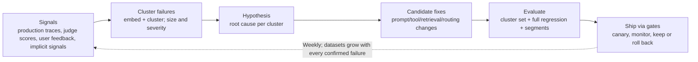
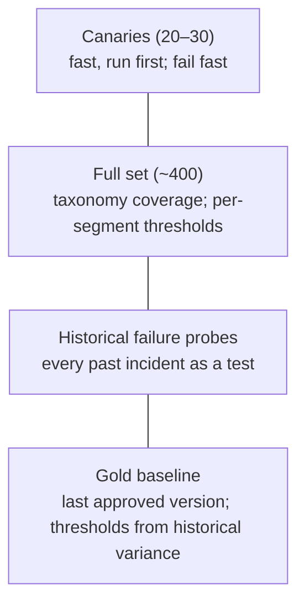

# Continuous improvement: LLM judges, synthetic data, optimisation loops, feedback

> AI-500 · D3 Evaluate, optimize, and monitor multi-agent solutions · about 85 min · Study Hub module `v03` ([open the hub](https://claude.ai/artifact/WBg4UvZLizXnza8mbGvMze))

## Why it matters
*Design and implement continuous improvement, including LLM-as-a-judge frameworks, synthetic data generation, semantic optimization loops, and user feedback loops.* This is how a multi-agent system gets better every month instead of quietly decaying — and how you prove it.

## Pre-question (answer before reading)
**Q:** You have 40 real examples of a rare failure (international shipping refunds) and need 400 test cases covering personas and complexity. What do you do?

<details><summary>Answer</summary>

Generate **taxonomy-driven synthetic data**: vary category × complexity × persona × adversarial flag with an LLM at higher temperature (~0.8), anchor on the real examples, define ground truth (required facts, acceptable ranges), have humans validate a sample, and version the dataset.

</details>

## Mental model & story
Fabrikam's quality team ran evaluations before each release, but between releases the system drifted: new products, new phrasing, new failure modes. They built a **continuous improvement loop**.

**Judges.** One omnibus judge became four **specialised judges** — factual accuracy, task completion, tone/policy, consistency — each with a rubric, the relevant context, a single criterion and a strict JSON output (score + reasoning). To counter known biases (length, position, self-preference, leniency), they swap answer order in pairwise comparisons, normalise length, use a **different model family** from the agents, provide reference answers and run at low temperature. Each judge is calibrated against 50–100 human labels; disagreements between judges go to humans.

**Synthetic data.** A taxonomy — 20 categories × 5 complexity levels × 2 personas × adversarial yes/no — produces 400 cases per refresh, generated at temperature ~0.8 for diversity, with ground truth as required facts or acceptable ranges. Humans validate a sample; the dataset is versioned in Git and refreshed quarterly, with production failures added as *historical failure probes*. Foundry's simulators generate multi-turn and adversarial conversations.

**Semantic optimisation loop.** Each week, failing traces are embedded and clustered; the biggest clusters become hypotheses ("refunds for multi-leg bookings miss the second leg"). Candidate fixes — prompt edits, tool changes, retrieval tweaks — are evaluated on the cluster plus the full regression suite; winners ship through the normal gates.

**Feedback.** Thumbs up/down get 42% completion but little detail; 1–5 stars with explanation get 8%. Internal reviewers flag responses with one click (factually incorrect, wrong tone, policy violation, missed opportunity) linked to the trace. Implicit signals — escalations, reopen within five minutes, abandonment — fill the gaps. Regression suites run in layers: 20–30 **canaries** first, then the full set, then historical failure probes, compared against a **gold baseline** with thresholds derived from historical variance and **per-segment** checks.

**Where the analogy breaks:** Loops can optimise the wrong thing. If judges reward verbosity or the synthetic data is easier than reality, scores rise while users suffer. Keep humans in the loop, refresh data from production, and watch business outcomes, not just judge scores.

## Diagrams
**Continuous improvement loop**



**Regression suite layers**



## Key points
- **Specialised judges** (one criterion each) beat one omnibus judge; prompt = rubric + context + criterion + strict output (JSON score + reasoning).
- Judge biases: **length/verbosity**, **position** (order), **self-preference** (own model family), **leniency**. Mitigate: swap order, normalise length, different model family, reference answers, low temperature.
- Calibrate judges on 50–100 human-labelled examples; **Cohen's κ > 0.7** for production use; multi-judge consensus; large disagreements (e.g., spread > 3 on 10 points) → human queue.
- **Synthetic data**: taxonomy-driven (category × complexity × persona × adversarial), generated at higher temperature (~0.8), with ground truth (binary, rubric, acceptable ranges, required facts); human-validated sample; version-controlled; refreshed (e.g., quarterly); Foundry `Simulator` / `AdversarialSimulator` for conversations.
- **Semantic optimisation loops**: embed and cluster failing traces, prioritise clusters, form hypotheses, test candidate fixes on the cluster and full suite, ship through gates.
- **User feedback**: explicit (thumbs, stars, comments — beware outcome bias and low completion), internal one-click flags linked to traces, implicit signals (escalation, reopen within minutes, abandonment).
- Feedback from approvals (d09): categorised rejections → regression cases; prioritise by mismatch, novelty and frequency.
- Regression testing: canaries → full set → historical failure probes vs a gold baseline; thresholds from historical variance (e.g., task completion −2 pts, any segment −5%); per-segment checks catch aggregate masking.
- CI gate: an `evaluate` job that the `deploy` job `needs`; fail on threshold breaches; the `microsoft/ai-agent-evals` action runs Foundry evaluations in GitHub Actions.
- Production drift: continuous evaluation on a sample (e.g., ~1%) with rolling averages and alerts.

## Comparisons
**Feedback signals**

| Signal | Strength | Weakness |
|---|---|---|
| Thumbs up/down | High completion | Little detail; outcome bias |
| 1–5 stars + comment | Rich detail | Low completion |
| Internal one-click flags | Expert, categorised, trace-linked | Coverage limited to reviewed items |
| Approval rejections | Expert, high-confidence | Only escalated cases |
| Implicit (escalation, reopen, abandonment) | Covers everyone | Noisy; needs baselines |

## Code to recognise
**A specialised, bias-aware pairwise judge (simplified)**

```python
JUDGE_PROMPT = """You judge ONE criterion: factual accuracy against the reference policy.
Reference policy:
{reference}
Question: {question}
Answer A: {a}
Answer B: {b}
Return JSON: {{"winner": "A"|"B"|"tie", "reasoning": "<2 sentences citing the policy>"}}"""

def pairwise(question, reference, ans1, ans2):
    v1 = judge(JUDGE_PROMPT.format(reference=reference, question=question, a=ans1, b=ans2))
    v2 = judge(JUDGE_PROMPT.format(reference=reference, question=question, a=ans2, b=ans1))
    w1 = {"A": "ans1", "B": "ans2", "tie": "tie"}[v1["winner"]]
    w2 = {"A": "ans2", "B": "ans1", "tie": "tie"}[v2["winner"]]
    return w1 if w1 == w2 else "inconsistent"      # position bias → route to human review

judge = make_judge(model="different-family-model", temperature=0)
```

- Line 1: One criterion per judge keeps scores interpretable.
- Line 3: A reference makes the judgment checkable.
- Line 7: Strict JSON output (double braces escape the format string).
- Line 10: Ask twice with the answers swapped...
- Line 14: ...and only accept consistent verdicts; inconsistency signals position bias.
- Line 16: Use a model family different from the agents (self-preference) at temperature 0.

## Portal steps
**Generate and manage synthetic evaluation data** (Foundry evaluation SDK (simulators) + Git)

1. Define the taxonomy (categories, complexity, personas, adversarial).
2. Generate cases with a simulator or LLM at ~0.8 temperature, seeded with real examples.
3. Attach ground truth (required facts, acceptable ranges, expected tools).
4. Human-validate a sample; fix or drop bad cases.
5. Commit the dataset with a version tag; refresh quarterly and add production failures.

## Worked example
**Scenario:** After three months, judge scores for a support agent rose 12%, but CSAT fell slightly. Investigate.

- Judge scores and user outcomes diverged.
- Possible judge bias (e.g., verbosity) or dataset drift from reality.
- Need human calibration and production-grounded data.

**Answer:** Check judge **calibration** against fresh human labels (κ), test for **length bias** (did answers get longer?), compare synthetic dataset difficulty with production failures, add **historical failure probes** and production samples to the suite, and weight business outcomes (CSAT, reopen) alongside judge scores in gates.

## Your turn (faded example)
**Scenario:** Hundreds of failed traces arrive each week and the team can't read them all.

- Manual reading doesn't scale.
- **What technique groups them?** <details><summary>answer</summary>Embed the failing traces (or their summaries) and cluster them; rank clusters by size and severity.</details>
- **What happens to a confirmed cluster?** <details><summary>answer</summary>A hypothesis and candidate fix, evaluated on that cluster plus the full regression suite; its cases join the regression set.</details>

## Exam traps & misconceptions
- ✗ One judge scoring everything at once. → ✓ Specialised single-criterion judges.
- ✗ Using the same model family as both agent and judge. → ✓ Self-preference bias; use a different family.
- ✗ Synthetic data without human validation. → ✓ Validate samples; anchor on real examples.
- ✗ Relying on thumbs-up rates alone. → ✓ Combine explicit, internal and implicit signals.
- ✗ Aggregate-only regression thresholds. → ✓ Per-segment checks catch masked regressions.

## Discussion prompts
- **How do you keep synthetic datasets honest?** Seed from real conversations, include adversarial and edge cases, validate a sample with humans, compare score distributions with production samples, and keep historical failure probes so the dataset can't drift easier.
- **What's a semantic optimisation loop in practice?** A weekly cadence: cluster failures by meaning, prioritise, hypothesise, test fixes against targeted and full suites, ship via gates, and verify the cluster shrinks in production.

## Interview angle / teach-back
**Prompt:** Explain how you'd set up a continuous improvement loop for a production multi-agent system.

**Rubric:** Specialised, calibrated LLM judges with bias mitigations · Taxonomy-driven synthetic data, validated and versioned · Semantic clustering of failures → fixes → evaluation · Feedback: explicit, internal flags, implicit, approvals · Layered regression suite vs gold baseline; per-segment; CI gate; continuous evaluation

**Model answer:** I use specialised judges — one criterion each, with rubrics, references and strict JSON — run on a different model family at low temperature, with order swapping and length normalisation, calibrated against human labels to about 0.7 kappa. Synthetic datasets come from a taxonomy of category, complexity, persona and adversarial cases, generated with variety, validated by humans, versioned and refreshed with production failures. Each week failing traces are clustered by meaning, the biggest clusters get hypotheses and candidate fixes, and fixes are tested on the cluster and the full suite. Feedback combines thumbs, internal flags linked to traces, implicit signals and approval rejections. Releases pass canaries, the full set and historical probes against a gold baseline with per-segment thresholds, and continuous evaluation watches production.

## Quick Q&A
- **Judge biases?** Length, position, self-preference, leniency.
- **Judge calibration target?** Cohen's κ > ~0.7.
- **Synthetic taxonomy dimensions?** Category × complexity × persona × adversarial.
- **Generation temperature for diversity?** ~0.8.
- **Regression layers?** Canaries → full set → historical failure probes.
- **Why per-segment checks?** Aggregates mask segment regressions.
- **GitHub action for Foundry evals?** `microsoft/ai-agent-evals`.

## Sources (accessed 2026-10-02)
- [Generate a synthetic evaluation dataset (preview)](https://learn.microsoft.com/en-us/azure/foundry/observability/how-to/evaluation-dataset-synthetic)
- [Simulator and AdversarialSimulator in the SDK (classic docs)](https://learn.microsoft.com/en-us/azure/foundry-classic/how-to/develop/simulator-interaction-data)
- [Continuous evaluation for agents](https://learn.microsoft.com/en-us/azure/foundry/observability/how-to/how-to-monitor-agents-dashboard#set-up-continuous-evaluation)
- [GitHub Action: AI agent evaluations](https://github.com/microsoft/ai-agent-evals)
- [Evaluation-driven development (Foundry concepts)](https://learn.microsoft.com/en-us/azure/foundry/concepts/observability)

## SRS cards created
- ai-500-v03-01, ai-500-v03-02, ai-500-v03-03, ai-500-v03-04
