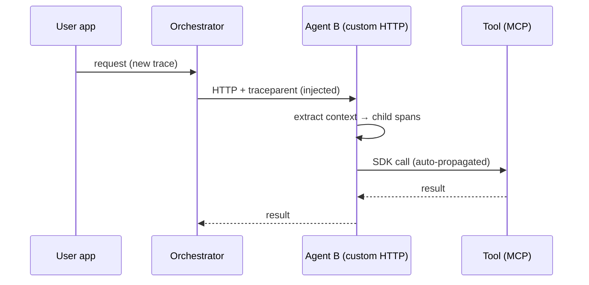
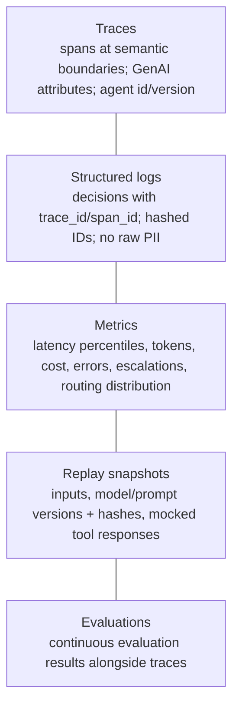

# Observability and tracing in Foundry

> AI-500 · D3 Evaluate, optimize, and monitor multi-agent solutions · about 85 min · Study Hub module `v04` ([open the hub](https://claude.ai/artifact/WBg4UvZLizXnza8mbGvMze))

## Why it matters
*Implement tracing in Foundry, including tokens, prompts, correlation IDs, alerting, and execution tracking.* In a multi-agent system one user request fans out across agents, tools and services. Without correlated traces you're debugging a distributed system blindfolded.

## Pre-question (answer before reading)
**Q:** Agent A calls Agent B over a custom HTTP endpoint (not the Foundry SDK). In Application Insights, B's spans show up as a separate trace. Why?

<details><summary>Answer</summary>

Trace context wasn't propagated. Foundry SDK calls propagate W3C trace context automatically, but **custom HTTP calls must inject** `traceparent` on the caller and **extract** it on the callee so B's spans join A's trace.

</details>

## Mental model & story
During a Friday incident, Northwind's on-call engineer saw 34% errors in checkout and six agents' logs, none of them connected. It took four hours to find that the pricing agent's output format had changed.

Afterwards the platform team standardised **OpenTelemetry**. Every agent calls `configure_azure_monitor()`, which reads the Application Insights connection string from the environment. Foundry SDK calls propagate **W3C trace context** automatically; for custom agent-to-agent HTTP calls the caller **injects** `traceparent` and the callee **extracts** it, so one user request becomes one trace across all agents.

They instrument **semantic boundaries**, not every function: agent entry, each LLM call, each tool call, each agent-to-agent call — about 40–60 spans per interaction. Spans carry **GenAI semantic conventions** (`gen_ai.request.model`, `gen_ai.usage.input_tokens`, `gen_ai.usage.output_tokens`, `gen_ai.operation.name`) plus `agent.id` and `agent.version`. Prompt and completion **content** recording is off by default and enabled only in environments where privacy rules allow.

At their volume, keeping every trace was unaffordable, so they moved from 5% **head sampling** (which dropped rare errors) to **tail sampling**: keep 100% of errors, 10% of slow requests (over 5 s) and 1% of successes. Structured JSON logs record **decisions** — routing choice, tool chosen, escalation reason — with `trace_id` and `span_id`, hashed session IDs and no raw personal data.

In Foundry, the project's connected Application Insights resource shows agent traces in the portal's tracing view; the same data powers KQL dashboards and alert rules. Failed requests are automatically captured as **replay snapshots** — inputs, model and prompt versions (with hashes) and mocked tool responses — so engineers can reproduce them safely.

**Where the analogy breaks:** Tracing everything is expensive and can leak data. Content capture (prompts, outputs, tool arguments) is powerful for debugging and dangerous for privacy. Decide per environment what's captured, redact before export, and set retention deliberately.

## Diagrams
**Trace context across agents**



**Observability signals**



## Key points
- **W3C Trace Context**: `traceparent: 00-<32-hex trace-id>-<16-hex parent span-id>-<2-hex flags>` (flags 01 = sampled); `tracestate` for vendor data.
- Foundry SDK/Agent Service calls propagate context automatically; **custom HTTP** between agents must **inject** (caller) and **extract** (callee) with the OpenTelemetry propagator.
- Instrument **semantic boundaries** (agent entry, LLM calls, tool calls, agent-to-agent calls); ~40–60 spans per interaction is healthy; per-function spans add noise and cost.
- **GenAI semantic conventions**: `gen_ai.system`, `gen_ai.request.model`, `gen_ai.usage.input_tokens`, `gen_ai.usage.output_tokens`, `gen_ai.operation.name`; add `agent.id`, `agent.version`, tenant (hashed if needed).
- `configure_azure_monitor()` (azure-monitor-opentelemetry) reads `APPLICATIONINSIGHTS_CONNECTION_STRING`; never hard-code it.
- Foundry tracing: connect Application Insights to the project; traces appear in the Foundry portal and Application Insights; prompt/completion **content recording is opt-in** (enable only where privacy allows).
- **Sampling**: head sampling (`traceidratio`, e.g., 5%) is cheap but drops rare errors; **tail sampling** keeps 100% errors, ~10% slow, ~1% successes — preferred for multi-agent production.
- **Structured logging** schema shared by all agents: timestamp, level, trace_id, span_id, agent_id/version, hashed session ID, operation, model, tokens, latency, status, error code, decision. Log decisions, not conversations.
- **Correlation IDs** link traces, logs, evaluation results, approvals and audit records (and cost meters).
- **Alerting & execution tracking**: alert rules on traces/metrics (latency, errors, token spikes), workflow run tracking, replay capture of failed requests.

## Comparisons
**Head vs tail sampling**

|  | Head sampling | Tail sampling |
|---|---|---|
| Decision time | At trace start | After the trace completes |
| Keeps rare errors? | Only by chance | Yes (100% of errors) |
| Cost | Lowest, simplest | Needs buffering/collector logic |
| Best for | Low-risk, high-volume dev/test | Production multi-agent systems |

## Code to recognise
**OpenTelemetry for agents: setup, GenAI attributes and manual propagation**

```python
from azure.monitor.opentelemetry import configure_azure_monitor
from opentelemetry import trace
from opentelemetry.trace.propagation.tracecontext import TraceContextTextMapPropagator

configure_azure_monitor()                      # reads APPLICATIONINSIGHTS_CONNECTION_STRING
tracer = trace.get_tracer("claims-orchestrator")
prop = TraceContextTextMapPropagator()

def call_agent_b(payload):
    with tracer.start_as_current_span("agent.call claims-verifier") as span:
        span.set_attribute("agent.id", "claims-orchestrator")
        span.set_attribute("agent.version", "3.2.0")
        headers = {}
        prop.inject(headers)                   # adds traceparent
        return http.post(VERIFIER_URL, json=payload, headers=headers)

# In agent B (callee):
def handle(request):
    ctx = prop.extract(request.headers)        # continue the caller's trace
    with tracer.start_as_current_span("agent.handle claims-verifier", context=ctx) as span:
        resp = llm_call(request.json())
        span.set_attribute("gen_ai.request.model", "gpt-5.4")
        span.set_attribute("gen_ai.usage.input_tokens", resp.usage.input_tokens)
        span.set_attribute("gen_ai.usage.output_tokens", resp.usage.output_tokens)
        return resp
```

- Line 5: The Azure Monitor distro configures exporters from the connection string environment variable.
- Line 10: A span per semantic boundary: here an agent-to-agent call.
- Line 11: Agent identity and version on every span enable per-agent analysis and regressions by version.
- Line 14: Custom HTTP calls need manual injection of `traceparent`.
- Line 19: The callee extracts the context so its spans join the same trace.
- Line 22: GenAI semantic convention attributes record model and token usage.

## Portal steps
**Enable tracing for a Foundry project** (Foundry > Operate/Observability > Tracing)

1. Connect (or create) an Application Insights resource for the project.
2. Instrument your app/agents with OpenTelemetry (Azure Monitor distro or Foundry/OpenAI instrumentors).
3. Decide content recording per environment (off by default; on only where allowed).
4. View traces in the Foundry portal and in Application Insights (transaction search, Agents view).
5. Create alert rules and workbooks from the same telemetry.

## Worked example
**Scenario:** A support system uses five agents; traces are fragmented, logs have no common IDs, and storage costs doubled after enabling 100% tracing. Fix it.

- Fragmented traces → propagate context, especially custom HTTP calls.
- No common IDs → shared structured log schema with trace/span IDs.
- Cost → sampling strategy that keeps what matters.

**Answer:** Propagate **W3C trace context** (inject/extract on custom calls), instrument only semantic boundaries with **GenAI attributes** and agent id/version, adopt a **shared JSON log schema** with trace_id/span_id and hashed IDs, and switch to **tail sampling** (100% errors, ~10% slow, ~1% success); capture **replay snapshots** for failures.

## Your turn (faded example)
**Scenario:** Privacy officers object to prompts and completions being stored in Application Insights in production.

- Content recording is optional.
- **What do you change?** <details><summary>answer</summary>Disable GenAI content recording in production (keep metadata: model, tokens, latency, status).</details>
- **How do engineers still debug failures?** <details><summary>answer</summary>Replay snapshots with redacted inputs in a restricted store, plus decision logs; enable content capture only in non-production or under controlled break-glass procedures.</details>

## Exam traps & misconceptions
- ✗ Assuming custom HTTP calls propagate trace context automatically. → ✓ Inject on the caller, extract on the callee.
- ✗ A span for every function. → ✓ Instrument semantic boundaries; 40–60 spans per interaction.
- ✗ Head sampling 5% in production multi-agent systems. → ✓ Rare errors vanish; prefer tail sampling.
- ✗ Logging full conversations. → ✓ Log decisions and metadata; hash/redact PII.
- ✗ Hard-coding the Application Insights connection string. → ✓ Read it from the environment/Key Vault.

## Discussion prompts
- **What should a replay snapshot contain to be useful and safe?** The exact inputs (redacted where required), model deployment and version, prompt text hash, tool responses as structure-preserving mocks, and the trace timeline — stored with restricted access and replayed in an isolated environment with no production writes.
- **How do you correlate cost with traces?** Record tokens on spans and emit metrics with agent, tenant and operation dimensions; join with APIM token metrics and Cost Management to attribute spend per agent and tenant.

## Interview angle / teach-back
**Prompt:** Explain how you'd implement tracing and observability for a multi-agent system in Foundry.

**Rubric:** OpenTelemetry + configure_azure_monitor; App Insights connected to the project · W3C trace context; inject/extract on custom calls · Semantic-boundary spans with GenAI attributes + agent id/version · Tail sampling; content recording decisions · Structured decision logs with correlation IDs; replay snapshots; alerts

**Model answer:** Every agent uses OpenTelemetry with the Azure Monitor exporter configured from the environment, and the Foundry project is connected to Application Insights. W3C trace context flows automatically through SDK calls, and I inject and extract traceparent on any custom agent-to-agent HTTP call, so one request is one trace. I create spans at semantic boundaries — agent entry, LLM calls, tool calls, agent calls — with GenAI token and model attributes plus agent id and version. Production uses tail sampling (all errors, some slow, few successes), content recording only where privacy allows, shared JSON decision logs with trace and span IDs, replay snapshots of failures, and alerts on latency, errors and token spikes.

## Quick Q&A
- **traceparent format?** `00-<trace-id 32 hex>-<span-id 16 hex>-<flags>`.
- **Custom HTTP propagation?** Inject on caller, extract on callee.
- **Healthy span count?** ~40–60 per interaction.
- **Token attributes?** `gen_ai.usage.input_tokens` / `output_tokens`.
- **Tail sampling policy?** 100% errors, ~10% slow, ~1% success.
- **Connection string source?** `APPLICATIONINSIGHTS_CONNECTION_STRING` (not code).
- **Content recording default?** Off; opt-in per environment.

## Sources (accessed 2026-10-02)
- [Set up tracing in Microsoft Foundry](https://learn.microsoft.com/en-us/azure/foundry/observability/how-to/trace-agent-setup)
- [Azure Monitor OpenTelemetry distro (Python)](https://learn.microsoft.com/en-us/azure/azure-monitor/app/opentelemetry-enable?tabs=python)
- [OpenTelemetry GenAI semantic conventions](https://github.com/open-telemetry/semantic-conventions-genai)
- [W3C Trace Context](https://www.w3.org/TR/trace-context/)

## SRS cards created
- ai-500-v04-01, ai-500-v04-02, ai-500-v04-03, ai-500-v04-04
