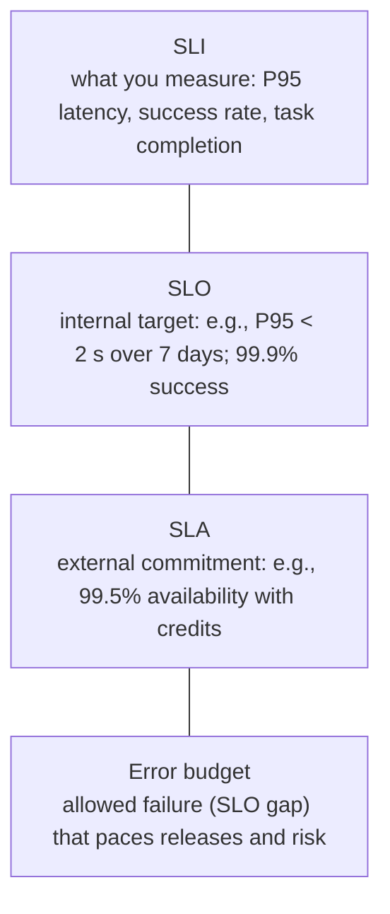
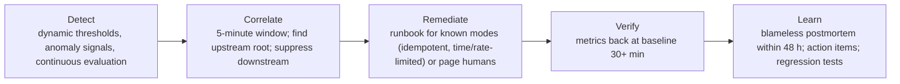

# Reliability, SLA and cost monitoring with automated remediation

> AI-500 · D3 Evaluate, optimize, and monitor multi-agent solutions · about 90 min · Study Hub module `v05` ([open the hub](https://claude.ai/artifact/WBg4UvZLizXnza8mbGvMze))

## Why it matters
Three monitoring skills: *reliability* (agent health, workflow failures, drift, regression, remediation), *availability and SLA adherence*, and *cost* (usage, quotas, allocations, chargebacks). The exam pairs them with incidents: an alert storm, a token explosion, a model upgrade gone wrong.

## Pre-question (answer before reading)
**Q:** At 03:15 a model deployment was upgraded. By 09:00 checkout errors are 34.5% (from 1.2%), and alerts fired for eleven services. How do you avoid eleven pages and find the cause fast?

<details><summary>Answer</summary>

**Correlate alerts** in a time window (e.g., 5 minutes), identify the upstream root and **suppress downstream** alerts; then follow the hypothesis order — **model deployment change first** — using traces comparing failed vs successful requests and replay with the old and new versions.

</details>

## Mental model & story
The 03:15 upgrade at Northwind made the pricing agent's output more verbose. The extra text pushed the price out of the truncated context, the payment API received `"$99.99"` instead of `99.99`, and checkouts failed. Failed traces took 3,200 ms in the pricing agent versus 450 ms normally.

The postmortem produced a monitoring strategy. **Health**: per-agent error rate, latency percentiles and heartbeats. **Baselines**: 14-day rolling, by hour of day and day of week, with **dynamic thresholds** (start at medium sensitivity, the default). **Multi-agent anomaly signals**: routing drift (the orchestrator's distribution shifts), latency spikes, **token explosions** (possible injection or loops), escalation surges, tool error bursts. **Quality drift**: continuous evaluation on sampled traffic with 7-day rolling averages.

**Alert hygiene**: anomalies within five minutes are grouped, the upstream root is identified and downstream alerts suppressed. Severities map to SLOs: **P1** threatens the SLA (page, acknowledge in 5 minutes), **P2** puts an SLO at risk (30 minutes), **P3** early warning (next business day), **P4** leading indicators (backlog).

**Automated remediation** handles *known* failure modes only: a token spike over 3σ on one agent applies a rate limit and opens its circuit; a gateway failure fails over after three health checks and a $1 test transaction — 45 minutes manual became under 2 minutes. Runbooks are idempotent, time-limited, rate-limited and logged; novel failures go to humans with an Incident Commander, Technical Lead and Communications Lead.

**Cost**: tokens are metered per agent and tenant (OpenTelemetry metrics and API Management token metrics), quotas enforced per tenant at the gateway, budgets and alerts in Cost Management, and monthly **showback** turned into **chargeback** for the two largest business units. Unit economics — cost per resolved task — became a release metric alongside quality.

**Where the analogy breaks:** Monitoring isn't the goal; reliable outcomes are. Too many alerts train people to ignore them (target ~80% genuine), and automated fixes for unknown problems can make outages worse. Review alerts monthly and keep automation to the failure modes you understand.

## Diagrams
**SLI → SLO → SLA → error budget**



**Detect → correlate → remediate → learn**



## Key points
- Reliability signals: per-agent health (errors, latency P50/P95/P99, heartbeats), workflow failure rates, trace correlation, **drift** (routing distribution, quality scores, token usage), **regression** (continuous evaluation, canary comparisons).
- Baselines: rolling 14 days by hour/day; z-scores (2σ warning, 3σ critical); Azure Monitor **dynamic thresholds** sensitivity: **High** (tight thresholds, more alerts), **Medium** (balanced default; start here), **Low** (loose thresholds, fewer alerts).
- Multi-agent anomalies: routing drift, latency spike, **token explosion** (injection or loop), escalation surge, tool error burst.
- Alert correlation: group within ~5 minutes, find the root, suppress downstream; target ~80% genuine alerts; review monthly.
- Separate **operational** workbooks (auto-refresh, last hour) from **analytical** ones (trends over weeks); slice by agent, model, operation, customer tier, error class.
- SLI/SLO/SLA and error budgets; severity P1–P4 tied to SLO/SLA risk; MTTD (< 5 min for P1) and MTTR (< 1 h for P1) targets; incident roles: Incident Commander, Technical Lead, Communications Lead; postmortem within 48 h, blameless.
- **Automated remediation**: action groups → runbooks (Automation, Functions, Logic Apps) for known failure modes; idempotent, time-limited (~5 min), rate-limited (e.g., ≤ 3 restarts/hour), logged; escalate after repeated failure.
- Circuit breakers at the system level (e.g., 40% failures over the last 50 requests → fallback; probe every 30 s).
- Cost: meter tokens per agent/tenant (span attributes, OTel metrics, APIM `llm-emit-token-metric`), enforce quotas (`llm-token-limit` per tenant/app; separate deployments per workload; PTU for steady load), budgets/alerts in Cost Management, **showback vs chargeback**, unit economics (cost per resolved task), Foundry Control Plane cost visibility.
- Incident hypothesis order: model deployment change → prompt regression → tool failure → orchestration logic → configuration change; test via replay and comparisons.

## Comparisons
**Severity levels (example)**

| Severity | Meaning | Response |
|---|---|---|
| P1 | Customer-impacting outage; SLA at risk (e.g., checkout errors > 5%) | Page; ack ≤ 5 min; IC assigned; updates every 30 min |
| P2 | Degraded; SLO at risk (completion down 10–50%) | Ack ≤ 30 min; fix within hours |
| P3 | Minor (one agent slow, < 5% traffic) | Next business day |
| P4 | Leading indicator | Backlog |

**Showback vs chargeback**

|  | Showback | Chargeback |
|---|---|---|
| What | Report costs per team/tenant | Bill costs to teams/tenants |
| Use when | Building awareness, early maturity | Mature metering; accountable budgets |
| Needs | Attribution by agent/tenant | Agreed allocation of shared baseline costs |

## Code to recognise
**KQL: per-agent latency percentiles and token cost by tenant**

```kusto
// P50/P95/P99 latency per agent over the last hour
dependencies
| where timestamp > ago(1h)
| extend agent = tostring(customDimensions["agent.id"])
| summarize p50 = percentile(duration, 50), p95 = percentile(duration, 95),
            p99 = percentile(duration, 99), calls = count() by agent
| order by p95 desc

// Daily input/output tokens per tenant for showback
customMetrics
| where name in ("gen_ai.client.token.usage") and timestamp > ago(30d)
| extend tenant = tostring(customDimensions["tenant.id"]),
         kind = tostring(customDimensions["gen_ai.token.type"])
| summarize tokens = sum(valueSum) by tenant, kind, bin(timestamp, 1d)
```

- Line 2: Dependency telemetry includes outgoing calls (models, tools, agents) with durations.
- Line 4: Custom dimensions carry the agent ID set on spans.
- Line 5: Percentiles, not averages: tails hurt users.
- Line 10: Token usage emitted as metrics (GenAI conventions) enables cost attribution.
- Line 13: Split input vs output tokens: they're priced differently.
- Line 14: Daily totals per tenant feed showback/chargeback reports.

## Portal steps
**Set up alerts and remediation** (Azure Monitor > Alerts / Action groups / Workbooks)

1. Create metric/log alerts with dynamic thresholds (medium sensitivity) for latency, errors, tokens, escalations per agent.
2. Group related alerts (alert processing rules/correlation) to suppress downstream noise.
3. Attach action groups: page for P1, chat for P2, ticket for P3; runbooks for known failure modes.
4. Build an operational workbook (last hour) and an analytical one (weeks).
5. Set Cost Management budgets and alerts per subscription/resource group; review showback monthly.

## Worked example
**Scenario:** A prompt injection campaign makes one agent loop, multiplying its token usage 6× within minutes. Design detection and automated response.

- Token explosion is an anomaly signal.
- Response must be safe and limited to this known mode.
- Humans need to follow up.

**Answer:** Alert on **per-agent token usage > 3σ** above its baseline (dynamic threshold) and on iteration-cap hits; an **automated runbook** applies a rate limit / opens the agent's circuit (fallback to a safe response or human), with idempotent, time-limited, logged actions; page the on-call (P2/P1 by impact), capture **replay snapshots** of offending requests, and add them to red-team and regression suites.

## Your turn (faded example)
**Scenario:** On-call engineers receive 120 alerts a night; 70% need no action.

- Alert fatigue hides real incidents.
- **What do you change in detection?** <details><summary>answer</summary>Correlate and suppress downstream alerts, tune dynamic-threshold sensitivity, and alert on SLO burn instead of every metric wobble.</details>
- **What's the process fix?** <details><summary>answer</summary>Monthly alert review targeting ~80% genuine alerts; delete or downgrade noisy rules; route P3/P4 to tickets.</details>

## Exam traps & misconceptions
- ✗ Averages on dashboards. → ✓ Use P95/P99 and per-agent slices.
- ✗ Automating remediation for novel failures. → ✓ Automate only known modes; humans handle the novel.
- ✗ Paging for every downstream symptom. → ✓ Correlate, find the root, suppress downstream.
- ✗ Chargeback before reliable metering. → ✓ Start with showback; agree allocation of shared costs.
- ✗ Ignoring model deployment changes in incident triage. → ✓ Check model/prompt/tool/config changes first (hypothesis order).

## Discussion prompts
- **How do error budgets influence agent releases?** If the SLO error budget is nearly spent, freeze risky releases (model upgrades, major prompts), prioritise reliability work, and require extra canary time; with budget left, ship at the normal pace.
- **What belongs in a monthly reliability review?** SLO attainment and budget burn, incidents and postmortem action status, alert precision, top failure clusters, cost per resolved task trend, and drift indicators per agent.

## Interview angle / teach-back
**Prompt:** Describe how you'd monitor reliability, SLAs and cost for a multi-agent system, including automated remediation.

**Rubric:** Health/drift/regression signals incl. routing drift and token explosion · Baselines + dynamic thresholds; correlation and suppression · SLI/SLO/SLA, error budgets, severities, incident roles, postmortems · Runbooks for known modes with safety limits · Cost metering, quotas, budgets, showback/chargeback, unit economics

**Model answer:** I monitor per-agent errors, latency percentiles and heartbeats, workflow failures and drift — routing distribution, token usage and quality from continuous evaluation — against 14-day baselines with dynamic thresholds. Alerts are correlated in a short window so the upstream root pages and downstream symptoms are suppressed. SLIs feed SLOs and the external SLA, with error budgets pacing releases and P1–P4 severities driving response, incident roles and blameless postmortems. Known failure modes trigger idempotent, time- and rate-limited runbooks; novel ones go to people. Cost is metered per agent and tenant from traces and gateway metrics, quotas are enforced at API Management, budgets alert in Cost Management, and showback grows into chargeback with cost per resolved task as a key metric.

## Quick Q&A
- **Dynamic threshold sensitivities?** High (more alerts), Medium (default), Low (fewer alerts).
- **Token explosion suggests?** Prompt injection or a loop.
- **Alert storm fix?** Correlate in ~5 min, suppress downstream.
- **SLO vs SLA?** Internal target vs external commitment.
- **Runbook safety rules?** Idempotent, time-limited, rate-limited, logged.
- **First incident hypothesis?** Model deployment change.
- **Showback vs chargeback?** Report vs bill.

## Sources (accessed 2026-10-02)
- [Dynamic thresholds in Azure Monitor](https://learn.microsoft.com/en-us/azure/azure-monitor/alerts/alerts-dynamic-thresholds)
- [Emit token metrics with API Management](https://learn.microsoft.com/en-us/azure/api-management/llm-emit-token-metric-policy)
- [Cost Management budgets](https://learn.microsoft.com/en-us/azure/cost-management-billing/costs/tutorial-acm-create-budgets)
- [AI-500 module: debug production multi-agent incidents](https://learn.microsoft.com/en-us/training/modules/aaai-debug-production-multi-agent-incidents-azure/)
- [AI-500 unit: design root cause analysis (hypothesis order)](https://learn.microsoft.com/en-us/training/modules/aaai-debug-production-multi-agent-incidents-azure/3-design-root-cause-analysis-agent-failures)

## SRS cards created
- ai-500-v05-01, ai-500-v05-02, ai-500-v05-03, ai-500-v05-04
