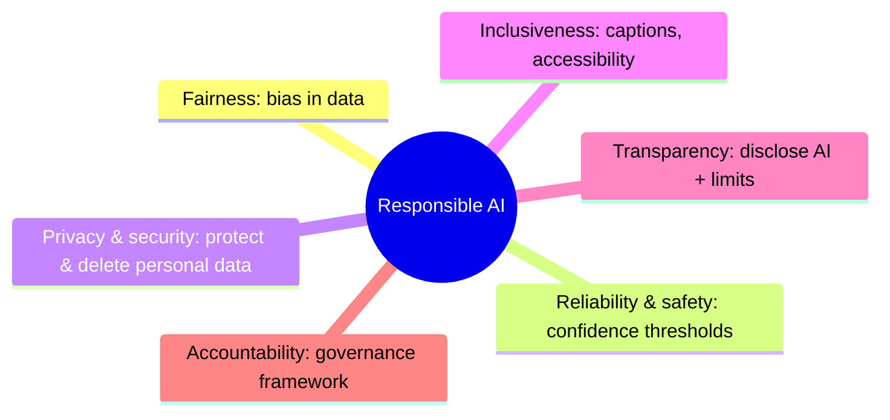

# Responsible AI - six principles

## In one sentence
Responsible AI = guardrails + principles applied from conception → design → implementation → operation, so AI doesn't produce harmful, illegal, or offensive content or actions. Content filters are only ONE tool.

## Mnemonic: "FRIPTA" → **F**airness, **R**eliability & safety, **I**nclusiveness, **P**rivacy & security, **T**ransparency, **A**ccountability

| Principle | Core idea (Learn wording) | Learn example | Trigger words in a question |
|---|---|---|---|
| Fairness | Training data chosen by humans can carry unconscious **bias** → discriminatory output. Minimize bias, test for fairness | College admissions AI must not discriminate on irrelevant demographics | bias, discriminate, gender/age/race, equal treatment, loan approval for groups |
| Reliability & safety | AI is **probabilistic**, not infallible → mitigate risk | Robot uses **confidence threshold**; no action if below threshold | confidence score, threshold, harm, damage, edge cases, testing, failure |
| Privacy & security | Training data may contain personal info; keep it secure; model must not leak private details | Airport face ID deletes images when no longer needed; restrict who can view | personal data, delete, retain, leak, encrypt, access |
| Inclusiveness | Benefits open to everyone; don't exclude users | Speech agent also gives **text captions** for hearing-impaired users | disability, accessibility, captions, languages, all users |
| Transparency | Users know how it works + limitations | Bank discloses AI is used for loans + describes training data features | disclose, explain, limitations, "users should know", model card |
| Accountability | People/orgs are accountable → governance framework | Org defines governance to apply principles | governance, oversight, who is responsible, audit, human review policy |

## Diagram

## Foundry features that implement them (practical twist)
- Guardrails/content filters (Azure AI Content Safety): 4 harm categories **Hate & fairness, Sexual, Violence, Self-harm**, severity **safe/low/medium/high**; applied to **input (prompt) and output (completion)**.
- Prompt Shields → jailbreak (user prompt attack) + indirect attack (injected via documents). Protected material (text/code). Groundedness detection.
- Filtered prompt → HTTP 400 `content_filter`; filtered completion → `finish_reason: "content_filter"`.
- Evaluators (safety evaluators) **detect & score** - they don't fix.
- Least-privilege RBAC, Key Vault, managed identity → privacy & security.

## Exam traps
- "Captions for deaf users" = **Inclusiveness**, not transparency.
- "Confidence threshold before acting" = **Reliability & safety**.
- "Tell users an AI made the decision" = **Transparency**.
- "Who is answerable / governance board" = **Accountability**.
- "Delete biometric data after use" = **Privacy & security**.
- Biased training data = **Fairness** (even if the scenario is about a loan).

## Interview angle
30-sec: "Microsoft frames responsible AI as six principles... in Foundry I'd apply them with content filters, prompt shields, evaluations, RBAC and transparency notes."

## SRS cards
ai901-rai-01..04
