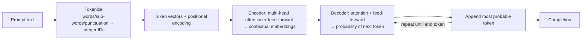

# How generative AI / LLMs work

## In one sentence
An LLM is "super-powerful predictive text": it turns your **prompt** into **tokens**, converts them to **embeddings** using **attention** in a **transformer**, and predicts the most probable **next token** again and again to build a **completion**.

## Story (the librarian who read the internet)
A librarian read billions of pages. She never memorised sentences; she learned which words *keep company* with which (dog ~ puppy ~ bark; nowhere near skateboard). When you start a sentence "When my dog was a…", she weighs every earlier word (attention: "dog" matters more than "a") and says the likeliest next word - "puppy" - then repeats until she decides the sentence is over.
**Where the analogy breaks:** she doesn't *look up* facts - she generates. That's why she can sound confident and be wrong (hallucination) → we ground her with RAG.

## Pipeline

## Key points
- **Tokens**: words, sub-words ("un" in "unbelievable"), punctuation, common sequences. Each gets a unique integer ID. Modern vocabularies: hundreds of thousands of tokens. Repeated word → same ID.
- **Embeddings**: vectors (arrays of numbers) encoding linguistic/semantic meaning. Similar meaning → similar **direction** (measured by **cosine similarity**). Real models: thousands of dimensions.
- **Positional encoding**: order matters → each token vector also carries its position.
- **Attention**: weights how much each surrounding token influences a token ("bark" ← "heard", "dog" high; "I", "a" low). **Multi-head attention** evaluates different vector elements **in parallel**.
- **Masked attention** (training): future tokens hidden so the model predicts the next token and compares with the known answer → adjust weights to reduce error.
- **Encoder** builds embeddings; **decoder** predicts the next token.
- **LLM vs SLM**: LLMs generalize broadly but cost more to train/use; SLMs fit focused topics, local/device scenarios (e.g., Phi).
- **Generative AI** creates new content: text, images, video, code. Users interact via **prompts**.
- Common GenAI uses: chatbots, assistants, drafting content, translation, summarizing/explaining documents.

## Comparison
| | Traditional ML classifier | LLM |
|---|---|---|
| Output | A label/number | New text (tokens) |
| Training | Labeled task data | Massive unlabeled text (self-supervised next-token) |
| Use | One task | Many tasks via prompts |

## Exam traps
- Tokens ≠ words (sub-words, punctuation).
- Embeddings capture meaning via **direction/closeness**, not alphabetical order.
- Attention = context weighting; multi-head = parallel.
- "Model looks up answers in a database" → FALSE (it generates).
- Fine-tuning changes weights; RAG/prompts do not.

## SRS cards
ai901-gen-01..04
