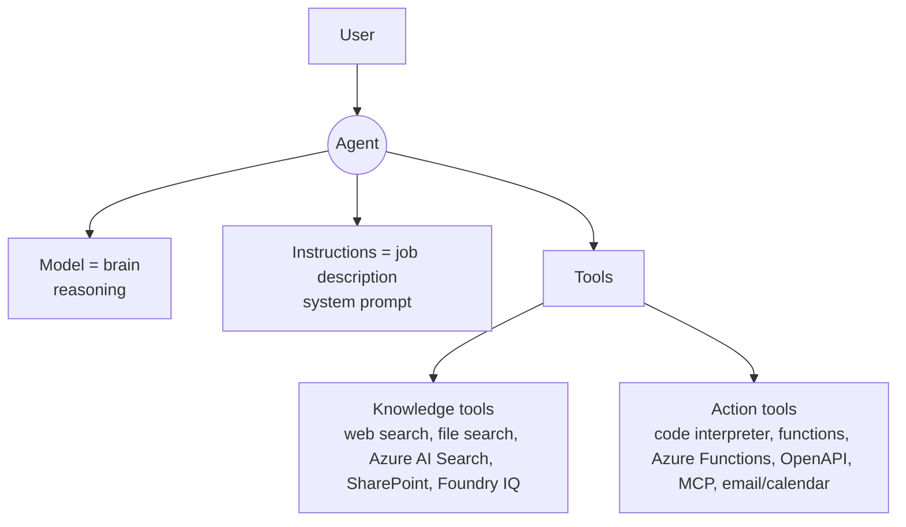

# Prompts, grounding and AI agents

## Prompts
| | System prompt (instructions) | User prompt |
|---|---|---|
| Who writes it | The **application/developer** | The end user (or app on user's behalf) |
| Purpose | Behaviour, tone, role, constraints, tools, guardrails | A specific question/instruction |
| Example | "You're a helpful, step-by-step tutor. Cite sources. Decline medical advice." | "Where should I travel?" |
| In Foundry | **Instructions** box in playground / agent | Chat box |

- **Completion** = the model's response.
- **Conversation history**: the app re-sends previous prompts + responses (often summarized) with each new prompt, so "What are common privacy risks?" is understood in context. Model itself is **stateless**. "New chat" in the playground clears history.
- **Prompt-engineering tips (Learn's 4)**: be clear & specific · add context (topic, **audience**, format) · use **examples** (one-/few-shot) · ask for **structure** (bullets, table, max 6 bullets, tone).
- **Grounding / RAG**: retrieve relevant data (e.g., expense policy) and add it to the prompt → specific, accurate, citable answer.

## Agents = Model + Instructions + Tools

- Agents reason over natural language, **automate tasks using tools**, respond to context, keep working memory in a conversation, break goals into steps.
- **Tools = actions; Knowledge = context.**
- **Multi-agent systems**: specialised agents (gather → analyze → act) talk to each other via prompts; orchestration decides who does what.
- Models vs agents: **models = raw intelligence** (prompt in, output out); **agents = packaged, task-oriented workers**.

## In the Foundry portal (lab 02a - practical)
1. Discover → Models → deploy `gpt-5-mini` (default settings) → playground opens.
2. Chat; **New chat** removes history.
3. Edit **Instructions** (system prompt) → off-topic questions get refused.
4. **Tools → Add → Web search** → real-time results with citations.
5. Upload a file (e.g., .docx) → creates an **index / vector store** → attach → **file search** grounds answers.
6. **Save as agent** (name it) → agent playground → **YAML** tab shows model, params, instructions, tools (web_search, file_search), vector store ID.
7. **Publish → Preview web app**; **</> Continue in code** shows Python using `AIProjectClient` + `DefaultAzureCredential` + `get_openai_client()` + Responses API with `extra_body` agent reference.
8. Agent/project endpoint auth = **Microsoft Entra ID** (key auth not supported for the project/agent API).
9. Clean up: delete the **resource group**.

## Tool catalog (knowledge vs action)
Knowledge: Web search (Bing grounding, citations) · File search (uploaded files, vector search) · Azure AI Search (existing index) · SharePoint · Foundry IQ knowledge base · Fabric data agent.
Action: Code interpreter (Python sandbox, data analysis, charts, files) · Function calling (app-side execution) · Azure Functions · OpenAPI 3.x tool · MCP server · A2A (agent-to-agent) · Image generation · Browser automation · Computer use.

## Exam traps
- Put persona/constraints in the **system prompt**, not the user prompt or deployment settings.
- Need current events → **web search tool**; need private docs → **file search / knowledge**; need calculation/charts on a CSV → **code interpreter**; need to call your own API → **function / OpenAPI / MCP**.
- "Agent remembers earlier turns" → the conversation/thread is sent; model weights don't change.

## SRS cards
ai901-pa-01..05
