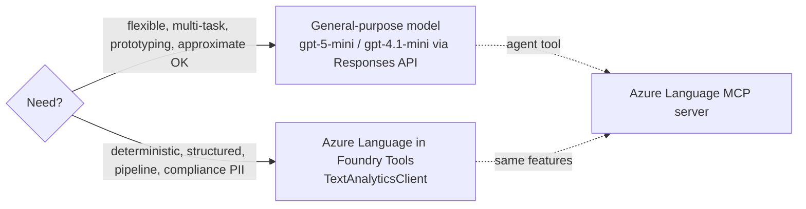

# NLP and text analysis

## Text analysis tasks (what the exam names)
| Task | What it returns | Example |
|---|---|---|
| Language detection | language name, ISO 639-1 code, confidence 0-1 | "¡Hola!..." → Spanish, es, 1.00 |
| Sentiment analysis (+ opinion mining) | positive/negative/neutral per sentence + document | review → strongly positive |
| Key phrase / keyword extraction | main concepts | "mushroom risotto", "waiter" |
| Entity detection (NER) | Person, Location, Organization, DateTime(Date/Time/Duration), Quantity(Percentage/Number/Dimension) | "Microsoft" → Organization |
| Entity linking | known entity + Wikipedia link | "Seattle" → wiki link |
| PII detection & redaction | Person, phone, email, address, PHI; `redacted_text` | "Maria Garcia" → ******* |
| Summarization | extractive (pick sentences) or abstractive (new wording) | 50-page doc → paragraph |
| Classification | user/custom categories (incl. spam) | ticket → "billing" |

## Text pre-processing (concept questions)
- **Tokenization**: split into tokens ("We choose to go to the moon" → 7 tokens; "to" twice).
- **Normalization**: lowercase + strip punctuation → helps frequency counts but can lose meaning ("Mr Banks" vs "banks").
- **Stop-word removal**: drop "the, a, it".
- **N-grams**: unigram "intelligence", bigram "artificial intelligence", trigram "natural language processing".
- **Stemming**: chop endings → "powering, powered, powerful" → "power" (may not be a real word).
- **Lemmatization**: dictionary form with linguistic rules → "running" → "run" (always valid word).
- **POS tagging**: noun/verb/adjective labels using context.
- **Corpus** = body of text analysed.

## Statistical techniques
- **Frequency analysis**: count normalized tokens → main topic; bad at telling documents apart.
- **TF-IDF** = tf(t,d) × log(N/df(t)). High = frequent in THIS doc, rare in others. Word in every doc → log(N/N)=0.
- **Bag-of-words**: word-count vector, ignores order/grammar → **Naive Bayes** classifier (spam: "miracle cure"), sentiment.
- **TextRank**: graph of sentences (edges = similarity), PageRank-style, damping 0.85 → **extractive** summary; word-level for keywords.
- Extractive vs **abstractive** summarization (abstractive generates new text - LLM era).

## Semantic models
- Word2Vec / GloVe (early dense vectors) → attention-based **contextual embeddings** (GPT family).
- **Cosine similarity** = (A·B)/(|A||B|); dog vs cat 0.992 (similar), dog vs tree 0.333 → "tree" is odd one out.
- Vector arithmetic: dog + young ≈ puppy; kitten − puppy + dog ≈ cat (analogies). Use nearest vector, rarely exact.
- Uses: extractive summarization (central sentence vectors), keyword extraction, NER (fine-tuned), classification (document vector vs class prototypes).

## In Foundry: two approaches

- Azure Language = purpose-built analyzers, **statistical techniques**, **structured deterministic output**. Portal: Build → Models/Services → **AI services** tab (e.g., "Azure Language - Language detection", "Text PII Redaction").
- LLM output depends on how the prompt is phrased.
- Language features now (docs): core = PII, language detection, NER, custom NER, Text Analytics for health; legacy-but-supported = CLU, custom text classification, entity linking, key phrase, orchestration, question answering, sentiment/opinion mining, summarization. **Translation is the separate Translator service**.

## SDK (memorize shape)
```python
# pip install azure-ai-textanalytics
from azure.core.credentials import AzureKeyCredential
from azure.ai.textanalytics import TextAnalyticsClient
client = TextAnalyticsClient(endpoint=endpoint, credential=AzureKeyCredential(key))
r = client.detect_language([text])[0]
r.primary_language.name, r.primary_language.iso6391_name, r.primary_language.confidence_score
p = client.recognize_pii_entities([text])[0]
p.redacted_text; [ (e.text, e.category, e.confidence_score) for e in p.entities ]
# others: analyze_sentiment, extract_key_phrases, recognize_entities, recognize_linked_entities, begin_analyze_actions
```
- Input is a **list** of documents; results come back in order; check `doc.is_error`.
- Endpoint style: `https://<resource>.cognitiveservices.azure.com/`.

## MCP (Model Context Protocol)
- Open standard: **MCP client** (agent/host) ↔ **MCP server** (exposes tools/data). Universal adapter, agent discovers tools.
- **Azure Language MCP server**: managed; exposes NER, sentiment, language detection, PII... Add in agent playground Tools → search "Azure Language in Foundry Tools" → enter **Foundry resource name**. No separate Language resource needed; no auth tokens in agent code.

## Exam traps
- Stemming vs lemmatization (valid dictionary word = lemmatization).
- TF-IDF of a word in every document = 0.
- "Consistent, repeatable, structured results for an automated pipeline" → Azure Language, not an LLM.
- PII redaction → `recognize_pii_entities` → `redacted_text`.
- Translation ≠ Azure Language.

## SRS cards
ai901-nlp-01..06
