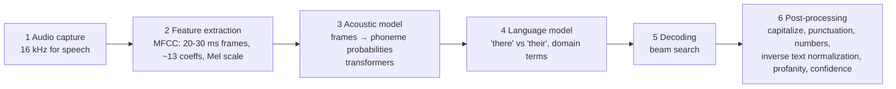
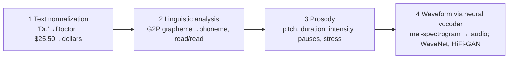

# Speech

## Two capabilities
- **Speech recognition = speech-to-text (STT)**: AI "hears". Captions, call/meeting transcripts, dictation, voice commands.
- **Speech synthesis = text-to-speech (TTS)**: AI "speaks". Voice replies, read-aloud accessibility, announcements, GPS, e-learning narration, game voices.
- Both together: voice bots, **IVR**, language-learning feedback, in-car assistants, **speech translation**.

## STT pipeline (6 stages)

- Phoneme = smallest sound unit (English ≈ 44). Acoustic model = audio→phonemes; language model = phonemes→words.
- Inverse text normalization: "three p m" → "3 PM". Azure returns word timestamps + confidence.

## TTS pipeline (4 stages)

- Robotic voice usually = flat **prosody**, not wrong phonemes. Neural voices fix intonation. SSML tunes pitch/rate/volume/pronunciation.

## Azure Speech in Foundry Tools
- Playground: Build → Models → **AI services** → "Azure Speech - Speech to Text" (upload/record) and "Text to Speech" (choose voice, speed, pitch).
- Features: real-time STT, **fast transcription**, **batch transcription** (async, SAS URI, best-effort scheduling), custom speech, neural TTS voices, custom neural voice, SSML, TTS **avatar**, **speech translation**, language identification, pronunciation assessment, **Voice Live**.
- Real-time vs batch: live captions → real-time; archive of recordings in storage → batch.

## SDK shape (pip install azure-cognitiveservices-speech)
```python
import azure.cognitiveservices.speech as speechsdk
cfg = speechsdk.SpeechConfig(subscription=KEY, endpoint=ENDPOINT)
# STT
audio = speechsdk.audio.AudioConfig(use_default_microphone=True)   # or filename="audiofile.wav"
rec = speechsdk.SpeechRecognizer(speech_config=cfg, audio_config=audio)
result = rec.recognize_once()            # single utterance; .text
rec.start_continuous_recognition()       # events: recognizing (partial) / recognized (final)
# TTS
cfg.speech_synthesis_voice_name = 'en-US-Ava:DragonHDLatestNeural'
out = speechsdk.audio.AudioOutputConfig(use_default_speaker=True)
syn = speechsdk.SpeechSynthesizer(speech_config=cfg, audio_config=out)
r = syn.speak_text_async(text).get()     # ResultReason.SynthesizingAudioCompleted / Canceled
```
- Recognizer ⇢ input (`AudioConfig`); Synthesizer ⇢ output (`AudioOutputConfig`).
- Auth: key or Microsoft Entra ID.

## Voice Live
- Fully managed **speech-to-speech** API: STT + generative model reasoning + TTS in one service (vs wiring 3 services). Uses a **generative AI model you choose** + Azure acoustic models. Can return avatars, trigger actions, handles interruptions; proactive engagement setting.
- In Foundry: enable **Voice mode** on an agent → Start session → Listening → Processing → Speaking; **cc** shows transcript. `pip install azure-ai-voicelive` (+ pyaudio, azure-identity).

## "Respond to spoken prompts with a deployed multimodal model"
- Audio-capable models (e.g., `gpt-4o-audio-preview`, `gpt-4o-mini-audio-preview`, `gpt-realtime`) accept audio directly: content part `{"type":"input_audio","input_audio":{"data": <base64>, "format":"wav"}}`, `modalities=["text","audio"]`, `audio={"voice":"alloy","format":"wav"}` → reply as text and/or audio (base64).
- Choice: one model hears & answers (multimodal) vs Azure Speech pipeline (STT→LLM→TTS) vs Voice Live (managed real-time).

## Exam traps
- STT = recognition; TTS = synthesis (don't swap).
- Hearing-impaired → captions (STT); visually-impaired → read-aloud (TTS).
- Batch for stored files; real-time for live.
- `speak_text_async(...).get()` - async needs `.get()`.

## SRS cards
ai901-sp-01..05
