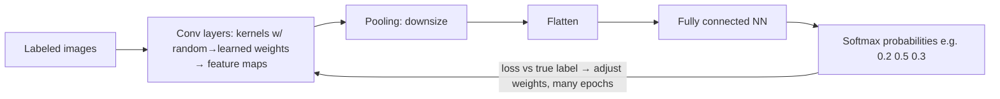

# Computer vision & image generation

## Tasks ladder (each more precise)
| Task | Output | Grocery-checkout example |
|---|---|---|
| Image classification | one label for the main subject | "apple" |
| Object detection | labels + **bounding boxes** (multiple objects) | apple box, banana box |
| Semantic segmentation | label per **pixel** (masks) | exact apple outline |
| Contextual analysis (multimodal) | description, tags, relationships | "a person eating an apple" |
Others: OCR (read text), facial recognition (privacy-sensitive), captioning, visual search.

## Images as numbers
- Grayscale = 2-D array, 0 (black) … 255 (white). Color = 3 channels **R, G, B** (each 0-255). Purple = R150 G0 B255; yellow = R255 G255 B0.
- **Filter kernel** (e.g., 3×3 Laplace `-1 -1 -1 / -1 8 -1 / -1 -1 -1`) **convolved** across image = weighted sums → **edge detection**; also blur/sharpen. Values clipped to 0-255; padding at edges.

## CNN (convolutional neural network)

## Vision transformers & multimodal
- **ViT**: image split into **patches** (like tokens) → embeddings via attention (color, shape, contrast, texture).
- **Multimodal**: language encoder + vision encoder joined by **cross-modal attention** → shared embedding space → captions like "A person in a park with a hat and a backpack".
- **Diffusion** (image generation): start from **random noise**, iteratively **denoise**, compare against prompt each step. Video = same + physics + temporal coherence.

## In Foundry (Domain 2)
- **Vision-enabled models** (GPT-4.1/-mini/-nano, GPT-5.x, partner models): describe images, visual Q&A, charts/screenshots/documents. Playground: **Upload image** + prompt.
- Code (Responses API):
```python
client = OpenAI(api_key=KEY, base_url="https://<res>.openai.azure.com/openai/v1/")
r = client.responses.create(model=DEPLOYMENT, input=[{"role":"user","content":[
  {"type":"input_text","text":"What is in this image?"},
  {"type":"input_image","image_url": url_or_"data:image/jpeg;base64,..."}]}])
print(r.output_text)
```
  Images via **URL or base64** (base64 turns binary into ASCII text for JSON).
- **Image generation models**: **GPT-Image-1.5** (latest, recommended start, editing), GPT-Image-1, **GPT-Image-1-mini** (cheaper/faster), third-party **FLUX** (Black Forest Labs). Portal: Deploy base model → filter Inference tasks "Text to image".
```python
r = client.responses.create(model=IMG_DEPLOYMENT, input=prompt, tools=[{"type":"image_generation"}])
b64 = next(i.result for i in r.output if i.type == "image_generation_call")
# alt: img = client.images.generate(model=..., prompt=..., n=1, size="1024x1024"); img.data[0].b64_json
```
- **Video generation**: **Sora** (text→video, image input) and **Sora 2** (preview: text/image/**video→video remix**, **audio**). Only native video-gen models in Foundry. Params: model, prompt, size "1280x720", seconds "8". **Async job**: POST `/openai/v1/videos` → poll GET `/videos/{id}` until completed → GET `/videos/{id}/content` → mp4. 1-5 min. RAI limits on real people/copyrighted characters.
- Azure Vision Image Analysis 4.0 (captions, dense captions, tags, objects, people, smart crop, read) is **deprecated (retire 2028-09-25)**; Custom Vision-style v4 features retired 2025. Learn path now favors multimodal models.

## Exam traps
- Locate many objects → detection; exact shape/pixels → segmentation.
- Generate an image → image-gen model (GPT-Image/FLUX), not a vision-enabled chat model or OCR.
- Video gen is asynchronous (create → poll → download).
- Multimodal reduces need for separate vision pipelines.

## SRS cards
ai901-cv-01..05
