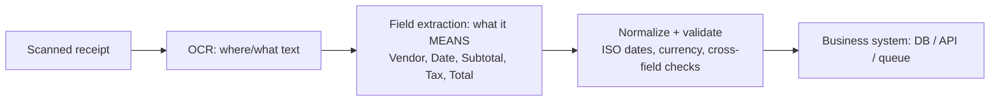

# Information extraction

## In one sentence
Unstructured content (scans, forms, images, audio, video) → **OCR / transcription** finds the text → an **analytical/semantic model maps values to fields** → structured JSON for business systems.

## Concept pipeline

### OCR - 5 stages
1 Image acquisition (photo, scan, video frame, PDF page; quality matters) → 2 Preprocessing (noise reduction, contrast, **skew correction**, resolution) → 3 Text region detection (layout analysis, text blocks, **reading order**, region classification) → 4 Character recognition (features, pattern matching, context via n-grams/LMs, **confidence**) → 5 Output (assemble text, preserve format, **coordinates/bounding boxes**, validation).
OCR reads text but does **not** understand meaning.
### Field extraction - 5 stages
1 Ingest OCR output (text + position + confidence + layout - **position gives context**: "12345" could be invoice no. or phone) → 2 Detect candidates (**template**/regex, **ML**, or **GenAI schema-based** prompts) → 3 Map & associate (key-value pairs by proximity, NER, tables: row/column, headers) → 4 Normalize & validate (dates, currency, required fields, **cross-field**: line items sum to total) → 5 Integrate (schema mapping to DB/API).
### Design choices
- Consistent layouts → template-based; many layouts → ML/GenAI.
- Critical accuracy → **human-in-the-loop**. Sensitive docs → security/compliance. Real-time → latency limits model size. Cloud → scale.
- Microsoft services: **Azure Document Intelligence** and **Azure Content Understanding** (both in Foundry Tools).

## Azure Content Understanding (AI-901 focus)
- Multimodal: **documents/forms, images, audio, video** → structured JSON (markdown + fields + confidence).
- **Analyzer** = reusable unit applying the same extraction logic + **schema** every time → predictable JSON.
- **Schema** = fields you want (supports nested/collections like invoice line items). Applied **semantically**: "Invoice No.", "Invoice #", or unlabeled number → `InvoiceNumber`.
- Field methods: **extract** (value present in content), **generate** (summaries/descriptions), **classify** (pick category / route).
- Prebuilt analyzers (examples): base `prebuilt-document|image|audio|video`; content `prebuilt-read` (OCR), `prebuilt-layout` (structure, tables); RAG `prebuilt-documentSearch|imageSearch|audioSearch|videoSearch`; domain `prebuilt-invoice`, `prebuilt-receipt`, `prebuilt-idDocument`, `prebuilt-contract`, `prebuilt-callCenter`, tax/mortgage...
- Audio: transcript, summary, caller, requested actions, callback number. Video: keyframes/segments, transcript, attendee counts, summary, actions.
- Lab: Read → Layout → **Receipt** analyzer; tabs **Fields / Markdown / Result (JSON)**. Custom field extraction may prompt you to deploy models.
```python
# python -m pip install azure-ai-contentunderstanding
from azure.ai.contentunderstanding import ContentUnderstandingClient
from azure.core.credentials import AzureKeyCredential
client = ContentUnderstandingClient(endpoint=FOUNDRY_ENDPOINT, credential=AzureKeyCredential(KEY))
poller = client.begin_analyze(analyzer_id="prebuilt-invoice", inputs=[{"url": doc_url}])  # LRO
result = poller.result()          # SDK polls for you
for c in result.contents: print(c.markdown, c.fields)  # fields: type, valueString/valueDate, confidence
```
- Endpoint: `https://<resource>.services.ai.azure.com/`. REST: `POST /analyzers/prebuilt-invoice:analyze` then poll Operation-Location.

## Content Understanding vs Document Intelligence (trap)
| | Content Understanding | Document Intelligence |
|---|---|---|
| Inputs | docs, images, **audio, video** | documents/forms |
| Schema | natural-language field descriptions, generative | prebuilt/custom form models |
| Pick when | multimodal, semantic, summaries | classic structured forms |
On AI-901 the blueprint names **Content Understanding** for docs, images, audio and video.

## SRS cards
ai901-ie-01..05
