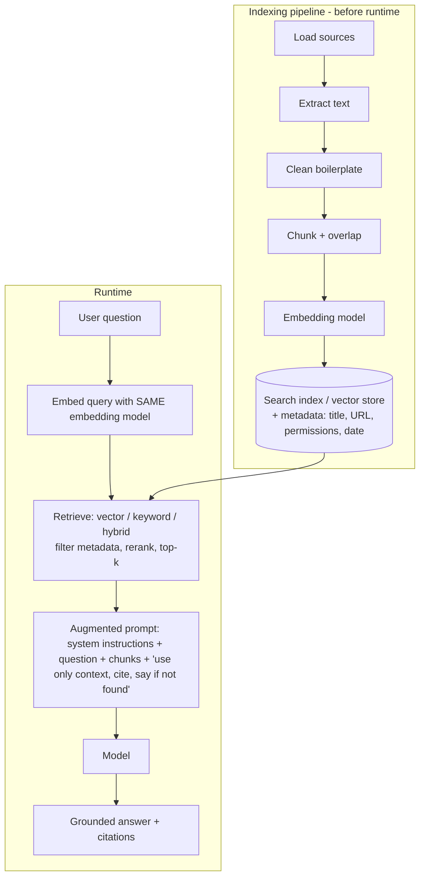

# RAG and Foundry IQ

## Why RAG
LLM limits: **knowledge boundaries** (no private data), **freshness** (stale), **verifiability** (no sources). RAG = **Retrieve** relevant content at runtime + **Augment** the prompt + **Generate** a **grounded** answer with citations. **Does not change model weights** (fine-tuning does). Update docs/index → answers update, no retraining.

## Two pipelines

- Chunks too big → noise, wasted context; too small → lose context. Overlap preserves boundaries. Embeddings ~768-3,072 dims.
- **Keyword** = exact terms (SKUs, codes); **vector** = meaning/paraphrase; **hybrid** = both (best general). Semantic reranking orders best first. **Top-k** = smallest sufficient set.
- Security: treat retrieved text as **data not instructions** (prompt injection); enforce access permissions.
- Maintenance is continuous: add/update/remove content.

## Evaluate RAG
| Retrieval | Generation |
|---|---|
| Relevance, Coverage, Ranking, Security & freshness | **Groundedness** (claims supported by context), Relevance, Completeness, Citation quality, Appropriate uncertainty |
- If retrieval misses the right content, **prompt tweaks won't fix it** → fix sources, chunking, metadata, search strategy, ranking.
- More chunks → better coverage but higher latency/cost, and can dilute focus.
- Test set: realistic Qs + hard cases (ambiguous, no answer, outdated, unauthorized). Re-evaluate when data, model, prompts or retrieval settings change.
- Foundry AI-assisted metrics: groundedness, relevance, coherence, fluency, GPT similarity; classic: accuracy, precision, recall, F1.

## Foundry IQ (managed knowledge layer)
- Built on **Azure AI Search**. Components: **Knowledge base** (domain-level, e.g., "Finance Policies"; controls retrieval behaviour; includes a chat model for agentic retrieval) → **Knowledge sources** (Azure AI Search index, **Azure Blob Storage**, **SharePoint**, **OneLake**, **public web**; also Azure SQL, Work IQ) → **Agentic retrieval** (query planning → sub-queries in parallel → keyword/vector/hybrid search → **semantic reranking** → answer synthesis → citations).
- Automatic chunking, embeddings, metadata extraction; **permission-aware** (user permissions, Purview sensitivity labels).
- Agents connect via **MCP tool** → many agents share one knowledge base (no per-agent RAG pipeline).
- Role: project **managed identity** needs **Search Index Data Reader** on the Azure AI Search resource (Access control (IAM) → Add role assignment → Managed identity).
- Lab settings: Search tier **Basic**; KB name/description; chat completions model; **Retrieval reasoning effort: Low**; **Output mode: Answer synthesis**; answer + retrieval instructions; knowledge source "Upload files"; "Use in an agent".
- Design KB by: scope, authority, freshness, metadata, content quality, access. Don't dump every source into one KB.
- Agent instructions should say: when to retrieve, ground claims, cite, say "I don't know" when missing.
- Test: straightforward, multi-source, ambiguous, out-of-scope, permission-based, **prompt injection**.

## Exam traps
- RAG ≠ fine-tuning. Same embedding model for index and query.
- Exact product codes → keyword (or hybrid); paraphrased questions → vector.
- Groundedness = supported by retrieved content (not "sounds fluent").
- Foundry IQ sits on Azure AI Search; agents reach it through MCP.

## SRS cards
ai901-rag-01..05
