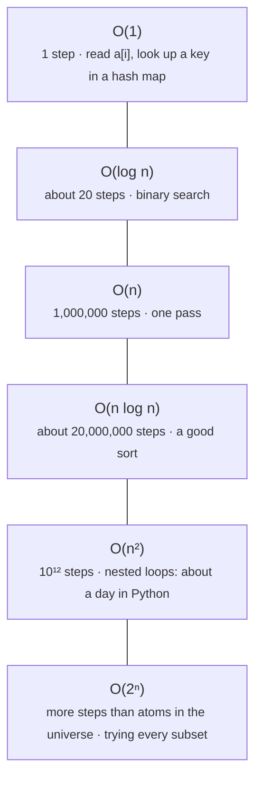
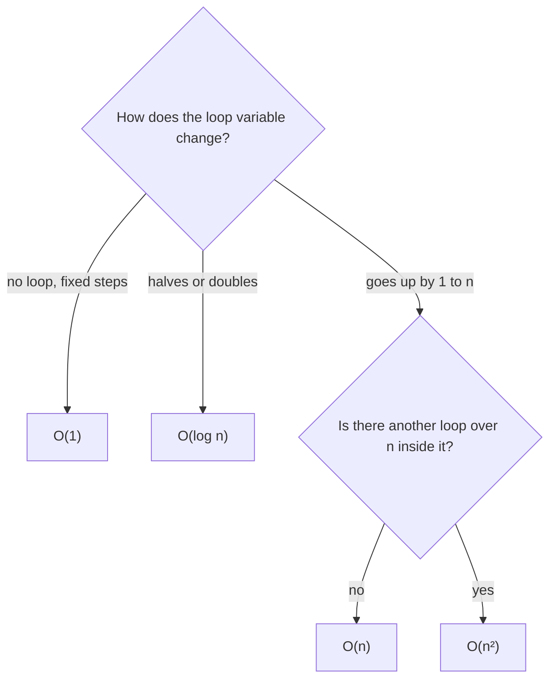

# Big-O: how work grows

> Data Structures & Algorithms · L1 Foundation · Analysis: Big-O · about 75 min · hub module `m01` ([open the hub](https://claude.ai/artifact/SWv6N1Uh2oiFNH1mxefcNr))

## Why it matters
A solution that's instant on 10 items can take hours on 10 million. Big-O lets you predict that before you run anything, and every coding interview asks you to state it.

## Pre-question (answer before reading)
**Q:** Doubling the input from 1,000 to 2,000 items makes function A take 2× longer and function B take 4× longer. Which one has a loop inside a loop?

<details><summary>Answer</summary>

B. A loop inside a loop over the same input does n × n work, so doubling n multiplies the work by 4. A makes one pass (O(n)), so doubling n only doubles the time.

</details>

## 🍎 Story time (kid version)
**The toy room and the treasure-map road trip: Tara's toy box**

Tara keeps her toys in one big pile. To find her red car she checks toys one by one: with 10 toys that's quick, with 100 toys it takes ten times longer. Ben keeps his toys in an egg carton with a label on every slot, so he grabs the car in one go, however many toys he has. Then Mum asks them to check whether any two toys are the same. Tara compares every toy with every other toy: 10 toys means about 50 comparisons, 100 toys about 5,000! Big-O is the name for how fast the work grows when the pile grows.

| In the story | In code |
|---|---|
| Checking toys one by one in the pile | O(n): a linear scan |
| Grabbing from a labelled egg-carton slot | O(1): array index or hash lookup |
| Comparing every toy with every other toy | O(n²): a loop inside a loop over the same input |
| How fast the work grows as the pile grows | Big-O: the growth rate, not the exact time |

**Where the story breaks:** Computers do millions of steps a second, so small piles are fast either way: Big-O only matters as n gets large. It also hides constant factors, so for small n a simple O(n²) method can beat an O(n log n) one. That's why real sort routines switch to insertion sort for short runs.

## Key ideas (grown-up version)
- **Big-O describes growth**: how the number of steps grows as the input size n grows. Drop constants and smaller terms: 3n² + 5n + 7 is O(n²).
- **The ladder, slowest-growing first**: O(1) < O(log n) < O(n) < O(n log n) < O(n²) < O(2ⁿ) < O(n!).
- **Read the loops**: one pass is O(n); a loop inside a loop over the same input is O(n²); halving the problem each step is O(log n). Steps one after another **add**, nested steps **multiply**.
- **One line can hide a loop**: `x in my_list`, `arr.includes(x)`, `index`, slicing, `sorted()` and `insert(0, x)` all cost O(n) or more.
- **Worst, average, best**: interviews mean the worst case unless they say otherwise. Hash lookups are quoted as *average* O(1) because collisions can make one lookup O(n).
- **Space complexity** counts the *extra* memory: a set of seen values is O(n); two index variables are O(1); a recursion n calls deep is O(n) stack space.
- **Amortised O(1)**: `list.append` and `arr.push` are O(1) on average because the backing block grows by a multiple when it's full, so the rare O(n) copy is spread over many cheap appends.
- **Let the constraints pick the target**: a judge runs roughly 10⁷–10⁸ simple steps a second (Python at the slow end). n ≤ 10⁵ → aim for O(n log n) or better; n ≤ a few thousand → O(n²) is fine; n ≤ 20 → O(2ⁿ) is fine.

## Diagrams
**Rough step counts at n = 1,000,000**



**Reading the Big-O off the code**



## Comparisons
**Costs you should know by heart**

| Operation | Python | JavaScript | Big-O |
|---|---|---|---|
| Read or write by index | `a[i]` | `a[i]` | O(1) |
| Add or remove at the end | `a.append(x)`, `a.pop()` | `a.push(x)`, `a.pop()` | O(1) amortised |
| Add or remove at the front | `a.insert(0, x)`, `a.pop(0)` | `a.unshift(x)`, `a.shift()` | O(n) |
| Search by value | `x in a`, `a.index(x)` | `a.includes(x)`, `a.indexOf(x)` | O(n) |
| Key in a set or map | `x in s`, `k in d` | `s.has(x)`, `m.has(k)` | O(1) average |
| Copy a slice | `a[i:j]` | `a.slice(i, j)` | O(j − i) |
| Sort | `a.sort()`, `sorted(a)` | `a.sort((x, y) => x - y)` | O(n log n) |

## Code (JavaScript + Python)
### Count the steps: one loop, nested loops, halving
```python
def linear_steps(n):
    steps = 0
    for _ in range(n):          # one pass
        steps += 1
    return steps

def quadratic_steps(n):
    steps = 0
    for _ in range(n):          # a loop ...
        for _ in range(n):      # ... inside a loop
            steps += 1
    return steps

def halving_steps(n):
    steps = 0
    while n > 1:                # halve until one item is left
        n //= 2
        steps += 1
    return steps

for n in (10, 100, 1000):
    print(n, linear_steps(n), quadratic_steps(n), halving_steps(n))
```

Output:
```text
10 10 100 3
100 100 10000 6
1000 1000 1000000 9
```

- line 3: One pass: n steps, so O(n). Ten times the input, ten times the steps.
- line 10: A loop inside a loop over the same n: n × n steps, so O(n²). Ten times the input, a hundred times the steps.
- line 16: Halving until one is left takes about log₂ n steps, so O(log n). Ten times the input adds only about 3 steps.

```javascript
function linearSteps(n) {
  let steps = 0;
  for (let i = 0; i < n; i++) steps++;          // one pass
  return steps;
}

function quadraticSteps(n) {
  let steps = 0;
  for (let i = 0; i < n; i++)                   // a loop ...
    for (let j = 0; j < n; j++) steps++;        // ... inside a loop
  return steps;
}

function halvingSteps(n) {
  let steps = 0;
  while (n > 1) {                               // halve until one item is left
    n = Math.floor(n / 2);
    steps++;
  }
  return steps;
}

for (const n of [10, 100, 1000])
  console.log(n, linearSteps(n), quadraticSteps(n), halvingSteps(n));
```

Output:
```text
10 10 100 3
100 100 10000 6
1000 1000 1000000 9
```

- line 3: One pass: n steps, so O(n).
- line 10: A loop inside a loop over the same n: n × n steps, so O(n²).
- line 17: `Math.floor(n / 2)` is integer halving, the same as Python's `n //= 2`: O(log n).

### Why append is O(1) on average: count the copies
```python
def copies_for(n):
    capacity, size, copies = 1, 0, 0
    for _ in range(n):
        if size == capacity:       # full: move to a block twice as big
            copies += size         # every item already stored is copied once
            capacity *= 2
        size += 1                  # the append itself is O(1)
    return copies

for n in (8, 1000, 1_000_000):
    c = copies_for(n)
    print(n, c, f"{c / n:.2f}")
```

Output:
```text
8 7 0.88
1000 1023 1.02
1000000 1048575 1.05
```

- line 4: Resizes happen at sizes 1, 2, 4, 8, … so they get rarer as the list grows.
- line 12: Copies per append stay below 2 however big n gets: that's what *amortised O(1)* means.

```javascript
function copiesFor(n) {
  let capacity = 1, size = 0, copies = 0;
  for (let i = 0; i < n; i++) {
    if (size === capacity) {       // full: move to a block twice as big
      copies += size;              // every item already stored is copied once
      capacity *= 2;
    }
    size++;                        // the append itself is O(1)
  }
  return copies;
}

for (const n of [8, 1000, 1_000_000]) {
  const c = copiesFor(n);
  console.log(n, c, (c / n).toFixed(2));
}
```

Output:
```text
8 7 0.88
1000 1023 1.02
1000000 1048575 1.05
```

- line 4: Real engines grow by a different multiple (CPython about 1.125×, V8 about 1.5×), but any constant multiple gives amortised O(1).

## Worked example
**Problem.** Count the pairs (i < j) whose values add up to 0. Work out the time and space complexity of the slow version, then of the fast one.

1. Slow version: the outer loop runs n times and the inner loop runs n − 1, n − 2, …, 0 times. That's n(n − 1)/2 checks; drop the ½ and the smaller term: **O(n²) time**.
2. It only keeps a counter and two indexes: **O(1) extra space**.
3. Fast version: one loop of n steps, and each dictionary or `Map` lookup and update is O(1) on average: **O(n) time**.
4. The map can hold up to n different values: **O(n) extra space**. We traded memory for time, the most common trade-off in DSA.

```python
def count_zero_pairs_slow(nums):
    count = 0
    for i in range(len(nums)):              # n iterations
        for j in range(i + 1, len(nums)):   # up to n - 1 each
            if nums[i] + nums[j] == 0:
                count += 1
    return count                            # O(n^2) time, O(1) space

def count_zero_pairs_fast(nums):
    seen = {}                               # value -> times seen so far
    count = 0
    for x in nums:                          # one pass
        count += seen.get(-x, 0)            # pairs with every earlier -x
        seen[x] = seen.get(x, 0) + 1
    return count                            # O(n) time, O(n) space

nums = [3, -3, 2, 0, -2, 3, 0]
print(count_zero_pairs_slow(nums), count_zero_pairs_fast(nums))
```

Output:
```text
4 4
```

```javascript
function countZeroPairsSlow(nums) {
  let count = 0;
  for (let i = 0; i < nums.length; i++)          // n iterations
    for (let j = i + 1; j < nums.length; j++)    // up to n - 1 each
      if (nums[i] + nums[j] === 0) count++;
  return count;                                  // O(n^2) time, O(1) space
}

function countZeroPairsFast(nums) {
  const seen = new Map();                        // value -> times seen so far
  let count = 0;
  for (const x of nums) {                        // one pass
    count += seen.get(-x) ?? 0;                  // pairs with every earlier -x
    seen.set(x, (seen.get(x) ?? 0) + 1);
  }
  return count;                                  // O(n) time, O(n) space
}

const nums = [3, -3, 2, 0, -2, 3, 0];
console.log(countZeroPairsSlow(nums), countZeroPairsFast(nums));
```

Output:
```text
4 4
```

**Answer.** Slow: O(n²) time, O(1) extra space. Fast: O(n) average time, O(n) extra space. For n = 100,000 that's about 5 × 10⁹ checks versus 100,000 map operations. (In JavaScript, `-0` and `0` are the same `Map` key, so the zeros pair up correctly.)

## Your turn (faded example)
**Problem.** What is the time complexity of `mystery(n)`? Predict `mystery(1024)` before you run it.

- ✓ The outer loop doubles `i` (1, 2, 4, 8, …), so it runs about log₂ n times.
- **How many inner steps happen in total for n = 1024? Add up 1 + 2 + 4 + … while i < n.**
  <details><summary>Answer</summary>1 + 2 + 4 + … + 512 = 1023.</details>
- **So is it O(n log n) or O(n)? Why?**
  <details><summary>Answer</summary>O(n). The inner loop runs i times and i doubles, so the total is a geometric series that stays below 2n. “log n outer × n inner” over-counts, because the inner loop is only long near the end.</details>

Starter:
```python
def mystery(n):
    steps = 0
    i = 1
    while i < n:            # i = 1, 2, 4, 8, ...
        for _ in range(i):  # i steps each time
            steps += 1
        i *= 2
    return steps

print(mystery(1024))        # your prediction: ?
```

```javascript
function mystery(n) {
  let steps = 0;
  for (let i = 1; i < n; i *= 2)      // i = 1, 2, 4, 8, ...
    for (let j = 0; j < i; j++)       // i steps each time
      steps++;
  return steps;
}

console.log(mystery(1024));           // your prediction: ?
```

<details><summary>Full solution</summary>

```python
def mystery(n):
    steps = 0
    i = 1
    while i < n:
        for _ in range(i):
            steps += 1
        i *= 2
    return steps

for n in (1024, 1_000_000):
    print(n, mystery(n), 2 * n)     # steps < 2n, so O(n)
```

Output:
```text
1024 1023 2048
1000000 1048575 2000000
```

```javascript
function mystery(n) {
  let steps = 0;
  for (let i = 1; i < n; i *= 2)
    for (let j = 0; j < i; j++)
      steps++;
  return steps;
}

for (const n of [1024, 1_000_000])
  console.log(n, mystery(n), 2 * n);  // steps < 2n, so O(n)
```

Output:
```text
1024 1023 2048
1000000 1048575 2000000
```

</details>

## Socratic checks and quiz (answers hidden)
**1. What does this print?**

```python
count = 0
for i in range(4):
    for j in range(4):
        count += 1
print(count)
```

```javascript
let count = 0;
for (let i = 0; i < 4; i++)
  for (let j = 0; j < 4; j++)
    count++;
console.log(count);
```

- A. 16
- B. 8
- C. 4
- D. 12

<details><summary>Answer</summary>

16. A loop of 4 inside a loop of 4 runs 4 × 4 = 16 times. Nested loops multiply.

</details>

**2. What is the time complexity of `f`?**

```python
def f(a):
    total = 0
    for x in a:
        total += x
    for x in a:
        total -= x
    return total
```

```javascript
function f(a) {
  let total = 0;
  for (const x of a) total += x;
  for (const x of a) total -= x;
  return total;
}
```

- A. O(n)
- B. O(n²)
- C. O(2n), which is slower than O(n)
- D. O(log n)

<details><summary>Answer</summary>

O(n). The loops run one after the other: O(n) + O(n) = O(2n) = O(n). Constants are dropped.

</details>

**3. The constraints say n ≤ 100,000. Your first idea compares every pair of elements. What should you do?**

- A. Look for an O(n log n) or O(n) idea: about 5 × 10⁹ pair checks is far too slow
- B. Submit it: 100,000 is a small number for a computer
- C. Rewrite it in JavaScript, which removes the problem
- D. Add a cache inside the inner loop, which makes any nested loop O(n)

<details><summary>Answer</summary>

Look for an O(n log n) or O(n) idea: about 5 × 10⁹ pair checks is far too slow. n²/2 ≈ 5 × 10⁹ checks. At roughly 10⁷–10⁸ simple steps a second that's about 1 to 8 minutes, far past a typical 1–2 second limit. Changing language changes the constant, not the growth.

</details>

**4. Which of these cost O(n) on a list or array of n items? (choose 3)**

- A. `x in my_list` / `arr.includes(x)`
- B. `my_list.pop(0)` / `arr.shift()`
- C. `my_list.insert(0, x)` / `arr.unshift(x)`
- D. `len(my_list)` / `arr.length`
- E. `my_list[i]` / `arr[i]`

<details><summary>Answer</summary>

`x in my_list` / `arr.includes(x)`, `my_list.pop(0)` / `arr.shift()`, `my_list.insert(0, x)` / `arr.unshift(x)`. Searching by value and adding or removing at the front touch every element. Reading the length and indexing are O(1): the length is stored, and the address of slot i is calculated.

</details>

**5. Judge each statement.**

- 3n² + 100n + 7 is O(n²).
- An O(n log n) algorithm is faster than an O(n²) one for every input size.
- A recursive function that goes n calls deep uses O(n) stack space.
- Big-O tells you the running time in seconds.

<details><summary>Answer</summary>

3n² + 100n + 7 is O(n²).: Yes; An O(n log n) algorithm is faster than an O(n²) one for every input size.: No; A recursive function that goes n calls deep uses O(n) stack space.: Yes; Big-O tells you the running time in seconds.: No. Keep the biggest term. Big-O hides constants, so small inputs can flip the ranking. Every pending call keeps a stack frame. Big-O describes growth, not seconds.

</details>

**6. Put these in order from slowest-growing to fastest-growing.**

- (put the steps in order)

<details><summary>Answer</summary>

O(1) → O(log n) → O(n) → O(n log n) → O(n²) → O(2ⁿ). Learn this ladder by heart: it's how you compare any two solutions.

</details>

**7. What does this print?**

```python
n, steps = 64, 0
while n > 1:
    n //= 2
    steps += 1
print(steps)
```

```javascript
let n = 64, steps = 0;
while (n > 1) {
  n = Math.floor(n / 2);
  steps++;
}
console.log(steps);
```

- A. 6
- B. 64
- C. 32
- D. 7

<details><summary>Answer</summary>

6. 64 → 32 → 16 → 8 → 4 → 2 → 1 is 6 halvings, and log₂ 64 = 6. Halving loops are O(log n).

</details>

**8. Match each code shape to its time complexity.**


<details><summary>Answer</summary>

Read one element by its index = O(1); Cut the remaining range in half each step = O(log n); One loop over the input = O(n); Sort, then one pass = O(n log n); A loop over the input inside another loop over the input = O(n²). Halving gives log n, a single pass gives n, and the sort dominates the pass that follows it.

</details>

## Traps & misconceptions
- **“Two loops means O(n²).”** Only when one is *inside* the other. Two loops one after the other cost O(n) + O(n) = O(n).
- **“O(2n) is slower than O(n).”** Constants are dropped: O(2n) is O(n). Big-O compares how work grows, not exact speed.
- **“`x in my_list` is O(1) because it's one line.”** Membership on a list or array scans the elements: O(n). Only sets and maps give average O(1).
- **“An outer loop that doubles i, with an inner loop of i steps, is O(n log n).”** Add up the inner work: 1 + 2 + 4 + … stays under 2n, so the total is O(n). (A doubling loop *inside* a loop of n really is O(n log n): check which loop is which.)
- **“Space is only the variables I create.”** Recursion uses stack space: n nested calls is O(n) space even without a single list.
- **“O(1) means fast.”** O(1) means the cost doesn't grow with n. A constant-time step can still be slow: one network call is O(1) and takes milliseconds.

## Discussion prompts
- **Your solution is O(n log n) and a colleague's is O(n). When could yours still be the better choice?**
  <details><summary>One good answer</summary>When n is small or capped (constants dominate), when yours is simpler and less error-prone, or when the O(n) one needs O(n) extra memory you can't spare. Big-O is one input to the decision, not the whole decision.</details>
- **Why do we say a hash map lookup is O(1) *on average* instead of just O(1)?**
  <details><summary>One good answer</summary>Collisions: if many keys land in the same bucket, a lookup has to check them all, up to O(n) in the worst case. Good hash functions and resizing keep the average constant.</details>

## Teach-back
**Prompt:** Explain to a junior colleague how to find the Big-O of a function just by reading it, and why we drop constants.

Rubric:
- [ ] Big-O describes how work grows as n grows (worst case unless stated)
- [ ] One pass is O(n), nested loops over the same input are O(n²), halving is O(log n)
- [ ] Steps in sequence add, nested steps multiply; keep only the biggest term
- [ ] Constants are dropped because they don't change the shape of the growth
- [ ] Mentions space complexity, including recursion depth

<details><summary>Model answer</summary>

Big-O tells you how a function's work grows as the input n grows, usually in the worst case. Read the loops: one pass over the input is O(n), a loop inside another loop over the same input is O(n²), and anything that halves the problem each step is O(log n). Steps one after another add, nested steps multiply, and you keep only the fastest-growing term, so 3n² + 5n is O(n²). Constants are dropped because they depend on the machine and the language, not on the shape of the growth. Do the same for memory: extra lists, maps and recursion depth all count.

</details>

## Quick Q&A (also in the SRS deck)
- **What does Big-O describe?** How the work (or memory) grows as the input size n grows, ignoring constants and smaller terms; usually the worst case.
- **Order these from slowest-growing: O(n log n), O(1), O(n²), O(log n), O(n).** O(1) < O(log n) < O(n) < O(n log n) < O(n²).
- **Two loops one after the other over n items: what's the Big-O?** O(n). O(n) + O(n) = O(2n) = O(n). Only nested loops multiply.
- **Why is list append / array push O(1) amortised?** The backing block grows by a multiple when full, so the rare O(n) copies average out to a constant per append.
- **n ≤ 10⁵: which complexities are usually fast enough?** O(n log n) or better. O(n²) would be about 10¹⁰ steps.
- **What does `x in my_list` (Python) or `arr.includes(x)` (JS) cost?** O(n): it scans the elements. Use a set for O(1) average membership.

## Practice problems
- [ ] [LC 268 · Missing Number](https://leetcode.com/problems/missing-number/) · Easy · sort O(n log n) → set O(n) → sum formula O(1) space
- [ ] [LC 136 · Single Number](https://leetcode.com/problems/single-number/) · Easy · hash count O(n) space → XOR O(1) space
- [ ] [LC 169 · Majority Element](https://leetcode.com/problems/majority-element/) · Easy · sort, then count, then the O(1)-space voting trick
- [ ] [LC 231 · Power of Two](https://leetcode.com/problems/power-of-two/) · Easy · halving loop O(log n), then a constant-time bit trick

## Sources (accessed 2026-10-09)
- [Python wiki: TimeComplexity (list, deque, set, dict)](https://wiki.python.org/moin/TimeComplexity)
- [MIT 6.006 Introduction to Algorithms (Spring 2020), lectures 1–2](https://ocw.mit.edu/courses/6-006-introduction-to-algorithms-spring-2020/)
- [MDN: Array (method reference)](https://developer.mozilla.org/en-US/docs/Web/JavaScript/Reference/Global_Objects/Array)
