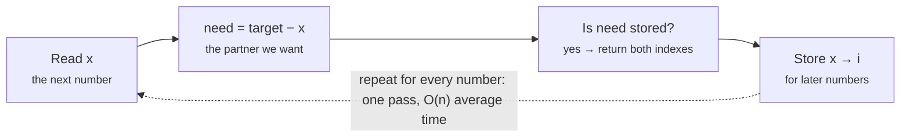

# Hash maps and sets

> Data Structures & Algorithms · L1 Foundation · Arrays, strings, hashing & pointers · about 85 min · hub module `m03` ([open the hub](https://claude.ai/artifact/SWv6N1Uh2oiFNH1mxefcNr))

## Why it matters
Hash maps turn “search the whole list” into “jump straight to it”. They're behind the fastest answer to more interview problems than any other structure: duplicates, counting, Two Sum, anagrams and caching.

## Pre-question (answer before reading)
**Q:** A dictionary holds a million keys. Roughly how many keys does `'zebra' in d` have to look at?

<details><summary>Answer</summary>

Usually one or a handful, not a million. The key is hashed to a number that says which bucket to look in, so lookups take O(1) on average.

</details>

## 🍎 Story time (kid version)
**The toy room and the treasure-map road trip: The cloakroom hooks**

At Ben's party, every coat goes to the cloakroom. The helper doesn't pile them up; she looks at the first letter of the guest's name and hangs the coat on that letter's hook: Ben's on B, Tara's on T. When Tara leaves, the helper goes straight to hook T, with no searching. When two guests share a letter, both coats go on the same hook, and the helper checks the name tags on that hook. If the hooks get crowded, she adds more hooks and rehangs every coat.

| In the story | In code |
|---|---|
| Turning a name into a hook letter | The hash function: key → bucket number |
| Going straight to hook T | Average O(1) lookup, insert and delete |
| Two coats on one hook, told apart by name tags | A collision, resolved by comparing the stored keys |
| Adding hooks and rehanging every coat | Resizing: an O(n) rehash now and then, O(1) amortised |

**Where the story breaks:** A real hash function mixes every character into a big number so keys spread evenly; “first letter” would crowd hook S. And the hooks can't hand you the coats in name order: hash maps keep no sorted order.

## Key ideas (grown-up version)
- **Hash map = key → value with average O(1)** insert, lookup and delete. Python: `dict` and `set`. JavaScript: `Map` and `Set` (plain objects work for string keys but have pitfalls).
- **How it works**: hash(key) → a big number → a bucket (`hash % capacity`). Equal keys must give equal hashes. Collisions are resolved by comparing the stored keys in a chain, or by probing other slots (open addressing, which CPython uses).
- **Resizing keeps buckets short**: when the table gets too full it grows and re-inserts every key. That O(n) step is rare, so operations stay O(1) amortised.
- **Worst case is O(n)** when many keys collide. Say “O(1) on average” in interviews.
- **Keys must be stable**: Python keys must be hashable (`str`, `int`, `tuple`), so use `tuple(sorted(word))` rather than a list. A JavaScript `Map` compares object keys by identity, so build a string key such as `'1,2'` for pairs.
- **Four patterns cover most problems**: seen-before (set), counting (`Counter` / `Map` of counts), complement lookup (Two Sum: is `target − x` stored?), and grouping by a signature (anagrams share their sorted letters).
- **Insertion order, not sorted order**: dicts and Maps remember the order keys were added. Need the smallest key or sorted keys? Sort them (O(k log k)) or use a heap or tree (L2).

## Diagrams
**Eight buckets (made-up hash values): ‘ben’ and ‘bo’ collide in bucket 3**

| bucket | 0 | 1 | 2 | 3 | 4 | 5 | 6 | 7 |
|---|---|---|---|---|---|---|---|---|
| value |  | tara |  | **ben · bo** |  |  | sam |  |

_Looking up ‘bo’ goes straight to bucket 3, then compares the stored keys there. Short buckets keep it O(1) on average._

**Two Sum in one pass**



## Comparisons
**The same hash tools in both languages**

| Need | Python | JavaScript |
|---|---|---|
| Set of seen values | `seen = set()`, `seen.add(x)`, `x in seen` | `const seen = new Set()`, `seen.add(x)`, `seen.has(x)` |
| Key → value | `d = {}`, `d[k] = v`, `d.get(k, 0)` | `const m = new Map()`, `m.set(k, v)`, `m.get(k) ?? 0` |
| Count items | `Counter(items)` | `m.set(x, (m.get(x) ?? 0) + 1)` in a loop |
| Group into lists | `defaultdict(list)`, `groups[key].append(x)` | `if (!m.has(key)) m.set(key, [])`, then `m.get(key).push(x)` |
| Size | `len(d)` | `m.size` |
| Loop over pairs | `for k, v in d.items():` | `for (const [k, v] of m)` |

**JavaScript: Map or plain object?**

|  | `Map` | Plain object `{}` |
|---|---|---|
| Key types | Any value (objects by identity) | Strings and symbols only: numbers become strings |
| Surprise keys | None | Inherited ones such as `toString` and `constructor` |
| Size | `m.size`, O(1) | `Object.keys(o).length`, O(n) |
| Iteration order | Insertion order | Integer-like keys first (ascending), then insertion order |

## Code (JavaScript + Python)
### Counting: the most common letters
```python
from collections import Counter

text = "banana bandana"
counts = Counter(ch for ch in text if ch != " ")
print(counts["a"], counts["n"], counts["z"])      # a missing key counts as 0
print(*[f"{ch}={n}" for ch, n in counts.most_common(2)])
```

Output:
```text
6 4 0
a=6 n=4
```

- line 4: `Counter` is a dict subclass that counts for you: O(n) for n characters.
- line 6: `most_common(k)` sorts by count, largest first.

```javascript
const text = "banana bandana";
const counts = new Map();
for (const ch of text)
  if (ch !== " ") counts.set(ch, (counts.get(ch) ?? 0) + 1);

console.log(counts.get("a"), counts.get("n"), counts.get("z") ?? 0);   // missing -> 0
const top = [...counts].sort((x, y) => y[1] - x[1]).slice(0, 2);
console.log(top.map(([ch, n]) => `${ch}=${n}`).join(" "));
```

Output:
```text
6 4 0
a=6 n=4
```

- line 4: `?? 0` turns a missing key (`undefined`) into 0 before adding 1.
- line 7: Sorting the k distinct letters costs O(k log k), tiny next to the O(n) count.

### Grouping by a signature
```python
from collections import defaultdict

files = ["app.py", "index.js", "utils.py", "README.md", "server.js"]
groups = defaultdict(list)                 # a missing key starts as []
for name in files:
    ext = name.rsplit(".", 1)[1]           # the signature we group by
    groups[ext].append(name)

for ext, names in groups.items():          # insertion order: py, js, md
    print(ext, *names)
```

Output:
```text
py app.py utils.py
js index.js server.js
md README.md
```

- line 6: Swap the signature and the same loop groups anything: anagrams use the sorted letters.

```javascript
const files = ["app.py", "index.js", "utils.py", "README.md", "server.js"];
const groups = new Map();
for (const name of files) {
  const ext = name.slice(name.lastIndexOf(".") + 1);   // the signature we group by
  if (!groups.has(ext)) groups.set(ext, []);
  groups.get(ext).push(name);
}

for (const [ext, names] of groups)                     // insertion order: py, js, md
  console.log(ext, ...names);
```

Output:
```text
py app.py utils.py
js index.js server.js
md README.md
```

- line 4: Swap the signature and the same loop groups anything: anagrams use the sorted letters.

### Key pitfalls in each language
```python
d = {}
d[(1, 2)] = "tuple key"            # tuples are hashable
print(d[(1, 2)])
try:
    d[[1, 2]] = "list key"         # lists are not
except TypeError as e:
    print(type(e).__name__)
print(1 == 1.0, len({1: "a", 1.0: "b"}))   # equal keys share one slot
```

Output:
```text
tuple key
TypeError
True 1
```

- line 5: Lists can change after insertion, so Python refuses them as keys.
- line 8: `1` and `1.0` are equal and hash the same, so they're one key.

```javascript
const m = new Map();
m.set([1, 2], "array key");
console.log(m.get([1, 2]));                // a different array object
m.set("1,2", "string key");
console.log(m.get([1, 2].join(",")));      // build a string key instead
const o = {};
o[1] = "number";
o["1"] = "string";
console.log(Object.keys(o).length);        // object keys become strings
```

Output:
```text
undefined
string key
1
```

- line 3: Map compares object keys by identity: this `[1, 2]` is a brand-new array.
- line 9: Plain objects turn the number 1 into the string '1'.

## Worked example
**Problem.** Given `nums` and `target`, return the indexes of the two numbers that add up to `target` (LeetCode 1, Two Sum). Exactly one answer exists.

1. Brute force checks every pair: O(n²).
2. For each x, the partner we need is `target − x`. “Have I already seen the partner?” is a lookup, so keep a hash map from value to index.
3. Check before you store, so a number can't pair with itself (a single 3 with target 6).
4. One pass: O(n) average time and O(n) extra space.

```python
def two_sum(nums, target):
    seen = {}                          # value -> index where we saw it
    for i, x in enumerate(nums):
        need = target - x
        if need in seen:               # partner already seen?
            return [seen[need], i]
        seen[x] = i                    # store AFTER checking
    return []

for nums, target in (([2, 7, 11, 15], 9), ([3, 2, 4], 6), ([3, 3], 6)):
    print(*two_sum(nums, target))
```

Output:
```text
0 1
1 2
0 1
```

```javascript
function twoSum(nums, target) {
  const seen = new Map();              // value -> index where we saw it
  for (let i = 0; i < nums.length; i++) {
    const need = target - nums[i];
    if (seen.has(need)) return [seen.get(need), i];   // partner already seen?
    seen.set(nums[i], i);              // store AFTER checking
  }
  return [];
}

for (const [nums, target] of [[[2, 7, 11, 15], 9], [[3, 2, 4], 6], [[3, 3], 6]])
  console.log(twoSum(nums, target).join(" "));
```

Output:
```text
0 1
1 2
0 1
```

**Answer.** [0, 1], [1, 2] and [0, 1]. O(n) average time and O(n) extra space. Storing after checking is what makes [3, 3] work without pairing a 3 with itself.

## Your turn (faded example)
**Problem.** Return the first character that appears a second time in a string, or `None` / `null` if none repeats.

- ✓ A set of characters seen so far gives O(1) average checks.
- **What do you do with each character?**
  <details><summary>Answer</summary>If it's already in the set, return it. Otherwise add it to the set.</details>
- **What are the time and space complexity?**
  <details><summary>Answer</summary>O(n) time. O(k) space for k distinct characters, which is at most the size of the alphabet.</details>

Starter:
```python
def first_repeat(s):
    seen = set()
    for ch in s:
        # TODO: return ch if it's been seen; otherwise remember it
        pass
    return None

print(first_repeat("abcdeb"))    # expect b
```

```javascript
function firstRepeat(s) {
  const seen = new Set();
  for (const ch of s) {
    // TODO: return ch if it's been seen; otherwise remember it
  }
  return null;
}

console.log(firstRepeat("abcdeb"));    // expect b
```

<details><summary>Full solution</summary>

```python
def first_repeat(s):
    seen = set()
    for ch in s:
        if ch in seen:
            return ch
        seen.add(ch)
    return None

print(first_repeat("abcdeb"), first_repeat("xyzzy"), first_repeat("abc"))
```

Output:
```text
b z None
```

```javascript
function firstRepeat(s) {
  const seen = new Set();
  for (const ch of s) {
    if (seen.has(ch)) return ch;
    seen.add(ch);
  }
  return null;
}

console.log(firstRepeat("abcdeb"), firstRepeat("xyzzy"), firstRepeat("abc"));
```

Output:
```text
b z null
```

</details>

## Socratic checks and quiz (answers hidden)
**1. What does this print?**

```python
seen = set()
dupes = 0
for x in [4, 1, 4, 2, 1, 4]:
    if x in seen:
        dupes += 1
    seen.add(x)
print(dupes, len(seen))
```

```javascript
const seen = new Set();
let dupes = 0;
for (const x of [4, 1, 4, 2, 1, 4]) {
  if (seen.has(x)) dupes++;
  seen.add(x);
}
console.log(dupes, seen.size);
```

- A. 3 3
- B. 2 3
- C. 3 6
- D. 6 3

<details><summary>Answer</summary>

3 3. The second 4, the second 1 and the third 4 are repeats (3). A set keeps one copy of each value: {4, 1, 2} has size 3.

</details>

**2. What does this print?**

```python
counts = {}
for ch in "letter":
    counts[ch] = counts.get(ch, 0) + 1
print(counts["t"], counts["e"], len(counts))
```

```javascript
const counts = new Map();
for (const ch of "letter") counts.set(ch, (counts.get(ch) ?? 0) + 1);
console.log(counts.get("t"), counts.get("e"), counts.size);
```

- A. 2 2 4
- B. 2 2 6
- C. 1 2 4
- D. 2 1 5

<details><summary>Answer</summary>

2 2 4. “letter” has two t's, two e's, one l and one r: 4 distinct keys.

</details>

**3. In the one-pass Two Sum, why do you check for `target − x` *before* storing x?**

- A. So a number can't pair with itself, such as a single 3 with target 6
- B. Because storing first is slower
- C. Because a hash map can't hold duplicate values
- D. It makes no difference to the result

<details><summary>Answer</summary>

So a number can't pair with itself, such as a single 3 with target 6. Store first and the lookup finds x itself. Checking first means only earlier numbers can be partners.

</details>

**4. Which of these can be Python dictionary keys? (choose 3)**

- A. `(1, 2)`
- B. `'abc'`
- C. `42`
- D. `[1, 2]`
- E. `{1, 2}`

<details><summary>Answer</summary>

`(1, 2)`, `'abc'`, `42`. Keys must be hashable. Tuples of immutable values, strings and numbers are; lists and sets are mutable, so they raise `TypeError`.

</details>

**5. Judge each statement.**

- A JavaScript `Map` can use an array as a key, but compares it by identity.
- A plain JavaScript object treats the keys `1` and `'1'` as the same key.
- Hash map lookups are O(1) even in the worst case.
- Python dicts iterate in sorted key order.

<details><summary>Answer</summary>

A JavaScript `Map` can use an array as a key, but compares it by identity.: Yes; A plain JavaScript object treats the keys `1` and `'1'` as the same key.: Yes; Hash map lookups are O(1) even in the worst case.: No; Python dicts iterate in sorted key order.: No. Two different arrays are different Map keys. Object keys become strings. The worst case is O(n). Dicts keep insertion order, not sorted order.

</details>

**6. You need to put 10,000 words into anagram groups (“eat”, “tea” and “ate” together). What key should you group by?**

- A. The word's letters in sorted order, such as “aet”
- B. The word's length
- C. The word's first letter
- D. The sum of the letter codes

<details><summary>Answer</summary>

The word's letters in sorted order, such as “aet”. Anagrams always share their sorted letters, and two words with the same sorted letters are always anagrams. Length, first letter and code sums collide for non-anagrams (“ad” and “bc” have the same code sum).

</details>

**7. Complete the JavaScript Two Sum.**

```
function twoSum(nums, target) {
  const seen = new Map();
  for (let i = 0; i < nums.length; i++) {
    const need = {{0}};
    if (seen.{{1}}(need)) return [seen.get(need), i];
    seen.set({{2}}, i);
  }
  return [];
}

```

<details><summary>Answer</summary>

target - nums[i] | has | nums[i]. Use `has`, not `get`: a stored index of 0 is falsy, so `if (seen.get(need))` would miss it. Store the current value `nums[i]`, not `need`.

</details>

**8. Match each problem to its hash pattern.**


<details><summary>Answer</summary>

Has this value appeared before? = A set of seen values; Which word appears most often? = A map of counts; Find two numbers that add up to a target = Complement lookup in a map; Put anagrams together = Group by a signature key. Seen-before, count, complement and group-by are the four hash patterns. Two pointers is a different tool (module 04).

</details>

## Traps & misconceptions
- **“Hash lookups are always O(1).”** They're O(1) on *average*. Many collisions (a bad hash or adversarial keys) degrade a lookup to O(n). Say “O(1) on average” in interviews.
- **“I can use a list as a dictionary key.”** Python keys must be hashable, so lists and sets raise `TypeError`: use a tuple or a string. A JavaScript `Map` accepts arrays but compares them by identity, so `m.get([1, 2])` misses unless it's the very same array.
- **“A plain JavaScript object is as good as a Map.”** Objects turn every key into a string (`o[1]` and `o['1']` collide), inherit keys like `toString`, and need O(n) `Object.keys(o).length` for the size. Use `Map` for general key → value data.
- **“In Two Sum, storing first and checking second is the same.”** Store first and a single 3 with target 6 pairs with itself. Check for the partner, then store.
- **“A dict or Map is sorted.”** They keep insertion order, not sorted order. For the smallest key, sort the keys or use a heap (L2).
- **“`d[x] += 1` counts straight away.”** A missing key raises `KeyError` in Python and gives `NaN` in JavaScript (`undefined + 1`). Use `d.get(x, 0) + 1`, `Counter` or `defaultdict(int)`, or `(m.get(x) ?? 0) + 1`.

## Discussion prompts
- **When would you sort (O(n log n) time, little extra memory) instead of using a hash set (O(n) time, O(n) memory) to find duplicates?**
  <details><summary>One good answer</summary>When memory is tight, when the data is already sorted, or when you need the sorted order anyway. An in-place sort such as heapsort needs O(1) extra memory; Python's and JavaScript's built-in sorts can use up to O(n), still usually less than a hash set. The hash set wins when you need speed and can afford the memory.</details>
- **Why must equal keys produce equal hashes, while different keys may share one?**
  <details><summary>One good answer</summary>A lookup only searches the bucket its hash points to, so equal keys must land in the same bucket. Different keys can collide because there are far more possible keys than buckets; the table tells them apart by comparing the stored keys.</details>

## Teach-back
**Prompt:** Explain to a junior colleague how a hash map gets O(1) lookups on average, what a collision is, and why the worst case is O(n).

Rubric:
- [ ] The hash function turns the key into a number that picks a bucket
- [ ] A lookup goes straight to that bucket instead of scanning
- [ ] Collision: different keys in one bucket, told apart by comparing the stored keys (or probing)
- [ ] Resizing keeps buckets short, so operations are O(1) amortised
- [ ] Worst case O(n) when many keys collide

<details><summary>Model answer</summary>

A hash map runs the key through a hash function to get a number, and that number, modulo the table size, picks a bucket. To find a key you go straight to its bucket instead of scanning everything, so lookups, inserts and deletes average O(1). Two different keys can land in the same bucket; that's a collision, and the map tells them apart by comparing the stored keys or by probing other slots. When the table gets too full it grows and re-inserts everything, which costs O(n) but is rare, so the average stays O(1). If many keys collide, one bucket holds them all and a lookup degrades to O(n).

</details>

## Quick Q&A (also in the SRS deck)
- **Average cost of insert, lookup and delete in a hash map?** O(1) on average; O(n) in the worst case when many keys collide.
- **What is a collision, and how is it handled?** Two keys landing in the same bucket. Handled by comparing the stored keys in a chain (chaining) or by probing other slots (open addressing).
- **Two Sum in one pass: what do you store, and what do you look up?** Store value → index for numbers seen so far; for each x, look up target − x before storing x.
- **A hashable key for a word's letters in Python? In JavaScript?** Python: `''.join(sorted(word))` or `tuple(sorted(word))`. JavaScript: `[...word].sort().join('')`.
- **Why prefer `Map` over a plain object for key → value data in JavaScript?** Any key type, no inherited keys like `toString`, O(1) `size`, and insertion-order iteration.
- **Safe counting idiom in Python and JavaScript?** Python: `counts[x] = counts.get(x, 0) + 1` or `Counter`. JavaScript: `m.set(x, (m.get(x) ?? 0) + 1)`.

## Practice problems
- [ ] [LC 1 · Two Sum](https://leetcode.com/problems/two-sum/) · Easy · re-solve the worked example from memory, in both languages
- [ ] [LC 217 · Contains Duplicate](https://leetcode.com/problems/contains-duplicate/) · Easy · a set of seen values
- [ ] [LC 242 · Valid Anagram](https://leetcode.com/problems/valid-anagram/) · Easy · count the letters of both, compare
- [ ] [LC 205 · Isomorphic Strings](https://leetcode.com/problems/isomorphic-strings/) · Easy · two maps, one in each direction
- [ ] [LC 290 · Word Pattern](https://leetcode.com/problems/word-pattern/) · Easy · the same idea as 205, with words
- [ ] [LC 349 · Intersection of Two Arrays](https://leetcode.com/problems/intersection-of-two-arrays/) · Easy · set intersection
- [ ] [LC 49 · Group Anagrams](https://leetcode.com/problems/group-anagrams/) · Medium · group by sorted letters
- [ ] [LC 347 · Top K Frequent Elements](https://leetcode.com/problems/top-k-frequent-elements/) · Medium · count, then sort or bucket by frequency
- [ ] [LC 128 · Longest Consecutive Sequence](https://leetcode.com/problems/longest-consecutive-sequence/) · Medium · a set; only start counting at the start of a run
- [ ] [LC 560 · Subarray Sum Equals K](https://leetcode.com/problems/subarray-sum-equals-k/) · Medium · prefix sums plus a map of how often each sum appeared

## Sources (accessed 2026-10-09)
- [Python docs: Mapping types (dict)](https://docs.python.org/3/library/stdtypes.html#mapping-types-dict)
- [Python docs: collections (Counter, defaultdict)](https://docs.python.org/3/library/collections.html)
- [MDN: Map](https://developer.mozilla.org/en-US/docs/Web/JavaScript/Reference/Global_Objects/Map)
- [MDN: Set](https://developer.mozilla.org/en-US/docs/Web/JavaScript/Reference/Global_Objects/Set)
- [Python wiki: TimeComplexity (dict and set)](https://wiki.python.org/moin/TimeComplexity)
