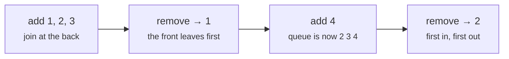

# Stacks, queues and deques

> Data Structures & Algorithms · L1 Foundation · Stacks, queues & linked lists · about 80 min · hub module `m05` ([open the hub](https://claude.ai/artifact/SWv6N1Uh2oiFNH1mxefcNr))

## Why it matters
Undo buttons, browser history, bracket checkers and task schedulers all run on two small ideas: last in, first out, and first in, first out. Picking the right one, with the right Python or JavaScript tool, avoids a hidden O(n) on every step.

## Pre-question (answer before reading)
**Q:** You type `(`, then `[`, then `]`. Which bracket must the next `)` close, and why does that suggest a stack?

<details><summary>Answer</summary>

It closes the `(`: once `[` is closed, `(` is the most recent bracket still open. The most recent opening is always the first to close (last in, first out), which is exactly what a stack does.

</details>

## 🍎 Story time (kid version)
**The toy room and the treasure-map road trip: Plates and the slide line**

In the toy room, Tara stacks her plates for a tea party. She can only add a plate on top and take the top one off; the plate she put down last comes off first. Outside, the children queue for the slide. New children join at the back, and the one at the front goes next; whoever arrived first slides first. Ben once painted a numbered spot for each child, so every time the front child slid, everyone had to step forward a spot: slow for a long line! A good queue just moves a “front” sign instead.

| In the story | In code |
|---|---|
| Plates: add on top, take from the top | Stack (LIFO): push and pop at one end, O(1) |
| Children join at the back and leave from the front | Queue (FIFO): add at the back, remove at the front, O(1) |
| Everyone stepping forward a spot | Removing from the front of an array: O(n) (`list.pop(0)`, `shift()`) |
| Moving a “front” sign instead of the children | A deque or circular buffer: O(1) at both ends |

**Where the story breaks:** Queues in code don't make anyone walk: a deque or a circular buffer just moves a “front” marker. And a stack of plates can't tell you its smallest plate in O(1); a min-stack can, by storing the minimum alongside each item.

## Key ideas (grown-up version)
- **Stack = LIFO**: push and pop at the top in O(1). Python: a `list` with `append` and `pop()`. JavaScript: an array with `push` and `pop()`.
- **Queue = FIFO**: add at the back and remove at the front in O(1). Python: `collections.deque` with `append` and `popleft()`. JavaScript has no built-in queue, and `shift()` can cost O(n) (V8 moves every item once an array passes roughly 16,000 items), so use a head index or a circular buffer.
- **Deque**: O(1) at both ends. Python's `deque` adds `appendleft` and `pop`, and `maxlen` gives a fixed-size buffer that drops the oldest items.
- **Stack signals**: matching brackets, undo, “the most recent unmatched thing”, evaluating Reverse Polish notation, and turning recursion into a loop (depth-first search, L2).
- **Monotonic stack**: keep the stack increasing or decreasing. Each item is pushed once and popped once, so “next greater element” for every item is O(n) instead of O(n²).
- **Queue signals**: process in arrival order, buffers and rate limits, and breadth-first search level by level (L2).
- **Peek safely**: check for emptiness before `stack[-1]` or `stack.at(-1)`. An empty Python list raises `IndexError`; an empty JavaScript array quietly returns `undefined`.

## Diagrams
**Checking “([]{})” with a stack (top on the right)**

| ( push | 0 |
|---|---|
| value | **(** |

| [ push | 0 | 1 |
|---|---|---|
| value | ( | **[** |

| ] pops [ | 0 |
|---|---|
| value | ( |

| { push | 0 | 1 |
|---|---|---|
| value | ( | **{** |

| } pops { | 0 |
|---|---|
| value | ( |

| ) pops ( | 0 |
|---|---|
| value | empty |

_Every closing bracket must match the top of the stack. An empty stack at the end means balanced._

**A queue serves in arrival order**



## Comparisons
**Stacks and queues in both languages**

| Need | Python | JavaScript | Cost |
|---|---|---|---|
| Stack push / pop / peek | `s.append(x)`, `s.pop()`, `s[-1]` | `s.push(x)`, `s.pop()`, `s.at(-1)` | O(1) |
| Queue add / remove | `q.append(x)`, `q.popleft()` on a `deque` | `q.push(x)`, then read `q[head++]` | O(1) |
| Queue, the slow way | `list.pop(0)` | `arr.shift()` | O(n) per removal |
| Both ends | `appendleft`, `append`, `popleft`, `pop` | A circular buffer or a doubly linked list | O(1) |
| Is it empty? | `if not s:` | `if (s.length === 0)` | O(1) |

## Code (JavaScript + Python)
### Balanced brackets with a stack
```python
PAIRS = {")": "(", "]": "[", "}": "{"}

def balanced(s):
    stack = []
    for ch in s:
        if ch in "([{":
            stack.append(ch)                   # opening: remember it
        elif ch in PAIRS:
            if not stack or stack.pop() != PAIRS[ch]:
                return False                   # nothing to close, or the wrong type
    return not stack                           # leftovers are unclosed brackets

for s in ("([]{})", "([)]", "((", ""):
    print(s or "(empty)", "yes" if balanced(s) else "no")
```

Output:
```text
([]{}) yes
([)] no
(( no
(empty) yes
```

- line 9: `not stack` catches a closing bracket with nothing open, such as “)(”.
- line 11: A non-empty stack at the end means something was never closed.

```javascript
const PAIRS = new Map([[")", "("], ["]", "["], ["}", "{"]]);

function balanced(s) {
  const stack = [];
  for (const ch of s) {
    if ("([{".includes(ch)) stack.push(ch);    // opening: remember it
    else if (PAIRS.has(ch)) {
      if (stack.length === 0 || stack.pop() !== PAIRS.get(ch))
        return false;                          // nothing to close, or the wrong type
    }
  }
  return stack.length === 0;                   // leftovers are unclosed brackets
}

for (const s of ["([]{})", "([)]", "((", ""])
  console.log(s || "(empty)", balanced(s) ? "yes" : "no");
```

Output:
```text
([]{}) yes
([)] no
(( no
(empty) yes
```

- line 8: Check `stack.length` first: popping an empty array returns `undefined`, not an error.

### Queues: a deque in Python, a head index in JavaScript
```python
from collections import deque

q = deque()
for task in ("wash", "dry", "fold"):
    q.append(task)                  # join at the back: O(1)
first = q.popleft()                 # leave from the front: O(1)
q.append("iron")
print(first, *q, len(q))
```

Output:
```text
wash dry fold iron 3
```

- line 6: `popleft()` is O(1). `list.pop(0)` would shift every remaining item.

```javascript
class Queue {                       // array + head index: O(1) amortised
  #items = [];
  #head = 0;
  enqueue(x) { this.#items.push(x); }
  dequeue() {
    if (this.#head === this.#items.length) return undefined;
    const x = this.#items[this.#head++];
    if (this.#head > 1024 && this.#head * 2 > this.#items.length) {
      this.#items = this.#items.slice(this.#head);    // compact now and then
      this.#head = 0;
    }
    return x;
  }
  get size() { return this.#items.length - this.#head; }
  *[Symbol.iterator]() { for (let i = this.#head; i < this.#items.length; i++) yield this.#items[i]; }
}

const q = new Queue();
for (const task of ["wash", "dry", "fold"]) q.enqueue(task);
const first = q.dequeue();
q.enqueue("iron");
console.log(first, ...q, q.size);
```

Output:
```text
wash dry fold iron 3
```

- line 7: Read at the head and move it on, instead of `shift()`, which moves every item.
- line 8: Throw away the used front part only occasionally, so the copying averages out to O(1) per item.

### Monotonic stack: the next greater element for every item
```python
def next_greater(nums):
    answer = [-1] * len(nums)
    stack = []                              # indexes still waiting for an answer
    for i, x in enumerate(nums):
        while stack and nums[stack[-1]] < x:
            answer[stack.pop()] = x         # x is the first bigger item to their right
        stack.append(i)
    return answer

print(*next_greater([2, 1, 2, 4, 3]))
```

Output:
```text
4 2 4 -1 -1
```

- line 3: The stack holds indexes whose values never increase from bottom to top: a monotonic stack.
- line 5: Each index is pushed once and popped at most once, so the whole loop is O(n).

```javascript
function nextGreater(nums) {
  const answer = new Array(nums.length).fill(-1);
  const stack = [];                         // indexes still waiting for an answer
  for (let i = 0; i < nums.length; i++) {
    while (stack.length && nums[stack.at(-1)] < nums[i])
      answer[stack.pop()] = nums[i];        // the first bigger item to their right
    stack.push(i);
  }
  return answer;
}

console.log(...nextGreater([2, 1, 2, 4, 3]));
```

Output:
```text
4 2 4 -1 -1
```

- line 5: Each index is pushed once and popped at most once, so the whole loop is O(n).

## Worked example
**Problem.** Simplify a Unix-style absolute path such as `/a/./b/../../c/` to its canonical form `/c` (LeetCode 71, Simplify Path).

1. Split on `/`. Empty parts (from `//` or a trailing slash) and `.` mean “stay here”: skip them.
2. A normal name means “go into this folder”: push it.
3. `..` means “go up one folder”: pop, if there's anything to pop (you can't go above the root).
4. Join what's left with `/` and put a `/` in front. Each part is pushed and popped at most once: O(n) time, O(n) space.

```python
def simplify_path(path):
    stack = []
    for part in path.split("/"):
        if part in ("", "."):
            continue                       # empty or "stay here"
        if part == "..":
            if stack:
                stack.pop()                # go up one folder
        else:
            stack.append(part)             # go into a folder
    return "/" + "/".join(stack)

for p in ("/a/./b/../../c/", "/../", "/home//user/docs/../photos"):
    print(simplify_path(p))
```

Output:
```text
/c
/
/home/user/photos
```

```javascript
function simplifyPath(path) {
  const stack = [];
  for (const part of path.split("/")) {
    if (part === "" || part === ".") continue;   // empty or "stay here"
    if (part === "..") {
      if (stack.length) stack.pop();             // go up one folder
    } else stack.push(part);                     // go into a folder
  }
  return "/" + stack.join("/");
}

for (const p of ["/a/./b/../../c/", "/../", "/home//user/docs/../photos"])
  console.log(simplifyPath(p));
```

Output:
```text
/c
/
/home/user/photos
```

**Answer.** `/c`, `/` and `/home/user/photos`. O(n) time and O(n) space for the stack. A name like `...` is just a folder name, so it's pushed like any other.

## Your turn (faded example)
**Problem.** Repeatedly remove pairs of equal neighbouring letters: “abbaca” becomes “ca” (bb goes, then aa).

- ✓ Removing a pair can make a new pair touch (“abba” → “aa” → “”), so you need the most recent kept letter: a stack.
- **What do you compare each new letter with?**
  <details><summary>Answer</summary>The top of the stack: the last letter you kept.</details>
- **What happens when they're equal, and when they differ?**
  <details><summary>Answer</summary>Equal: pop, because the pair cancels. Different: push the new letter.</details>
- **Time and space?**
  <details><summary>Answer</summary>O(n) time, since each letter is pushed once and popped at most once. O(n) space for the stack.</details>

Starter:
```python
def remove_pairs(s):
    stack = []
    for ch in s:
        ...      # TODO: pop if ch equals the top, otherwise push
    return "".join(stack)

print(remove_pairs("abbaca"))      # expect ca
```

```javascript
function removePairs(s) {
  const stack = [];
  for (const ch of s) {
    // TODO: pop if ch equals the top, otherwise push
  }
  return stack.join("");
}

console.log(removePairs("abbaca"));    // expect ca
```

<details><summary>Full solution</summary>

```python
def remove_pairs(s):
    stack = []
    for ch in s:
        if stack and stack[-1] == ch:
            stack.pop()                # the pair cancels out
        else:
            stack.append(ch)
    return "".join(stack)

print(remove_pairs("abbaca"), remove_pairs("azxxzy"))
```

Output:
```text
ca ay
```

```javascript
function removePairs(s) {
  const stack = [];
  for (const ch of s) {
    if (stack.length && stack.at(-1) === ch) stack.pop();   // the pair cancels out
    else stack.push(ch);
  }
  return stack.join("");
}

console.log(removePairs("abbaca"), removePairs("azxxzy"));
```

Output:
```text
ca ay
```

</details>

## Socratic checks and quiz (answers hidden)
**1. What does this print?**

```python
s = []
for x in [1, 2, 3]:
    s.append(x)
s.pop()
s.append(4)
print(s.pop(), s.pop(), len(s))
```

```javascript
const s = [];
for (const x of [1, 2, 3]) s.push(x);
s.pop();
s.push(4);
console.log(s.pop(), s.pop(), s.length);
```

- A. 4 2 1
- B. 1 2 1
- C. 4 3 1
- D. 2 4 1

<details><summary>Answer</summary>

4 2 1. After the pushes the stack is 1 2 3; pop removes 3; push 4 gives 1 2 4. Popping twice returns 4 then 2, leaving one item.

</details>

**2. What does this print?**

```python
from collections import deque
q = deque([1, 2, 3])
q.append(4)
q.popleft()
q.appendleft(0)
print(*q)
```

```javascript
const q = [1, 2, 3];
q.push(4);
q.shift();
q.unshift(0);
console.log(...q);
```

- A. 0 2 3 4
- B. 0 1 2 3 4
- C. 2 3 4 0
- D. 1 2 3 4

<details><summary>Answer</summary>

0 2 3 4. Add 4 at the back (1 2 3 4), remove 1 from the front (2 3 4), add 0 at the front (0 2 3 4).

</details>

**3. A print server handles jobs in the order they arrive. Which structure and tool should you use?**

- A. A queue: `collections.deque` with `popleft()`, or a JavaScript array with a head index
- B. A stack: `list.pop()` / `array.pop()`
- C. A queue built on `list.pop(0)` / `array.shift()`, which are O(1)
- D. A hash set of jobs

<details><summary>Answer</summary>

A queue: `collections.deque` with `popleft()`, or a JavaScript array with a head index. Arrival order is first in, first out. `pop(0)` and `shift()` work but cost O(n) per job, so the third option's claim is false.

</details>

**4. Which of these fit a stack? (choose 3)**

- A. Undo in a text editor
- B. Checking that brackets are balanced
- C. Evaluating `3 4 + 2 *` (Reverse Polish notation)
- D. Serving customers in arrival order
- E. Keeping the median of a stream of numbers

<details><summary>Answer</summary>

Undo in a text editor, Checking that brackets are balanced, Evaluating `3 4 + 2 *` (Reverse Polish notation). Undo, brackets and RPN all need the most recent item first. Arrival order is a queue, and a running median uses two heaps (L2).

</details>

**5. Judge each statement.**

- `collections.deque.popleft()` is O(1).
- JavaScript's `array.shift()` is guaranteed to be O(1).
- Counting opening and closing brackets is enough to reject `([)]`.
- A monotonic stack finds the next greater element for every item in O(n) total.

<details><summary>Answer</summary>

`collections.deque.popleft()` is O(1).: Yes; JavaScript's `array.shift()` is guaranteed to be O(1).: No; Counting opening and closing brackets is enough to reject `([)]`.: No; A monotonic stack finds the next greater element for every item in O(n) total.: Yes. deque is built for O(1) at both ends. `shift()` moves the remaining items. Counts can't see order or type. Each index is pushed and popped once.

</details>

**6. Put the bracket checker's steps in order.**

- (put the steps in order)

<details><summary>Answer</summary>

Create an empty stack → For each character: if it's an opening bracket, push it → Otherwise, if it's a closing bracket and the stack is empty, fail → Otherwise, pop the top and fail if it isn't the matching opening bracket → After the loop, succeed only if the stack is empty. Set up, push openings, guard against an empty stack, match on pop, and check for leftovers at the end.

</details>

**7. Complete the JavaScript next-greater-element function.**

```
function nextGreater(nums) {
  const answer = new Array(nums.length).fill(-1);
  const stack = [];
  for (let i = 0; i < nums.length; i++) {
    while (stack.length && nums[stack.at(-1)] {{0}} nums[i])
      answer[stack.{{1}}()] = nums[i];
    stack.push({{2}});
  }
  return answer;
}

```

<details><summary>Answer</summary>

< | pop | i. Pop while the waiting item is strictly smaller (`<`; with `<=`, equal values would count as greater), and push the index `i`, not the value, so you know where to write the answer.

</details>

**8. Match each job to its tool.**


<details><summary>Answer</summary>

The most recent unmatched item = Stack; The oldest waiting item = Queue; Fast adds and removes at both ends = Deque; The next greater element for every item = Monotonic stack. LIFO, FIFO, both ends, and a stack kept in order.

</details>

## Traps & misconceptions
- **“`list.pop(0)` / `arr.shift()` makes a fine queue.”** Each removal can shift every remaining item: O(n), so n removals can cost O(n²) (V8 has a shortcut for smaller arrays, but don't rely on it). Use `collections.deque.popleft()` in Python and a head index or circular buffer in JavaScript.
- **“Peeking at an empty stack is harmless.”** Python's `stack[-1]` raises `IndexError`; JavaScript's `stack.at(-1)` quietly returns `undefined` and the bug shows up later. Check for emptiness first.
- **“To check brackets, just count them.”** Counts can't catch `([)]`: order and type matter. Compare each closing bracket with the top of the stack.
- **“Items left on the stack at the end don't matter.”** In bracket matching, leftovers mean unclosed brackets: `((` must be rejected.
- **“A monotonic stack is O(n²) because of the inner while.”** Each index is pushed once and popped at most once: O(n) in total.
- **“Python's `queue.Queue` is the queue for algorithms.”** `queue.Queue` is built for threads and adds locking overhead. For algorithms, use `collections.deque`.

## Discussion prompts
- **When would you use a deque instead of a list for a stack in Python?**
  <details><summary>One good answer</summary>Rarely: a list is the idiomatic stack and is fast at the end. Use a deque when you also need O(1) work at the front, or a bounded buffer with `maxlen`.</details>
- **Why does a browser's Back button behave like a stack, and Forward like a second stack?**
  <details><summary>One good answer</summary>Back returns to the most recent page (LIFO). Going back pushes the current page onto the Forward stack, and visiting a new page clears it. Two stacks model undo and redo the same way.</details>

## Teach-back
**Prompt:** Explain to a junior colleague when to reach for a stack versus a queue, and how to build each efficiently in Python and JavaScript.

Rubric:
- [ ] Stack = last in, first out; queue = first in, first out
- [ ] Stack in both languages: an array or list with push/append and pop at the end, O(1)
- [ ] Queue: Python's deque.popleft(); JavaScript needs a head index because shift() is O(n)
- [ ] Gives a stack signal (brackets, undo) and a queue signal (arrival order, BFS)
- [ ] Checks for emptiness before popping or peeking

<details><summary>Model answer</summary>

A stack hands back the most recent item first (last in, first out), so it fits anything about “the latest unmatched thing”: brackets, undo, backtracking. A queue hands back the oldest item first (first in, first out), so it fits processing in arrival order, like a job line or breadth-first search. In both languages an array with push or append and pop at the end is an O(1) stack. For a queue, Python's collections.deque gives an O(1) popleft; JavaScript's shift() is O(n), so keep a head index or a circular buffer instead. Always check for emptiness before you pop or peek.

</details>

## Quick Q&A (also in the SRS deck)
- **Stack or queue for “undo the most recent action”?** A stack: last in, first out.
- **O(1) queue in Python?** `collections.deque`: `append` to add, `popleft()` to remove.
- **Why avoid `arr.shift()` / `list.pop(0)` for a busy queue?** They shift every remaining item: O(n) per removal.
- **How does a bracket checker use a stack?** Push openings; a closing bracket must match the top (pop it); the stack must be empty at the end.
- **What does a monotonic stack give you, and at what cost?** The next greater (or smaller) element for every item in O(n) total: each index is pushed and popped once.
- **What does `stack.at(-1)` return on an empty JavaScript array?** `undefined`, with no error, so check `stack.length` first.

## Practice problems
- [ ] [LC 20 · Valid Parentheses](https://leetcode.com/problems/valid-parentheses/) · Easy · the bracket checker, from memory
- [ ] [LC 232 · Implement Queue using Stacks](https://leetcode.com/problems/implement-queue-using-stacks/) · Easy · two stacks; refill the out-stack only when it's empty
- [ ] [LC 225 · Implement Stack using Queues](https://leetcode.com/problems/implement-stack-using-queues/) · Easy · rotate the queue after each push
- [ ] [LC 933 · Number of Recent Calls](https://leetcode.com/problems/number-of-recent-calls/) · Easy · a queue of timestamps; drop old ones from the front
- [ ] [LC 496 · Next Greater Element I](https://leetcode.com/problems/next-greater-element-i/) · Easy · monotonic stack plus a map from value to answer
- [ ] [LC 155 · Min Stack](https://leetcode.com/problems/min-stack/) · Medium · store the minimum alongside each item
- [ ] [LC 150 · Evaluate Reverse Polish Notation](https://leetcode.com/problems/evaluate-reverse-polish-notation/) · Medium · push numbers; an operator pops two (mind the order); divide toward zero: int(a / b) in Python, Math.trunc(a / b) in JS
- [ ] [LC 739 · Daily Temperatures](https://leetcode.com/problems/daily-temperatures/) · Medium · monotonic stack of indexes; the answer is a distance

## Sources (accessed 2026-10-09)
- [Python docs: collections.deque](https://docs.python.org/3/library/collections.html#collections.deque)
- [Python tutorial: Using lists as stacks](https://docs.python.org/3/tutorial/datastructures.html#using-lists-as-stacks)
- [MDN: Array.prototype.shift](https://developer.mozilla.org/en-US/docs/Web/JavaScript/Reference/Global_Objects/Array/shift)
- [MDN: Private elements (#fields)](https://developer.mozilla.org/en-US/docs/Web/JavaScript/Reference/Classes/Private_elements)
