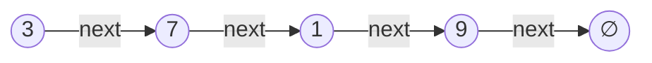
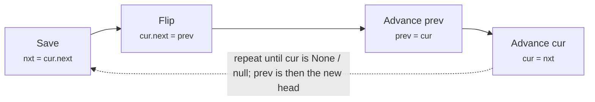
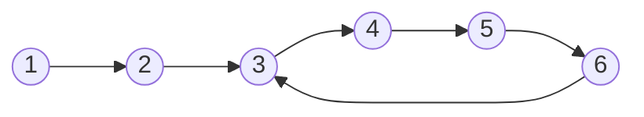

# Linked lists

> Data Structures & Algorithms · L1 Foundation · Stacks, queues & linked lists · about 85 min · hub module `m06` ([open the hub](https://claude.ai/artifact/SWv6N1Uh2oiFNH1mxefcNr))

## Why it matters
Linked lists are rarely the fastest choice in Python or JavaScript, but they're the classic way interviews test pointer reasoning: reversing, merging, finding the middle and spotting cycles, all in O(1) extra space.

## Pre-question (answer before reading)
**Q:** In a chain where each node only knows the next one, how could you find the middle node in one pass, without counting first?

<details><summary>Answer</summary>

Walk two pointers from the head: slow takes one step, fast takes two. When fast reaches the end, slow is in the middle.

</details>

## 🍎 Story time (kid version)
**The toy room and the treasure-map road trip: The treasure-hunt notes**

On the road trip, Ben sets up a treasure hunt. Each note says where to find the next note: “look under the seat”, then “check the glovebox”. To reach note 5, Tara must follow notes 1 to 4 first; there's no shortcut. But adding a new clue is easy: Ben rewrites one note to point to the new clue, and the new clue points where the old note did. One day Ben makes a mistake and a note points back to an earlier one, so Tara goes round and round forever.

| In the story | In code |
|---|---|
| Each note says where the next one is | A node holds a value and a `next` reference |
| Following notes 1 to 4 to reach note 5 | Access by position is O(n): there's no indexing |
| Rewriting one note to add a clue | Insert after a node you hold: O(1), two pointer changes |
| A note pointing back to an earlier one | A cycle: detect it with fast and slow pointers |

**Where the story breaks:** Paper notes don't change while you read them, but in code you overwrite pointers as you go, so the order matters: save `next` before you change it. And the nodes are scattered around memory, so walking a list is slower than walking an array even though both are O(n).

## Key ideas (grown-up version)
- **Node = value + next.** A singly linked list is reached through its `head`, and the last node's `next` is `None` / `null`. A doubly linked list adds `prev`.
- **Costs**: access or search by position O(n); insert at the head O(1); insert or delete *after a node you already hold* O(1). Arrays win at indexing; lists win at cheap re-linking.
- **Dummy head**: put a fake node before the real head, so inserting or deleting at the front needs no special case, then return `dummy.next`.
- **Reverse in place** with three pointers: save `nxt = cur.next`, set `cur.next = prev`, then move `prev = cur` and `cur = nxt`. O(n) time, O(1) space.
- **Fast and slow pointers** (Floyd's tortoise and hare): slow moves 1, fast moves 2. If they meet there's a cycle; when fast reaches the end, slow is at the middle.
- **Gap pointers**: move a lead pointer k steps ahead, then move both. When the lead falls off the end, the follower is k nodes from the end.
- **Real code rarely needs one** in Python or JavaScript: use lists and arrays, `deque`, or `Map` (which keeps insertion order). Interviews use linked lists to test pointer reasoning, and an LRU cache (L2) pairs a hash map with a doubly linked list.

## Diagrams
**A singly linked list: 3 → 7 → 1 → 9**



_The head (highlighted) is the only way in. The last node points to None / null (∅)._

**One step of the in-place reversal**



**A cycle: node 6 points back to node 3**



_Inside the loop, fast gains one node on slow at every step, so they must meet within one lap._

## Comparisons
**Array versus singly linked list**

| Operation | Array (Python list / JS array) | Singly linked list |
|---|---|---|
| Read the i-th item | O(1) | O(i): walk from the head |
| Insert or delete at the front | O(n): shift everything | O(1): change the head |
| Insert after an item you already hold | O(n): shift the rest | O(1): change two pointers |
| Append at the end | O(1) amortised | O(1) with a tail pointer, otherwise O(n) |
| Search by value | O(n) | O(n) |
| Memory per item | One reference | A whole node object plus its `next` reference |

## Code (JavaScript + Python)
### Build, print and reverse a list
```python
class ListNode:
    def __init__(self, val=0, next=None):
        self.val = val
        self.next = next

def from_list(values):                     # [1, 2, 3] -> 1 -> 2 -> 3
    dummy = tail = ListNode()
    for v in values:
        tail.next = ListNode(v)
        tail = tail.next
    return dummy.next

def to_list(head):
    out = []
    while head:
        out.append(head.val)
        head = head.next
    return out

def reverse(head):                         # O(n) time, O(1) extra space
    prev, cur = None, head
    while cur:
        nxt = cur.next                     # 1. save the rest of the list
        cur.next = prev                    # 2. flip this arrow
        prev, cur = cur, nxt               # 3. step forward
    return prev                            # the old tail is the new head

head = from_list([1, 2, 3, 4])
print(*to_list(head))
print(*to_list(reverse(head)))
```

Output:
```text
1 2 3 4
4 3 2 1
```

- line 7: The dummy node means the first real node needs no special case.
- line 23: Save `cur.next` before overwriting it, or the rest of the list is lost.

```javascript
class ListNode {
  constructor(val = 0, next = null) {
    this.val = val;
    this.next = next;
  }
}

function fromArray(values) {               // [1, 2, 3] -> 1 -> 2 -> 3
  const dummy = new ListNode();
  let tail = dummy;
  for (const v of values) {
    tail.next = new ListNode(v);
    tail = tail.next;
  }
  return dummy.next;
}

function toArray(head) {
  const out = [];
  for (let n = head; n; n = n.next) out.push(n.val);
  return out;
}

function reverse(head) {                   // O(n) time, O(1) extra space
  let prev = null, cur = head;
  while (cur) {
    const nxt = cur.next;                  // 1. save the rest of the list
    cur.next = prev;                       // 2. flip this arrow
    prev = cur;                            // 3. step forward
    cur = nxt;
  }
  return prev;                             // the old tail is the new head
}

const head = fromArray([1, 2, 3, 4]);
console.log(...toArray(head));
console.log(...toArray(reverse(head)));
```

Output:
```text
1 2 3 4
4 3 2 1
```

- line 9: The dummy node means the first real node needs no special case.
- line 27: Save `cur.next` before overwriting it, or the rest of the list is lost.

### Fast and slow pointers: the middle, and a cycle check
```python
class ListNode:
    def __init__(self, val=0, next=None):
        self.val, self.next = val, next

def from_list(values):
    head = None
    for v in reversed(values):             # build from the back
        head = ListNode(v, head)
    return head

def middle(head):
    slow = fast = head
    while fast and fast.next:              # check fast before fast.next
        slow = slow.next                   # 1 step
        fast = fast.next.next              # 2 steps
    return slow                            # the 2nd middle when the length is even

def has_cycle(head):
    slow = fast = head
    while fast and fast.next:
        slow, fast = slow.next, fast.next.next
        if slow is fast:                   # the same node object: they met
            return True
    return False

a = from_list([1, 2, 3, 4, 5])
b = from_list([1, 2, 3, 4, 5, 6])
print(middle(a).val, middle(b).val, "cycle" if has_cycle(a) else "no cycle")
a.next.next.next.next.next = a.next.next   # the tail (5) now points back to 3
print("cycle" if has_cycle(a) else "no cycle")
```

Output:
```text
3 4 no cycle
cycle
```

- line 13: `fast and fast.next` stops safely on both odd and even lengths.
- line 22: `is` compares node identity, not values: two different nodes can hold the same value.

```javascript
class ListNode {
  constructor(val = 0, next = null) { this.val = val; this.next = next; }
}

function fromArray(values) {
  let head = null;
  for (let i = values.length - 1; i >= 0; i--) head = new ListNode(values[i], head);   // build from the back
  return head;
}

function middle(head) {
  let slow = head, fast = head;
  while (fast && fast.next) {              // check fast before fast.next
    slow = slow.next;                      // 1 step
    fast = fast.next.next;                 // 2 steps
  }
  return slow;                             // the 2nd middle when the length is even
}

function hasCycle(head) {
  let slow = head, fast = head;
  while (fast && fast.next) {
    slow = slow.next;
    fast = fast.next.next;
    if (slow === fast) return true;        // the same node object: they met
  }
  return false;
}

const a = fromArray([1, 2, 3, 4, 5]);
const b = fromArray([1, 2, 3, 4, 5, 6]);
console.log(middle(a).val, middle(b).val, hasCycle(a) ? "cycle" : "no cycle");
a.next.next.next.next.next = a.next.next;  // the tail (5) now points back to 3
console.log(hasCycle(a) ? "cycle" : "no cycle");
```

Output:
```text
3 4 no cycle
cycle
```

- line 13: `fast && fast.next` stops safely on both odd and even lengths.
- line 25: `===` on objects compares identity: the very same node.

## Worked example
**Problem.** Merge two sorted linked lists into one sorted list by re-linking their nodes (LeetCode 21, Merge Two Sorted Lists).

1. Make a dummy node and a `tail` pointer at it; the answer will be `dummy.next`.
2. While both lists have nodes, attach the smaller head to `tail` and advance that list.
3. Move `tail` onto the node you just attached.
4. When one list runs out, attach the rest of the other in one step: it's already sorted. O(n + m) time and O(1) extra space, because we re-link nodes instead of copying them.

```python
class ListNode:
    def __init__(self, val=0, next=None):
        self.val, self.next = val, next

def from_list(values):
    head = None
    for v in reversed(values):
        head = ListNode(v, head)
    return head

def to_list(head):
    out = []
    while head:
        out.append(head.val)
        head = head.next
    return out

def merge(a, b):
    dummy = tail = ListNode()              # fake head: no first-node special case
    while a and b:
        if a.val <= b.val:                 # <= keeps equal values in order (a first)
            tail.next, a = a, a.next
        else:
            tail.next, b = b, b.next
        tail = tail.next
    tail.next = a or b                     # attach whatever is left
    return dummy.next

print(*to_list(merge(from_list([1, 2, 4]), from_list([1, 3, 4]))))
print(*to_list(merge(from_list([]), from_list([0]))))
```

Output:
```text
1 1 2 3 4 4
0
```

```javascript
class ListNode {
  constructor(val = 0, next = null) { this.val = val; this.next = next; }
}

function fromArray(values) {
  let head = null;
  for (let i = values.length - 1; i >= 0; i--) head = new ListNode(values[i], head);
  return head;
}

function toArray(head) {
  const out = [];
  for (let n = head; n; n = n.next) out.push(n.val);
  return out;
}

function merge(a, b) {
  const dummy = new ListNode();            // fake head: no first-node special case
  let tail = dummy;
  while (a && b) {
    if (a.val <= b.val) { tail.next = a; a = a.next; }   // <= keeps equal values in order
    else { tail.next = b; b = b.next; }
    tail = tail.next;
  }
  tail.next = a ?? b;                      // attach whatever is left
  return dummy.next;
}

console.log(...toArray(merge(fromArray([1, 2, 4]), fromArray([1, 3, 4]))));
console.log(...toArray(merge(fromArray([]), fromArray([0]))));
```

Output:
```text
1 1 2 3 4 4
0
```

**Answer.** 1 1 2 3 4 4, and 0 when the first list is empty. O(n + m) time and O(1) extra space. Without the dummy node you'd need an `if` just to choose the first head.

## Your turn (faded example)
**Problem.** Return the value of the k-th node from the end in one pass (k = 1 is the last node). Assume 1 ≤ k ≤ length.

- ✓ Counting the length and then walking again takes two passes. A gap of k nodes between two pointers does it in one.
- **Where does the `lead` pointer start, compared with `follow`?**
  <details><summary>Answer</summary>Both start at the head; then `lead` moves k steps ahead.</details>
- **When do you stop, and where is `follow` then?**
  <details><summary>Answer</summary>When `lead` falls off the end (becomes None / null). `follow` is then exactly k nodes from the end.</details>
- **Time and space?**
  <details><summary>Answer</summary>O(n) time in one pass, O(1) extra space.</details>

Starter:
```python
def kth_from_end(head, k):
    lead = follow = head
    for _ in range(k):          # open a gap of k nodes
        lead = lead.next
    # TODO: move both pointers until lead falls off the end
    return follow.val
```

```javascript
function kthFromEnd(head, k) {
  let lead = head, follow = head;
  for (let i = 0; i < k; i++) lead = lead.next;   // open a gap of k nodes
  // TODO: move both pointers until lead falls off the end
  return follow.val;
}
```

<details><summary>Full solution</summary>

```python
class ListNode:
    def __init__(self, val=0, next=None):
        self.val, self.next = val, next

def from_list(values):
    head = None
    for v in reversed(values):
        head = ListNode(v, head)
    return head

def kth_from_end(head, k):
    lead = follow = head
    for _ in range(k):                     # open a gap of k nodes
        lead = lead.next
    while lead:                            # move both until lead falls off the end
        lead, follow = lead.next, follow.next
    return follow.val

h = from_list([10, 20, 30, 40, 50])
print(kth_from_end(h, 1), kth_from_end(h, 2), kth_from_end(h, 5))
```

Output:
```text
50 40 10
```

```javascript
class ListNode {
  constructor(val = 0, next = null) { this.val = val; this.next = next; }
}

function fromArray(values) {
  let head = null;
  for (let i = values.length - 1; i >= 0; i--) head = new ListNode(values[i], head);
  return head;
}

function kthFromEnd(head, k) {
  let lead = head, follow = head;
  for (let i = 0; i < k; i++) lead = lead.next;   // open a gap of k nodes
  while (lead) {                                  // move both until lead falls off the end
    lead = lead.next;
    follow = follow.next;
  }
  return follow.val;
}

const h = fromArray([10, 20, 30, 40, 50]);
console.log(kthFromEnd(h, 1), kthFromEnd(h, 2), kthFromEnd(h, 5));
```

Output:
```text
50 40 10
```

</details>

## Socratic checks and quiz (answers hidden)
**1. What does this print?**

```python
class ListNode:
    def __init__(self, val, next=None):
        self.val, self.next = val, next

head = ListNode(1, ListNode(2, ListNode(3)))
head.next = head.next.next
total, node = 0, head
while node:
    total += node.val
    node = node.next
print(total)
```

```javascript
class ListNode {
  constructor(val, next = null) { this.val = val; this.next = next; }
}
const head = new ListNode(1, new ListNode(2, new ListNode(3)));
head.next = head.next.next;
let total = 0;
for (let node = head; node; node = node.next) total += node.val;
console.log(total);
```

- A. 4
- B. 6
- C. 3
- D. 1

<details><summary>Answer</summary>

4. `head.next = head.next.next` skips node 2, so the list is 1 → 3 and the total is 4. That one line is how you delete a node.

</details>

**2. What does this print?**

```python
class ListNode:
    def __init__(self, val, next=None):
        self.val, self.next = val, next

head = None
for v in [8, 7, 6, 5]:
    head = ListNode(v, head)      # push to the front
slow = fast = head
while fast and fast.next:
    slow, fast = slow.next, fast.next.next
print(slow.val)
```

```javascript
class ListNode {
  constructor(val, next = null) { this.val = val; this.next = next; }
}
let head = null;
for (const v of [8, 7, 6, 5]) head = new ListNode(v, head);   // push to the front
let slow = head, fast = head;
while (fast && fast.next) {
  slow = slow.next;
  fast = fast.next.next;
}
console.log(slow.val);
```

- A. 7
- B. 6
- C. 5
- D. 8

<details><summary>Answer</summary>

7. Pushing to the front builds 5 → 6 → 7 → 8. With an even length this loop stops on the second middle node: 7.

</details>

**3. What goes wrong if the reversal loop runs `cur.next = prev` *before* saving `cur.next`?**

- A. The rest of the list is lost, so the loop can't move on
- B. Nothing: the order of the steps doesn't matter
- C. The list gets reversed twice
- D. It becomes O(n²)

<details><summary>Answer</summary>

The rest of the list is lost, so the loop can't move on. `cur.next` was the only link to the rest of the list. Overwrite it first and that link is gone.

</details>

**4. Which are O(1) on a singly linked list that only keeps a head pointer? (choose 2)**

- A. Insert a new node at the head
- B. Insert a node right after a node you already hold
- C. Read the 50th node
- D. Append at the end
- E. Find the node with value 42

<details><summary>Answer</summary>

Insert a new node at the head, Insert a node right after a node you already hold. Head inserts and inserts after a known node only change pointers. Reading by position, appending without a tail pointer and searching all walk the list.

</details>

**5. Judge each statement.**

- A dummy head node removes the special case for deleting the first node.
- `while fast.next and fast:` is a safe loop condition.
- Floyd's method detects a cycle with O(1) extra space.
- Reversing a list recursively uses O(1) extra space.

<details><summary>Answer</summary>

A dummy head node removes the special case for deleting the first node.: Yes; `while fast.next and fast:` is a safe loop condition.: No; Floyd's method detects a cycle with O(1) extra space.: Yes; Reversing a list recursively uses O(1) extra space.: No. Check `fast` before `fast.next`: the order of short-circuit tests matters. Recursion keeps one stack frame per node, so it's O(n) space.

</details>

**6. Put one iteration of the reversal loop in order.**

- (put the steps in order)

<details><summary>Answer</summary>

nxt = cur.next → cur.next = prev → prev = cur → cur = nxt. Save, flip, then advance both pointers.

</details>

**7. Complete the Python merge of two sorted lists.**

```
def merge(a, b):
    dummy = tail = ListNode(0)
    while a and b:
        if a.val <= b.val:
            tail.next, a = a, a.next
        else:
            tail.next, b = b, b.next
        tail = {{0}}
    tail.next = {{1}}
    return {{2}}

```

<details><summary>Answer</summary>

tail.next | a or b | dummy.next. Move `tail` onto the node just attached, hang whatever list is left on the end (`a or b`), and skip the dummy when returning.

</details>

**8. Match each task to its technique.**


<details><summary>Answer</summary>

Find the middle in one pass = Fast and slow pointers; Find the k-th node from the end = A lead pointer k steps ahead; Merge two sorted lists without special cases = A dummy head node; Reverse in place = prev, cur and a saved next. Speed difference, a fixed gap, a fake head, and save-before-overwrite: the four core linked-list moves.

</details>

## Traps & misconceptions
- **“Reverse by setting `cur.next = prev` first.”** Overwrite `cur.next` before saving it and the rest of the list is lost. Save `nxt = cur.next` first.
- **“The head never changes, so it needs no special case.”** Deleting or inserting at the front changes the head. A dummy node before the head removes the special case: return `dummy.next`.
- **“`fast.next.next` is always safe.”** Check `fast and fast.next` (`fast && fast.next`) first, in that order, or you'll dereference `None` / `null`.
- **“Two nodes with the same value are the same node.”** Cycle and intersection checks compare identity: `is` in Python and `===` on objects in JavaScript, not equal values.
- **“Linked lists beat arrays at everything except indexing.”** Nodes are scattered in memory, so walking a list is slower in practice, and finding *where* to insert is still O(n). The O(1) insert only applies when you already hold the node.
- **“Recursion is a free way to reverse a list.”** Recursive reversal uses O(n) call-stack space, and 100,000 nodes would blow past Python's default recursion limit of 1,000. Prefer the loop.

## Discussion prompts
- **Python and JavaScript don't ship a linked-list type. Why do interviews still use them?**
  <details><summary>One good answer</summary>They test careful pointer reasoning (save before overwriting, edge cases at the head and tail, O(1)-space tricks), and the same thinking powers trees and graphs in L2. Real code reaches for lists, `deque` or `Map` instead.</details>
- **Why does Floyd's fast/slow method always detect a cycle?**
  <details><summary>One good answer</summary>Once both pointers are inside the loop, fast gains exactly one node on slow per step, so the gap shrinks by one each time and must reach zero within one lap.</details>

## Teach-back
**Prompt:** Explain to a junior colleague how to reverse a singly linked list in place, and how to find its middle in one pass.

Rubric:
- [ ] Three pointers: prev, cur and a saved next
- [ ] Order: save next, point cur.next at prev, then advance prev and cur
- [ ] When cur runs out, prev is the new head
- [ ] Middle: slow moves 1, fast moves 2; when fast reaches the end, slow is in the middle
- [ ] Both are O(n) time and O(1) extra space

<details><summary>Model answer</summary>

To reverse, walk the list with prev starting at None and cur at the head. At each node, first save nxt = cur.next so the rest of the list isn't lost, then point cur.next back at prev, then move prev to cur and cur to nxt. When cur runs off the end, prev is the old tail, which is the new head. To find the middle, start slow and fast at the head and, while fast and fast.next exist, move slow one step and fast two. When fast can't move on, slow is at the middle. Both take one pass: O(n) time and O(1) extra space.

</details>

## Quick Q&A (also in the SRS deck)
- **Cost of reading the i-th node of a linked list?** O(i), so O(n): you have to walk from the head.
- **Why use a dummy head node?** Inserting or deleting at the front stops being a special case; return `dummy.next` at the end.
- **The three steps inside the reversal loop?** Save nxt = cur.next; set cur.next = prev; move prev = cur and cur = nxt.
- **How do fast and slow pointers detect a cycle?** Slow moves 1 and fast moves 2. If they ever reach the same node there's a cycle; if fast reaches the end there isn't.
- **Find the k-th node from the end in one pass?** Move a lead pointer k steps ahead, then move lead and follow together until lead falls off the end; follow is the answer.
- **Why compare nodes with `is` / `===` in a cycle check?** You need the same node object, not just an equal value.

## Practice problems
- [ ] [LC 206 · Reverse Linked List](https://leetcode.com/problems/reverse-linked-list/) · Easy · the loop from memory; then try it recursively
- [ ] [LC 141 · Linked List Cycle](https://leetcode.com/problems/linked-list-cycle/) · Easy · fast and slow pointers
- [ ] [LC 876 · Middle of the Linked List](https://leetcode.com/problems/middle-of-the-linked-list/) · Easy · fast and slow; the second middle
- [ ] [LC 203 · Remove Linked List Elements](https://leetcode.com/problems/remove-linked-list-elements/) · Easy · a dummy head
- [ ] [LC 234 · Palindrome Linked List](https://leetcode.com/problems/palindrome-linked-list/) · Easy · find the middle, reverse the second half, compare
- [ ] [LC 160 · Intersection of Two Linked Lists](https://leetcode.com/problems/intersection-of-two-linked-lists/) · Easy · two pointers that switch lists at the end
- [ ] [LC 19 · Remove Nth Node From End of List](https://leetcode.com/problems/remove-nth-node-from-end-of-list/) · Medium · dummy head + a lead pointer n + 1 steps ahead
- [ ] [LC 2 · Add Two Numbers](https://leetcode.com/problems/add-two-numbers/) · Medium · walk both lists with a carry
- [ ] [LC 707 · Design Linked List](https://leetcode.com/problems/design-linked-list/) · Medium · build it yourself: dummy head and a size counter

## Sources (accessed 2026-10-09)
- [MIT 6.006 Introduction to Algorithms (Spring 2020): sequence data structures](https://ocw.mit.edu/courses/6-006-introduction-to-algorithms-spring-2020/)
- [Wikipedia: Cycle detection (Floyd's tortoise and hare)](https://en.wikipedia.org/wiki/Cycle_detection)
- [Python docs: collections.deque (what to use instead in real code)](https://docs.python.org/3/library/collections.html#collections.deque)
