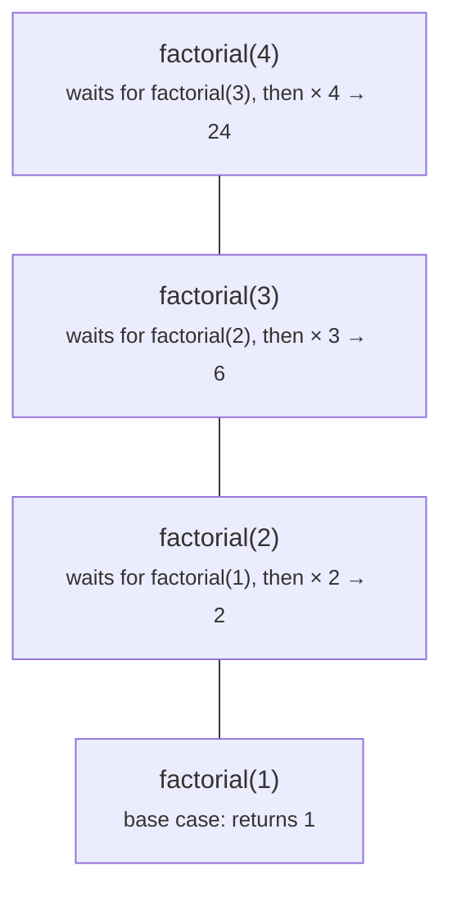
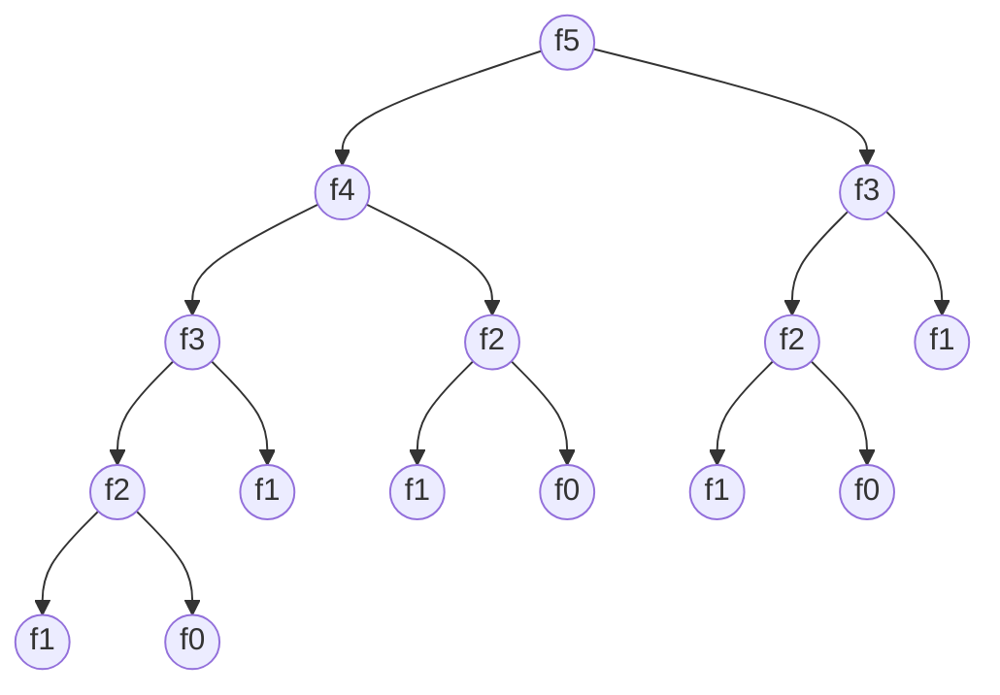

# Recursion

> Data Structures & Algorithms · L1 Foundation · Recursion, sorting & binary search · about 85 min · hub module `m07` ([open the hub](https://claude.ai/artifact/SWv6N1Uh2oiFNH1mxefcNr))

## Why it matters
Recursion solves a big problem by solving a smaller copy of the same problem. It's the foundation for trees, graphs, backtracking and divide-and-conquer sorting, so getting comfortable with it now pays off all through L2.

## Pre-question (answer before reading)
**Q:** `count_down(n)` prints n, then calls `count_down(n − 1)`. What must it do when n reaches 0, and what happens if it doesn't?

<details><summary>Answer</summary>

It must stop and return without calling itself: that's the base case. Without it the calls never end and the program crashes with a stack overflow (`RecursionError` in Python, `RangeError: Maximum call stack size exceeded` in JavaScript).

</details>

## 🍎 Story time (kid version)
**The toy room and the treasure-map road trip: The boxes inside boxes**

Tara gets a present in a box. Inside is a smaller box, and inside that another, each with a note: “open me, then add 1 to whatever the inner box says”. The tiniest box has no box inside, just a note saying “1”. Tara opens boxes all the way down, remembering where she is in each one, then climbs back out adding 1 at each level: the answer is how many boxes there were. If a box pointed to an even bigger box, she'd never finish.

| In the story | In code |
|---|---|
| Each box holds a smaller box | The recursive case: call yourself on a smaller input |
| The tiniest box just says “1” | The base case: answer directly, no more calls |
| Remembering where she is in each box | The call stack: one frame per pending call |
| Climbing back out, adding 1 at each level | Results combine as the calls return |
| A box that points to a bigger box | No progress towards the base case: infinite recursion, stack overflow |

**Where the story breaks:** Real call stacks are small: Python stops at about 1,000 nested calls by default, and JavaScript runs out after roughly ten thousand, so a present with 100,000 boxes would crash. Deep, simple recursion is often better as a loop.

## Key ideas (grown-up version)
- **Two parts**: a base case that answers directly, and a recursive case that calls the function on a *smaller* input and combines the result. Every call must move towards the base case.
- **The call stack** keeps one frame (local variables and where to return to) per pending call, so a recursion d levels deep costs O(d) space.
- **Limits**: Python's default limit is 1,000 nested calls (`RecursionError`); Node.js runs out after roughly ten thousand (`RangeError: Maximum call stack size exceeded`). Neither CPython nor Node.js optimises tail calls, so deep linear recursion should become a loop.
- **Time = number of calls × work per call.** One call on n − 1 makes n calls: O(n). Halving makes about log₂ n calls. Two calls on n − 1 and n − 2 (naive Fibonacci) makes about 1.6ⁿ calls: exponential.
- **Memoisation** caches the answer to each subproblem, so naive Fibonacci drops from exponential to O(n). Python: `@functools.cache`; JavaScript: a `Map`. This is the doorway to dynamic programming (L2).
- **Trust the recursion** (the “leap of faith”): assume the call on the smaller input returns the right answer, and only check your base case and your combine step.
- **Pass indexes, not slices**: give the helper `lo` and `hi` instead of `a[1:]` or `s.slice(1)`, so each call does O(1) work and nothing is copied.

## Diagrams
**The call stack for factorial(4): calls go down, answers come back up**



**Naive fib(5) calls fib(n − 1) on the left and fib(n − 2) on the right**



_fib(3) is computed twice and fib(2) three times. A memo computes each value once: O(n) instead of exponential._

## Comparisons
**Counting calls**

| Shape of the recursion | Calls | Time | Stack space |
|---|---|---|---|
| One call on n − 1 (factorial, sum of a list) | n | O(n) | O(n) |
| One call on n / 2 (fast power) | about log₂ n | O(log n) | O(log n) |
| Calls on n − 1 and n − 2 (naive Fibonacci) | about 1.6ⁿ | O(2ⁿ) (tighter: O(1.62ⁿ)) | O(n) |
| The same, memoised | about 2n | O(n) | O(n) |
| Two calls on halves plus a linear merge (merge sort) | about 2n | O(n log n) | O(log n) stack + O(n) merge buffer |

## Code (JavaScript + Python)
### Base case, recursive case, and the stack limit
```python
import sys

def factorial(n):
    if n <= 1:                    # base case
        return 1
    return n * factorial(n - 1)   # smaller input, then combine

def digit_sum(n):
    if n < 10:                    # base case: a single digit
        return n
    return n % 10 + digit_sum(n // 10)

print(factorial(5), digit_sum(9045), sys.getrecursionlimit())
```

Output:
```text
120 18 1000
```

- line 4: `n <= 1` rather than `n == 1`: a stray 0 or negative input still stops.
- line 13: Python's default recursion limit: about 1,000 nested calls.

```javascript
function factorial(n) {
  if (n <= 1) return 1;                 // base case
  return n * factorial(n - 1);          // smaller input, then combine
}

function digitSum(n) {
  if (n < 10) return n;                 // base case: a single digit
  return (n % 10) + digitSum(Math.floor(n / 10));
}

function dive() { dive(); }             // no base case at all
try {
  dive();
} catch (e) {
  console.log(factorial(5), digitSum(9045), e instanceof RangeError);
}
```

Output:
```text
120 18 true
```

- line 11: With no base case, the stack fills up and Node.js throws a `RangeError`.

### Memoisation: from about 240,000 calls to about 50
```python
from functools import cache

calls = 0
def fib(n):
    global calls
    calls += 1
    if n <= 1:
        return n
    return fib(n - 1) + fib(n - 2)

@cache                           # remember every answer
def fib_memo(n):
    if n <= 1:
        return n
    return fib_memo(n - 1) + fib_memo(n - 2)

print(fib(25), calls)
print(fib_memo(78))
```

Output:
```text
75025 242785
8944394323791464
```

- line 17: 242,785 calls for fib(25): the same small values are recomputed again and again.
- line 18: With the cache, fib(78) needs each value from 0 to 78 only once.

```javascript
let calls = 0;
function fib(n) {
  calls++;
  if (n <= 1) return n;
  return fib(n - 1) + fib(n - 2);
}

const memo = new Map();          // remember every answer
function fibMemo(n) {
  if (n <= 1) return n;
  if (memo.has(n)) return memo.get(n);
  const v = fibMemo(n - 1) + fibMemo(n - 2);
  memo.set(n, v);
  return v;
}

console.log(fib(25), calls);
console.log(fibMemo(78));
```

Output:
```text
75025 242785
8944394323791464
```

- line 18: fib(78) is the largest Fibonacci number below 2⁵³, the limit for exact whole numbers in a JavaScript `Number` (use `BigInt` beyond it).

### Pass indexes, not slices: a recursive palindrome check
```python
def is_palindrome(s, lo=0, hi=None):
    if hi is None:
        hi = len(s) - 1
    if lo >= hi:                          # 0 or 1 characters left
        return True
    if s[lo] != s[hi]:
        return False
    return is_palindrome(s, lo + 1, hi - 1)   # O(1) work per call: no slicing

print(*("yes" if is_palindrome(w) else "no" for w in ("racecar", "abba", "abca", "")))
```

Output:
```text
yes yes no yes
```

- line 8: `is_palindrome(s[1:-1])` would copy the string at every level: O(n²) in total. The depth is n/2 calls, so very long strings (over about 2,000 characters) hit Python's limit: a loop is better there.

```javascript
function isPalindrome(s, lo = 0, hi = s.length - 1) {
  if (lo >= hi) return true;                 // 0 or 1 characters left
  if (s[lo] !== s[hi]) return false;
  return isPalindrome(s, lo + 1, hi - 1);    // O(1) work per call: no slicing
}

console.log(...["racecar", "abba", "abca", ""].map(w => (isPalindrome(w) ? "yes" : "no")));
```

Output:
```text
yes yes no yes
```

- line 1: Default parameters are evaluated at call time, so `hi` can depend on `s`.

## Worked example
**Problem.** Compute `x ** n` for a whole number n ≥ 0 with O(log n) multiplications instead of n.

1. Base case: x⁰ = 1.
2. Recursive case: compute `half = power(x, n // 2)` **once**.
3. If n is even, xⁿ = half × half; if n is odd, xⁿ = half × half × x.
4. n halves at every call, so there are about log₂ n calls: O(log n) time and O(log n) stack space. Calling `power(x, n // 2)` twice instead of reusing `half` would bring back about n calls.

```python
def power(x, n):
    if n == 0:                         # base case
        return 1
    half = power(x, n // 2)            # solve the half-size problem ONCE
    if n % 2 == 0:
        return half * half
    return half * half * x

calls = []
def traced(x, n):                       # the same function, recording each n
    calls.append(n)
    if n == 0:
        return 1
    half = traced(x, n // 2)
    return half * half * (x if n % 2 else 1)

print(power(2, 10), power(3, 5), traced(2, 30), *calls)
```

Output:
```text
1024 243 1073741824 30 15 7 3 1 0
```

```javascript
function power(x, n) {
  if (n === 0) return 1;                      // base case
  const half = power(x, Math.floor(n / 2));   // solve the half-size problem ONCE
  return n % 2 === 0 ? half * half : half * half * x;
}

const calls = [];
function traced(x, n) {                       // the same function, recording each n
  calls.push(n);
  if (n === 0) return 1;
  const half = traced(x, Math.floor(n / 2));
  return half * half * (n % 2 ? x : 1);
}

console.log(power(2, 10), power(3, 5), traced(2, 30), ...calls);
```

Output:
```text
1024 243 1073741824 30 15 7 3 1 0
```

**Answer.** 1024, 243 and 2³⁰ = 1,073,741,824, using only 6 calls for n = 30 (30 → 15 → 7 → 3 → 1 → 0) instead of 30 multiplications.

## Your turn (faded example)
**Problem.** Flatten a nested list: `[1, [2, [3, 4]], 5]` becomes `[1, 2, 3, 4, 5]`.

- ✓ A list can contain lists, which can contain lists… The data is recursive, so the code can be too.
- **What's the base case?**
  <details><summary>Answer</summary>An item that isn't a list: append it to the output.</details>
- **What's the recursive case, and why pass the same `out` list down?**
  <details><summary>Answer</summary>An item that is a list: flatten it into the same `out` list (trust the recursion). Returning a new list from every level and extending it would copy deeply nested items once per level.</details>
- **Time and stack space?**
  <details><summary>Answer</summary>O(total items + total lists) time, because each item is appended exactly once. Stack depth equals the deepest nesting level.</details>

Starter:
```python
def flatten(items, out=None):
    if out is None:                # a fresh list for each top-level call
        out = []
    for x in items:
        if isinstance(x, list):
            ...                    # TODO: flatten x into the same out list
        else:
            out.append(x)
    return out

print(flatten([1, [2, [3, 4]], 5]))     # expect [1, 2, 3, 4, 5]
```

```javascript
function flatten(items, out = []) {      // a fresh [] for each top-level call
  for (const x of items) {
    if (Array.isArray(x)) {
      // TODO: flatten x into the same out array
    } else out.push(x);
  }
  return out;
}

console.log(flatten([1, [2, [3, 4]], 5]));   // expect [1, 2, 3, 4, 5]
```

<details><summary>Full solution</summary>

```python
def flatten(items, out=None):
    if out is None:                # not `out=[]`: a default list would be shared by every call
        out = []
    for x in items:
        if isinstance(x, list):
            flatten(x, out)        # trust the recursion: it appends into out
        else:
            out.append(x)          # base case: a plain item
    return out

print(*flatten([1, [2, [3, [4, []]]], 5]))
```

Output:
```text
1 2 3 4 5
```

```javascript
function flatten(items, out = []) {      // JS evaluates the default on every call, so this is safe
  for (const x of items) {
    if (Array.isArray(x)) flatten(x, out);   // trust the recursion: it pushes into out
    else out.push(x);                        // base case: a plain item
  }
  return out;
}

console.log(...flatten([1, [2, [3, [4, []]]], 5]));   // built-in: arr.flat(Infinity)
```

Output:
```text
1 2 3 4 5
```

</details>

## Socratic checks and quiz (answers hidden)
**1. What does this print?**

```python
def f(n):
    if n == 0:
        return 0
    return n + f(n - 1)

print(f(4))
```

```javascript
function f(n) {
  if (n === 0) return 0;
  return n + f(n - 1);
}
console.log(f(4));
```

- A. 10
- B. 4
- C. 24
- D. 9

<details><summary>Answer</summary>

10. 4 + 3 + 2 + 1 + 0 = 10. The additions happen as the calls return.

</details>

**2. What does this print?**

```python
def show(n):
    if n == 0:
        return
    show(n - 1)
    print(n, end=" ")

show(3)
print()
```

```javascript
const out = [];
function show(n) {
  if (n === 0) return;
  show(n - 1);
  out.push(n);
}
show(3);
console.log(out.join(" "));
```

- A. 1 2 3
- B. 3 2 1
- C. 3 2 1 0
- D. 0 1 2 3

<details><summary>Answer</summary>

1 2 3. Each call prints *after* its recursive call returns, so the deepest call (n = 1) prints first.

</details>

**3. What is the time complexity of `g(n)`?**

```python
def g(n):
    if n <= 1:
        return 1
    return g(n - 1) + g(n - 1)
```

```javascript
function g(n) {
  if (n <= 1) return 1;
  return g(n - 1) + g(n - 1);
}
```

- A. O(2ⁿ)
- B. O(n)
- C. O(n²)
- D. O(log n)

<details><summary>Answer</summary>

O(2ⁿ). Each call makes two calls on n − 1, doubling the calls at every level: 1 + 2 + 4 + … ≈ 2ⁿ. Computing `g(n − 1)` once and doubling it would be O(n).

</details>

**4. Which of these make a recursive function crash with a stack overflow? (choose 2)**

- A. It has no base case
- B. The recursive case never moves towards the base case
- C. The base case returns 0
- D. It uses a memo dictionary
- E. It calls itself twice per level on smaller inputs

<details><summary>Answer</summary>

It has no base case, The recursive case never moves towards the base case. Without a reachable base case the calls never end. Two calls per level on smaller inputs is slow (exponential) but still finishes.

</details>

**5. Judge each statement.**

- Each pending recursive call uses stack space.
- CPython optimises tail calls, so deep tail recursion is safe.
- Memoisation helps when the same subproblem is solved many times.
- `f(a[1:])` in a recursive function costs O(1) per call.

<details><summary>Answer</summary>

Each pending recursive call uses stack space.: Yes; CPython optimises tail calls, so deep tail recursion is safe.: No; Memoisation helps when the same subproblem is solved many times.: Yes; `f(a[1:])` in a recursive function costs O(1) per call.: No. Frames stay on the stack until their call returns. CPython has no tail-call optimisation. Slicing copies the rest of the list.

</details>

**6. For n = 20, order these from fewest calls to most.**

- (put the steps in order)

<details><summary>Answer</summary>

One call on n // 2 (about 5 calls) → One call on n − 1 (20 calls) → Memoised Fibonacci (about 40 calls) → Naive Fibonacci (about 22,000 calls). Halving is logarithmic, n − 1 is linear, the memo makes about 2n calls, and naive Fibonacci makes 2·F(21) − 1 = 21,891 calls.

</details>

**7. Complete the memoised Fibonacci in JavaScript.**

```
const memo = new Map();
function fib(n) {
  if (n <= 1) return {{0}};
  if (memo.{{1}}(n)) return memo.get(n);
  const v = fib(n - 1) + fib(n - 2);
  memo.set(n, {{2}});
  return v;
}

```

<details><summary>Answer</summary>

n | has | v. fib(0) = 0 and fib(1) = 1, so the base case returns n. Check the cache with `has`, and store the computed value v.

</details>

**8. Match each recursive function to its time complexity.**


<details><summary>Answer</summary>

factorial(n): one call on n − 1 = O(n); power(x, n): one call on n // 2 = O(log n); naive fib(n): calls on n − 1 and n − 2 = O(2ⁿ); merge sort: two calls on halves plus a linear merge = O(n log n). Count the calls and the work per call; the tree of calls tells you the total.

</details>

## Traps & misconceptions
- **“Recursion without a base case stops eventually.”** It never stops by itself: it fills the call stack and crashes with `RecursionError` (Python) or `RangeError: Maximum call stack size exceeded` (JavaScript).
- **“Every recursive call automatically gets closer to the base case.”** Only if the input really shrinks. `f(n)` calling `f(n)` or `f(n + 1)`, or a negative n that skips past an `== 0` check, recurses forever. Guards like `n <= 0` are safer.
- **“Recursion costs no extra memory.”** Each pending call keeps a stack frame: depth d means O(d) extra space, and 100,000 levels crashes in both languages unless you rewrite it as a loop.
- **“Naive Fibonacci is O(n) because it's only n levels deep.”** Depth is n, but the number of calls is about 1.6ⁿ: exponential time. Memoisation brings it down to O(n).
- **“Slicing in recursive calls is fine.”** `f(a[1:])` or `f(s.slice(1))` copies the rest of the input at every level: O(n²) time and memory in total. Pass indexes instead.
- **“A mutable default argument makes a handy memo.”** In Python, `def f(n, memo={})` shares one dict across every call, forever, which surprises people in tests. Use `@functools.cache` or pass the memo explicitly.

## Discussion prompts
- **When is recursion clearer than a loop, and when is a loop better?**
  <details><summary>One good answer</summary>Recursion is clearer for naturally recursive shapes: trees, nested lists, divide and conquer, backtracking. A loop is better for long linear chains, such as counting down or walking a long list, where the depth would hit the stack limit.</details>
- **Why does memoising Fibonacci turn exponential time into O(n)?**
  <details><summary>One good answer</summary>There are only n + 1 different inputs (0 to n). Without a cache, the same inputs are recomputed exponentially many times; with one, each is computed once and every later call is an O(1) lookup.</details>

## Teach-back
**Prompt:** Explain to a junior colleague how a recursive function works, using factorial, and how to judge its time and space.

Rubric:
- [ ] The base case answers directly; the recursive case calls itself on a smaller input
- [ ] Each call waits on the stack until the smaller call returns, then combines
- [ ] Time = number of calls × work per call (factorial: n calls, O(n))
- [ ] Space = the deepest the call stack gets (factorial: O(n))
- [ ] Names the risk: a missing base case or too much depth causes a stack overflow

<details><summary>Model answer</summary>

A recursive function solves a problem by calling itself on a smaller version of it. factorial(n) has a base case, factorial(1) = 1, and a recursive case, n × factorial(n − 1). Each call waits on the call stack until the smaller call returns, then multiplies and returns its own answer, so the result builds up on the way back. To judge the cost, count the calls and the work per call: factorial makes n calls of O(1) work, so O(n) time, and up to n calls wait at once, so O(n) stack space. Without a base case, or with very deep input, the stack overflows.

</details>

## Quick Q&A (also in the SRS deck)
- **The two parts of every recursive function?** A base case that answers directly, and a recursive case that calls itself on a smaller input and combines the result.
- **Stack space of a recursion n levels deep?** O(n): one frame per pending call.
- **Python's default recursion limit, and the error you get past it?** About 1,000 nested calls; `RecursionError`.
- **Roughly how many calls does naive fib(n) make?** About 1.6ⁿ, which is exponential. Memoisation makes it O(n).
- **How do you memoise in Python and in JavaScript?** Python: `@functools.cache` (or `lru_cache`). JavaScript: a `Map` checked at the start of the function.
- **Why pass indexes instead of slices into recursive calls?** A slice copies O(n) items per call; indexes keep each call O(1).

## Practice problems
- [ ] [LC 509 · Fibonacci Number](https://leetcode.com/problems/fibonacci-number/) · Easy · plain recursion first, then memoise
- [ ] [LC 70 · Climbing Stairs](https://leetcode.com/problems/climbing-stairs/) · Easy · the same recurrence as Fibonacci
- [ ] [LC 342 · Power of Four](https://leetcode.com/problems/power-of-four/) · Easy · divide by 4 while you can
- [ ] [LC 50 · Pow(x, n)](https://leetcode.com/problems/powx-n/) · Medium · the worked example, plus negative n
- [ ] [LC 24 · Swap Nodes in Pairs](https://leetcode.com/problems/swap-nodes-in-pairs/) · Medium · swap the first two, recurse on the rest
- [ ] [LC 78 · Subsets](https://leetcode.com/problems/subsets/) · Medium · include or skip each item: a first taste of backtracking

## Sources (accessed 2026-10-09)
- [Python docs: functools.cache](https://docs.python.org/3/library/functools.html#functools.cache)
- [Python docs: sys.getrecursionlimit](https://docs.python.org/3/library/sys.html#sys.getrecursionlimit)
- [MDN: Recursion](https://developer.mozilla.org/en-US/docs/Glossary/Recursion)
- [MDN: Too much recursion (stack overflow errors)](https://developer.mozilla.org/en-US/docs/Web/JavaScript/Reference/Errors/Too_much_recursion)
